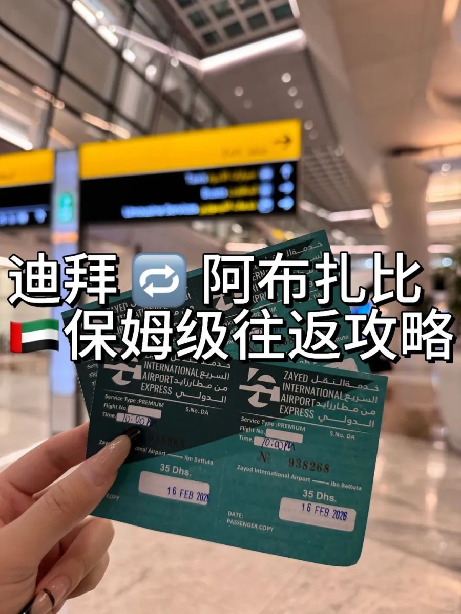
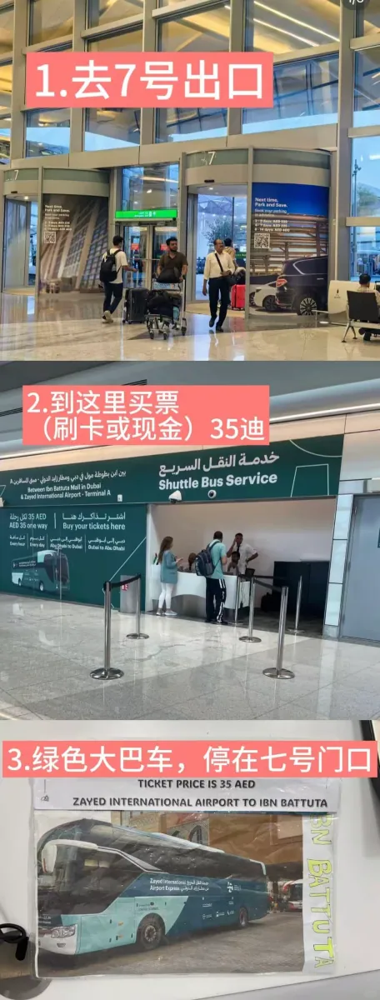
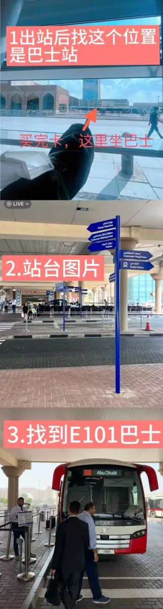
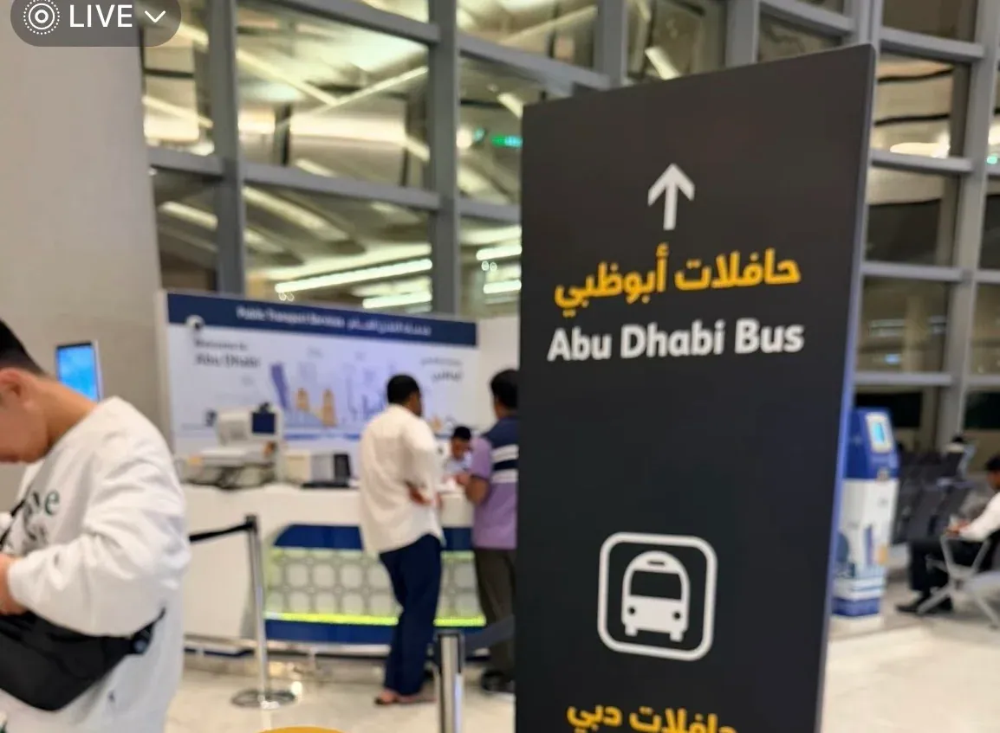

Abou Dabi et Dubaï sont distantes d'environ 140 km, et les transports publics entre les deux villes fonctionnent bien — ils sont simplement gérés par deux organismes différents. La liaison qui part de l'aéroport d'Abou Dabi est un express aéroport ; celle qui part de Dubaï est un bus interurbain de la RTA. **Les tarifs, les modes de paiement et les points d'embarquement diffèrent tous**, et c'est exactement ainsi qu'un premier voyageur finit par tourner en rond dans une gare routière.

Ce guide suit l'itinéraire réel de l'auteur : l'express de l'aéroport d'Abou Dabi à Ibn Battuta, puis le E101 de Dubaï vers le centre d'Abou Dabi. Considérés comme deux trajets distincts, l'un et l'autre sont simples.

## 1. Les deux lignes en un coup d'œil

| Sens | Ligne | Tarif | Paiement | Fréquence | Durée |
| --- | --- | --- | --- | --- | --- |
| Aéroport d'Abou Dabi → Ibn Battuta (Dubaï) | Zayed International Airport Express | 35 AED | Espèces ou carte au guichet ; aucune carte de transport nécessaire | Toutes les heures, jour et nuit | Environ 1 h 05 min |
| Ibn Battuta (Dubaï) → gare routière principale d'Abou Dabi | **E101** (interurbain de la RTA) | 25 AED | **Carte Nol uniquement** | Environ toutes les 20 minutes | Environ 1 h 50 min |

La différence ne tient pas seulement au prix. L'express aéroport est **direct, de point à point**, sans arrêt intermédiaire, tandis que le E101 emprunte l'autoroute interurbaine et prend des passagers en chemin, ce qui explique sa durée plus longue. Avec des bagages lourds et un programme serré, l'express est la solution la plus simple ; pour économiser, le E101 coûte 10 AED de moins mais suppose d'avoir d'abord une carte Nol.

## 2. De l'aéroport d'Abou Dabi à Dubaï : acheter son billet à la porte 7

Après l'atterrissage à l'aéroport international Zayed et la récupération de vos bagages, suivez les panneaux **Buses** dans le hall des arrivées jusqu'à la **porte 7**. À l'extérieur, sur la droite, se trouve le guichet de l'express, surmonté d'une enseigne verte **Shuttle Bus Service** et accompagné de l'itinéraire détaillé :

> Entre Ibn Battuta Mall à Dubaï et Zayed International Airport – Terminal A
> 35 AED l'aller simple · toutes les heures · tous les jours · Abou Dabi–Dubaï · Dubaï–Abou Dabi

Vous pouvez payer en espèces ou par carte, et **aucune carte de transport n'est nécessaire** — c'est le point le plus simple de tout le trajet. Le billet est en papier, avec l'heure de départ imprimée : **Service Type: PREMIUM**, un départ à l'heure pile, et la direction Zayed International Airport → Ibn Battuta. Gardez-le à portée de main, le chauffeur peut le contrôler.

Le bus part de l'arrêt situé juste devant la porte 7 : un autocar Volvo vert portant **Zayed International Airport Express** sur le flanc. Les départs se font à l'heure pile : présentez-vous dix minutes avant, déposez les bagages en soute et installez-vous.

**En pratique** : aucun arrêt intermédiaire, et avec une circulation fluide, le trajet jusqu'à Ibn Battuta a pris 1 h 05, plus vite que prévu. L'autocar n'était pas bondé, il y a des prises USB, et l'itinéraire passe par le secteur de la Grande Mosquée Cheikh Zayed — une place côté fenêtre vaut la peine.

## 3. Le retour depuis Dubaï : le E101 et une carte Nol

Le retour demande une autre procédure. Prenez la ligne rouge du métro de Dubaï jusqu'à **Ibn Battuta Metro Station**, sortez par la **sortie 1**, et la gare routière d'Ibn Battuta se trouve devant vous. Des panneaux bleus sur les quais indiquent la borne de vente des billets, l'espace d'attente, les toilettes, le comptoir d'accueil et le métro de Dubaï.

Cherchez le bus rouge marqué **E101 / Abu Dhabi** et mettez-vous dans la file. Il est exploité par la RTA de Dubaï, si bien que les règles sont celles des bus urbains de Dubaï :

- **Carte Nol uniquement** — pas d'espèces, et pas d'achat de billet à bord ;
- la carte doit disposer d'au moins 25 AED de solde, faute de quoi elle ne sera pas validée ;
- validez une fois à la montée et une fois à la descente, le tarif étant facturé par zone.

Les cartes Nol sont en vente dans toutes les stations de métro de Dubaï ; la carte argent coûte 25 AED (6 AED de frais de carte et 19 AED de solde). Si vous comptez reprendre le E101 pour Abou Dabi, **achetez la carte dès votre premier jour à Dubaï**, et non le matin du départ.

Le E101 circule environ toutes les 20 minutes et met à peu près 1 h 50 pour rejoindre **Abu Dhabi Main Bus Terminal**, la gare routière principale d'Abou Dabi. Il s'arrête en chemin : surveillez votre arrêt ; depuis la gare, vous pouvez prendre une correspondance vers les bus urbains d'Abou Dabi pour le reste de la ville.

## 4. La carte Hafilat pour les bus urbains d'Abou Dabi

À Abou Dabi, les bus urbains fonctionnent avec un autre système, la carte **Hafilat**. Le comptoir ITC, à droite du hall des arrivées de l'aéroport Zayed, délivre une **carte argent** gratuite (validité 30 jours, recharge minimale de 10 AED), ou une **carte verte** pour 10 AED de frais, valable 16 ans mais dont le solde n'est pas remboursable.

Notez les deux directions sur ce totem : **Abu Dhabi Bus** pour les lignes urbaines, **Dubai Bus** pour l'autocar longue distance — les deux ne partent pas du même arrêt. Pour une correspondance ou un aller-retour dans la journée, la carte argent suffit ; une petite taxe est prélevée lors de la recharge (des voyageurs ont vu 3 AED prélevés sur un paiement de 30 AED), alors gardez une marge.

## 5. Temps et argent : le compte

Pour « atterrir à l'aéroport d'Abou Dabi → centre de Dubaï », les deux étapes s'additionnent ainsi :

| Étape | Durée | Coût |
| --- | --- | --- |
| Express aéroport : AUH → Ibn Battuta | Environ 1 h 05 min | 35 AED |
| Ligne rouge : Ibn Battuta → Burj Khalifa／Dubai Mall | Environ 35–40 min | Tarif par zones sur carte Nol |
| **Total** | **Environ 1 h 45 min** | **Environ 40–45 AED** |

Dans l'autre sens, du centre de Dubaï au centre d'Abou Dabi : métro jusqu'à Ibn Battuta (environ 40 minutes) plus le E101 (environ 1 h 50), soit à peu près 2 h 30 et 25 AED, auxquels s'ajoute le tarif du métro.

Si le temps manque et que les bagages sont lourds, un taxi ou un transfert privé reste une alternative : Abou Dabi–Dubaï coûte environ 250–350 AED l'aller simple, environ 1 h 20 par l'autoroute E11, et partagé entre deux ou trois personnes, l'écart avec l'autocar est plus faible qu'il n'y paraît.

## 6. Notes pratiques

- **À l'heure pile** : l'express aéroport part toutes les heures à l'heure pile, et un départ manqué coûte une heure entière — vérifiez l'heure avant de décider de mettre vos bagages en consigne.
- **Gardez le billet** : le billet papier porte l'heure de départ et peut être contrôlé ; le trajet retour exige son propre billet.
- **Solde Nol** : le E101 exige 25 AED, alors rechargez à la station s'il ne vous reste que quelques dirhams.
- **Bagages** : les deux services disposent de soutes et ne facturent aucun supplément pour les grands bagages, mais gardez vos objets de valeur avec vous.
- **La nuit** : l'express circule jour et nuit, tandis que le E101 se fait plus rare — vérifiez le dernier départ si vous traversez tard.
- **Aucune formalité de frontière** : il n'y a pas de poste de contrôle entre les émirats, même s'il existe des contrôles ponctuels au bord de la route ; emportez votre passeport.

Les tarifs, les fréquences et l'emplacement des comptoirs proviennent des publications des exploitants et des notes de l'auteur (photographiées en février 2026) ; les prix et les horaires changent, alors confirmez au comptoir ou sur les sites officiels avant de partir.

## Liens utiles

- **Sur ce site** : [Aéroport international Zayed (AUH)](/airport/AUH), [Aéroport international de Dubaï (DXB)](/airport/DXB), [Émirats arabes unis (AE)](/country/AE)
- **Wikipédia** : [Abou Dabi](https://en.wikipedia.org/wiki/Abu_Dhabi), [Métro de Dubaï](https://en.wikipedia.org/wiki/Dubai_Metro)
- **Baidu Baike** : [Abou Dabi](https://baike.baidu.com/item/%E9%98%BF%E5%B8%83%E6%89%8E%E6%AF%94)
- **Site de l'aéroport** : [Zayed International Airport](https://www.zayedinternationalairport.ae/)
- **Bus de Dubaï** : [RTA de Dubaï](https://www.rta.ae/)
- **Bus d'Abou Dabi** : [ITC d'Abou Dabi](https://www.itc.gov.ae/)

Source des images : les photographies de l'auteur. Les tarifs et les fréquences sont ceux affichés aux comptoirs au moment des prises de vue et peuvent changer.
