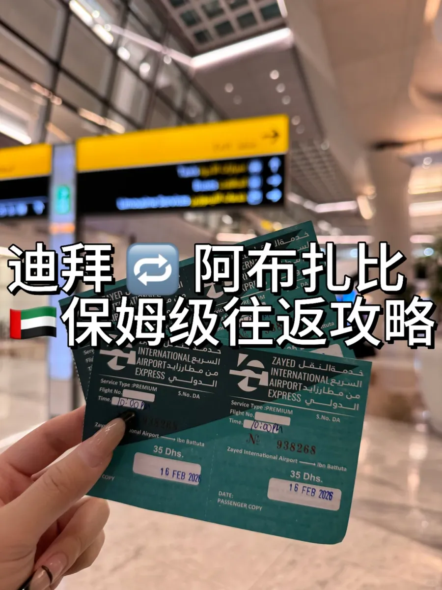
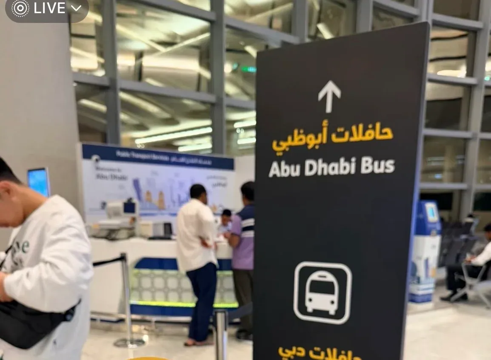

Abu Dhabi och Dubai ligger ungefär 14 mil från varandra, och kollektivtrafiken mellan dem fungerar bra – det är bara två olika organisationer som sköter den. Bussen som går från Abu Dhabis flygplats är en flygplatsbuss, och den som går från Dubai är en intercitybuss från RTA. **Biljettpriserna, betalsätten och påstigningsplatserna skiljer sig alla åt**, vilket är precis hur förstagångsresenärer kan hamna med att cirkla runt en busstation.

Den här guiden följer författarens verkliga resa: expressturen från Abu Dhabis flygplats till Ibn Battuta, och sedan E101 från Dubai tillbaka till Abu Dhabi stad. Som två separata resor är båda enkla.

## 1. De två sträckorna i korthet

| Riktning | Linje | Pris | Betalning | Avgångar | Restid |
| --- | --- | --- | --- | --- | --- |
| Abu Dhabis flygplats → Ibn Battuta (Dubai) | Zayed International Airport Express | 35 AED | Kontant eller kort i biljettdisken; inget transportkort behövs | En gång i timmen, dygnet runt | Cirka 1 tim 5 min |
| Ibn Battuta (Dubai) → Abu Dhabi Main Bus Terminal | **E101** (RTA intercity) | 25 AED | **Endast Nol-kort** | Cirka var 20:e minut | Cirka 1 tim 50 min |

Skillnaden handlar inte bara om pris. Flygplatsbussen går **punkt till punkt** utan mellanliggande stopp, medan E101 går på motorvägen mellan städerna och plockar upp passagerare längs vägen, vilket är anledningen till att den tar längre tid. Med tunga väskor och tight schema är flygplatsbussen det enklare valet; för att spara pengar är E101 10 AED billigare, men kräver ett Nol-kort först.

## 2. Från Abu Dhabis flygplats till Dubai: köp vid Gate 7

Efter att ha landat på Zayed International Airport och hämtat väskorna följer du skyltarna **Buses** i ankomsthallen till **Gate 7**. Utanför och till höger ligger biljettdisken för flygplatsbussen, med en grön skylt **Shuttle Bus Service** ovanför och rutten utskriven nedanför:

> Mellan Ibn Battuta Mall i Dubai och Zayed International Airport – Terminal A
> 35 AED enkel resa · En gång i timmen · Varje dag · Abu Dhabi till Dubai · Dubai till Abu Dhabi

Du kan betala kontant eller med kort, och **inget transportkort behövs** – det enklaste momentet på hela resan. Biljetten är i papper med avgångstiden tryckt: **Service Type: PREMIUM**, avgång på hel timme och riktningen Zayed International Airport → Ibn Battuta. Håll den till hands, eftersom föraren kan vilja se den.

Bussen avgår från hållplatsen precis utanför Gate 7: en grön Volvo-buss med **Zayed International Airport Express** längs sidan. Avgångarna sker på hel timme, så var vid hållplatsen tio minuter i förväg, lämna väskorna i bagageutrymmet och hitta en plats.

**I praktiken**: inga mellanliggande stopp, och med fri väg tog resan till Ibn Battuta 1 tim 5 min, snabbare än väntat. Bussen var inte full, det finns USB-uttag, och rutten passerar området kring Sheikh Zayed-moskén – en fönsterplats är värd att satsa på.

## 3. Tillbaka från Dubai: E101 och ett Nol-kort

Returen är en annan procedur. Ta Dubais tunnelbana Red Line till **Ibn Battuta Metro Station**, gå ut genom **utgång 1**, och Ibn Battutas busstation ligger framför dig. Blå skyltar på plattformarna pekar mot biljettautomaten, kundväntområdet, toaletterna, kundtjänstdisken och Dubai Metro.

Leta efter den röda bussen märkt **E101 / Abu Dhabi** och ställ dig i kön. Den körs av Dubais RTA, så reglerna är desamma som för stadsbussarna i Dubai:

- **Endast Nol-kort** – inga kontanter och ingen biljett att köpa ombord;
- kortet måste ha minst 25 AED i saldo, annars valideras det inte;
- blippa en gång vid påstigning och en gång vid avstigning, och biljettpriset dras per zon.

Nol-kort säljs på alla Dubais tunnelbanestationer; silverkortet kostar 25 AED (6 AED i kortavgift plus 19 AED i saldo). Om du planerar att ta E101 tillbaka till Abu Dhabi, **köp kortet redan första dagen i Dubai**, inte på avresemorgonen.

E101 går ungefär var 20:e minut och tar cirka 1 tim 50 min till **Abu Dhabi Main Bus Terminal**. Den stannar längs vägen, så håll koll på din hållplats; från terminalen kan du byta till Abu Dhabis stadsbussar för att ta dig vidare i staden.

## 4. Hafilat-kortet för stadsbussarna i Abu Dhabi

I Abu Dhabi använder stadsbussarna ett annat system, **Hafilat**-kortet. ITC-disken till höger i ankomsthallen på Zayed Airport utfärdar ett gratis **silverkort** (30 dagars giltighet, minst 10 AED i påfyllning), eller ett **grönt kort** mot en avgift på 10 AED med 16 års giltighet men med icke återbetalningsbart saldo.

Lägg märke till de två riktningarna på pelaren: **Abu Dhabi Bus** för stadslinjerna, **Dubai Bus** för långdistansbussen – de avgår inte från samma hållplats. För en anslutning eller en retur samma dag räcker silverkortet; en liten skatt dras när du fyller på (resenärer har sett 3 AED dras från en betalning på 30 AED), så lämna lite marginal.

## 5. Tid och pengar, summerat

För "landa på Abu Dhabis flygplats → centrala Dubai" kombineras de två etapperna så här:

| Etapp | Tid | Kostnad |
| --- | --- | --- |
| Flygplatsbussen: AUH → Ibn Battuta | Cirka 1 tim 5 min | 35 AED |
| Red Line: Ibn Battuta → Burj Khalifa／Dubai Mall | Cirka 35–40 min | Zonpris på Nol-kort |
| **Totalt** | **Cirka 1 tim 45 min** | **Cirka 40–45 AED** |

Åt andra hållet, från centrala Dubai till centrala Abu Dhabi: tunnelbana till Ibn Battuta (cirka 40 minuter) plus E101 (cirka 1 tim 50 min), alltså ungefär 2,5 timmar och 25 AED plus tunnelbanebiljetten.

Om tiden är knapp och väskorna tunga är taxi eller privat transfer ett alternativ: Abu Dhabi till Dubai kostar cirka 250–350 AED enkel resa, ungefär 1 tim 20 min på E11-motorvägen, och delat mellan två eller tre personer är skillnaden mot bussen mindre än den verkar.

## 6. Praktiska anteckningar

- **På hel timme**: flygplatsbussen avgår varje timme på hel timme, och en missad avgång kostar en hel timme – kolla tiden innan du bestämmer dig för att lämna in väskorna.
- **Behåll biljetten**: pappersbiljetten har avgångstiden och kan kontrolleras; returresan behöver sin egen biljett.
- **Nol-saldo**: E101 kräver 25 AED, så fyll på vid stationen om du är nere på de sista dirhamerna.
- **Bagage**: båda linjerna har bagageutrymme och tar inte extra för stora väskor, men ha värdesaker hos dig.
- **På natten**: flygplatsbussen går dygnet runt, medan E101 glesnar under natten – kolla sista avgången för en sen överresa.
- **Inga gränsformaliteter**: det finns ingen gränskontroll mellan emiraten, men det förekommer enstaka vägkontroller, så ha passet med dig.

Priser, avgångar och diskarnas placering kommer från operatörernas publikationer och författarens egna anteckningar (fotograferade i februari 2026); priser och tidtabeller ändras, så bekräfta vid disken eller på de officiella webbplatserna före resan.

## Relaterade länkar

- **På den här sidan**: [Zayed International Airport (AUH)](/airport/AUH), [Dubai International Airport (DXB)](/airport/DXB), [Förenade Arabemiraten (AE)](/country/AE)
- **Wikipedia**: [Abu Dhabi](https://en.wikipedia.org/wiki/Abu_Dhabi), [Dubai Metro](https://en.wikipedia.org/wiki/Dubai_Metro)
- **Baidu Baike**: [Abu Dhabi](https://baike.baidu.com/item/%E9%98%BF%E5%B8%83%E6%89%8E%E6%AF%94)
- **Flygplatsens webbplats**: [Zayed International Airport](https://www.zayedinternationalairport.ae/)
- **Dubais bussar**: [Dubai RTA](https://www.rta.ae/)
- **Abu Dhabis bussar**: [Abu Dhabi ITC](https://www.itc.gov.ae/)

Bildkälla: författarens egna fotografier. Priser och avgångar gäller enligt vad som angavs vid diskarna när bilderna togs och kan ändras.
