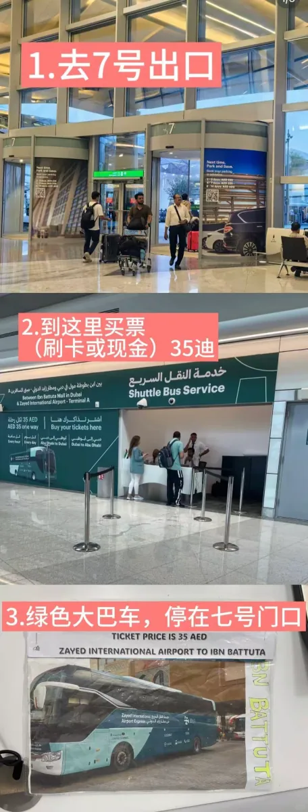

Abu Dhabi na Dubai ziko takriban kilomita 140 mbali, na usafiri wa umma kati yao unafanya kazi vizuri — unatawaliwa tu na mashirika mawili tofauti. Huduma inayoondoka Uwanja wa Ndege wa Abu Dhabi ni basi la haraka la uwanja wa ndege, na ile inayoondoka Dubai ni basi la RTA la kati ya miji. **Nauli, njia za malipo na vituo vya kupanda vyote vinatofautiana**, na ndivyo hasa wageni wa mara ya kwanza wanavyojikuta wakizunguka kituo cha basi.

Mwongozo huu unafuata safari halisi ya mwandishi: basi la haraka kutoka Uwanja wa Ndege wa Abu Dhabi hadi Ibn Battuta, kisha E101 kutoka Dubai kurudi jiji la Abu Dhabi. Zikichukuliwa kama safari mbili tofauti, zote mbili ni rahisi.

## 1. Njia mbili kwa mtazamo mmoja

| Mwelekeo | Huduma | Nauli | Malipo | Mzunguko | Muda |
| --- | --- | --- | --- | --- | --- |
| Uwanja wa Ndege wa Abu Dhabi → Ibn Battuta (Dubai) | Zayed International Airport Express | AED 35 | Pesa taslimu au kadi kwenye dawati la tiketi; hakuna kadi ya usafiri inayohitajika | Kila saa, mchana na usiku | Takriban saa 1 dakika 5 |
| Ibn Battuta (Dubai) → Abu Dhabi Main Bus Terminal | **E101** (ya RTA kati ya miji) | AED 25 | **Kadi ya Nol pekee** | Takriban kila dakika 20 | Takriban saa 1 dakika 50 |

Tofauti si bei pekee. Basi la haraka la uwanja wa ndege ni **kutoka mahali hadi mahali**, bila vituo vya kati, wakati E101 inapita kwenye barabara kuu ya kati ya miji na kuchukua abiria njiani, ndiyo sababu inachukua muda mrefu zaidi. Ukiwa na mizigo mizito na ratiba finyu, basi la haraka ndilo chaguo rahisi; ili kuokoa fedha, E101 ni rahisi kwa AED 10 lakini inahitaji kadi ya Nol kwanza.

## 2. Kutoka Uwanja wa Ndege wa Abu Dhabi hadi Dubai: nunua tiketi kwenye Gate 7

Baada ya kutua Uwanja wa Ndege wa Kimataifa wa Zayed na kuchukua mizigo yako, fuata alama za **Mabasi** kwenye ukumbi wa wasili hadi **Gate 7**. Nje upande wa kulia kuna dawati la tiketi la basi la haraka, likiwa na alama ya kijani ya **Shuttle Bus Service** juu yake na njia imeelezwa chini:

> Between Ibn Battuta Mall in Dubai & Zayed International Airport – Terminal A
> 35 AED one way · Every hour · Every day · Abu Dhabi to Dubai · Dubai to Abu Dhabi

Unaweza kulipa kwa pesa taslimu au kwa kadi, na **hakuna kadi ya usafiri inayohitajika** — sehemu rahisi zaidi ya safari nzima. Tiketi ni ya karatasi yenye muda wa kuondoka uliochapishwa: **Service Type: PREMIUM**, kuondoka kwa saa kamili, na mwelekeo Zayed International Airport → Ibn Battuta. Iweke karibu nawe, kwa kuwa dereva anaweza kuikagua.

Basi linaondoka kwenye kituo kilicho nje kidogo ya Gate 7: basi la kijani la Volvo lenye **Zayed International Airport Express** kando yake. Kuondoka ni kwa saa kamili, kwa hiyo fika kituoni dakika kumi mapema, weka mizigo kwenye sehemu ya mizigo na tafuta kiti.

**Kwa vitendo**: hakuna vituo vya kati, na kwa barabara wazi safari hadi Ibn Battuta ilichukua saa 1 dakika 5, haraka kuliko ilivyotarajiwa. Basi halikuwa limejaa, kuna soketi za USB, na njia inapita eneo la karibu na Msikiti Mkuu wa Sheikh Zayed — kiti cha dirishani kinafaa kuwa nacho.

## 3. Kurudi kutoka Dubai: E101 na kadi ya Nol

Mara ya kurudi ni mchakato tofauti. Panda metro ya Dubai kwenye **Red Line** hadi **Ibn Battuta Metro Station**, toka kwa **exit 1**, na kituo cha basi cha Ibn Battuta kiko mbele yako. Alama za bluu kwenye majukwaa zinaelekeza kwenye mashine ya tiketi, eneo la kusubiri la abiria, vyoo, dawati la furaha ya mteja na Dubai Metro.

Tafuta basi jekundu lenye alama **E101 / Abu Dhabi** na jiunge na foleni. Linaendeshwa na RTA ya Dubai, kwa hiyo kanuni zinalingana na za mabasi ya jiji la Dubai:

- **Kadi ya Nol pekee** — hakuna pesa taslimu, na hakuna kununua tiketi ndani ya basi;
- kadi inahitaji angalau salio la AED 25, la sivyo haitathibitishwa;
- gusa mara moja unapopanda na mara moja unaposhuka, na nauli inatozwa kwa eneo.

Kadi za Nol zinauzwa katika kila kituo cha metro cha Dubai; kadi ya fedha ni AED 25 (ada ya kadi ya AED 6 pamoja na salio la AED 19). Ikiwa unapanga kuchukua E101 kurudi Abu Dhabi, **nunua kadi siku yako ya kwanza Dubai**, si asubuhi ya siku ya kuondoka.

E101 hupita takriban kila dakika 20 na huchukua takriban saa 1 dakika 50 hadi **Abu Dhabi Main Bus Terminal**. Inasimama njiani, kwa hiyo angalia kituo chako; kutoka terminal unaweza kubadilisha kwenda mabasi ya jiji la Abu Dhabi kwa sehemu nyingine za jiji.

## 4. Kadi ya Hafilat kwa mabasi ya jiji la Abu Dhabi

Huko Abu Dhabi mabasi ya jiji hutumia mfumo tofauti, kadi ya **Hafilat**. Dawati la ITC upande wa kulia wa ukumbi wa wasili kwenye Uwanja wa Ndege wa Zayed hutoa **kadi ya fedha** ya bure (uhalali wa siku 30, ongezo la chini la AED 10), au **kadi ya kijani** kwa ada ya AED 10 yenye uhalali wa miaka 16 lakini salio lisilorejeshwa.

Angalia mwelekeo mbili kwenye nguzo hiyo: **Abu Dhabi Bus** kwa huduma za jiji, **Dubai Bus** kwa basi la masafa marefu — hayaondoki kwenye kituo kimoja. Kwa kuunganisha safari au kurudi siku hiyo hiyo kadi ya fedha inatosha; kodi ndogo hukatwa unapoongeza salio (wasafiri wameona AED 3 ikikatwa kutoka malipo ya AED 30), kwa hiyo acha nafasi kidogo ya ziada.

## 5. Muda na fedha, kwa jumla

Kwa "kutua Uwanja wa Ndege wa Abu Dhabi → katikati ya Dubai", sehemu mbili za safari zinaunganishwa hivi:

| Sehemu | Muda | Gharama |
| --- | --- | --- |
| Basi la uwanja wa ndege: AUH → Ibn Battuta | Takriban saa 1 dakika 5 | AED 35 |
| Red Line: Ibn Battuta → Burj Khalifa／Dubai Mall | Takriban dakika 35–40 | Nauli ya eneo kwenye kadi ya Nol |
| **Jumla** | **Takriban saa 1 dakika 45** | **Takriban AED 40–45** |

Upande mwingine, kutoka katikati ya Dubai hadi katikati ya Abu Dhabi: metro hadi Ibn Battuta (takriban dakika 40) pamoja na E101 (takriban saa 1 dakika 50), kwa hiyo takriban saa 2.5 na AED 25 pamoja na nauli ya metro.

Ikiwa muda ni mfupi na mizigo ni mizito, teksi au usafiri wa kibinafsi ni njia mbadala: Abu Dhabi hadi Dubai ni takriban AED 250–350 kwa safari moja, takriban saa 1 dakika 20 kwenye barabara kuu E11, na ukigawanywa kati ya watu wawili au watatu tofauti na basi ni ndogo kuliko inavyoonekana.

## 6. Vidokezo vya vitendo

- **Kwa saa kamili**: basi la haraka la uwanja wa ndege huondoka kila saa kwa saa kamili, na kukosa moja hugharimu saa nzima — angalia muda kabla ya kuamua kuweka mizigo yako.
- **Tunza tiketi**: tiketi ya karatasi ina muda wa kuondoka na inaweza kukaguliwa; safari ya kurudi inahitaji tiketi yake yenyewe.
- **Salio la Nol**: E101 inahitaji AED 25, kwa hiyo ongeza salio kwenye kituo ikiwa umebakiza dirham chache za mwisho.
- **Mizigo**: huduma zote mbili zina sehemu ya mizigo na hazitozi ada ya ziada kwa mizigo mikubwa, lakini weka vitu vya thamani karibu nawe.
- **Usiku**: basi la haraka hufanya kazi mchana na usiku, wakati E101 hupungua usiku — angalia safari ya mwisho kwa kuvuka kwa usiku.
- **Hakuna taratibu za mpaka**: hakuna kituo cha ukaguzi kati ya emirati, ingawa kuna ukaguzi wa njiani mara kwa mara, kwa hiyo beba pasipoti yako.

Nauli, mzunguko na maeneo ya madawati yanatoka kwenye machapisho ya waendeshaji na maelezo ya mwandishi mwenyewe (yaliyopigwa picha Februari 2026); bei na ratiba hubadilika, kwa hiyo thibitisha kwenye dawati au kwenye tovuti rasmi kabla ya kusafiri.

## Viungo vinavyohusiana

- **Kwenye tovuti hii**: [Zayed International Airport (AUH)](/airport/AUH), [Dubai International Airport (DXB)](/airport/DXB), [United Arab Emirates (AE)](/country/AE)
- **Wikipedia**: [Abu Dhabi](https://en.wikipedia.org/wiki/Abu_Dhabi), [Dubai Metro](https://en.wikipedia.org/wiki/Dubai_Metro)
- **Baidu Baike**: [Abu Dhabi](https://baike.baidu.com/item/%E9%98%BF%E5%B8%83%E6%89%8E%E6%AF%94)
- **Tovuti ya uwanja wa ndege**: [Zayed International Airport](https://www.zayedinternationalairport.ae/)
- **Mabasi ya Dubai**: [Dubai RTA](https://www.rta.ae/)
- **Mabasi ya Abu Dhabi**: [Abu Dhabi ITC](https://www.itc.gov.ae/)

Chanzo cha picha: picha za mwandishi mwenyewe. Nauli na mzunguko ni kama zilivyoandikwa kwenye madawati wakati picha zilipigwa na zinaweza kubadilika.
