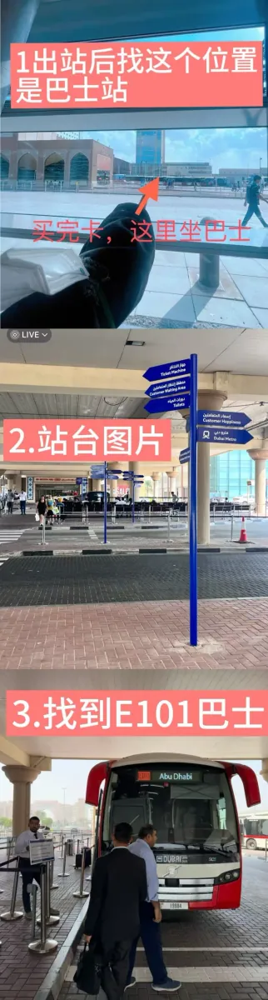

อาบูดาบีและดูไบอยู่ห่างกันประมาณ 140 กม. และระบบขนส่งสาธารณะระหว่างสองเมืองก็ใช้งานได้ดี เพียงแต่บริหารโดยสององค์กรที่แตกต่างกัน บริการที่ออกจากสนามบินอาบูดาบีเป็น airport express ส่วนบริการที่ออกจากดูไบเป็นรถโดยสารระหว่างเมืองของ RTA **ค่าโดยสาร วิธีชำระเงิน และจุดขึ้นรถแตกต่างกันทั้งหมด** ซึ่งเป็นสาเหตุที่ผู้เดินทางครั้งแรกมักวนหาสถานีรถบัส

คู่มือนี้เดินตามเส้นทางจริงของผู้เขียน: ขึ้น express จากสนามบินอาบูดาบีไปยังอิบน์ บัตตูตา แล้วต่อ E101 จากดูไบกลับสู่ใจกลางอาบูดาบี เมื่อมองเป็นการเดินทางสองช่วงแยกกัน ทั้งสองช่วงก็ตรงไปตรงมา

## 1. สองเส้นทางโดยสรุป

| ทิศทาง | บริการ | ค่าโดยสาร | การชำระเงิน | ความถี่ | เวลา |
| --- | --- | --- | --- | --- | --- |
| สนามบินอาบูดาบี → อิบน์ บัตตูตา (ดูไบ) | Zayed International Airport Express | AED 35 | เงินสดหรือบัตรที่เคาน์เตอร์ตั๋ว ไม่ต้องใช้บัตรขนส่ง | ทุกชั่วโมง ตลอด 24 ชั่วโมง | ประมาณ 1 ชม. 5 นาที |
| อิบน์ บัตตูตา (ดูไบ) → สถานีขนส่งหลักอาบูดาบี | **E101** (รถโดยสารระหว่างเมือง RTA) | AED 25 | **เฉพาะบัตร Nol** | ประมาณทุก 20 นาที | ประมาณ 1 ชม. 50 นาที |

ความแตกต่างไม่ได้อยู่ที่ราคาเพียงอย่างเดียว airport express เป็นแบบ **จุดต่อจุด** ไม่มีจุดจอดระหว่างทาง ส่วน E101 วิ่งบนทางหลวงระหว่างเมืองและรับผู้โดยสารตลอดทาง จึงใช้เวลานานกว่า หากมีกระเป๋าเยอะและเวลาจำกัด express เป็นตัวเลือกที่ง่ายกว่า หากต้องการประหยัด E101 ถูกกว่า AED 10 แต่ต้องมีบัตร Nol ก่อน

## 2. จากสนามบินอาบูดาบีไปดูไบ: ซื้อตั๋วที่ประตู 7

หลังจากลงจอดที่ท่าอากาศยานนานาชาติซายิดและรับกระเป๋าแล้ว ให้ตามป้าย **Buses** ในโถงผู้โดยสารขาเข้าไปยัง **ประตู 7** ด้านนอกทางขวาคือเคาน์เตอร์ตั๋วของ express มีป้ายสีเขียว **Shuttle Bus Service** อยู่ด้านบนและระบุเส้นทางไว้ด้านล่าง

> ระหว่าง Ibn Battuta Mall ในดูไบ & ท่าอากาศยานนานาชาติซายิด – อาคารผู้โดยสาร A
> 35 AED ต่อเที่ยว · ทุกชั่วโมง · ทุกวัน · อาบูดาบีไปดูไบ · ดูไบไปอาบูดาบี

ชำระด้วยเงินสดหรือบัตรได้ และ **ไม่ต้องใช้บัตรขนส่ง** ซึ่งเป็นส่วนที่ง่ายที่สุดของการเดินทางทั้งหมด ตั๋วเป็นกระดาษที่พิมพ์เวลาออกเดินทางไว้: **Service Type: PREMIUM** ออกเดินทางตรงทุกต้นชั่วโมง และมีทิศทาง Zayed International Airport → Ibn Battuta เก็บตั๋วไว้ใกล้ตัวเพราะพนักงานขับรถอาจตรวจ

รถออกจากจุดจอดด้านนอกประตู 7 เป็นรถโค้ช Volvo สีเขียวที่มีข้อความ **Zayed International Airport Express** อยู่ด้านข้าง รถออกทุกต้นชั่วโมง จึงควรไปถึงจุดจอดก่อนเวลา 10 นาที ฝากกระเป๋าในห้องเก็บสัมภาระแล้วหาที่นั่ง

**ในทางปฏิบัติ**: ไม่มีจุดจอดระหว่างทาง และเมื่อการจราจรโล่ง การเดินทางไปอิบน์ บัตตูตาใช้เวลา 1 ชม. 5 นาที เร็วกว่าที่คาด รถไม่แออัด มีปลั๊ก USB และเส้นทางผ่านบริเวณรอบมัสยิดเชคซายิด — ที่นั่งริมหน้าต่างคุ้มค่าที่จะเลือก

## 3. กลับจากดูไบ: E101 และบัตร Nol

ขากลับเป็นกระบวนการที่ต่างออกไป ขึ้นรถไฟใต้ดินดูไบสาย Red Line ไปยัง **สถานีรถไฟใต้ดินอิบน์ บัตตูตา** ออกทาง **ทางออก 1** แล้วสถานีรถบัสอิบน์ บัตตูตาจะอยู่ตรงหน้าคุณ ป้ายสีน้ำเงินบนชานชาลาชี้ไปยังเครื่องจำหน่ายตั๋ว พื้นที่รอผู้โดยสาร ห้องน้ำ เคาน์เตอร์บริการลูกค้า และรถไฟใต้ดินดูไบ

มองหารถบัสสีแดงที่มีป้าย **E101 / Abu Dhabi** แล้วต่อคิว รถสายนี้ให้บริการโดย RTA ของดูไบ กฎจึงเหมือนกับรถเมล์ในเมืองดูไบ

- **เฉพาะบัตร Nol** — ไม่รับเงินสด และไม่มีการขายตั๋วบนรถ;
- บัตรต้องมีเงินคงเหลืออย่างน้อย AED 25 มิฉะนั้นจะไม่สามารถแตะผ่านได้;
- แตะหนึ่งครั้งตอนขึ้นและอีกครั้งตอนลง โดยคิดค่าโดยสารตามโซน

บัตร Nol มีจำหน่ายที่สถานีรถไฟใต้ดินดูไบทุกแห่ง บัตรสีเงินราคา AED 25 (ค่าบัตร AED 6 บวกยอดคงเหลือ AED 19) หากวางแผนจะนั่ง E101 กลับอาบูดาบี **ควรซื้อบัตรตั้งแต่วันแรกที่ถึงดูไบ** ไม่ใช่เช้าวันเดินทาง

E101 วิ่งประมาณทุก 20 นาที และใช้เวลาราว 1 ชม. 50 นาทีถึง **สถานีขนส่งหลักอาบูดาบี** รถจอดระหว่างทาง จึงควรจับตาดูป้ายสถานีของคุณ จากสถานีขนส่งสามารถต่อรถเมล์ในเมืองอาบูดาบีไปยังส่วนอื่น ๆ ของเมืองได้

## 4. บัตร Hafilat สำหรับรถเมล์ในเมืองอาบูดาบี

ในอาบูดาบี รถเมล์ในเมืองใช้ระบบที่แตกต่างออกไป คือบัตร **Hafilat** เคาน์เตอร์ ITC ทางขวาของโถงผู้โดยสารขาเข้าที่สนามบินซายิดออก **บัตรสีเงิน** ฟรี (อายุ 30 วัน เติมขั้นต่ำ AED 10) หรือ **บัตรสีเขียว** ค่าธรรมเนียม AED 10 ใช้ได้ 16 ปี แต่ยอดคงเหลือไม่สามารถขอคืนได้

สังเกตทิศทางทั้งสองบนเสานั้น: **Abu Dhabi Bus** สำหรับบริการในเมือง และ **Dubai Bus** สำหรับรถโค้ชระยะไกล ทั้งสองไม่ได้ออกจากจุดจอดเดียวกัน หากเป็นการต่อรถหรือไปกลับในวันเดียว บัตรสีเงินก็เพียงพอ มีภาษีเล็กน้อยหักเมื่อเติมเงิน (ผู้เดินทางเคยเห็นการหัก AED 3 จากยอดชำระ AED 30) จึงควรเผื่อเงินไว้เล็กน้อย

## 5. เวลาและค่าใช้จ่ายเมื่อรวมกัน

สำหรับเส้นทาง «ลงจอดที่สนามบินอาบูดาบี → ใจกลางดูไบ» สองช่วงเดินทางรวมกันดังนี้

| ช่วงเดินทาง | เวลา | ค่าใช้จ่าย |
| --- | --- | --- |
| Airport express: AUH → อิบน์ บัตตูตา | ประมาณ 1 ชม. 5 นาที | AED 35 |
| Red Line: อิบน์ บัตตูตา → บุรจญ์เคาะลีฟะฮ์／ดูไบมอลล์ | ประมาณ 35–40 นาที | ค่าโดยสารตามโซนด้วยบัตร Nol |
| **รวม** | **ประมาณ 1 ชม. 45 นาที** | **ประมาณ AED 40–45** |

อีกทิศทางหนึ่ง จากใจกลางดูไบไปใจกลางอาบูดาบี: นั่งรถไฟใต้ดินไปอิบน์ บัตตูตา (ประมาณ 40 นาที) บวก E101 (ประมาณ 1 ชม. 50 นาที) รวมราว 2.5 ชั่วโมง และ AED 25 บวกค่าโดยสารรถไฟใต้ดิน

หากเวลากระชั้นและกระเป๋าหนัก รถแท็กซี่หรือรถรับส่งส่วนตัวเป็นอีกทางเลือก: อาบูดาบีถึงดูไบราคาประมาณ AED 250–350 ต่อเที่ยว ใช้เวลาราว 1 ชม. 20 นาทีบนทางหลวง E11 และหากแบ่งกันสองหรือสามคน ช่องว่างกับรถโค้ชจะเล็กกว่าที่คิด

## 6. หมายเหตุการใช้งาน

- **ตรงต้นชั่วโมง**: airport express ออกทุกชั่วโมงตรงเวลา และหากพลาดต้องรอเต็มชั่วโมง — ตรวจเวลาก่อนตัดสินใจฝากกระเป๋า
- **เก็บตั๋วไว้**: ตั๋วกระดาษระบุเวลาออกเดินทางและอาจถูกตรวจ ขากลับต้องใช้ตั๋วของตัวเอง
- **ยอดคงเหลือในบัตร Nol**: E101 ต้องใช้ AED 25 จึงควรเติมเงินที่สถานีหากเหลือเงินไม่กี่ดิรฮัม
- **สัมภาระ**: ทั้งสองบริการมีห้องเก็บกระเป๋าและไม่คิดเงินเพิ่มสำหรับกระเป๋าใบใหญ่ แต่ควรเก็บของมีค่าไว้กับตัว
- **ตอนกลางคืน**: express วิ่งตลอด 24 ชั่วโมง ส่วน E101 มีรอบถี่น้อยลงในช่วงกลางคืน — ตรวจสอบรอบสุดท้ายหากเดินทางข้ามเมืองตอนดึก
- **ไม่มีพิธีการชายแดน**: ไม่มีจุดตรวจระหว่างเอมิเรตส์ แต่มีจุดตรวจข้างทางเป็นครั้งคราว จึงควรพาหนังสือเดินทางติดตัวไว้

ค่าโดยสาร ความถี่ และตำแหน่งเคาน์เตอร์มาจากเอกสารเผยแพร่ของผู้ให้บริการและบันทึกส่วนตัวของผู้เขียน (ถ่ายภาพเมื่อเดือนกุมภาพันธ์ 2026) ราคาและตารางเวลาอาจเปลี่ยนแปลง จึงควรตรวจสอบที่เคาน์เตอร์หรือเว็บไซต์ทางการก่อนเดินทาง

## ลิงก์ที่เกี่ยวข้อง

- **ในเว็บไซต์นี้**: [ท่าอากาศยานนานาชาติซายิด (AUH)](/airport/AUH), [ท่าอากาศยานนานาชาติดูไบ (DXB)](/airport/DXB), [สหรัฐอาหรับเอมิเรตส์ (AE)](/country/AE)
- **Wikipedia**: [อาบูดาบี](https://en.wikipedia.org/wiki/Abu_Dhabi), [รถไฟใต้ดินดูไบ](https://en.wikipedia.org/wiki/Dubai_Metro)
- **Baidu Baike**: [อาบูดาบี](https://baike.baidu.com/item/%E9%98%BF%E5%B8%83%E6%89%8E%E6%AF%94)
- **เว็บไซต์สนามบิน**: [ท่าอากาศยานนานาชาติซายิด](https://www.zayedinternationalairport.ae/)
- **รถบัสดูไบ**: [Dubai RTA](https://www.rta.ae/)
- **รถบัสอาบูดาบี**: [Abu Dhabi ITC](https://www.itc.gov.ae/)

ที่มาของภาพ: ภาพถ่ายของผู้เขียน ค่าโดยสารและความถี่เป็นไปตามที่ประกาศที่เคาน์เตอร์เมื่อถ่ายภาพ และอาจเปลี่ยนแปลงได้
