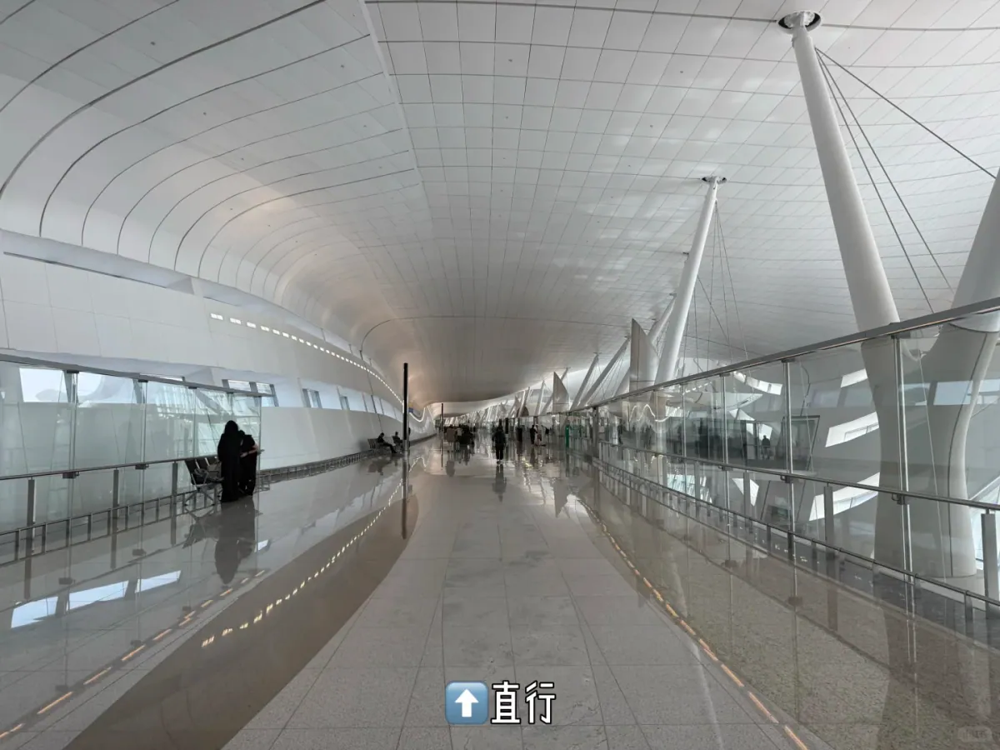
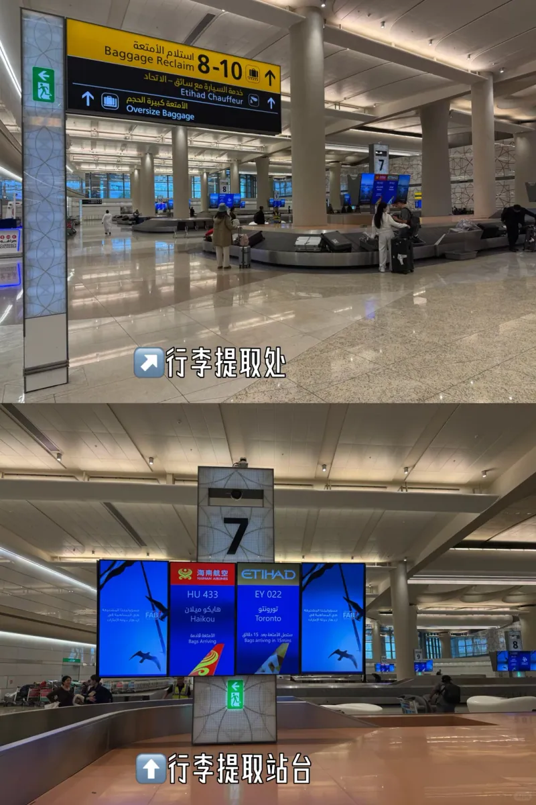
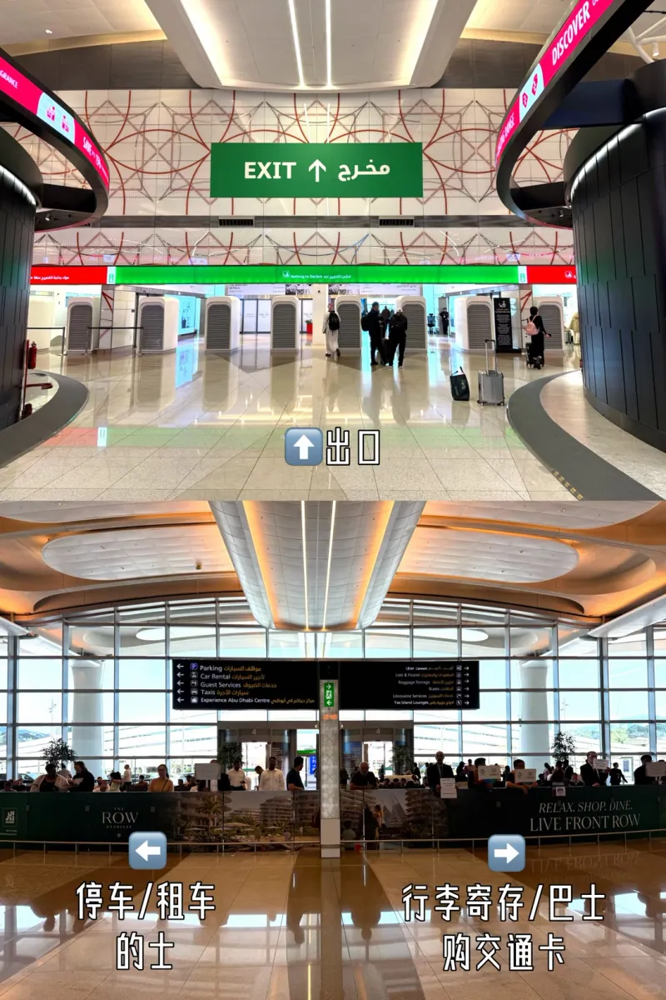

আবু ধাবির জায়েদ আন্তর্জাতিক বিমানবন্দর (**AUH**) 2023 সালের শেষে টার্মিনাল A খুলে দেয়, পুরোনো T1, T2 ও T3 মিলিয়ে একটি X-আকৃতির ভবনে পরিণত হয়। চীন থেকে আসা যাত্রীদের কাছে এটি আমিরাতের রাজধানীর প্রবেশদ্বার, আবার দুবাই বা শেখ জায়েদ গ্র্যান্ড মসজিদের দিকে যাওয়ার সিঁড়িও — তাই নামার পর প্রথম ঘণ্টাটা কেটে যায় একই কয়েকটি প্রশ্নের উত্তর খুঁজতে: এখন কোন দিকে, ব্যাগ কোথায় রাখব, ট্রান্সপোর্ট কার্ড কীভাবে পাব, আর দুবাইয়ের কোচ কোন দরজা থেকে ছাড়ে।

দুবাইয়ের তুলনায় টার্মিনাল A দিয়ে হেঁটে যাওয়া সহজ: ভবনের একটাই মূল মেরুদণ্ড, তাই আগমন, ব্যাগেজ ক্লেইম আর বেরোনোর পথ প্রায় এক সরলরেখায়। কঠিন কাজ দিক খোঁজা নয়, বেছে নেওয়া — ই-গেট নাকি ম্যানুয়াল কাউন্টার, আগমন হলে বাঁয় না ডানে, সিলভার নাকি সবুজ হাফিলাত কার্ড। নিচে পুরো ধারাবাহিকটা সেই ক্রমেই দেওয়া, যে ক্রমে আপনি সেগুলোর মুখোমুখি হবেন।

## 1. নামার পর: হলুদ সাইন অনুসরণ করুন

টার্মিনালের ভেতরে ঢুকেই প্রথমে চোখে পড়ে সারি সারি হলুদ সাইন, কালো রঙে **Arrivals (القادمون)**। জায়েদে সাইনগুলো আরবি ও ইংরেজিতে, আর ভূমিকাটা রঙই পালন করে: আগমন ও ব্যাগেজে হলুদ, ট্রান্সফারে নীল, বেরোনোর পথে সবুজ। একটা অক্ষরও না পড়েও শুধু রঙ ধরেই পৌঁছে যাওয়া যায়।

কাচের দেয়ালওয়ালা করিডোর ধরে সোজা হাঁটুন। এই অংশে কোনো মোড় নেই, কোনো পিপল মুভার নেই — টার্মিনাল A আসা যাত্রীদের সরাসরি পাসপোর্ট কন্ট্রোলের দিকে পাঠায়, পাশে শুধু টয়লেট আর একটি নার্সিং রুম।

কিছুদূর এগোলেই সাইন দুই ভাগে ভাগ হয় — **Arrivals** আর **Transfers**: আবু ধাবিতে ঢুকে ব্যাগ নিতে চাওয়া যাত্রীরা হলুদ দিকে যায়, আর দেশে না ঢুকে সংযোগ নেওয়া যাত্রীরা নীল দিকে। বোর্ডিং পাসে ইতিমধ্যে পরের ফ্লাইট লেখা থাকলে এবং ব্যাগ চেক-থ্রু হয়ে গেলে নীল দিক ধরে এয়ারসাইডেই থাকুন।

বিভাজনের পর একটা এসকেলেটর নেমে যেতে হয়, দুই পাশে বড় বড় শহরের লাইটবক্স। ট্রলি নিয়ে যেতে হলে পাশের লিফট ব্যবহার করুন, বড় সুটকেস সিঁড়িতে টেনে নামানোর দরকার নেই।

নিচে পৌঁছে একবার বাঁয়ে ঘুরলেই পাসপোর্ট হল। এখানে সাইনে **Visa Services (خدمات التأشيرات)**-এর জন্য ছোট সবুজ রেখা যোগ হয় — ওই দিকটা অন-অ্যারাইভাল ভিসা আর ভিসা সংক্রান্ত সমস্যার; সাধারণ যাত্রীরা Arrivals ধরে এগোবেন।

## 2. পাসপোর্ট কন্ট্রোল: ই-গেট নাকি কাউন্টার

হলটি দুটি সমান্তরাল পথে ভাগ হয়, আর লাইনে দাঁড়ানোর আগে এই একটি সিদ্ধান্তই নেওয়া দরকার।

- **সোজা সামনে: ই-গেট।** পাসপোর্ট স্ক্যান করুন, ক্যামেরা আপনার মুখ মিলিয়ে নিক, গেট খুলে যাবে — পুরোটা দশ-বারো সেকেন্ড। যাঁদের বায়োমেট্রিক পাসপোর্টের তথ্য আগেই নথিভুক্ত আছে, তাঁদের জন্য উপযুক্ত।
- **ডান দিকে: ম্যানুয়াল কাউন্টার।** মেশিন আপনার পাসপোর্ট পড়তে না পারলে, পাসপোর্টে চিপ না থাকলে, শিশুদের সঙ্গে ভ্রমণ করলে বা সিল লাগালে এই দিকটাই ঠিক। কাউন্টারগুলো 25 থেকে ওপরের দিকে নম্বর দেওয়া, স্ক্রিনে লেখা **Foreign Passports**।

প্রথমবার আসছেন বা পাসপোর্ট নতুন হলে গেটে দাঁড়িয়ে বারবার চেষ্টা করবেন না — কাউন্টারে যান, সমাধান খোঁজার চেয়ে সাধারণত দ্রুত। অফিসাররা সাধারণত পাসপোর্ট, আঙুলের ছাপ আর ক্যামেরার দিকে একবার তাকানো ছাড়া বেশি কিছু চান না। হলটা এত চওড়া যে একসঙ্গে কয়েকটি ওয়াইডবডি ফ্লাইটের যাত্রী এলেও লাইন সাধারণত বিশ মিনিট ছাড়ায় না।

## 3. ব্যাগেজ: স্ক্রিনে নিজের বেল্ট খুঁজুন

পাসপোর্ট কন্ট্রোলের পরে ব্যাগেজ হল। সাইনে এক প্যানেলে **Baggage Reclaim 8–10** আর আলাদাভাবে **Oversize Baggage**-এর দিক দেখানো — সার্ফবোর্ড, স্ট্রলার আর মাপের বাইরের বাক্স সাধারণ বেল্টে আসে না, সেগুলোর আলাদা ডেস্ক আছে।

প্রতিটি বেল্টের উপরে স্ক্রিনে ফ্লাইট নম্বর, কোথা থেকে এসেছে আর স্ট্যাটাস দেখানো। ছবিতে বেল্ট 7-এ হাইনান এয়ারলাইনসের **HU433** হাইকো থেকে আর ইতিহাদের **EY022** টরন্টো থেকে — দুটোই একই বেল্টে নামছে। ভিড় অনুসরণ না করে উপরের স্ক্রিনে নিজের ফ্লাইট নম্বর খুঁজুন।

অপেক্ষার সময় দুটি কাজ সেরে নিন: আপনার ফোন বিমানবন্দরের বিনামূল্যের ওয়াই-ফাইতে যুক্ত হয়েছে কি না (টার্মিনাল A মোবাইল নম্বর চেয়ে কোড এসএমএস করে, চীনা নম্বর সাধারণত কাজ করে), আর যাত্রার পরের অংশের জন্য আগে থেকে টিকিট কেনা দরকার কি না।

## 4. বেরোনোর পথ: বাঁ না ডান

ব্যাগ নেওয়ার পর সবুজ **EXIT (مخرج)** সাইন ধরে এগোন; এক সেট স্বয়ংক্রিয় দরজা খুলে আগমন হলে ঢুকে পড়বেন। জায়েদে হলের কাজগুলো বাঁ-ডানে ভাগ করা, কোনটা কোথায় জানলে অনেক হাঁটাচলা বাঁচে।

বেরোনোর দরজার দিকে মুখ করে:

| দিক | কী আছে |
| --- | --- |
| ⬅️ বাঁয়ে | পার্কিং, গাড়ি ভাড়ার ডেস্ক, ট্যাক্সি, লস্ট অ্যান্ড ফাউন্ড, গেস্ট সার্ভিস |
| ➡️ ডানে | ব্যাগ সংরক্ষণ, বাস, ট্রান্সপোর্ট-কার্ড কাউন্টার, লিমুজিন ও বিমানবন্দর ট্রান্সফার |

দরজার বিপরীতে লাল ভাস্কর্য-স্তম্ভের সারি, সঙ্গে ক্যাফের আসন; এটিএম আর কারেন্সি এক্সচেঞ্জ তার পেছনে। এই এলাকার নীল ওভারহেড সাইনে এক নজরে পার্কিং, লস্ট অ্যান্ড ফাউন্ড, ব্যাগ সংরক্ষণ আর বাসের কথা লেখা, আর **AED Exchange / ATM** লাইটবক্সই নগদ তোলার সবচেয়ে সুবিধাজনক জায়গা — বিমানবন্দরের রেট সাধারণ মানের, তাই দিনের যাতায়াতের যা দরকার ততটুকুই তুলুন।

## 5. ব্যাগ সংরক্ষণ: সময়ভেদে দাম

সোজা শহরে না গিয়ে অন্য কোথাও যেতে চাইলে — ধরুন আগে গ্র্যান্ড মসজিদ দেখতে চান, বা দুবাই যাচ্ছেন — ব্যাগ রাখার জায়গা দরকার। সংরক্ষণ আগমন হলের ডান দিকে, সাইনে **Excess Baggage Company**, বাইরে কার্ডবোর্ডের মাপ-টেমপ্লেটের স্তূপ (ছোট জিনিসে 20 দিরহাম থেকে বড় জিনিসে 40 দিরহাম) আর Baggage Storage লেখা সাদা স্তম্ভ।

দাম সময়ভেদে ভাগ করা, 72 ঘণ্টার পরে দৈনিক হার। বোর্ডটার ছবি তুলে রাখা ভালো:

| সংরক্ষণের সময় | প্রতি জিনিসের দাম (দিরহাম) |
| --- | --- |
| 3 ঘণ্টা পর্যন্ত | 35 |
| 12 ঘণ্টা পর্যন্ত | 55 |
| 24 ঘণ্টা পর্যন্ত | 75 |
| 48 ঘণ্টা পর্যন্ত | 105 |
| 72 ঘণ্টা পর্যন্ত | 140 |
| 72 ঘণ্টার বেশি | দিনে +25 |

সংখ্যায় ছাড় আছে: **10টি থেকে 10% ছাড়, 20টি থেকে 15%**। দাম প্রতি জিনিসে — একটি সুটকেস বা একটি ব্যাগ — তাই জমা দেওয়ার আগে জিনিস গুছিয়ে নিলে পরিশ্রম সার্থক হয়।

## 6. হাফিলাত কার্ড: সিলভার না সবুজ

আবু ধাবির বাস **হাফিলাত** কার্ডে চলে, বাসে নগদ নেওয়া হয় না, অনেকটা দুবাইয়ের নলের মতো। ইন্টিগ্রেটেড ট্রান্সপোর্ট সেন্টারের (ITC) কাউন্টার আর স্বয়ংক্রিয় রিচার্জ মেশিন আগমন হলের ডান দিকে, তাই শহরে আউটলেট খোঁজার বদলে বিমানবন্দরেই কার্ড নিয়ে নিন।

দুটি কার্ড, কতদিন থাকবেন তা দেখে বাছুন:

| কার্ড | ইস্যু ফি | মেয়াদ | সর্বনিম্ন রিচার্জ | মন্তব্য |
| --- | --- | --- | --- | --- |
| সিলভার | বিনামূল্যে | 30 দিন | 10 দিরহাম | স্বল্প সময়ের জন্য ডিফল্ট; কার্ডটির নিজের কোনো দাম নেই |
| সবুজ | 10 দিরহাম | 16 বছর | 10 দিরহাম | বাসিন্দা ও বারবার আসা যাত্রীদের জন্য; ব্যালেন্স ফেরত পাওয়া যায় না |

একটা সতর্কতা: কর্মীরা আপনার দেওয়া টাকা থেকে অল্প কর কেটে নিতে পারেন (যাত্রীদের 30 দিরহাম রিচার্জে 3 দিরহাম কর নেওয়া হয়েছে), তাই শেষ ভাড়া পর্যন্ত হিসাব মিলিয়ে ব্যালেন্স ভেবো না। সিলভার কার্ড 30 দিনে মেয়াদোত্তীর্ণ হয়, ব্যালেন্সও তার সঙ্গে যায়, তাই দেশে ফেরার আগে খরচ করে খালি করুন।

## 7. শেখ জায়েদ গ্র্যান্ড মসজিদের A10 বাস

শেখ জায়েদ গ্র্যান্ড মসজিদ আবু ধাবির অপরিহার্য গন্তব্য, আর বিমানবন্দর থেকে সরাসরি বাস আছে — **A10**, কোনো বদল নেই। আগমন হলে **Gate 7** দিয়ে বেরিয়ে ডান দিকে স্টপ; প্ল্যাটফর্মের নীল স্ক্রিনে লেখা **Bus Stops (محطة الحافلات)**।

ব্যারিয়ার দিয়ে রুটগুলো আলাদা করা, ছোট সাইনে **Bus Waiting Area**। মসজিদগামী A10 শহরের রুটগুলোর সঙ্গে একই এলাকা ভাগ করে, তাই সঠিক লাইনে দাঁড়ান — ছাড় কম হয়, একটা মিস মানে আধা ঘণ্টা।

সংখ্যায় A10:

| বিষয় | বিবরণ |
| --- | --- |
| ভাড়া | 4 দিরহাম, শুধু হাফিলাত কার্ড — বাসে নগদ নয় |
| যাত্রার সময় | প্রায় 45–55 মিনিট |
| ফ্রিকোয়েন্সি | প্রতি 30–40 মিনিটে |
| সময় | মোটামুটি 05:00–23:30 |
| স্টপ | শেখ জায়েদ গ্র্যান্ড মসজিদ |

স্টপটা মসজিদের প্রবেশপথ নয়: দর্শনার্থী প্রবেশপথ পর্যন্ত প্রায় 800 মিটার হাঁটতে হয়। প্রবেশ বিনামূল্যে, তবে অফিসিয়াল ওয়েবসাইটে বুকিং দরকার; খোলা থাকে শনিবার থেকে বৃহস্পতিবার 09:00–22:00, শুক্রবার 16:30–22:00, নামাজের সময় বন্ধ থাকে। পোশাকের নিয়ম লম্বা হাতা ও প্যান্ট, আর মহিলাদের মাথায় স্কার্ফ দরকার — বিমানবন্দরে কিনে নেওয়া গেটে ভাড়া নেওয়ার চেয়ে সহজ।

## 8. ট্যাক্সি, রাইড-হেইলিং আর দুবাইয়ের কোচ

**ট্যাক্সি** বেরোনোর বাঁ দিকে পাওয়া যায়, চলে মিটারে। বিমানবন্দর থেকে আবু ধাবির কেন্দ্র (কর্নিশ) পর্যন্ত প্রায় 60–80 দিরহাম, সময় ও যানজটের ওপর নির্ভর করে; সন্ধ্যায় ও শুক্রবার নামাজের সময় গাড়ি কম থাকে।

**রাইড-হেইলিং**: **Careem** এখানকার চালু অ্যাপ, দাম প্রায় ট্যাক্সির কাছাকাছি, তবে ভাড়া বুকিংয়ের সময়েই নির্ধারিত হয়ে যায়, তাই ঘুরিয়ে নেওয়ার ভয় থাকে না। উবেরও আবু ধাবিতে চলে, তবে কভারেজ কম। পিক-আপ পয়েন্ট অ্যাপ অনুযায়ী, সাধারণত আগমনের বাইরে নির্দিষ্ট বে-তে।

**দুবাইয়ের কোচ**: টিকিট ডেস্ক আর নির্দিষ্ট স্ট্যান্ড আগমন হলের ডান দিকে, যাত্রায় প্রায় 1.5 ঘণ্টা লাগে, আর ছাড় ঘন ঘন — চলতি সময়সূচির জন্য ডেস্কে দেখে নিন। ওই রুটের বিস্তারিত (ভাড়া, কোথায় উঠবেন, কীভাবে ফিরবেন) আলাদা গাইডে, নিচে লিংক দেওয়া।

## 9. প্রথম দিনে কাজে লাগে এমন ছোট বিষয়

- **দ্বিভাষিক সাইন**: সর্বত্র আরবি ও ইংরেজি, আর লেখার চেয়ে রঙই বেশি কাজে দেয় — আগমনে হলুদ, ট্রান্সফারে নীল, বেরোনোর পথে সবুজ।
- **সময়ের পার্থক্য**: আমিরাত বেইজিংয়ের চার ঘণ্টা পিছিয়ে, তাই ফোনের সময় স্বয়ংক্রিয় করে রাখুন আর বোর্ডিংয়ের সময় ভুল পড়া এড়ান।
- **প্লাগ**: যুক্তরাজ্যের মতো থ্রি-পিন (type G), হংকংয়ের মতোই; মূল ভূখণ্ড চীনের প্লাগের জন্য অ্যাডাপ্টার লাগবে।
- **পোশাক**: টার্মিনালে শীতাতপ নিয়ন্ত্রণ প্রবল, তাই হালকা একটা স্তর সঙ্গে রাখুন; মসজিদে উল্টোটা দরকার, কাঁধ ও হাঁটু ঢাকা থাকতে হবে।
- **পানি**: আগমন হলে পানির ফোয়ারা আছে, তাই পুনরায় ব্যবহারযোগ্য বোতল থাকলে পানি কেনা বাঁচে।

ভাড়া, খোলার সময় আর কাউন্টারের অবস্থান বিমানবন্দর ও অপারেটরদের প্রকাশনা এবং লেখকের নিজের নোট থেকে; অফিসিয়াল সাইট ও ডেস্কে সেদিন যাচাই করে নিন।

## সংশ্লিষ্ট লিংক

- **এই সাইটে**: [জায়েদ আন্তর্জাতিক বিমানবন্দর (AUH)](/airport/AUH), [সংযুক্ত আরব আমিরাত (AE)](/country/AE), [আবু ধাবি–দুবাই বাস গাইড](/blog/abu-dhabi-dubai-bus-guide)
- **উইকিপিডিয়া**: [জায়েদ আন্তর্জাতিক বিমানবন্দর](https://en.wikipedia.org/wiki/Zayed_International_Airport)
- **বাইদু বাইকে**: [আবু ধাবি আন্তর্জাতিক বিমানবন্দর](https://baike.baidu.com/item/%E9%98%BF%E5%B8%83%E6%89%8E%E6%AF%94%E5%9B%BD%E9%99%85%E6%9C%BA%E5%9C%BA)
- **বিমানবন্দরের ওয়েবসাইট**: [জায়েদ আন্তর্জাতিক বিমানবন্দর](https://www.zayedinternationalairport.ae/)
- **বাস ও ট্রান্সপোর্ট কার্ড**: [আবু ধাবি ইন্টিগ্রেটেড ট্রান্সপোর্ট সেন্টার (ITC)](https://www.itc.gov.ae/)

ছবির সূত্র: লেখকের নিজের তোলা ছবি। ভাড়া, সংরক্ষণের দাম ও ফ্রিকোয়েন্সি ছবি তোলার সময় ডেস্কে যা লেখা ছিল তা অনুযায়ী, যা বদলে যেতে পারে।
