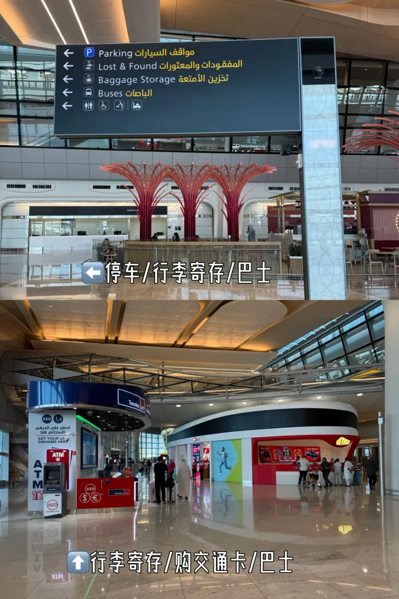
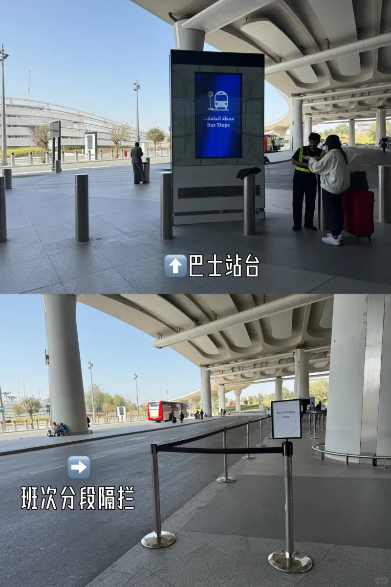

Zayedovo mezinárodní letiště v Abú Zabí (**AUH**) otevřelo na konci roku 2023 terminál A, který sloučil staré terminály T1, T2 a T3 do jedné budovy ve tvaru X. Pro cestovatele z Číny je jak branou do emirátů, tak odrazovým můstkem do Dubaje nebo k Velké mešitě šejka Zayeda — což znamená, že první hodina po přistání probíhá ve znamení stejných několika otázek: kudy teď, kde nechám zavazadla, jak získám dopravní kartu a ze kterých dveří odjíždí autokar do Dubaje.

Ve srovnání s Dubají se terminálem A prochází snadněji: budova má jednu hlavní osu, takže přílety, výdej zavazadel a východ tvoří téměř přímku. Těžké není najít směr, ale vybrat — e-brány, nebo ruční přepážka, vlevo, nebo vpravo v příletové hale, stříbrná, nebo zelená karta Hafilat. Následující text prochází celý sled kroků v pořadí, v jakém je potkáte.

## 1. Po přistání: následujte žluté značky

První, co v terminálu uvidíte, je řada žlutých značek s černým nápisem **Arrivals (القادمون)**. Značení na Zayedově letišti je arabsky a anglicky a práci odvede barevné kódování: žlutá pro přílety a zavazadla, modrá pro přestupy, zelená pro východy. I bez přečtení jediného slova vás barva dovede na místo.

Držte se rovně podél chodby s prosklenou stěnou. Na tomto úseku není žádné odbočení ani pohyblivý chodník — terminál A vede přilétající cestující přímo k pasové kontrole, stranou jsou jen toalety a místnost pro kojící matky.

Dále se značky rozdělují na **Arrivals** a **Transfers**: cestující mířící do Abú Zabí, kteří si vyzvedávají zavazadla, jdou žlutou stranou, zatímco ti, kdo přestupují, aniž by vstoupili do země, jdou modrou stranou. Pokud má vaše palubní vstupenka už další let a zavazadla jsou odbavená až do cíle, jděte po modré a zůstaňte v tranzitním prostoru.

Za rozcestím sjíždíte po eskalátoru, po obou stranách jsou velké světelné reklamní panely s motivy města. Vozíky mohou použít výtah vedle, takže není třeba zápasit s velkým kufrem na schodech.

Dole jednou odbočte vlevo a objeví se pasová hala. Značky zde doplňuje malý zelený řádek **Visa Services (خدمات التأشيرات)** — to je strana pro víza při příjezdu a problémy s vízy; běžní přilétající pokračují dál podle Arrivals.

## 2. Pasová kontrola: e-brány, nebo přepážka

Hala se dělí na dvě paralelní trasy a tohle je jediné rozhodnutí, které se vyplatí udělat dřív, než se zařadíte do fronty.

- **Přímo vpředu: e-brány.** Naskenujete pas, kamera porovná váš obličej a brána se otevře — celé to trvá deset a něco sekund. Hodí se pro cestující s biometrickým pasem, jehož údaje jsou už v systému.
- **Vpravo: ruční přepážky.** Správná volba, když vás automat nepřečte, pas nemá čip, cestujete s dětmi nebo potřebujete razítko. Přepážky jsou číslované od 25 výš a na obrazovkách stojí **Foreign Passports**.

Pokud jste tu poprvé nebo máte nový pas, nestůjte u brány a nezkoušejte to pořád dokola — jděte k přepážce, která je obvykle rychlejší než řešení problému. Úředníci obvykle chtějí jen pas, otisk prstu a pohled do kamery. Hala je dost široká na to, aby se fronta i při několika příletech širokotrupých letadel najednou málokdy protáhla přes dvacet minut.

## 3. Zavazadla: najděte svůj pás na obrazovce

Za pasovou kontrolou je zavazadlová hala. Značky sdružují **Baggage Reclaim 8–10** na jednom panelu a zvlášť ukazují na **Oversize Baggage** — surfy, kočárky a nadrozměrné bedny nevyjíždějí na běžných pásech a mají vlastní přepážku.

Nad každým pásem je obrazovka s číslem letu, místem odletu a stavem. Na pásu 7 na fotografii vykládají současně Hainan Airlines **HU433** z Haikou a Etihad **EY022** z Toronta. Raději se dívejte nahoru na číslo svého letu, než abyste šli s davem.

Zatímco čekáte, vyřiďte dvě věci: jestli se váš telefon připojil k bezplatnému letištnímu Wi-Fi (terminál A žádá telefonní číslo, na které pošle SMS s kódem, a čínská čísla obvykle fungují) a jestli další úsek cesty nevyžaduje jízdenku zakoupenou předem.

## 4. Východ: vlevo, nebo vpravo

Po vyzvednutí zavazadel následujte zelené značky **EXIT (مخرج)**; jedny automatické dveře se otevírají do příletové haly. Zayed rozděluje funkce haly vlevo a vpravo a vědět, co je kde, ušetří spoustu přecházení tam a zpět.

Čelem k východu:

| Směr | Co tam je |
| --- | --- |
| ⬅️ Vlevo | Parkoviště, přepážky půjčoven aut, taxi, ztráty a nálezy, služby pro hosty |
| ➡️ Vpravo | Úschovna zavazadel, autobusy, přepážky dopravních karet, limuzíny a letištní transfery |

Naproti dveřím stojí řada červených sochařských sloupů s posezením kavárny; za nimi jsou bankomaty a směnárna. Modrá zavěšená značka v této zóně na jeden pohled vypisuje parkoviště, ztráty a nálezy, úschovnu zavazadel a autobusy a světelný panel **AED Exchange / ATM** je nejpraktičtějším místem pro výběr hotovosti — kurzy na letišti jsou běžné, takže si vezměte jen tolik, kolik potřebujete na denní dopravu.

## 5. Úschovna zavazadel: ceny podle časových pásem

Pokud hned nemíříte do města — třeba chcete nejdřív Velkou mešitu nebo pokračujete do Dubaje — potřebují vaše zavazadla někde zůstat. Úschovna je na pravé straně příletové haly, označená **Excess Baggage Company**, venku je stojan kartonových šablon velikostí (od 20 AED za malý kus do 40 AED za velký) a bílý sloup s nápisem Baggage Storage.

Ceny se účtují v časových pásmech, po 72 hodinách platí denní sazba. Ceník stojí za vyfotografování:

| Doba uložení | Cena za kus (AED) |
| --- | --- |
| Do 3 hodin | 35 |
| Do 12 hodin | 55 |
| Do 24 hodin | 75 |
| Do 48 hodin | 105 |
| Do 72 hodin | 140 |
| Nad 72 hodin | +25 za den |

Při větším počtu je sleva: **10 % od 10 kusů, 15 % od 20 kusů**. Cena je za kus — jeden kufr nebo jedna taška — takže vyplatí se věci před odevzdáním sloučit.

## 6. Karta Hafilat: stříbrná, nebo zelená

Autobusy v Abú Zabí jezdí na kartu **Hafilat** a na palubě nepřijímají hotovost, podobně jako v Dubaji na kartu Nol. Přepážka Integrovaného dopravního centra (ITC) a samoobslužné automaty na dobití jsou vpravo v příletové hale, takže si kartu pořiďte už na letišti a nehledejte prodejní místo ve městě.

Dvě karty podle délky pobytu:

| Karta | Poplatek za vydání | Platnost | Minimální dobití | Poznámky |
| --- | --- | --- | --- | --- |
| Stříbrná | Zdarma | 30 dní | 10 AED | Výchozí volba pro krátké pobyty; sama karta nic nestojí |
| Zelená | 10 AED | 16 let | 10 AED | Pro rezidenty a opakované návštěvníky; kredit nelze vrátit |

Jedno upozornění: personál může z předané částky strhnout malou daň (cestujícím bylo účtováno 3 AED daně z dobití 30 AED), takže nepočítejte kredit na poslední jízdné. Stříbrné karty po 30 dnech vyprší i s kreditem, takže ho před odletem domů utraťte.

## 7. Autobus A10 k Velké mešitě šejka Zayeda

Velká mešita šejka Zayeda je v Abú Zabí povinnou zastávkou a letiště k ní má přímý autobus **A10** bez přestupů. Zastávka je vpravo, když vyjdete z **brány 7** v příletové hale; na nástupišti svítí modrá obrazovka **Bus Stops (محطة الحافلات)**.

Trasy oddělují bariéry a malá značka označuje **Bus Waiting Area**. Linka A10 k mešitě sdílí zónu s městskými linkami, takže se zařaďte do správné fronty — odjezdy nejsou časté a zmeškání stojí půl hodiny.

Linka A10 v číslech:

| Údaj | Detail |
| --- | --- |
| Jízdné | 4 AED, pouze karta Hafilat — na palubě žádná hotovost |
| Doba jízdy | Asi 45–55 minut |
| Interval | Každých 30–40 minut |
| Provozní doba | Přibližně 05:00–23:30 |
| Zastávka | Velká mešita šejka Zayeda |

Zastávka není u vchodu do mešity: ke vchodu pro návštěvníky je to asi 800 m pěšky. Vstup je zdarma, ale je nutná rezervace na oficiálních stránkách; otevírací doba je 09:00–22:00 od soboty do čtvrtka a v pátek 16:30–22:00, s uzavírkou během modlitebních časů. Dress code je dlouhé rukávy a dlouhé kalhoty a ženy potřebují šátek na hlavu — koupit si ho na letišti je snazší než si ho půjčit u brány.

## 8. Taxi, ride-hailing a autokar do Dubaje

**Taxi** nastupují vlevo od východu a jezdí na taxametr. Z letiště do centra Abú Zabí (na Corniche) stojí cesta přibližně 60–80 AED podle hodiny a provozu; večer a v pátek v době modliteb je aut méně.

**Ride-hailing**: **Careem** je místní standard, cenově blízko taxi, ale s jízdným zafixovaným při rezervaci, takže odpadá obava z objížděk. Uber v Abú Zabí funguje také, ale má řidší pokrytí. Místa vyzvednutí určuje aplikace a obvykle jsou ve vyhrazených stáních před příletovou halou.

**Autokary do Dubaje**: přepážka a vyhrazené stání jsou vpravo v příletové hale, cesta trvá asi 1,5 hodiny a odjezdy jsou časté — aktuální jízdní řád najdete u přepážky. Podrobnosti o této trase (jízdné, kde nastoupit a jak se vrátit) najdete v samostatném průvodci, na který odkazujeme níže.

## 9. Drobnosti, které první den pomohou

- **Dvojjazyčné značení**: všude arabština a angličtina a barva je spolehlivější než text — žlutá pro přílety, modrá pro přestupy, zelená pro východy.
- **Časový rozdíl**: SAE jsou čtyři hodiny za Pekingem, takže nastavte telefon na automatický čas a předejdete záměně času nástupu.
- **Zásuvky**: britské tříkolíkové (typ G), jako v Hongkongu; zástrčky z pevninské Číny potřebují adaptér.
- **Oblečení**: v terminálu je silná klimatizace, proto si vezměte lehkou vrstvu; v mešitě je to naopak, zakrytá ramena a kolena.
- **Voda**: v příletové hale jsou pítka, takže s opakovaně použitelnou lahví ušetříte za kupovanou vodu.

Jízdné, otevírací doba a umístění přepážek vycházejí z publikací letiště a dopravců a z autorových poznámek; v den cesty je ověřte na oficiálních stránkách a u přepážek.

## Související odkazy

- **Na tomto webu**: [Zayed International Airport (AUH)](/airport/AUH), [Spojené arabské emiráty (AE)](/country/AE), [průvodce autobusem Abú Zabí–Dubaj](/blog/abu-dhabi-dubai-bus-guide)
- **Wikipedie**: [Zayed International Airport](https://en.wikipedia.org/wiki/Zayed_International_Airport)
- **Baidu Baike**: [Mezinárodní letiště Abú Zabí](https://baike.baidu.com/item/%E9%98%BF%E5%B8%83%E6%89%8E%E6%AF%94%E5%9B%BD%E9%99%85%E6%9C%BA%E5%9C%BA)
- **Web letiště**: [Zayed International Airport](https://www.zayedinternationalairport.ae/)
- **Autobusy a dopravní karty**: [Integrované dopravní centrum Abú Zabí (ITC)](https://www.itc.gov.ae/)

Zdroj obrázků: autorovy vlastní fotografie. Jízdné, ceny úschovny a intervaly odpovídají údajům vyvěšeným u přepážek v době pořízení snímků a mohou se změnit.
