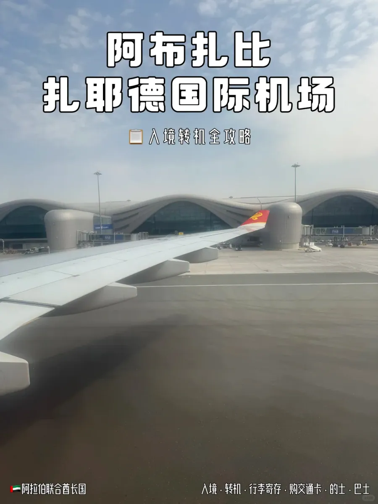

Der Zayed International Airport (**AUH**) in Abu Dhabi hat Ende 2023 Terminal A eröffnet und die alten Terminals T1, T2 und T3 in einem einzigen X-förmigen Gebäude zusammengefasst. Für Reisende aus China ist er zugleich das Tor zur Hauptstadt der Emirate und ein Zwischenstopp auf dem Weg nach Dubai oder zur Scheich-Zayid-Moschee – das bedeutet, dass die erste Stunde nach der Landung mit denselben wenigen Fragen vergeht: Wo geht es jetzt lang, wo lasse ich mein Gepäck, wie bekomme ich eine Verkehrskarte, und von welcher Tür fährt der Bus nach Dubai ab?

Im Vergleich zu Dubai lässt sich Terminal A leichter zu Fuß durchqueren: Das Gebäude hat nur eine Hauptachse, sodass Ankunft, Gepäckausgabe und Ausgang nahezu eine gerade Linie bilden. Schwierig ist nicht der Weg, sondern die Wahl – E-Gate oder Schalter, links oder rechts in der Ankunftshalle, die silberne oder die grüne Hafilat-Karte. Im Folgenden gehen wir die ganze Abfolge in der Reihenfolge durch, in der Sie ihr begegnen.

## 1. Nach der Landung: den gelben Schildern folgen

Das Erste, was Sie im Terminal sehen, ist eine Reihe gelber Schilder mit schwarzer Aufschrift **Arrivals (القادمون)**. Die Beschilderung in Zayed ist zweisprachig (Arabisch und Englisch), und die Farbcodierung übernimmt die eigentliche Arbeit: Gelb steht für Ankunft und Gepäck, Blau für Transfers, Grün für Ausgänge. Selbst ohne ein Wort zu lesen, bringt Sie die Farbe ans Ziel.

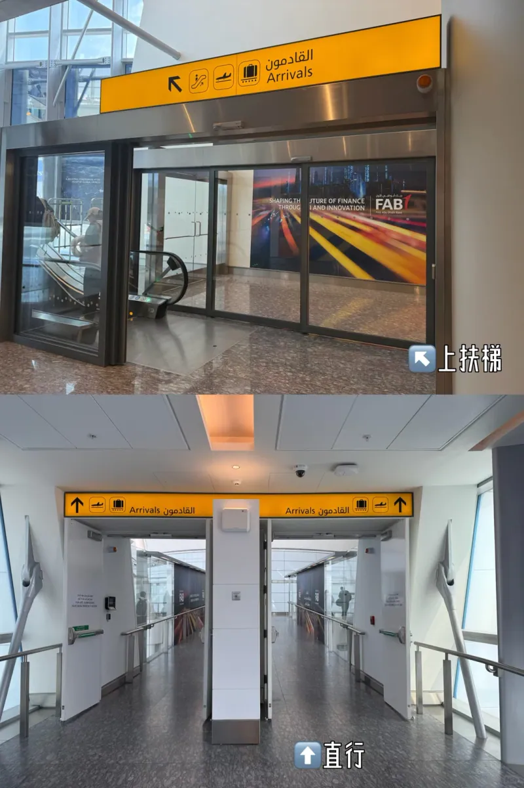

Gehen Sie geradeaus weiter den verglasten Korridor entlang. Auf diesem Abschnitt gibt es weder eine Abzweigung noch eine Rollbahn – Terminal A leitet ankommende Passagiere direkt zur Passkontrolle, seitlich liegen nur Toiletten und ein Stillraum.

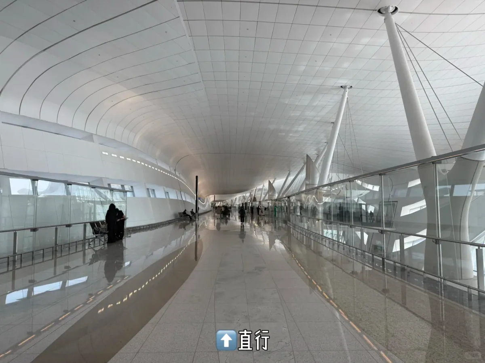

Weiter vorne trennen die Schilder **Arrivals** und **Transfers**: Wer nach Abu Dhabi einreist und sein Gepäck abholt, nimmt die gelbe Seite, wer nur umsteigt und das Land nicht betritt, die blaue. Steht der Anschlussflug bereits auf Ihrer Bordkarte und ist Ihr Gepäck durchgecheckt, folgen Sie Blau und bleiben im Transitbereich.

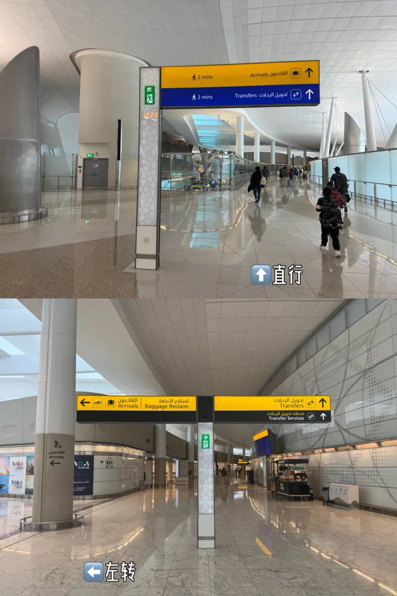

Nach der Gabelung geht es mit der Rolltreppe hinunter, links und rechts hängen große Leuchtwände mit Stadtmotiven. Für Gepäckwagen steht daneben ein Aufzug bereit, Sie müssen also keinen großen Koffer die Stufen hinunterwuchten.

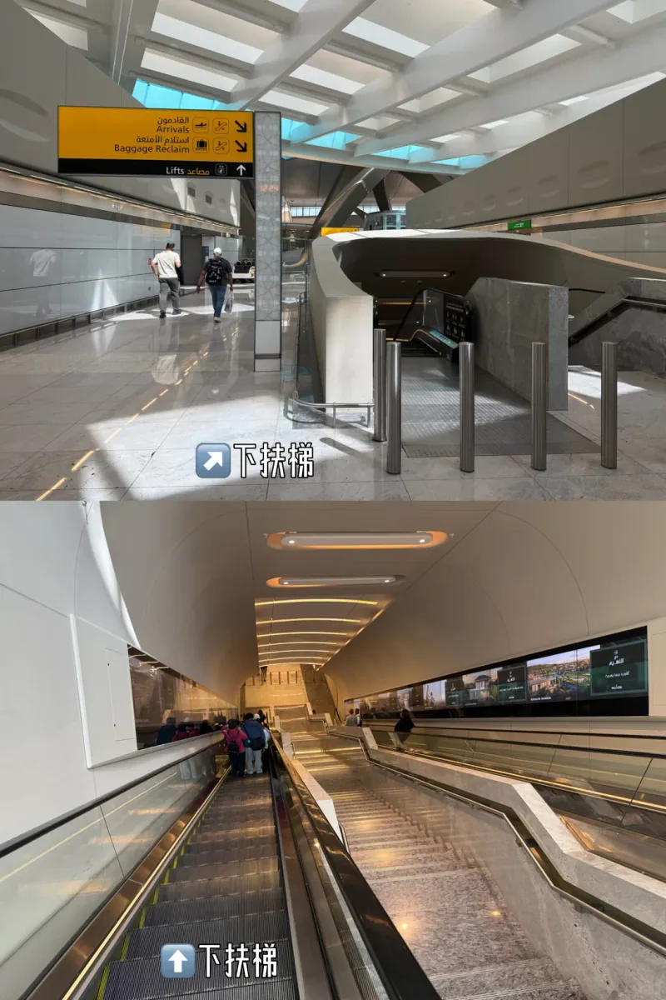

Unten angekommen, biegen Sie einmal links ab, und die Passhalle liegt vor Ihnen. Die Schilder hier ergänzen eine kleine grüne Zeile für **Visa Services (خدمات التأشيرات)** – das ist die Seite für Visa bei der Ankunft und für Visumprobleme; alle anderen folgen weiterhin Arrivals.

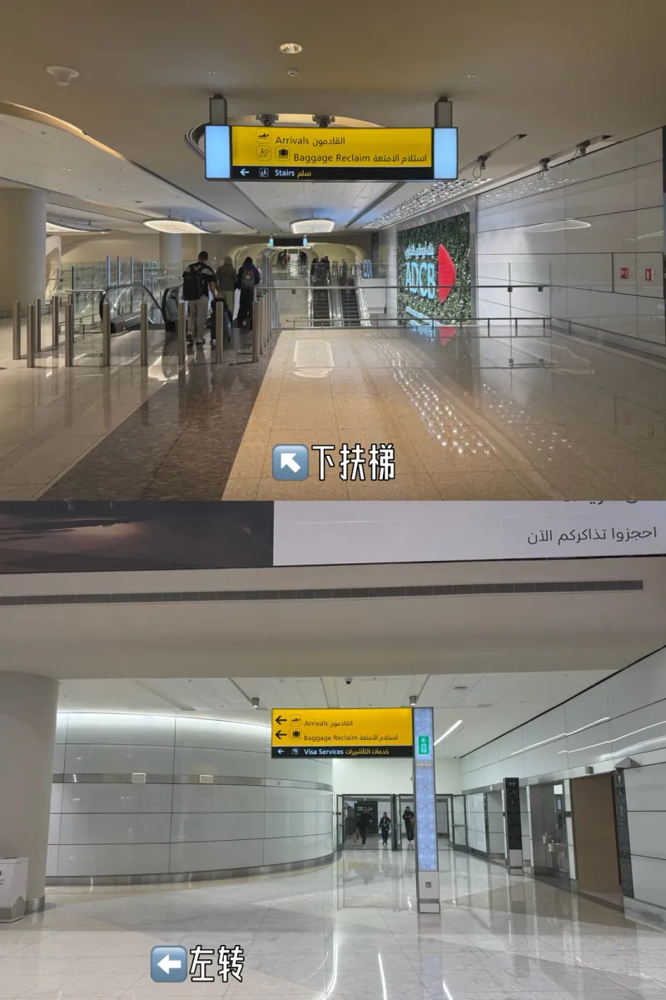

## 2. Die Passkontrolle: E-Gate oder Schalter

Die Halle teilt sich in zwei parallele Wege, und das ist die eine Entscheidung, die Sie treffen sollten, bevor Sie sich anstellen.

- **Geradeaus: die E-Gates.** Reisepass scannen, das Gesicht von der Kamera abgleichen lassen, und das Gate öffnet sich – alles in etwa zehn Sekunden. Geeignet für Reisende mit biometrischem Pass, dessen Daten bereits hinterlegt sind.
- **Rechts: die Schalter mit Personal.** Die richtige Wahl, wenn das Gerät Sie nicht erkennt, der Pass keinen Chip hat, Sie mit Kindern reisen oder einen Stempel brauchen. Die Schalter sind ab Nummer 25 aufwärts nummeriert, die Bildschirme zeigen **Foreign Passports**.

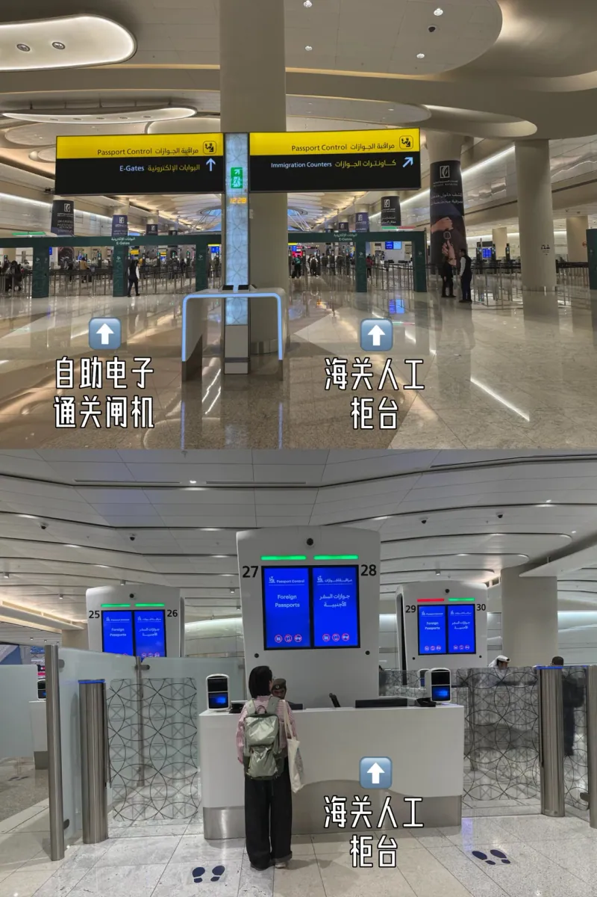

Wenn Sie zum ersten Mal einreisen oder der Pass neu ist, stellen Sie sich nicht ans Gate und versuchen es immer wieder – nehmen Sie den Schalter, das geht meist schneller als die Fehlersuche. Die Beamten verlangen selten mehr als den Reisepass, einen Fingerabdruck und einen Blick in die Kamera. Die Halle ist so weitläufig, dass selbst mehrere gleichzeitig gelandete Großraumflugzeuge die Warteschlange selten über zwanzig Minuten hinausdrücken.

## 3. Gepäck: das richtige Band auf dem Bildschirm finden

Hinter der Passkontrolle liegt die Gepäckhalle. Die Schilder fassen **Baggage Reclaim 8–10** auf einer Tafel zusammen und weisen getrennt auf **Oversize Baggage** hin – Surfbretter, Kinderwagen und übergroße Kisten kommen nicht über die normalen Bänder und haben einen eigenen Schalter.

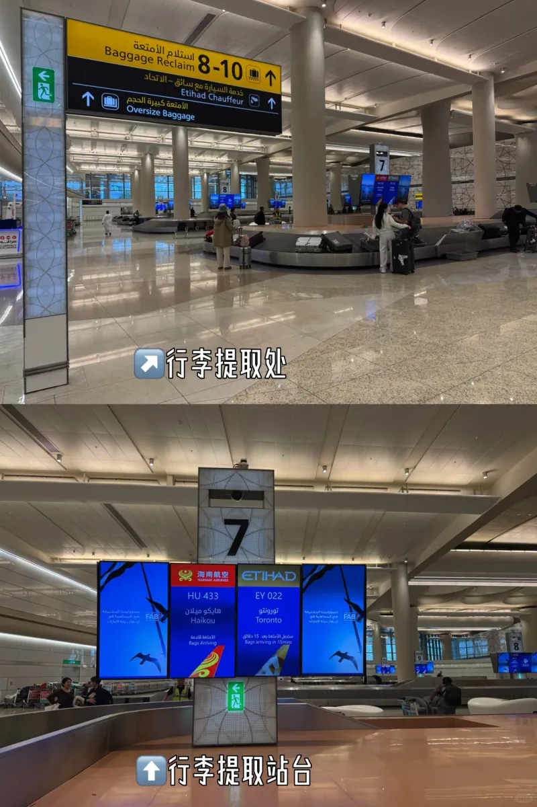

Über jedem Band hängt ein Bildschirm mit Flugnummer, Herkunft und Status. Auf Band 7 im Foto entladen Hainan Airlines **HU433** aus Haikou und Etihad **EY022** aus Toronto gleichzeitig dasselbe Band. Achten Sie auf Ihre Flugnummer über sich, statt einfach der Menge zu folgen.

Während Sie warten, klären Sie zwei Dinge: ob Ihr Telefon im kostenlosen Flughafen-WLAN angemeldet ist (Terminal A verlangt eine Handynummer, an die ein Code geschickt wird, und chinesische Nummern funktionieren in der Regel) und ob Sie für die nächste Etappe Ihrer Reise ein Ticket im Voraus kaufen müssen.

## 4. Der Ausgang: links oder rechts

Folgen Sie nach der Gepäckausgabe den grünen Schildern **EXIT (مخرج)**; eine Reihe automatischer Türen öffnet sich in die Ankunftshalle. Zayed verteilt die Funktionen der Halle auf links und rechts, und wer weiß, was wo liegt, spart sich viel Hin und Her.

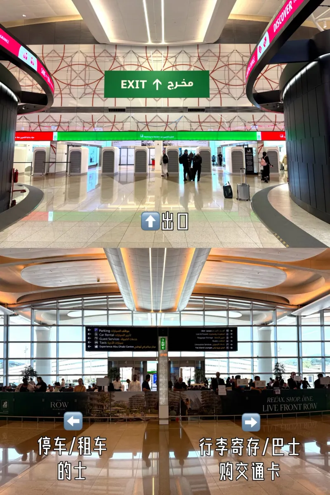

Mit Blick zum Ausgang:

| Richtung | Was dort ist |
| --- | --- |
| ⬅️ Links | Parkplätze, Mietwagenschalter, Taxis, Fundbüro, Gästeservice |
| ➡️ Rechts | Gepäckaufbewahrung, Busse, Schalter für Verkehrskarten, Limousinen- und Flughafentransfers |

Gegenüber den Türen steht eine Reihe roter, skulpturaler Säulen mit Café-Sitzplätzen, dahinter liegen die Geldautomaten und die Wechselstube. Das blaue Hängeschild in diesem Bereich listet Parkplätze, Fundbüro, Gepäckaufbewahrung und Busse auf einen Blick, und die Leuchttafel **AED Exchange / ATM** ist der praktischste Ort, um Bargeld abzuheben – die Kurse am Flughafen sind durchschnittlich, heben Sie also nur ab, was Sie für den Transport des Tages brauchen.

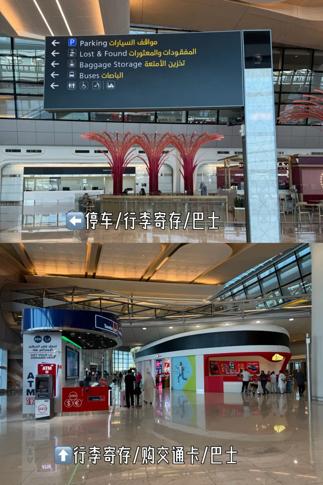

## 5. Gepäckaufbewahrung: Preise nach Zeitfenster

Wenn Sie nicht direkt in die Stadt fahren – etwa weil zuerst die Moschee auf dem Programm steht oder Sie nach Dubai weiterreisen –, braucht Ihr Gepäck einen Platz. Die Aufbewahrung liegt auf der rechten Seite der Ankunftshalle, ausgeschildert mit **Excess Baggage Company**, davor ein Stapel Pappschablonen für die Größen (von AED 20 für ein kleines Gepäckstück bis AED 40 für ein großes) und eine weiße Säule mit der Aufschrift Baggage Storage.

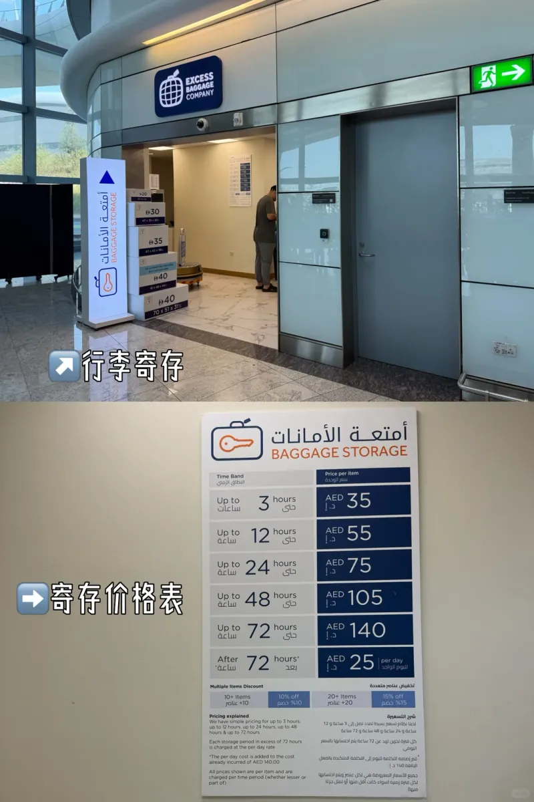

Die Gebühren richten sich nach Zeitfenstern, ab 72 Stunden gilt ein Tagessatz. Die Tafel lohnt ein Foto:

| Aufbewahrungsdauer | Preis pro Gepäckstück (AED) |
| --- | --- |
| Bis 3 Stunden | 35 |
| Bis 12 Stunden | 55 |
| Bis 24 Stunden | 75 |
| Bis 48 Stunden | 105 |
| Bis 72 Stunden | 140 |
| Über 72 Stunden hinaus | +25 pro Tag |

Bei größeren Mengen gibt es Rabatt: **10 % ab 10 Gepäckstücken, 15 % ab 20**. Abgerechnet wird pro Gepäckstück – ein Koffer oder eine Tasche –, es lohnt sich also, das Gepäck vor der Abgabe zusammenzufassen.

## 6. Die Hafilat-Karte: silber oder grün

Die Busse in Abu Dhabi fahren mit der **Hafilat**-Karte und nehmen kein Bargeld an, ähnlich wie in Dubai mit Nol. Der Schalter des Integrated Transport Centre (ITC) und die Selbstbedienungsautomaten zum Aufladen liegen rechts in der Ankunftshalle – holen Sie die Karte also am Flughafen, statt in der Stadt nach einer Verkaufsstelle zu suchen.

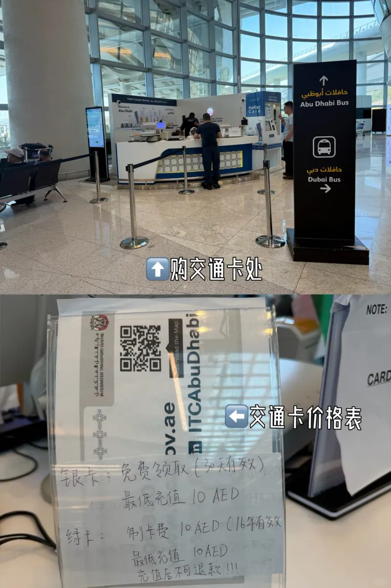

Zwei Karten, gewählt nach der Dauer des Aufenthalts:

| Karte | Ausgabegebühr | Gültigkeit | Mindestaufladung | Hinweise |
| --- | --- | --- | --- | --- |
| Silber | kostenlos | 30 Tage | AED 10 | Die Standardwahl für kurze Aufenthalte; die Karte selbst kostet nichts |
| Grün | AED 10 | 16 Jahre | AED 10 | Für Einwohner und wiederkehrende Besucher; das Guthaben wird nicht erstattet |

Eine Warnung: Das Personal behält unter Umständen eine kleine Steuer vom übergebenen Betrag ein (bei einer Aufladung von AED 30 wurden Reisenden bereits AED 3 Steuer berechnet), kalkulieren Sie das Guthaben also nicht bis zur letzten Fahrt herunter. Silberne Karten verfallen nach 30 Tagen – zusammen mit dem Guthaben –, verbrauchen Sie es daher, bevor Sie nach Hause fliegen.

## 7. Der A10-Bus zur Scheich-Zayid-Moschee

Die Scheich-Zayid-Moschee gehört zu jedem Besuch in Abu Dhabi, und der Flughafen hat einen direkten Bus, den **A10**, ohne Umsteigen. Die Haltestelle liegt rechts, wenn Sie die Ankunftshalle durch **Gate 7** verlassen; ein blauer Bildschirm am Steig zeigt **Bus Stops (محطة الحافلات)**.

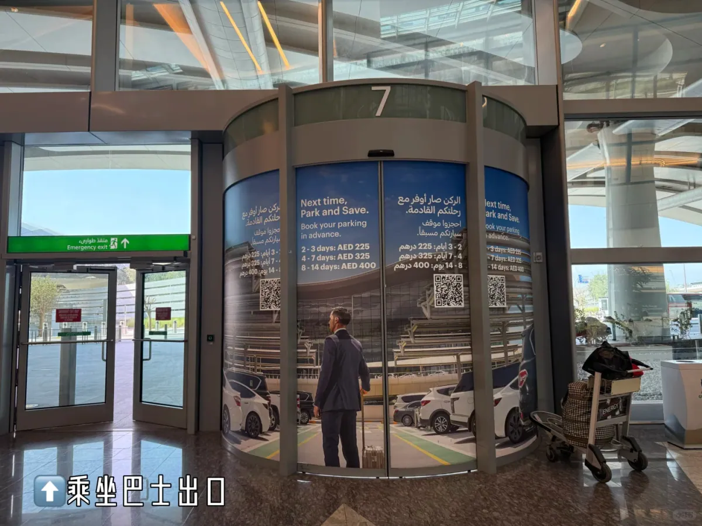

Absperrungen trennen die Linien, ein kleines Schild markiert den Bereich **Bus Waiting Area**. Der A10 zur Moschee teilt sich den Bereich mit den Stadtlinien, stellen Sie sich also in die richtige Schlange – die Abfahrten sind nicht häufig, und eine verpasste kostet eine halbe Stunde.

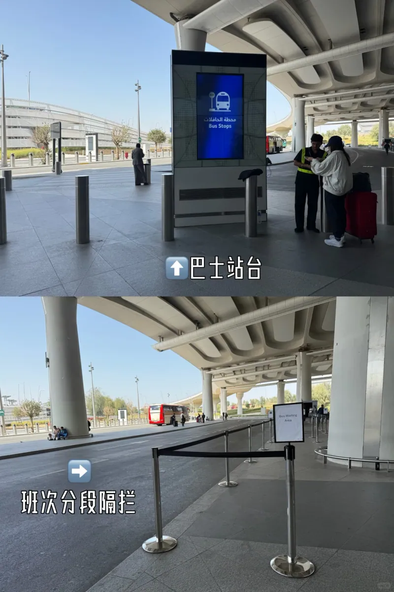

Der A10 in Zahlen:

| Punkt | Angabe |
| --- | --- |
| Fahrpreis | AED 4, nur mit Hafilat-Karte – kein Bargeld im Bus |
| Fahrzeit | etwa 45–55 Minuten |
| Taktung | alle 30–40 Minuten |
| Betriebszeiten | etwa 05:00–23:30 |
| Haltestelle | Scheich-Zayid-Moschee |

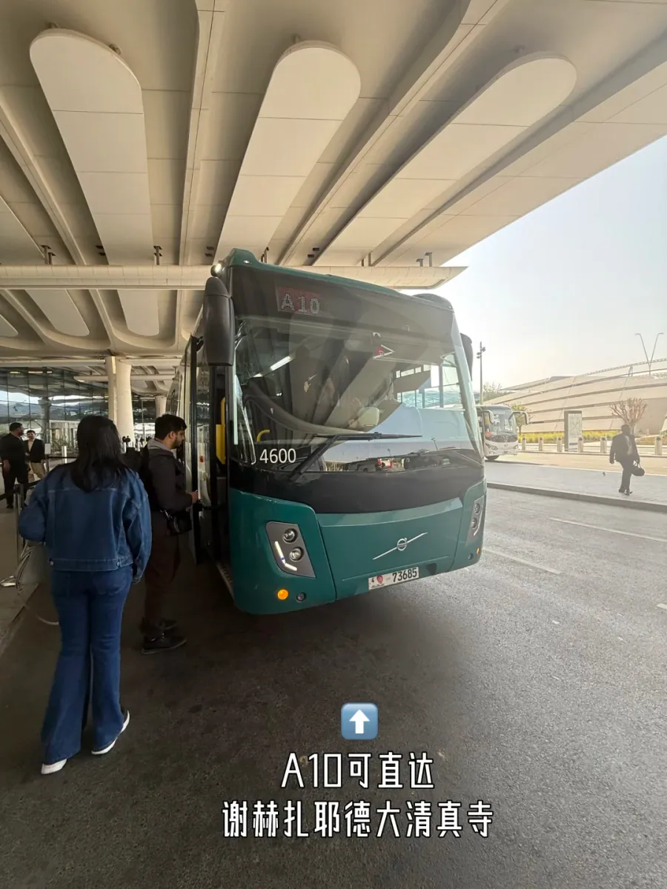

Die Haltestelle ist nicht der Eingang der Moschee: Bis zum Besuchereingang sind es rund 800 m zu Fuß. Der Eintritt ist kostenlos, erfordert aber eine Buchung über die offizielle Website; die Öffnungszeiten sind 09:00–22:00 Uhr von Samstag bis Donnerstag und 16:30–22:00 Uhr am Freitag, während der Gebetszeiten bleibt sie geschlossen. Es gilt eine Kleiderordnung mit langen Ärmeln und langen Hosen, Frauen brauchen ein Kopftuch – eines am Flughafen zu kaufen ist einfacher, als es am Tor zu leihen.

## 8. Taxis, Ride-Hailing und der Bus nach Dubai

**Taxis** halten links vom Ausgang und fahren nach Taxameter. Vom Flughafen in die Innenstadt von Abu Dhabi (Corniche) kostet es je nach Uhrzeit und Verkehr etwa AED 60–80; abends und während der Freitagsgebete sind weniger Fahrzeuge unterwegs.

**Ride-Hailing**: **Careem** ist der lokale Standard, preislich nahe am Taxi, aber mit einem bei der Buchung festgeschriebenen Fahrpreis, was die Sorge vor Umwegen erspart. Auch Uber ist in Abu Dhabi verfügbar, hat aber eine dünnere Abdeckung. Die Abholpunkte richten sich nach der App und liegen in der Regel in den eigenen Buchten außerhalb der Ankunftshalle.

**Busse nach Dubai**: Der Fahrkartenschalter und der eigene Steig liegen rechts in der Ankunftshalle, die Fahrt dauert etwa 1,5 Stunden, und die Abfahrten sind häufig – den aktuellen Fahrplan erfahren Sie am Schalter. Die Details dieser Strecke (Fahrpreise, Einstieg und Rückweg) stehen in einem eigenen Leitfaden, der unten verlinkt ist.

## 9. Kleine Dinge, die am ersten Tag helfen

- **Zweisprachige Beschilderung**: durchgehend Arabisch und Englisch, und die Farbe schlägt den Text – Gelb für Ankunft, Blau für Transfers, Grün für Ausgänge.
- **Zeitverschiebung**: Die VAE liegen vier Stunden hinter Peking, stellen Sie Ihr Telefon daher auf automatische Zeit und verlesen Sie keine Boardingzeit.
- **Steckdosen**: britische Dreipolstecker (Typ G) wie in Hongkong; Stecker vom chinesischen Festland brauchen einen Adapter.
- **Kleidung**: Das Terminal ist stark klimatisiert, nehmen Sie also eine leichte Jacke mit; die Moschee verlangt das Gegenteil, Schultern und Knie müssen bedeckt sein.
- **Wasser**: In der Ankunftshalle gibt es Trinkbrunnen, eine Mehrwegflasche erspart den Kauf von Wasser.

Fahrpreise, Öffnungszeiten und Schalterstandorte stammen aus Veröffentlichungen des Flughafens und der Betreiber sowie aus den eigenen Notizen des Autors; prüfen Sie die offiziellen Websites und die Schalter am Reisetag.

## Weiterführende Links

- **Auf dieser Website**: [Zayed International Airport (AUH)](/airport/AUH), [Vereinigte Arabische Emirate (AE)](/country/AE), [Leitfaden zum Bus zwischen Abu Dhabi und Dubai](/blog/abu-dhabi-dubai-bus-guide)
- **Wikipedia**: [Zayed International Airport](https://en.wikipedia.org/wiki/Zayed_International_Airport)
- **Baidu Baike**: [Internationaler Flughafen Abu Dhabi](https://baike.baidu.com/item/%E9%98%BF%E5%B8%83%E6%89%8E%E6%AF%94%E5%9B%BD%E9%99%85%E6%9C%BA%E5%9C%BA)
- **Flughafen-Website**: [Zayed International Airport](https://www.zayedinternationalairport.ae/)
- **Busse und Verkehrskarten**: [Integrated Transport Centre (ITC) Abu Dhabi](https://www.itc.gov.ae/)
- **Originalbeitrag**: [Xiaohongshu @曜光纪JACK](https://www.xiaohongshu.com/explore/6ab8a2e1000000001400081f)

Bildquelle: eigene Fotografien des Autors. Fahrpreise, Preise für die Gepäckaufbewahrung und Taktungen entsprechen den Aushängen an den Schaltern zum Zeitpunkt der Aufnahmen und können sich ändern.
