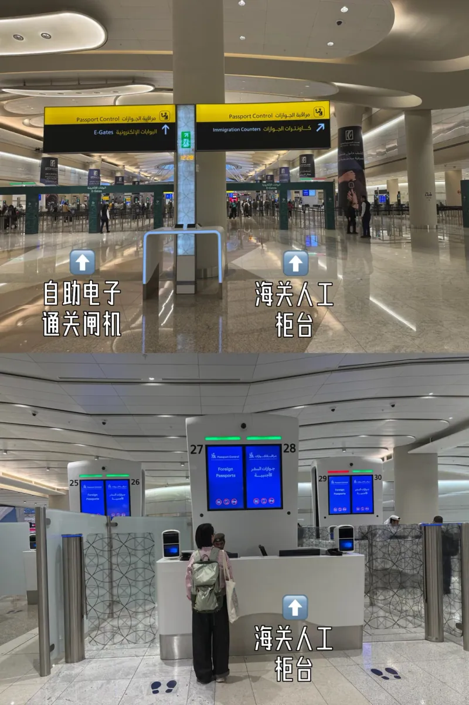

El Aeropuerto Internacional Zayed de Abu Dabi (**AUH**) inauguró la Terminal A a finales de 2023, uniendo las antiguas T1, T2 y T3 en un único edificio en forma de X. Para los viajeros procedentes de China es a la vez la puerta de entrada a la capital emiratí y un punto de paso hacia Dubái o la Gran Mezquita Sheikh Zayed, lo que significa que la primera hora tras aterrizar se dedica a responder las mismas preguntas: ¿por dónde sigo?, ¿dónde dejo las maletas?, ¿cómo consigo una tarjeta de transporte?, ¿de qué puerta sale el autocar a Dubái?

Comparada con Dubái, la Terminal A es el aeropuerto más fácil de recorrer a pie: el edificio tiene un solo eje, así que las llegadas, la recogida de equipaje y la salida forman una línea casi recta. Lo difícil no es orientarse, sino elegir: puertas automáticas o mostrador manual, izquierda o derecha en la sala de llegadas, tarjeta Hafilat plateada o verde. Lo que sigue recorre toda la secuencia en el orden en que te la encontrarás.

## 1. Tras aterrizar: sigue los carteles amarillos

Lo primero que ves dentro de la terminal es una fila de carteles amarillos con **Arrivals (القادمون)** en negro. La señalización de Zayed es en árabe e inglés, y el código de colores hace el trabajo: amarillo para llegadas y equipajes, azul para tránsitos, verde para salidas. Aunque no leas una palabra, siguiendo el color llegarás.

Sigue recto por el pasillo de paredes acristaladas. En este tramo no hay giros ni cintas transportadoras para pasajeros: la Terminal A encamina a los pasajeros que llegan directamente hacia el control de pasaportes, con solo aseos y una sala de lactancia a un lado.

Más adelante, los carteles separan **Arrivals** de **Transfers**: los viajeros que entran en Abu Dabi y recogen maletas toman el lado amarillo, mientras que quienes hacen conexión sin entrar en el país toman el azul. Si tu tarjeta de embarque ya indica el siguiente vuelo y tus maletas van facturadas hasta el destino, sigue el azul y permanece en la zona restringida.

Tras la bifurcación bajas por una escalera mecánica, con grandes paneles luminosos de ciudades a ambos lados. Los carritos pueden usar el ascensor de al lado, así que no hay que pelearse con una maleta grande en los escalones.

Abajo, gira una vez a la izquierda y aparece la sala de pasaportes. Los carteles añaden una pequeña línea verde para **Visa Services (خدمات التأشيرات)**: ese es el lado para el visado a la llegada y los problemas de visado; las llegadas ordinarias siguen siguiendo Arrivals.

## 2. Control de pasaportes: puertas automáticas o mostrador

La sala se divide en dos rutas paralelas, y esta es la única decisión que conviene tomar antes de ponerte a la cola.

- **Todo recto: las puertas automáticas.** Escanea el pasaporte, deja que la cámara compare tu cara y la puerta se abre: unos diez segundos en total. Es adecuada para viajeros con pasaporte biométrico cuyos datos ya están registrados.
- **A la derecha: los mostradores manuales.** La opción correcta cuando la máquina no te lee, el pasaporte no tiene chip, viajas con niños o necesitas un sello. Los mostradores están numerados a partir del 25 y las pantallas indican **Foreign Passports**.

Si es tu primera visita o el pasaporte es nuevo, no te quedes en una puerta intentándolo una y otra vez: ve al mostrador, que suele ser más rápido que solucionar el problema. Los agentes rara vez piden más que el pasaporte, una huella y un vistazo a la cámara. La sala es lo bastante amplia como para que, incluso con varios vuelos de fuselaje ancho llegando a la vez, la cola rara vez supere los veinte minutos.

## 3. Equipaje: encuentra tu cinta en la pantalla

Pasado el control de pasaportes está la sala de equipajes. Los carteles agrupan **Baggage Reclaim 8–10** en un panel y señalan por separado **Oversize Baggage**: las tablas de surf, los carritos de bebé y las cajas de gran tamaño no salen por las cintas normales y tienen su propio mostrador.

Cada cinta tiene una pantalla encima que muestra el número de vuelo, el origen y el estado. En la cinta 7 de la foto, Hainan Airlines **HU433** desde Haikou y Etihad **EY022** desde Toronto están descargando en la misma cinta. Mira hacia arriba para buscar tu número de vuelo en lugar de seguir a la multitud.

Mientras esperas, resuelve dos cosas: si tu teléfono se ha conectado al wifi gratuito del aeropuerto (la Terminal A pide un número de móvil para enviar un código por SMS, y los números chinos suelen funcionar) y si el siguiente tramo de tu viaje necesita un billete comprado con antelación.

## 4. La salida: izquierda o derecha

Sigue los carteles verdes de **EXIT (مخرج)** después de recoger las maletas; una puerta automática se abre a la sala de llegadas. Zayed reparte las funciones de la sala entre izquierda y derecha, y saber cuál es cuál ahorra muchos paseos de un lado a otro.

De cara a la salida:

| Dirección | Qué hay |
| --- | --- |
| ⬅️ Izquierda | Aparcamiento, mostradores de alquiler de coches, taxis, objetos perdidos, atención al cliente |
| ➡️ Derecha | Consigna de equipaje, autobuses, mostradores de tarjetas de transporte, limusinas y traslados al aeropuerto |

Frente a las puertas hay una fila de columnas escultóricas rojas con asientos de cafetería; los cajeros automáticos y el cambio de divisas están detrás. El cartel azul del techo de esta zona enumera de un vistazo aparcamiento, objetos perdidos, consigna de equipaje y autobuses, y el panel luminoso **AED Exchange / ATM** es el lugar más práctico para sacar efectivo: los tipos de cambio del aeropuerto son normales, así que saca solo lo que necesites para el transporte del día.

## 5. Consigna de equipaje: tarifas por tramos de tiempo

Si no te diriges directamente a la ciudad —por ejemplo, si quieres ver primero la Gran Mezquita o si sigues hacia Dubái—, tus maletas necesitan un sitio donde quedarse. La consigna está en el lado derecho de la sala de llegadas, señalizada como **Excess Baggage Company**, con una pila de plantillas de cartón de tamaños fuera (desde 20 AED para un artículo pequeño hasta 40 AED para uno grande) y un pilar blanco marcado Baggage Storage.

Las tarifas van por tramos de tiempo, con una tarifa diaria a partir de las 72 horas. Merece la pena fotografiar el panel:

| Periodo de almacenamiento | Precio por artículo (AED) |
| --- | --- |
| Hasta 3 horas | 35 |
| Hasta 12 horas | 55 |
| Hasta 24 horas | 75 |
| Hasta 48 horas | 105 |
| Hasta 72 horas | 140 |
| Más de 72 horas | +25 por día |

Hay descuentos por volumen: **10 % a partir de 10 artículos, 15 % a partir de 20**. El precio es por artículo —una maleta o una bolsa—, así que consolidar antes de entregar las cosas merece la pena.

## 6. La tarjeta Hafilat: plateada o verde

Los autobuses de Abu Dabi funcionan con la tarjeta **Hafilat** y no aceptan efectivo a bordo, igual que Dubái funciona con la Nol. El mostrador del Centro de Transporte Integrado (ITC) y las máquinas de recarga autoservicio están a la derecha de la sala de llegadas, así que consigue la tarjeta en el aeropuerto en lugar de buscarla en la ciudad.

Dos tarjetas, según la duración de la estancia:

| Tarjeta | Tasa de emisión | Validez | Recarga mínima | Notas |
| --- | --- | --- | --- | --- |
| Plateada | Gratis | 30 días | 10 AED | La opción por defecto para estancias cortas; la tarjeta no cuesta nada |
| Verde | 10 AED | 16 años | 10 AED | Para residentes y visitantes habituales; el saldo no es reembolsable |

Una advertencia: el personal puede descontar un pequeño impuesto del importe que entregas (a viajeros se les han cobrado 3 AED de impuesto por una recarga de 30 AED), así que no calcules el saldo hasta la última tarifa. Las tarjetas plateadas caducan a los 30 días y el saldo se pierde con ellas, así que gástalo antes de volver a casa.

## 7. El autobús A10 a la Gran Mezquita Sheikh Zayed

La Gran Mezquita Sheikh Zayed es la parada imprescindible de Abu Dabi y el aeropuerto tiene un autobús directo, el **A10**, sin transbordos. La parada está a la derecha al salir por la **puerta 7** de la sala de llegadas; una pantalla azul en la plataforma indica **Bus Stops (محطة الحافلات)**.

Unas barreras separan las rutas y un pequeño cartel marca la **Bus Waiting Area**. El A10 a la mezquita comparte zona con las rutas urbanas, así que ponte en la cola correcta: las salidas no son frecuentes y perder una cuesta media hora.

El A10 en cifras:

| Concepto | Detalle |
| --- | --- |
| Tarifa | 4 AED, solo tarjeta Hafilat; no se acepta efectivo a bordo |
| Duración del trayecto | Unos 45–55 minutos |
| Frecuencia | Cada 30–40 minutos |
| Horario | Aproximadamente de 05:00 a 23:30 |
| Parada | Gran Mezquita Sheikh Zayed |

La parada no es la entrada de la mezquita: queda a unos 800 m a pie hasta la entrada de visitantes. La entrada es gratuita, pero requiere reserva en la web oficial; el horario de apertura es de 09:00 a 22:00 de sábado a jueves y de 16:30 a 22:00 los viernes, con cierres durante las horas de oración. El código de vestimenta exige manga larga y pantalón, y las mujeres necesitan pañuelo en la cabeza: comprarlo en el aeropuerto es más fácil que alquilarlo en la puerta.

## 8. Taxis, aplicaciones y el autocar a Dubái

**Taxis**: recogen a la izquierda de la salida y funcionan con taxímetro. Del aeropuerto al centro de Abu Dabi (la Corniche) cuesta unos 60–80 AED según la hora y el tráfico; por la tarde y en las horas de oración del viernes hay menos coches.

**Aplicaciones de transporte**: **Careem** es el estándar local, con un precio cercano al del taxi pero con la tarifa bloqueada al reservar, lo que elimina la preocupación por los desvíos. Uber también funciona en Abu Dabi, pero tiene menos cobertura. Los puntos de recogida siguen a la aplicación y suelen estar en las dársenas reservadas fuera de llegadas.

**Autocares a Dubái**: el mostrador de billetes y la parada reservada están a la derecha de la sala de llegadas, el trayecto dura unas 1,5 horas y las salidas son frecuentes; consulta el mostrador para el horario actual. Los detalles de esa ruta (tarifas, dónde embarcar y cómo volver) tienen su propia guía, enlazada abajo.

## 9. Pequeñas cosas que ayudan el primer día

- **Señalización bilingüe**: árabe e inglés en todo el recinto, y el color manda sobre el texto: amarillo para llegadas, azul para tránsitos, verde para salidas.
- **Diferencia horaria**: los EAU están cuatro horas por detrás de Pekín, así que pon el teléfono en hora automática y evita leer mal una hora de embarque.
- **Enchufes**: de tres clavijas tipo británico (tipo G), como en Hong Kong; los enchufes de China continental necesitan adaptador.
- **Ropa**: la terminal tiene mucha aire acondicionado, así que lleva una capa ligera; la mezquita pide lo contrario, con hombros y rodillas cubiertos.
- **Agua**: hay fuentes en la sala de llegadas, así que una botella reutilizable ahorra comprar agua.

Las tarifas, horarios y ubicaciones de los mostradores proceden de publicaciones del aeropuerto y de los operadores, además de las notas del autor; consulta las webs oficiales y los mostradores el día del viaje.

## Enlaces relacionados

- **En este sitio**: [Aeropuerto Internacional Zayed (AUH)](/airport/AUH), [Emiratos Árabes Unidos (AE)](/country/AE), [Guía de autobús Abu Dabi–Dubái](/blog/abu-dhabi-dubai-bus-guide)
- **Wikipedia**: [Aeropuerto Internacional Zayed](https://en.wikipedia.org/wiki/Zayed_International_Airport)
- **Baidu Baike**: [Aeropuerto Internacional de Abu Dabi](https://baike.baidu.com/item/%E9%98%BF%E5%B8%83%E6%89%8E%E6%AF%94%E5%9B%BD%E9%99%85%E6%9C%BA%E5%9C%BA)
- **Web del aeropuerto**: [Zayed International Airport](https://www.zayedinternationalairport.ae/)
- **Autobuses y tarjetas de transporte**: [Centro de Transporte Integrado (ITC) de Abu Dabi](https://www.itc.gov.ae/)

Fuente de las imágenes: fotografías del propio autor. Las tarifas, los precios de consigna y las frecuencias son los publicados en los mostradores cuando se tomaron las fotos y pueden cambiar.
