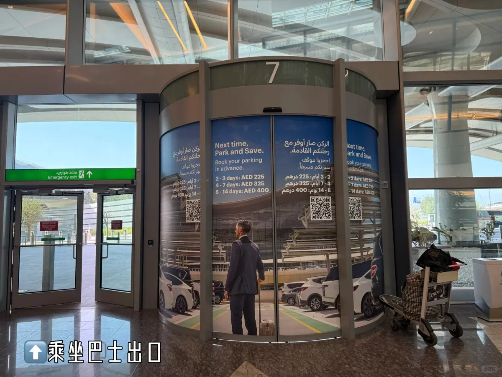

अबू धाबी के ज़ायद इंटरनेशनल एयरपोर्ट (**AUH**) ने 2023 के अंत में टर्मिनल A खोला, जिसने पुराने T1, T2 और T3 को मिलाकर एक X आकार की इमारत बना दी। चीन से आने वाले यात्रियों के लिए यह अमीरात की राजधानी का प्रवेशद्वार भी है और दुबई या शेख ज़ायद ग्रैंड मस्जिद तक का पड़ाव भी — यानी उतरने के बाद का पहला घंटा उन्हीं कुछ सवालों के जवाब ढूँढ़ने में जाता है: अब किस तरफ़ जाऊँ, बैग कहाँ रखवाऊँ, यात्रा कार्ड कैसे बनवाऊँ, और दुबई की कोच किस दरवाज़े से निकलती है।

दुबई की तुलना में टर्मिनल A से चलकर निकलना आसान है: इमारत का एक ही मुख्य गलियारा है, इसलिए आगमन, बैगेज क्लेम और निकास लगभग एक सीधी रेखा में हैं। मुश्किल दिशा नहीं, चुनाव है — ई-गेट या मैनुअल काउंटर, आगमन हॉल में बाएँ या दाएँ, सिल्वर या हरा हफ़ीलत कार्ड। आगे वही क्रम दिया गया है जिस क्रम में आपको सब मिलेगा।

## 1. उतरने के बाद: पीले साइन का पालन करें

टर्मिनल के अंदर सबसे पहले जो दिखता है वह पीले साइन की कतार है जिन पर काले अक्षरों में **Arrivals (القادمون)** लिखा होता है। ज़ायद में साइन अरबी और अंग्रेज़ी दोनों में हैं, और रंग ही काम कर देते हैं: आगमन और सामान के लिए पीला, ट्रांज़िट के लिए नीला, निकास के लिए हरा। एक शब्द पढ़े बिना भी, रंग के पीछे चलते जाएँ तो पहुँच जाएँगे।

काँच की दीवारों वाले गलियारे में सीधे चलते रहें। इस हिस्से में कोई मोड़ नहीं है और न ही कोई पीपल मूवर — टर्मिनल A आने वाले यात्रियों को सीधे पासपोर्ट नियंत्रण की ओर भेजता है, किनारे पर सिर्फ़ शौचालय और एक नर्सिंग रूम हैं।

आगे जाकर साइन **Arrivals** और **Transfers** को अलग करते हैं: अबू धाबी में जाने वाले और सामान लेने वाले यात्री पीली तरफ़ जाते हैं, जबकि बिना देश में घुसे कनेक्ट करने वाले नीली तरफ़। अगर आपके बोर्डिंग पास पर अगली उड़ान पहले से है और आपका सामान चेक-थ्रू है, तो नीले का पालन करें और एयरसाइड ही रहें।

विभाजन के बाद एक एस्केलेटर से नीचे जाना है, दोनों तरफ़ शहर के बड़े लाइटबॉक्स हैं। ट्रॉली के लिए साथ में लिफ़्ट है, इसलिए बड़ा सूटकेस सीढ़ियों पर घसीटने की ज़रूरत नहीं।

नीचे एक बार बाएँ मुड़ें और पासपोर्ट हॉल सामने आ जाता है। यहाँ के साइन में **Visa Services (خدمات التأشيرات)** के लिए एक छोटी हरी पट्टी जुड़ती है — यही तरफ़ वीज़ा ऑन अराइवल और वीज़ा संबंधी परेशानियों के लिए है; सामान्य यात्री Arrivals के पीछे चलते रहें।

## 2. पासपोर्ट नियंत्रण: ई-गेट या काउंटर

हॉल दो समानांतर रास्तों में बँटता है, और कतार में लगने से पहले यही एक फ़ैसला है जो सोच-समझकर लेना चाहिए।

- **सीधे सामने: ई-गेट।** अपना पासपोर्ट स्कैन करें, कैमरे को अपना चेहरा मिलाने दें, और गेट खुल जाता है — कुल दस-बारह सेकंड। यह उन यात्रियों के लिए ठीक है जिनका बायोमेट्रिक पासपोर्ट है और जिसकी जानकारी पहले से दर्ज है।
- **दाईं ओर: मैनुअल काउंटर।** यह चुनना ठीक है जब मशीन आपको पढ़ न पाए, पासपोर्ट में चिप न हो, आप बच्चों के साथ हों, या आपको स्टैंप चाहिए। काउंटर 25 से शुरू होकर आगे तक गिने गए हैं और स्क्रीन पर **Foreign Passports** लिखा है।

अगर यह आपकी पहली यात्रा है, या पासपोर्ट नया है, तो गेट पर बार-बार कोशिश न करें — काउंटर पर जाएँ, जो आम तौर पर ठीक करने की कोशिश से तेज़ होता है। अधिकारी शायद ही पासपोर्ट, फ़िंगरप्रिंट और कैमरे पर एक नज़र से ज़्यादा पूछते हैं। हॉल इतना चौड़ा है कि एक साथ कई चौड़े शरीर वाली उड़ानें उतरने पर भी कतार शायद ही बीस मिनट से ज़्यादा हो।

## 3. सामान: स्क्रीन पर अपनी बेल्ट ढूँढ़ें

पासपोर्ट नियंत्रण के आगे बैगेज हॉल है। साइन एक पैनल पर **Baggage Reclaim 8–10** दिखाते हैं और अलग से **Oversize Baggage** की दिशा बताते हैं — सर्फ़बोर्ड, स्ट्रॉलर और बड़े डिब्बे आम बेल्ट पर नहीं आते, उनके लिए अलग डेस्क है।

हर बेल्ट के ऊपर एक स्क्रीन है जिस पर उड़ान संख्या, कहाँ से आई और स्थिति दिखती है। फ़ोटो में बेल्ट 7 पर हैनान एयरलाइंस की **HU433** (हाइको से) और एतिहाद की **EY022** (टोरंटो से) दोनों एक ही बेल्ट पर सामान उतार रही हैं। भीड़ के पीछे चलने के बजाय अपनी उड़ान संख्या के लिए ऊपर देखें।

प्रतीक्षा के दौरान दो बातें निपटा लें: क्या आपका फ़ोन मुफ़्त एयरपोर्ट वाई-फ़ाई से जुड़ा है (टर्मिनल A मोबाइल नंबर माँगकर कोड भेजता है, और चीनी नंबर आम तौर पर काम करते हैं), और क्या आपकी यात्रा के अगले चरण के लिए पहले से टिकट खरीदना है।

## 4. निकास: बाएँ या दाएँ

बैग लेने के बाद हरे **EXIT (مخرج)** साइन का पालन करें; स्वचालित दरवाज़ों का एक सेट आगमन हॉल में खुलता है। ज़ायद हॉल के कामकाज को बाएँ-दाएँ बाँटता है, और यह जानना कि कौन-सी तरफ़ क्या है, बहुत सारी इधर-उधर आने-जाने की मेहनत बचा देता है।

निकास की ओर मुँह करके:

| दिशा | वहाँ क्या है |
| --- | --- |
| ⬅️ बाएँ | पार्किंग, कार रेंटल डेस्क, टैक्सी, लॉस्ट एंड फ़ाउंड, गेस्ट सर्विसेज़ |
| ➡️ दाएँ | बैगेज स्टोरेज, बसें, ट्रांसपोर्ट-कार्ड काउंटर, लिमोसिन और एयरपोर्ट ट्रांसफ़र |

दरवाज़ों के सामने लाल रंग के मूर्तिकला जैसे खंभों की कतार है जिनके बीच कैफ़े की सीटें हैं; उनके पीछे ATM और करेंसी एक्सचेंज हैं। इस क्षेत्र में ऊपर लगा नीला साइन एक नज़र में पार्किंग, लॉस्ट एंड फ़ाउंड, बैगेज स्टोरेज और बसें बता देता है, और **AED Exchange / ATM** लाइटबॉक्स नकद निकालने की सबसे सुविधाजनक जगह है — एयरपोर्ट पर दरें सामान्य ही हैं, इसलिए दिन के सफ़र के लिए जितना चाहिए उतना ही निकालें।

## 5. बैगेज स्टोरेज: समय-खंड के हिसाब से दाम

अगर आप सीधे शहर नहीं जा रहे — मान लीजिए पहले ग्रैंड मस्जिद देखना है, या आगे दुबई जाना है — तो आपके बैग को कहीं रखना होगा। स्टोरेज आगमन हॉल के दाईं ओर है, जिस पर **Excess Baggage Company** लिखा है, बाहर गत्ते के आकार के नमूने रखे हैं (छोटी वस्तु के 20 दिरहम से बड़ी वस्तु के 40 दिरहम तक) और एक सफ़ेद खंभे पर Baggage Storage लिखा है।

शुल्क समय-खंडों में लगता है, और 72 घंटे के बाद प्रतिदिन की दर। बोर्ड की फ़ोटो लेना लायक है:

| स्टोरेज अवधि | प्रति वस्तु कीमत (दिरहम) |
| --- | --- |
| 3 घंटे तक | 35 |
| 12 घंटे तक | 55 |
| 24 घंटे तक | 75 |
| 48 घंटे तक | 105 |
| 72 घंटे तक | 140 |
| 72 घंटे से ज़्यादा | प्रतिदिन +25 |

मात्रा पर छूट भी है: **10 वस्तुओं से 10% छूट, 20 से 15%**। दाम प्रति वस्तु है — एक सूटकेस या एक बैग — इसलिए सामान सौंपने से पहले मिलाकर रखना मेहनत के लायक है।

## 6. हफ़ीलत कार्ड: सिल्वर या हरा

अबू धाबी की बसें **हफ़ीलत** कार्ड पर चलती हैं और बस में नकद नहीं लेतीं, ठीक वैसे ही जैसे दुबई नोल पर चलता है। इंटीग्रेटेड ट्रांसपोर्ट सेंटर (ITC) का काउंटर और सेल्फ़-सर्विस टॉप-अप मशीनें आगमन हॉल के दाईं ओर हैं, इसलिए कार्ड एयरपोर्ट पर ही ले लें, शहर में आउटलेट ढूँढ़ने के बजाय।

ठहरने की अवधि के हिसाब से दो कार्ड:

| कार्ड | जारी करने का शुल्क | वैधता | न्यूनतम टॉप-अप | टिप्पणियाँ |
| --- | --- | --- | --- | --- |
| सिल्वर | मुफ़्त | 30 दिन | 10 दिरहम | कम ठहराव का डिफ़ॉल्ट; कार्ड की खुद की कोई कीमत नहीं |
| हरा | 10 दिरहम | 16 साल | 10 दिरहम | निवासियों और बार-बार आने वालों के लिए; बैलेंस वापस नहीं मिलता |

एक सावधानी: कर्मचारी आपके दिए पैसों में से थोड़ा टैक्स काट सकते हैं (यात्रियों से 30 दिरहम के टॉप-अप पर 3 दिरहम टैक्स लिया गया है), इसलिए बैलेंस को आखिरी किराए तक न गिनें। सिल्वर कार्ड 30 दिन बाद एक्सपायर हो जाता है और उसके साथ बैलेंस भी, इसलिए घर उड़ान से पहले उसे खर्च कर लें।

## 7. शेख ज़ायद ग्रैंड मस्जिद जाने वाली A10 बस

शेख ज़ायद ग्रैंड मस्जिद अबू धाबी की अनिवार्य जगह है और एयरपोर्ट से सीधी बस, **A10**, बिना किसी बदलाव के जाती है। स्टॉप आगमन हॉल में **गेट 7** से बाहर निकलते ही दाईं ओर है; प्लेटफ़ॉर्म पर नीली स्क्रीन पर **Bus Stops (محطة الحافلات)** लिखा है।

बैरियर रूट को अलग करते हैं और एक छोटा साइन **Bus Waiting Area** दिखाता है। मस्जिद जाने वाली A10 शहर के रूट के साथ यही ज़ोन साझा करती है, इसलिए सही कतार में लगें — प्रस्थान ज़्यादा नहीं होते और एक चूकने पर आधा घंटा जाता है।

A10 आँकड़ों में:

| विवरण | जानकारी |
| --- | --- |
| किराया | 4 दिरहम, केवल हफ़ीलत कार्ड — बस में नकद नहीं |
| यात्रा समय | लगभग 45–55 मिनट |
| आवृत्ति | हर 30–40 मिनट |
| समय | मोटे तौर पर 05:00–23:30 |
| स्टॉप | शेख ज़ायद ग्रैंड मस्जिद |

स्टॉप मस्जिद का प्रवेश द्वार नहीं है: आगंतुक प्रवेश तक लगभग 800 मीटर पैदल चलना है। प्रवेश मुफ़्त है लेकिन आधिकारिक वेबसाइट पर बुकिंग करनी होती है; खुलने का समय शनिवार से गुरुवार 09:00–22:00 और शुक्रवार 16:30–22:00 है, नमाज़ के समय बंद रहता है। कपड़ों का नियम आस्तीन और पतलून, और महिलाओं को हेडस्कार्फ़ चाहिए — एयरपोर्ट पर एक खरीद लेना गेट पर किराए पर लेने से आसान है।

## 8. टैक्सी, राइड-हेलिंग और दुबई की कोच

**टैक्सी** निकास के बाईं ओर से मिलती हैं और मीटर पर चलती हैं। एयरपोर्ट से अबू धाबी के केंद्र (कॉर्निश) तक करीब 60–80 दिरहम, समय और ट्रैफ़िक पर निर्भर; शाम और शुक्रवार की नमाज़ के समय कम गाड़ियाँ मिलती हैं।

**राइड-हेलिंग**: **Careem** यहाँ का आम विकल्प है, कीमत टैक्सी के करीब लेकिन किराया बुकिंग पर तय हो जाता है, जिससे घुमावदार रास्ते की चिंता नहीं रहती। Uber भी अबू धाबी में चलता है लेकिन उसका कवरेज कम है। पिक-अप पॉइंट ऐप के अनुसार होते हैं और आम तौर पर आगमन के बाहर तय बे में।

**दुबई की कोच**: टिकट डेस्क और समर्पित स्टैंड आगमन हॉल के दाईं ओर हैं, यात्रा में करीब 1.5 घंटे लगते हैं, और प्रस्थान लगातार होते हैं — मौजूदा समय-सारणी डेस्क पर देख लें। उस रूट का ब्यौरा (किराए, कहाँ से चढ़ें, और कैसे लौटें) अलग गाइड में है, जिसका लिंक नीचे है।

## 9. पहले दिन काम आने वाली छोटी बातें

- **द्विभाषी साइन**: हर जगह अरबी और अंग्रेज़ी, और रंग पढ़ने से बेहतर काम करते हैं — आगमन के लिए पीला, ट्रांज़िट के लिए नीला, निकास के लिए हरा।
- **समय का अंतर**: यूएई बीजिंग से चार घंटे पीछे है, इसलिए फ़ोन को समय अपने आप सेट कर दें और बोर्डिंग का समय गलत न पढ़ें।
- **प्लग**: ब्रिटेन जैसे तीन-पिन (टाइप G), हाँग काँग की तरह; मेनलैंड चीन के प्लग के लिए अडैप्टर चाहिए।
- **कपड़े**: टर्मिनल में भारी एयर-कंडीशनिंग है, इसलिए हल्की परत साथ रखें; मस्जिद में उलटा चाहिए, कंधे और घुटने ढके हों।
- **पानी**: आगमन हॉल में पीने के पानी के फ़व्वारे हैं, इसलिए दोबारा भरने वाली बोतल पानी खरीदने की ज़रूरत बचा देती है।

किराए, खुलने का समय और काउंटरों के स्थान एयरपोर्ट और ऑपरेटर के प्रकाशनों तथा लेखक के अपने नोट्स से हैं; उसी दिन आधिकारिक साइटों और डेस्क पर जाँच लें।

## संबंधित लिंक

- **इस साइट पर**: [ज़ायद इंटरनेशनल एयरपोर्ट (AUH)](/airport/AUH), [संयुक्त अरब अमीरात (AE)](/country/AE), [अबू धाबी–दुबई बस गाइड](/blog/abu-dhabi-dubai-bus-guide)
- **विकिपीडिया**: [ज़ायद इंटरनेशनल एयरपोर्ट](https://en.wikipedia.org/wiki/Zayed_International_Airport)
- **बाइडू बाइके**: [अबू धाबी इंटरनेशनल एयरपोर्ट](https://baike.baidu.com/item/%E9%98%BF%E5%B8%83%E6%89%8E%E6%AF%94%E5%9B%BD%E9%99%85%E6%9C%BA%E5%9C%BA)
- **एयरपोर्ट वेबसाइट**: [ज़ायद इंटरनेशनल एयरपोर्ट](https://www.zayedinternationalairport.ae/)
- **बसें और ट्रांसपोर्ट कार्ड**: [अबू धाबी इंटीग्रेटेड ट्रांसपोर्ट सेंटर (ITC)](https://www.itc.gov.ae/)

चित्र स्रोत: लेखक के अपने फ़ोटो। किराए, स्टोरेज के दाम और आवृत्तियाँ फ़ोटो लेते समय डेस्क पर लगे बोर्ड के अनुसार हैं और बदल सकती हैं।
