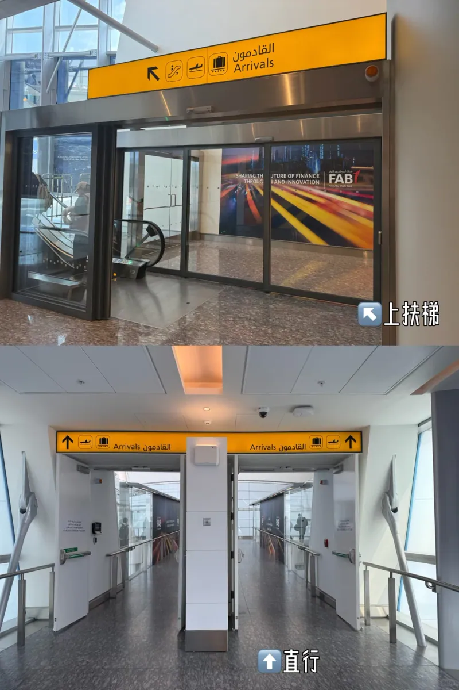
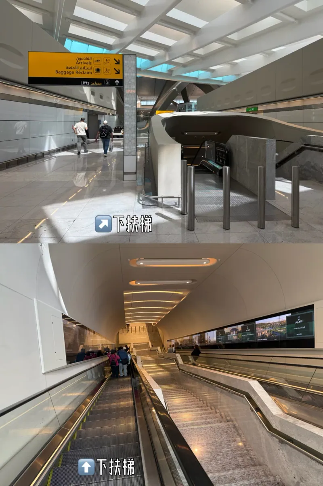

Bandara Internasional Zayed (**AUH**) di Abu Dhabi membuka Terminal A pada akhir 2023, menggabungkan T1, T2, dan T3 lama menjadi satu bangunan berbentuk X. Bagi wisatawan dari Tiongkok, bandara ini adalah gerbang menuju ibu kota Emirat sekaligus batu pijakan menuju Dubai atau Masjid Agung Sheikh Zayed — yang berarti jam pertama setelah mendarat dihabiskan untuk menjawab beberapa pertanyaan yang sama: ke arah mana sekarang, di mana saya menitipkan bagasi, bagaimana cara mendapatkan kartu transportasi, dan dari pintu mana bus Dubai berangkat.

Dibandingkan Dubai, Terminal A adalah bandara yang lebih mudah dilalui dengan berjalan kaki: bangunannya memiliki satu poros, sehingga kedatangan, pengambilan bagasi, dan pintu keluar membentuk garis yang hampir lurus. Bagian sulitnya bukan arah, melainkan pilihan — e-gate atau loket manual, kiri atau kanan di aula kedatangan, kartu Hafilat silver atau hijau. Berikut ini menelusuri seluruh urutan sesuai urutan yang akan Anda temui.

## 1. Setelah mendarat: ikuti tanda kuning

Hal pertama yang Anda lihat di dalam terminal adalah deretan tanda kuning dengan tulisan **Kedatangan (القادمون)** berwarna hitam. Papan petunjuk di Zayed menggunakan bahasa Arab dan Inggris, dan kode warnanya yang memudahkan: kuning untuk kedatangan dan bagasi, biru untuk transfer, hijau untuk pintu keluar. Bahkan tanpa membaca satu kata pun, mengikuti warna akan membawa Anda ke sana.

Terus berjalan lurus di sepanjang koridor berdinding kaca. Tidak ada belokan dan tidak ada people mover di bagian ini — Terminal A mengarahkan penumpang yang datang langsung menuju pemeriksaan paspor, dengan hanya toilet dan ruang menyusui di sisinya.

Lebih jauh, tanda memisahkan **Kedatangan** dari **Transfer**: pelancong yang menuju Abu Dhabi dan mengambil bagasi mengambil sisi kuning, sedangkan mereka yang transit tanpa memasuki negara mengambil sisi biru. Jika boarding pass Anda sudah memuat penerbangan berikutnya dan bagasi Anda diteruskan, ikuti warna biru dan tetap di sisi udara.

Setelah percabangan, Anda turun melalui eskalator, dengan kotak lampu kota besar di kedua sisi. Troli dapat menggunakan lift di sampingnya, jadi tidak perlu memaksakan koper besar ke tangga.

Di bagian bawah, belok kiri sekali dan aula paspor muncul. Papan di sini menambahkan garis hijau kecil untuk **Layanan Visa (خدمات التأشيرات)** — itulah sisi untuk visa saat kedatangan dan masalah visa; kedatangan biasa tetap mengikuti Kedatangan.

## 2. Pemeriksaan paspor: e-gate atau loket

Aula terbagi menjadi dua rute paralel, dan inilah satu keputusan yang layak diambil sebelum Anda bergabung dengan antrean.

- **Lurus ke depan: e-gate.** Pindai paspor Anda, biarkan kamera mencocokkan wajah Anda, dan gerbang terbuka — sekitar sepuluh detik. Cocok untuk pelancong dengan paspor biometrik yang datanya sudah tersimpan.
- **Ke kanan: loket manual.** Pilihan yang tepat ketika mesin tidak dapat membaca Anda, paspor tidak memiliki chip, Anda bepergian dengan anak-anak, atau Anda memerlukan cap. Loket diberi nomor mulai 25 dan layarnya bertuliskan **Paspor Asing**.

Jika ini kunjungan pertama Anda, atau paspornya baru, jangan berdiri di gerbang dan mencoba berulang kali — ambil loket, yang biasanya lebih cepat daripada memecahkan masalah. Petugas jarang meminta lebih dari paspor, sidik jari, dan sekilas pandang ke kamera. Aula ini cukup luas sehingga bahkan beberapa kedatangan pesawat berbadan lebar sekaligus jarang membuat antrean melewati dua puluh menit.

## 3. Bagasi: temukan ban berjalan Anda di layar

Setelah pemeriksaan paspor adalah aula bagasi. Papan mengelompokkan **Pengambilan Bagasi 8–10** dalam satu panel dan menunjuk secara terpisah ke **Bagasi Luar Ukuran** — papan selancar, kereta dorong bayi, dan kotak berukuran besar tidak keluar di ban berjalan biasa dan memiliki mejanya sendiri.

Setiap ban berjalan memiliki layar di atasnya yang menampilkan nomor penerbangan, asal, dan status. Di ban berjalan 7 pada foto, Hainan Airlines **HU433** dari Haikou dan Etihad **EY022** dari Toronto sama-sama membongkar bagasi ke ban berjalan yang sama. Lihatlah ke atas untuk nomor penerbangan Anda daripada mengikuti kerumunan.

Sambil menunggu, selesaikan dua hal: apakah ponsel Anda sudah terhubung ke Wi-Fi bandara gratis (Terminal A meminta nomor ponsel untuk mengirim kode melalui SMS, dan nomor Tiongkok umumnya berfungsi), dan apakah etape berikutnya perjalanan Anda memerlukan tiket yang dibeli terlebih dahulu.

## 4. Pintu keluar: kiri atau kanan

Ikuti tanda hijau **KELUAR (مخرج)** setelah mengambil bagasi; satu set pintu otomatis terbuka ke aula kedatangan. Zayed membagi fungsi aula ke kiri dan kanan, dan mengetahui yang mana yang mana menghemat banyak langkah bolak-balik.

Menghadap pintu keluar:

| Arah | Apa yang ada di sana |
| --- | --- |
| ⬅️ Kiri | Parkir, meja sewa mobil, taksi, barang hilang dan ditemukan, layanan tamu |
| ➡️ Kanan | Penitipan bagasi, bus, loket kartu transportasi, limusin dan transfer bandara |

Di seberang pintu ada deretan pilar pahatan merah dengan tempat duduk kafe; ATM dan penukaran mata uang berada di belakangnya. Papan biru di atas kepala di zona ini mencantumkan parkir, barang hilang dan ditemukan, penitipan bagasi, dan bus dalam sekali pandang, dan kotak lampu **AED Exchange / ATM** adalah tempat paling praktis untuk menarik uang tunai — kurs di bandara biasa saja, jadi ambillah hanya yang Anda perlukan untuk transportasi hari itu.

## 5. Penitipan bagasi: tarif berdasarkan rentang waktu

Jika Anda tidak langsung menuju kota — misalnya ingin ke Masjid Agung dulu, atau akan melanjutkan ke Dubai — bagasi Anda perlu tempat. Penitipan berada di sisi kanan aula kedatangan, bertanda **Excess Baggage Company**, dengan tumpukan templat ukuran kardus di luar (dari AED 20 untuk barang kecil hingga AED 40 untuk barang besar) dan pilar putih bertanda Baggage Storage.

Biayanya dihitung dalam rentang waktu, dengan tarif harian setelah 72 jam. Papan harganya layak difoto:

| Periode penitipan | Harga per barang (AED) |
| --- | --- |
| Hingga 3 jam | 35 |
| Hingga 12 jam | 55 |
| Hingga 24 jam | 75 |
| Hingga 48 jam | 105 |
| Hingga 72 jam | 140 |
| Lebih dari 72 jam | +25 per hari |

Ada diskon untuk jumlah banyak: **diskon 10% mulai 10 barang, 15% mulai 20 barang**. Tarifnya per barang — satu koper atau satu tas — jadi menggabungkan barang sebelum menyerahkannya sepadan dengan usahanya.

## 6. Kartu Hafilat: silver atau hijau

Bus Abu Dhabi menggunakan kartu **Hafilat** dan tidak menerima uang tunai di dalam bus, seperti Dubai yang menggunakan Nol. Meja Integrated Transport Centre (ITC) dan mesin isi ulang swalayan berada di kanan aula kedatangan, jadi dapatkan kartu di bandara daripada mencari gerai di kota.

Dua kartu, dipilih berdasarkan lama tinggal:

| Kartu | Biaya penerbitan | Masa berlaku | Isi ulang minimum | Catatan |
| --- | --- | --- | --- | --- |
| Silver | Gratis | 30 hari | AED 10 | Pilihan default untuk masa tinggal singkat; kartunya sendiri tidak berbiaya |
| Hijau | AED 10 | 16 tahun | AED 10 | Untuk penduduk dan pengunjung berulang; saldo tidak dapat dikembalikan |

Satu peringatan: petugas dapat memotong pajak kecil dari jumlah yang Anda serahkan (pelancong pernah dikenai pajak AED 3 untuk isi ulang AED 30), jadi jangan menghitung saldo sampai tarif terakhir. Kartu silver kedaluwarsa setelah 30 hari bersama saldonya, jadi habiskan saldonya sebelum Anda terbang pulang.

## 7. Bus A10 ke Masjid Agung Sheikh Zayed

Masjid Agung Sheikh Zayed adalah perhentian wajib di Abu Dhabi dan bandara memiliki bus langsung, **A10**, tanpa pergantian. Halte berada di sebelah kanan saat Anda keluar dari **Gerbang 7** di aula kedatangan; layar biru di peron bertuliskan **Halte Bus (محطة الحافلات)**.

Pembatas memisahkan rute-rute dan papan kecil menandai **Area Tunggu Bus**. A10 ke masjid berbagi zona dengan rute kota, jadi bergabunglah dengan antrean yang benar — keberangkatannya tidak sering dan jika terlewat Anda kehilangan setengah jam.

A10 dalam angka:

| Item | Rincian |
| --- | --- |
| Tarif | AED 4, hanya kartu Hafilat — tidak ada uang tunai di dalam bus |
| Waktu perjalanan | Sekitar 45–55 menit |
| Frekuensi | Setiap 30–40 menit |
| Jam operasi | Kira-kira 05.00–23.30 |
| Halte | Masjid Agung Sheikh Zayed |

Halte bukan pintu masuk masjid: jaraknya sekitar 800 m berjalan kaki ke pintu masuk pengunjung. Masuk gratis tetapi perlu pemesanan di situs web resmi; jam buka 09.00–22.00 Sabtu sampai Kamis dan 16.30–22.00 pada Jumat, dengan penutupan selama waktu salat. Kode berpakaian adalah lengan panjang dan celana panjang, dan perempuan perlu syal kepala — membelinya di bandara lebih mudah daripada menyewanya di gerbang.

## 8. Taksi, ride-hailing, dan bus ke Dubai

**Taksi** menjemput di kiri pintu keluar dan menggunakan argo. Bandara ke pusat kota Abu Dhabi (Corniche) sekitar AED 60–80 tergantung jam dan lalu lintas; malam hari dan waktu salat Jumat lebih sedikit mobil.

**Ride-hailing**: **Careem** adalah standar lokal, harganya mendekati taksi tetapi tarifnya dikunci saat pemesanan, sehingga menghilangkan kekhawatiran tentang jalan memutar. Uber juga beroperasi di Abu Dhabi tetapi cakupannya lebih tipis. Titik penjemputan mengikuti aplikasi dan biasanya berada di teluk khusus di luar kedatangan.

**Bus ke Dubai**: meja tiket dan halte khusus berada di kanan aula kedatangan, perjalanan memakan waktu sekitar 1,5 jam, dan keberangkatannya sering — periksa meja untuk jadwal terbaru. Rincian rute itu (tarif, tempat naik, dan cara kembali) memiliki panduannya sendiri, tertaut di bawah.

## 9. Hal-hal kecil yang membantu pada hari pertama

- **Papan petunjuk dua bahasa**: bahasa Arab dan Inggris di seluruh area, dan warna lebih ampuh daripada teks — kuning untuk kedatangan, biru untuk transfer, hijau untuk pintu keluar.
- **Perbedaan waktu**: UEA empat jam di belakang Beijing, jadi atur ponsel Anda ke waktu otomatis dan hindari salah membaca waktu boarding.
- **Colokan**: tiga pin gaya Inggris (tipe G), seperti di Hong Kong; colokan Tiongkok daratan memerlukan adaptor.
- **Pakaian**: terminal ber-AC sangat dingin, jadi bawalah lapisan tipis; masjid meminta sebaliknya, dengan bahu dan lutut tertutup.
- **Air**: ada air mancur minum di aula kedatangan, jadi botol yang dapat digunakan ulang menghemat pembelian air.

Tarif, jam buka, dan lokasi loket berasal dari publikasi bandara dan operator serta catatan penulis sendiri; periksa situs resmi dan meja pada hari keberangkatan.

## Tautan terkait

- **Di situs ini**: [Bandara Internasional Zayed (AUH)](/airport/AUH), [Uni Emirat Arab (AE)](/country/AE), [Panduan bus Abu Dhabi–Dubai](/blog/abu-dhabi-dubai-bus-guide)
- **Wikipedia**: [Bandara Internasional Zayed](https://en.wikipedia.org/wiki/Zayed_International_Airport)
- **Baidu Baike**: [Bandara Internasional Abu Dhabi](https://baike.baidu.com/item/%E9%98%BF%E5%B8%83%E6%89%8E%E6%AF%94%E5%9B%BD%E9%99%85%E6%9C%BA%E5%9C%BA)
- **Situs web bandara**: [Bandara Internasional Zayed](https://www.zayedinternationalairport.ae/)
- **Bus dan kartu transportasi**: [Abu Dhabi Integrated Transport Centre (ITC)](https://www.itc.gov.ae/)

Sumber gambar: foto penulis sendiri. Tarif, harga penitipan, dan frekuensi sesuai yang tertera di meja saat foto diambil dan dapat berubah.
