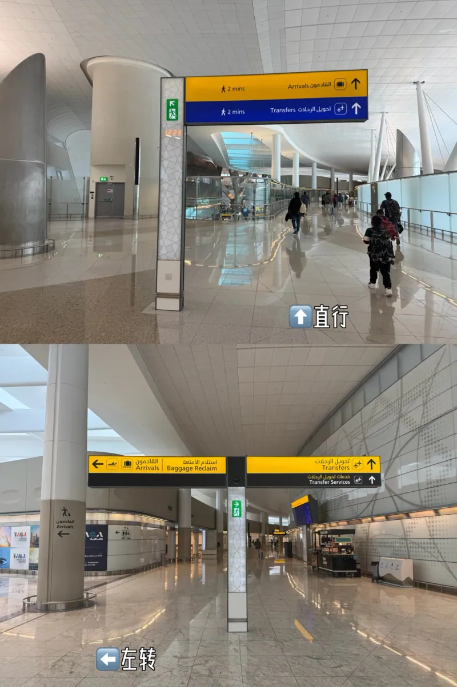

Lotnisko Zayed International (**AUH**) w Abu Zabi otworzyło terminal A pod koniec 2023 r., łącząc stare terminale T1, T2 i T3 w jeden budynek w kształcie litery X. Dla podróżnych z Chin jest jednocześnie bramą do stolicy emiratu i punktem przesiadkowym w drodze do Dubaju lub do Wielkiego Meczetu Szejka Zajida — co oznacza, że pierwsza godzina po wylądowaniu upływa na odpowiadaniu na te same kilka pytań: w którą stronę teraz, gdzie zostawić bagaże, jak zdobyć kartę transportową i z których drzwi odjeżdża autokar do Dubaju.

W porównaniu z Dubajem terminal A jest łatwiejszy do przejścia: budynek ma jedną główną oś, więc przyloty, odbiór bagażu i wyjście tworzą niemal prostą linię. Trudna jest nie nawigacja, lecz wybór — e-gate czy ręczne stanowisko, w lewo czy w prawo w hali przylotów, srebrna czy zielona karta Hafilat. Poniżej przechodzimy przez całą sekwencję w kolejności, w jakiej ją napotkasz.

## 1. Po wylądowaniu: idź za żółtymi znakami

Pierwsze, co widzisz w terminalu, to rząd żółtych znaków z czarnym napisem **Arrivals (القادمون)**. Oznaczenia na lotnisku Zayed są dwujęzyczne — po arabsku i po angielsku — a robotę wykonuje kod kolorów: żółty dla przylotów i bagażu, niebieski dla przesiadek, zielony dla wyjść. Nawet nie czytając ani słowa, kierując się kolorem, dotrzesz na miejsce.

Idź prosto szklanym korytarzem. Na tym odcinku nie ma zakrętu ani ruchomych chodników — terminal A prowadzi przylatujących prosto do kontroli paszportowej, a z boku są tylko toalety i pokój dla matek z dziećmi.

Dalej znaki rozdzielają **Arrivals** i **Transfers**: podróżni jadący do Abu Zabi i odbierający bagaże wybierają żółtą stronę, a przesiadający się bez wjazdu do kraju — niebieską. Jeśli karta pokładowa ma już następny lot, a bagaże są nadane do końca trasy, idź niebieską stroną i pozostań w strefie airside.

Za rozwidleniem zjeżdżasz ruchomymi schodami w dół, po obu stronach wiszą duże podświetlane plansze z miastami. Wózki można przewieźć sąsiednią windą, więc nie trzeba siłować się z dużą walizką na schodach.

Na dole skręć raz w lewo i pojawia się hala kontroli paszportowej. Znaki mają tu dodatkowy zielony pasek **Visa Services (خدمات التأشيرات)** — to strona dla wiz wydawanych na granicy i rozwiązywania problemów z wizami; zwykli przylatujący idą dalej za Arrivals.

## 2. Kontrola paszportowa: e-gate czy stanowisko

Hala dzieli się na dwie równoległe trasy i to jedyna decyzja, którą warto podjąć, zanim staniesz w kolejce.

- **Prosto: e-gate.** Zeskanuj paszport, pozwól kamerze dopasować twarz i bramka się otwiera — w sumie kilkanaście sekund. Rozwiązanie dla podróżnych z paszportem biometrycznym, którego dane są już w systemie.
- **Po prawej: ręczne stanowiska.** Właściwy wybór, gdy automat nie chce cię odczytać, paszport nie ma chipa, podróżujesz z dziećmi albo potrzebujesz stempla. Stanowiska są numerowane od 25 w górę, a na ekranach widnieje **Foreign Passports**.

Jeśli to twoja pierwsza wizyta albo masz nowy paszport, nie stój przy bramce i nie próbuj w kółko — wybierz stanowisko, które zwykle działa szybciej niż szukanie usterki. Funkcjonariusze rzadko proszą o więcej niż paszport, odcisk palca i spojrzenie w kamerę. Hala jest na tyle duża, że nawet kilka przylotów szerokokadłubowych samolotów naraz rzadko wydłuża kolejkę ponad dwadzieścia minut.

## 3. Bagaż: znajdź swoją taśmę na ekranie

Za kontrolą paszportową jest hala odbioru bagażu. Znaki grupują **Baggage Reclaim 8–10** na jednej tablicy i osobno wskazują **Oversize Baggage** — deski surfingowe, wózki dziecięce i wielkie kartony nie wyjeżdżają na zwykłych taśmach, lecz mają własne stanowisko.

Nad każdą taśmą wisi ekran z numerem lotu, miejscem wylotu i statusem. Na taśmie 7 ze zdjęcia Hainan Airlines **HU433** z Haikou i Etihad **EY022** z Toronto wyładowują bagaże na tę samą taśmę. Patrz w górę na swój numer lotu, zamiast iść za tłumem.

Czekając, załatw dwie sprawy: czy telefon połączył się z darmowym Wi-Fi lotniska (terminal A prosi o numer komórki, na który wysyła kod, a chińskie numery zwykle działają) oraz czy na kolejny etap podróży nie trzeba kupić biletu z wyprzedzeniem.

## 4. Wyjście: w lewo czy w prawo

Po odebraniu bagaży idź za zielonymi znakami **EXIT (مخرج)**; jedne automatyczne drzwi prowadzą do hali przylotów. Zayed dzieli funkcje hali na lewą i prawą stronę, a wiedza, co jest gdzie, oszczędza sporo chodzenia w tę i z powrotem.

Stojąc twarzą do wyjścia:

| Kierunek | Co tam jest |
| --- | --- |
| ⬅️ W lewo | Parking, wypożyczalnie samochodów, taksówki, biuro rzeczy znalezionych, obsługa gości |
| ➡️ W prawo | Przechowalnia bagażu, autobusy, stanowiska kart transportowych, limuzyny i transfery lotniskowe |

Naprzeciwko drzwi stoi rząd czerwonych rzeźbiarskich kolumn ze stolikami kawiarnianymi; za nimi znajdują się bankomaty i kantor. Niebieski podwieszony znak w tej strefie wymienia jednym spojrzeniem parking, biuro rzeczy znalezionych, przechowalnię bagażu i autobusy, a podświetlana tablica **AED Exchange / ATM** to najwygodniejsze miejsce na wypłatę gotówki — kursy na lotnisku są zwyczajne, więc weź tylko tyle, ile potrzebujesz na dzisiejszy transport.

## 5. Przechowalnia bagażu: ceny według przedziałów czasowych

Jeśli nie wybierasz się od razu do miasta — powiedzmy, że najpierw chcesz zobaczyć Wielki Meczet albo jedziesz dalej do Dubaju — bagaże muszą gdzieś zamieszkać. Przechowalnia znajduje się po prawej stronie hali przylotów, z oznaczeniem **Excess Baggage Company**, przed nią stoją kartonowe wzorniki rozmiarów (od 20 AED za mały przedmiot do 40 AED za duży) i biały słupek z napisem Baggage Storage.

Opłaty są naliczane w przedziałach czasowych, a po 72 godzinach obowiązuje stawka dzienna. Tablicę warto sfotografować:

| Okres przechowywania | Cena za sztukę (AED) |
| --- | --- |
| Do 3 godzin | 35 |
| Do 12 godzin | 55 |
| Do 24 godzin | 75 |
| Do 48 godzin | 105 |
| Do 72 godzin | 140 |
| Powyżej 72 godzin | +25 za dobę |

Obowiązują rabaty ilościowe: **10% zniżki od 10 sztuk, 15% od 20**. Cena jest za sztukę — jedną walizkę lub jedną torbę — więc warto połączyć bagaże, zanim oddasz je do przechowania.

## 6. Karta Hafilat: srebrna czy zielona

Autobusy w Abu Zabi działają na karcie **Hafilat** i nie przyjmują gotówki w pojeździe, podobnie jak w Dubaju na karcie Nol. Stanowisko Integrated Transport Centre (ITC) i samoobsługowe automaty do doładowań są po prawej stronie hali przylotów, więc zdobądź kartę na lotnisku, zamiast szukać punktu w mieście.

Dwie karty, wybierane według długości pobytu:

| Karta | Opłata za wydanie | Ważność | Minimalne doładowanie | Uwagi |
| --- | --- | --- | --- | --- |
| Srebrna | Bezpłatnie | 30 dni | 10 AED | Domyślna przy krótkim pobycie; sama karta nic nie kosztuje |
| Zielona | 10 AED | 16 lat | 10 AED | Dla mieszkańców i osób wracających; saldo nie podlega zwrotowi |

Jedno ostrzeżenie: personel może pobrać niewielki podatek z kwoty, którą przekazujesz (podróżnym naliczono 3 AED podatku od doładowania 30 AED), więc nie licz salda co do ostatniego przejazdu. Srebrne karty wygasają po 30 dniach, a wraz z nimi saldo, więc wykorzystaj je przed powrotem do domu.

## 7. Autobus A10 do Wielkiego Meczetu Szejka Zajida

Wielki Meczet Szejka Zajida to obowiązkowy punkt w Abu Zabi, a z lotniska jeździ do niego bezpośredni autobus **A10**, bez przesiadek. Przystanek jest po prawej, gdy wyjdziesz z **bramki 7** w hali przylotów; niebieski ekran na peronie głosi **Bus Stops (محطة الحافلات)**.

Barierki oddzielają poszczególne trasy, a mały znak wyznacza **Bus Waiting Area**. A10 do meczetu dzieli strefę z trasami miejskimi, więc ustaw się we właściwej kolejce — odjazdy nie są częste, a spóźnienie kosztuje pół godziny.

A10 w liczbach:

| Pozycja | Szczegóły |
| --- | --- |
| Opłata | 4 AED, tylko karta Hafilat — bez gotówki w pojeździe |
| Czas przejazdu | Około 45–55 minut |
| Częstotliwość | Co 30–40 minut |
| Godziny | Mniej więcej 05:00–23:30 |
| Przystanek | Wielki Meczet Szejka Zajida |

Przystanek to nie wejście do meczetu: do wejścia dla zwiedzających jest około 800 m pieszo. Wstęp jest bezpłatny, ale wymaga rezerwacji na oficjalnej stronie; godziny otwarcia to 09:00–22:00 od soboty do czwartku i 16:30–22:00 w piątek, z przerwami w porze modlitw. Obowiązuje strój z długimi rękawami i spodniami, a kobiety potrzebują chusty na głowę — kupno chusty na lotnisku jest łatwiejsze niż wypożyczenie przy wejściu do meczetu.

## 8. Taksówki, przejazdy przez aplikacje i autokar do Dubaju

**Taksówki** zabierają pasażerów po lewej stronie wyjścia i jeżdżą na liczniku. Przejazd z lotniska do centrum Abu Zabi (Corniche) kosztuje mniej więcej 60–80 AED w zależności od godziny i ruchu; wieczorami i w piątki w porze modlitw samochodów jest mniej.

**Przejazdy przez aplikacje**: **Careem** to lokalny standard, cenowo bliski taksówce, ale z opłatą zablokowaną przy rezerwacji, co usuwa obawę o nadkładanie drogi. Uber też działa w Abu Zabi, ale ma rzadsze pokrycie. Miejsca odbioru wskazuje aplikacja i zwykle są to dedykowane zatoczki przed halą przylotów.

**Autokary do Dubaju**: kasa i dedykowane stanowisko są po prawej stronie hali przylotów, podróż trwa około 1,5 godziny, a odjazdy są częste — aktualny rozkład sprawdź w kasie. Szczegóły tej trasy (opłaty, miejsce wsiadania i jak wrócić) mają osobny przewodnik, podlinkowany poniżej.

## 9. Drobiazgi, które pomagają pierwszego dnia

- **Dwujęzyczne oznaczenia**: wszędzie arabski i angielski, a kolor wygrywa z tekstem — żółty dla przylotów, niebieski dla przesiadek, zielony dla wyjść.
- **Różnica czasu**: ZEA są cztery godziny za Pekinem, więc ustaw w telefonie automatyczną strefę czasową i nie pomyl godziny wejścia na pokład.
- **Gniazdka**: brytyjskie trzybolcowe (typ G), jak w Hongkongu; wtyczki z Chin kontynentalnych wymagają przejściówki.
- **Ubranie**: w terminalu mocno działa klimatyzacja, więc weź lekką warstwę; w meczecie potrzebne jest odwrotnie — zakryte ramiona i kolana.
- **Woda**: w hali przylotów są kraniki z wodą pitną, więc bidon wielorazowy oszczędza kupowanie wody.

Opłaty, godziny otwarcia i lokalizacje stanowisk pochodzą z publikacji lotniska i przewoźników oraz z notatek autora; sprawdź oficjalne strony i stanowiska w dniu podróży.

## Powiązane linki

- **Na tej stronie**: [Zayed International Airport (AUH)](/airport/AUH), [Zjednoczone Emiraty Arabskie (AE)](/country/AE), [Przewodnik po autobusach Abu Zabi–Dubaj](/blog/abu-dhabi-dubai-bus-guide)
- **Wikipedia**: [Zayed International Airport](https://en.wikipedia.org/wiki/Zayed_International_Airport)
- **Baidu Baike**: [Lotnisko międzynarodowe Abu Zabi](https://baike.baidu.com/item/%E9%98%BF%E5%B8%83%E6%89%8E%E6%AF%94%E5%9B%BD%E9%99%85%E6%9C%BA%E5%9C%BA)
- **Strona lotniska**: [Zayed International Airport](https://www.zayedinternationalairport.ae/)
- **Autobusy i karty transportowe**: [Abu Dhabi Integrated Transport Centre (ITC)](https://www.itc.gov.ae/)

Źródło zdjęć: własne fotografie autora. Opłaty, ceny przechowania i częstotliwość są takie, jak podano na stanowiskach w momencie wykonywania zdjęć, i mogą się zmienić.
