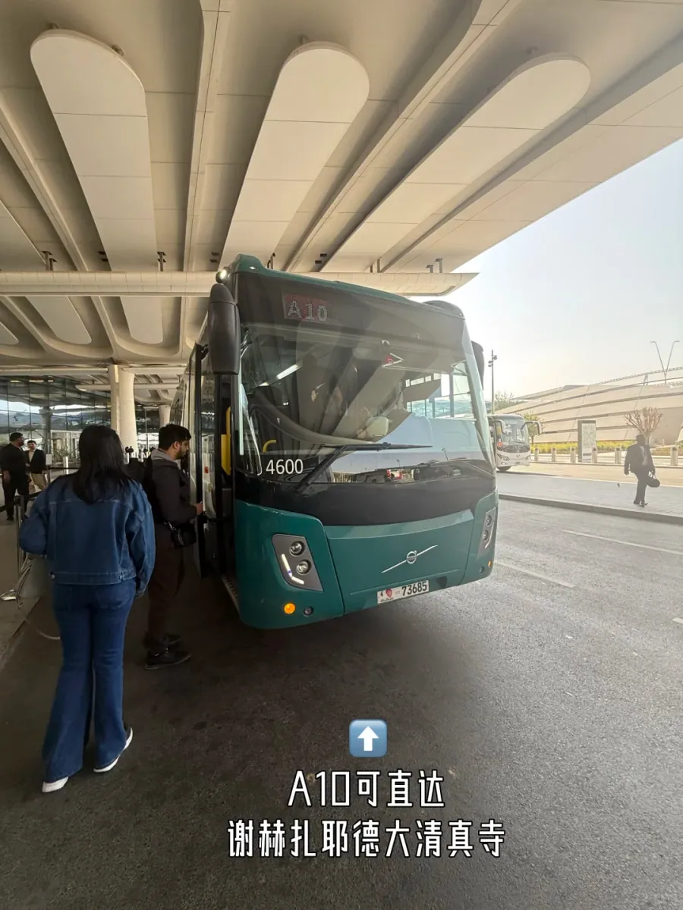

Международный аэропорт Заид (**AUH**) в Абу-Даби открыл терминал A в конце 2023 года, объединив старые T1, T2 и T3 в одно здание X-образной формы. Для путешественников из Китая это одновременно вход в столицу Эмиратов и перевалочный пункт на пути в Дубай или к Большой мечети шейха Заида — поэтому первый час после посадки уходит на ответы на одни и те же вопросы: куда идти, где оставить багаж, как получить транспортную карту и из какой двери отправляется автобус в Дубай.

По сравнению с Дубаем терминал A проще для прогулки: у здания один центральный коридор, поэтому прилёт, выдача багажа и выход выстраиваются почти в прямую линию. Сложность не в направлении, а в выборе — электронные ворота или ручная стойка, налево или направо в зале прилёта, серебряная или зелёная карта Hafilat. Далее весь путь разобран по порядку, в котором вы его пройдёте.

## 1. После посадки: идите по жёлтым указателям

Первое, что вы видите в терминале, — ряд жёлтых указателей с чёрной надписью **Arrivals (القادمون)**. Указатели в Заиде дублируются на арабском и английском, и цветовая кодировка делает работу: жёлтый для прилёта и багажа, синий для трансфера, зелёный для выхода. Даже не читая ни слова, по цвету можно дойти до места.

Идите прямо по коридору со стеклянными стенами. На этом участке нет ни поворотов, ни траволаторов — терминал A направляет прибывающих пассажиров прямо к паспортному контролю, а в стороне остаются только туалеты и комната матери и ребёнка.

Дальше указатели расходятся: **Arrivals** и **Transfers**. Те, кто едет в Абу-Даби и получает багаж, идут по жёлтой стороне; те, кто пересаживается на другой рейс, не входя в страну, — по синей. Если на посадочном талоне уже стоит следующий рейс, а багаж зарегистрирован до конечной точки, следуйте по синему указателю и оставайтесь в стерильной зоне.

После развилки спуститесь на эскалаторе; по обе стороны большие световые панели с видами города. Тележки можно провезти на лифте рядом, так что тащить большой чемодан по ступеням не нужно.

Внизу поверните один раз налево — и появится паспортный зал. Здесь на указателях добавляется зелёная полоска **Visa Services (خدمات التأشيرات)** — это сторона для визы по прибытии и визовых вопросов; обычные пассажиры продолжают идти по Arrivals.

## 2. Паспортный контроль: электронные ворота или стойка

Зал делится на два параллельных маршрута, и это единственное решение, которое стоит принять до того, как встанете в очередь.

- **Прямо: электронные ворота.** Приложите паспорт, дайте камере сопоставить лицо — ворота откроются, всё занимает около десяти секунд. Подходит путешественникам с биометрическим паспортом, данные которого уже внесены в систему.
- **Справа: ручные стойки.** Правильный выбор, если автомат не читает вас, в паспорте нет чипа, вы летите с детьми или нужен штамп. Стойки пронумерованы с 25 и выше, а на экранах написано **Foreign Passports**.

Если вы здесь впервые или паспорт новый, не стойте у ворот и не пытайтесь снова и снова — идите к стойке: обычно это быстрее, чем разбираться с автоматом. Сотрудники редко просят больше паспорта, отпечатка пальца и взгляда в камеру. Зал настолько широкий, что даже несколько широкофюзеляжных рейсов одновременно редко затягивают очередь дольше чем на двадцать минут.

## 3. Багаж: найдите свою ленту на экране

За паспортным контролем начинается багажный зал. Указатели объединяют **Baggage Reclaim 8–10** на одной панели и отдельно ведут к **Oversize Baggage** — сёрфборды, коляски и негабаритные коробки не выдаются на обычных лентах, для них есть отдельная стойка.

Над каждой лентой висит экран с номером рейса, пунктом вылета и статусом. На ленте 7 на фото одновременно разгружаются Hainan Airlines **HU433** из Хайкоу и Etihad **EY022** из Торонто. Смотрите на номер своего рейса, а не идите за толпой.

Пока ждёте, решите два вопроса: подключился ли телефон к бесплатному Wi-Fi аэропорта (в терминале A нужно указать номер мобильного, чтобы получить код по SMS, и китайские номера обычно работают) и нужно ли заранее купить билет на следующий отрезок пути.

## 4. Выход: налево или направо

После получения багажа идите по зелёным указателям **EXIT (مخرج)**; одни автоматические двери ведут в зал прилёта. В Заиде функции зала разделены на левую и правую стороны, и знание, что где находится, избавляет от долгой ходьбы туда и обратно.

Если стоять лицом к выходу:

| Направление | Что там |
| --- | --- |
| ⬅️ Налево | Парковка, стойки проката автомобилей, такси, бюро находок, стойка обслуживания гостей |
| ➡️ Направо | Камера хранения, автобусы, стойки транспортных карт, лимузины и аэропортовые трансферы |

Напротив дверей — ряд красных скульптурных колонн с местами у кафе; за ними банкоматы и обмен валюты. Синий указатель над этим участком сразу перечисляет парковку, бюро находок, камеру хранения и автобусы, а лайтбокс **AED Exchange / ATM** — самое удобное место, чтобы снять наличные: курсы в аэропорту обычные, поэтому берите только то, что нужно на транспорт в этот день.

## 5. Камера хранения: тариф по временным интервалам

Если вы не едете сразу в город — скажем, хотите сначала в Большую мечеть или дальше в Дубай, — багажу нужно где-то остаться. Камера хранения находится справа в зале прилёта, вывеска **Excess Baggage Company**, снаружи лежат картонные шаблоны размеров (от 20 AED за мелкую вещь до 40 AED за крупную) и стоит белая колонна с надписью Baggage Storage.

Плата взимается по временным интервалам, после 72 часов — посуточный тариф. Табло стоит сфотографировать:

| Срок хранения | Цена за единицу (AED) |
| --- | --- |
| До 3 часов | 35 |
| До 12 часов | 55 |
| До 24 часов | 75 |
| До 48 часов | 105 |
| До 72 часов | 140 |
| Свыше 72 часов | +25 в сутки |

Есть скидки за количество: **10% от 10 единиц, 15% от 20**. Цена за единицу — один чемодан или одна сумка, поэтому перед сдачей стоит объединить вещи.

## 6. Карта Hafilat: серебряная или зелёная

Автобусы Абу-Даби работают по карте **Hafilat** и не принимают наличные в салоне — примерно так же, как Дубай работает по Nol. Стойка Integrated Transport Centre (ITC) и автоматы самообслуживания для пополнения находятся справа в зале прилёта, поэтому получите карту в аэропорту, а не ищите точку в городе.

Две карты на выбор, в зависимости от длительности пребывания:

| Карта | Плата за выпуск | Срок действия | Минимальное пополнение | Примечания |
| --- | --- | --- | --- | --- |
| Серебряная | Бесплатно | 30 дней | 10 AED | Стандартный выбор для короткой поездки; сама карта ничего не стоит |
| Зелёная | 10 AED | 16 лет | 10 AED | Для жителей и тех, кто приезжает регулярно; остаток не возвращается |

Одна осторожность: сотрудники могут удержать небольшой налог из суммы, которую вы передаёте (путешественникам начисляли 3 AED налога при пополнении на 30 AED), поэтому не рассчитывайте баланс вплоть до последнего тарифа. Серебряные карты действуют 30 дней, и остаток сгорает вместе с ними, так что потратьте его до отъезда домой.

## 7. Автобус A10 до Большой мечети шейха Заида

Большая мечеть шейха Заида — обязательная остановка в Абу-Даби, и из аэропорта туда идёт прямой автобус **A10** без пересадок. Остановка справа, если выйти из **выхода 7** в зале прилёта; на платформе синий экран с надписью **Bus Stops (محطة الحافلات)**.

Маршруты разделены ограждениями, а небольшая табличка обозначает **Bus Waiting Area**. A10 до мечети делит зону с городскими маршрутами, поэтому вставайте в правильную очередь — рейсы нечастые, и опоздание стоит полчаса.

A10 в цифрах:

| Параметр | Детали |
| --- | --- |
| Тариф | 4 AED, только по карте Hafilat — наличные в салоне не принимают |
| Время в пути | Около 45–55 минут |
| Частота | Каждые 30–40 минут |
| Часы работы | Примерно 05:00–23:30 |
| Остановка | Большая мечеть шейха Заида |

Остановка — не вход в мечеть: до входа для посетителей около 800 м пешком. Вход бесплатный, но нужна бронь на официальном сайте; часы работы — 09:00–22:00 с субботы по четверг и 16:30–22:00 в пятницу, с перерывами во время молитв. Дресс-код — длинные рукава и брюки, женщинам нужен платок; купить его в аэропорту проще, чем брать напрокат у входа.

## 8. Такси, онлайн-такси и автобус до Дубая

**Такси** стоят слева от выхода и работают по счётчику. От аэропорта до центра Абу-Даби (Корниш) — примерно 60–80 AED в зависимости от времени и пробок; вечером и во время пятничной молитвы машин меньше.

**Онлайн-такси**: **Careem** — местный стандарт, цена близка к такси, но фиксируется при заказе, что избавляет от беспокойства о крюках. Uber в Абу-Даби тоже работает, но покрытие слабее. Точки посадки указаны в приложении и обычно находятся на специальных площадках у выхода из терминала.

**Автобусы до Дубая**: билетная касса и отдельная остановка справа в зале прилёта, дорога занимает около 1,5 часа, рейсы частые — уточните актуальное расписание в кассе. Подробности этого маршрута (тарифы, где садиться и как возвращаться) есть в отдельном гиде по ссылке ниже.

## 9. Мелочи, которые помогают в первый день

- **Двуязычные указатели**: арабский и английский по всему терминалу, и цвет важнее текста — жёлтый для прилёта, синий для трансфера, зелёный для выхода.
- **Разница во времени**: ОАЭ на четыре часа позже Пекина, поэтому включите автоматическое время на телефоне, чтобы не перепутать время посадки.
- **Розетки**: британские трёхконтактные (тип G), как в Гонконге; для материковых китайских вилок нужен переходник.
- **Одежда**: в терминале сильно работает кондиционер, поэтому возьмите лёгкий слой; в мечети нужно наоборот — закрытые плечи и колени.
- **Вода**: в зале прилёта есть питьевые фонтанчики, так что многоразовая бутылка избавит от покупки воды.

Тарифы, часы работы и расположение стоек взяты из публикаций аэропорта и операторов, а также из заметок автора; уточняйте на официальных сайтах и на стойках в день поездки.

## Полезные ссылки

- **На этом сайте**: [Международный аэропорт Заид (AUH)](/airport/AUH), [Объединённые Арабские Эмираты (AE)](/country/AE), [Гид по автобусу Абу-Даби — Дубай](/blog/abu-dhabi-dubai-bus-guide)
- **Википедия**: [Zayed International Airport](https://en.wikipedia.org/wiki/Zayed_International_Airport)
- **Baidu Baike**: [Международный аэропорт Абу-Даби](https://baike.baidu.com/item/%E9%98%BF%E5%B8%83%E6%89%8E%E6%AF%94%E5%9B%BD%E9%99%85%E6%9C%BA%E5%9C%BA)
- **Сайт аэропорта**: [Zayed International Airport](https://www.zayedinternationalairport.ae/)
- **Автобусы и транспортные карты**: [Abu Dhabi Integrated Transport Centre (ITC)](https://www.itc.gov.ae/)

Источник изображений: собственные фотографии автора. Тарифы, цены хранения и частота указаны по информации на стойках на момент съёмки и могут измениться.
