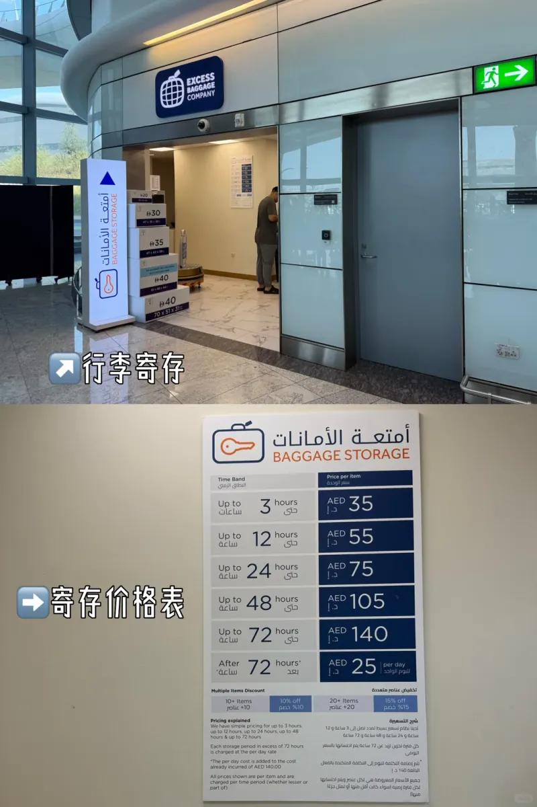

Abu Dhabis Zayed International Airport (**AUH**) öppnade Terminal A i slutet av 2023 och slog samman de gamla terminalerna T1, T2 och T3 till en enda X-formad byggnad. För resenärer från Kina är den både porten till emiratets huvudstad och en språngbräda till Dubai eller Sheikh Zayed-moskén – vilket innebär att den första timmen efter landning går åt till att besvara samma få frågor: vilken väg ska jag ta, var lämnar jag väskorna, hur får jag ett transportkort och från vilken dörr avgår bussen till Dubai.

Jämfört med Dubai är Terminal A den lättare flygplatsen att ta sig igenom: byggnaden har en enda ryggrad, så ankomst, bagageutlämning och utgång bildar en nästan rak linje. Det svåra är inte att hitta utan att välja – e-grindar eller manuell disk, vänster eller höger i ankomsthallen, silver- eller grönt Hafilat-kort. Det följande går igenom hela sekvensen i den ordning du möter den.

## 1. Efter landning: följ de gula skyltarna

Det första du ser inne i terminalen är en rad gula skyltar med **Arrivals (القادمون)** i svart. Skyltningen på Zayed är på arabiska och engelska, och färgkodningen gör jobbet: gult för ankomst och bagage, blått för transfer, grönt för utgångar. Även utan att läsa ett ord tar du dig fram genom att följa färgen.

Håll rak kurs längs den glasbeklädda korridoren. Det finns ingen sväng och ingen rullbana på den här sträckan – Terminal A leder ankommande passagerare rakt mot passkontrollen, med bara toaletter och ett amningsrum vid sidan om.

Längre fram delar skyltarna på **Arrivals** och **Transfers**: resenärer som ska in i Abu Dhabi och hämta bagage tar den gula sidan, medan de som byter utan att resa in i landet tar den blå sidan. Om boardingkortet redan har nästa flight och väskorna är genomcheckade följer du blått och stannar kvar på flygplatssidan.

Efter delningen går du nedför en rulltrappa med stora ljuslådor med stadsmotiv på båda sidor. Bagagevagnar kan använda hissen intill, så det finns ingen anledning att brotta upp en stor väska i trappan.

Nere svänger du vänster en gång och passhallen öppnar sig. Skyltarna här har en liten grön linje för **Visa Services (خدمات التأشيرات)** – det är sidan för visum vid ankomst och visumproblem; vanliga ankomster fortsätter följa Arrivals.

## 2. Passkontroll: e-grindar eller disk

Hallen delar sig i två parallella flöden, och detta är det enda valet som är värt att göra innan du ställer dig i kö.

- **Rakt fram: e-grindarna.** Skanna passet, låt kameran matcha ansiktet och grinden öppnas – tio sekunder eller så. Det passar resenärer med biometriskt pass vars uppgifter redan finns registrerade.
- **Till höger: de manuella diskarna.** Rätt val när maskinen inte läser dig, passet saknar chip, du reser med barn eller behöver en stämpel. Diskarna är numrerade från 25 och uppåt och skärmarna visar **Foreign Passports**.

Om det är ditt första besök, eller passet är nytt, stå inte vid en grind och försök igen och igen – ta disken, som vanligtvis går snabbare än felsökning. Tjänstemännen frågar sällan efter mer än pass, fingeravtryck och en blick i kameran. Hallen är tillräckligt bred för att även flera widebody-plan som anländer samtidigt sällan ska pressa kön över tjugo minuter.

## 3. Bagage: hitta ditt band på skärmen

Bortom passkontrollen ligger bagagehallen. Skyltarna grupperar **Baggage Reclaim 8–10** på en panel och pekar separat mot **Oversize Baggage** – surfbrädor, barnvagnar och överstora lådor kommer inte ut på de vanliga banden och har sin egen disk.

Varje band har en skärm ovanför som visar flightnummer, ursprung och status. På band 7 på bilden lossas både Hainan Airlines **HU433** från Haikou och Etihad **EY022** från Toronto till samma band. Titta upp efter ditt flightnummer i stället för att följa strömmen.

Medan du väntar kan du ordna två saker: om telefonen har anslutit till flygplatsens gratis Wi-Fi (Terminal A begär ett mobilnummer för att skicka en kod, och kinesiska nummer fungerar oftast) och om nästa etapp av resan kräver en biljett som köps i förväg.

## 4. Utgången: vänster eller höger

Följ de gröna skyltarna **EXIT (مخرج)** efter att du hämtat väskorna; en uppsättning automatiska dörrar öppnas mot ankomsthallen. Zayed delar hallens funktioner åt vänster och höger, och att veta vilket som är vilket sparar mycket fram- och tillbakagående.

Vänd mot utgången:

| Riktning | Vad som finns där |
| --- | --- |
| ⬅️ Vänster | Parkering, biluthyrningsdiskar, taxi, hittegods, gästservice |
| ➡️ Höger | Bagageförvaring, bussar, transportkortsdiskar, limousine och flygplatstransfer |

Mittemot dörrarna står en rad röda skulpturala pelare med kafébord; bankomaterna och valutaväxlingen ligger bakom dem. Den blå skylten ovanför i den här zonen listar parkering, hittegods, bagageförvaring och bussar i ett svep, och ljuslådan **AED Exchange / ATM** är det smidigaste stället att ta ut kontanter – kurserna på flygplatsen är ordinära, så ta bara ut vad du behöver för dagens transporter.

## 5. Bagageförvaring: pris efter tidsintervall

Om du inte ska in till staden direkt – säg att du vill se moskén först eller fortsätter till Dubai – behöver väskorna någonstans att bo. Förvaringen ligger på höger sida av ankomsthallen, skyltad **Excess Baggage Company**, med en trave kartongmallar i olika storlekar utanför (från 20 AED för ett litet föremål till 40 AED för ett stort) och en vit pelare märkt Baggage Storage.

Avgifterna går i tidsintervall, med en dagstaxa efter 72 timmar. Tavlan är värd att fotografera:

| Förvaringstid | Pris per föremål (AED) |
| --- | --- |
| Upp till 3 timmar | 35 |
| Upp till 12 timmar | 55 |
| Upp till 24 timmar | 75 |
| Upp till 48 timmar | 105 |
| Upp till 72 timmar | 140 |
| Utöver 72 timmar | +25 per dag |

Det finns rabatter vid volym: **10 % rabatt från 10 föremål, 15 % från 20**. Prissättningen är per föremål – en resväska eller en väska – så det lönar sig att konsolidera innan du lämnar in.

## 6. Hafilat-kortet: silver eller grönt

Abu Dhabis bussar går på **Hafilat**-kortet och tar inga kontanter ombord, ungefär som Dubai går på Nol. Integrated Transport Centre (ITC) har en disk och självbetjäningsautomater för påfyllning till höger i ankomsthallen, så skaffa kortet på flygplatsen i stället för att leta efter ett försäljningsställe i stan.

Två kort, valda efter vistelsens längd:

| Kort | Utfärdandeavgift | Giltighet | Minsta påfyllning | Anmärkningar |
| --- | --- | --- | --- | --- |
| Silver | Gratis | 30 dagar | 10 AED | Standardvalet för kortare vistelse; kortet kostar inget i sig |
| Grönt | 10 AED | 16 år | 10 AED | För boende och återkommande besökare; saldot återbetalas inte |

En varning: personalen kan ta en liten skatt ur beloppet du lämnar över (resenärer har fått 3 AED i skatt på en påfyllning på 30 AED), så räkna inte saldot ned till sista biljettpriset. Silverkort går ut efter 30 dagar, och saldot med dem, så gör av med det innan du flyger hem.

## 7. Buss A10 till Sheikh Zayed-moskén

Sheikh Zayed-moskén är Abu Dhabis självklara stopp och flygplatsen har en direktbuss, **A10**, utan byten. Hållplatsen ligger till höger när du kommer ut genom **Gate 7** i ankomsthallen; en blå skärm på plattformen visar **Bus Stops (محطة الحافلات)**.

Barriärer skiljer linjerna åt och en liten skylt markerar **Bus Waiting Area**. A10 till moskén delar zon med stadslinjerna, så ställ dig i rätt kö – avgångarna är inte täta och en missad buss kostar en halvtimme.

A10 i siffror:

| Post | Detalj |
| --- | --- |
| Pris | 4 AED, endast Hafilat-kort – inga kontanter ombord |
| Restid | Cirka 45–55 minuter |
| Avgångar | Var 30–40:e minut |
| Tider | Ungefär 05:00–23:30 |
| Hållplats | Sheikh Zayed-moskén |

Hållplatsen är inte moskéns entré: det är cirka 800 meter att gå till besökarentrén. Inträdet är gratis men kräver bokning på den officiella webbplatsen; öppettiderna är 09:00–22:00 lördag–torsdag och 16:30–22:00 på fredagar, med stängning under bönestiderna. Klädkoden är långa ärmar och långbyxor, och kvinnor behöver huvudduk – att köpa en på flygplatsen är enklare än att hyra vid grinden.

## 8. Taxi, beställningstaxi och bussen till Dubai

**Taxi** tar upp på vänster sida om utgången och kör på taxameter. Från flygplatsen till centrala Abu Dhabi (Corniche) kostar det ungefär 60–80 AED beroende på tid och trafik; på kvällar och under fredagsböner finns det färre bilar.

**Beställningstaxi**: **Careem** är den lokala standarden, prissatt nära taxi men med priset låst vid bokning, vilket tar bort oron för omvägar. Uber fungerar också i Abu Dhabi men har glesare täckning. Upphämtningsplatserna följer appen och ligger vanligtvis i de särskilda fickorna utanför ankomsten.

**Bussar till Dubai**: biljettdisken och den särskilda hållplatsen ligger till höger i ankomsthallen, resan tar cirka 1,5 timme och avgångarna är täta – kolla disken för aktuell tidtabell. Detaljerna för den sträckan (priser, var du stiger på och hur du tar dig tillbaka) finns i en egen guide, länkad nedan.

## 9. Små saker som hjälper första dagen

- **Tvåspråkig skyltning**: arabiska och engelska rakt igenom, och färg slår text – gult för ankomst, blått för transfer, grönt för utgångar.
- **Tidskillnad**: Förenade Arabemiraten ligger fyra timmar efter Peking, så ställ telefonen på automatisk tid och undvik att läsa av en boardingtid fel.
- **Kontakter**: brittisk trestiftskontakt (typ G), som i Hongkong; kontakter från det kinesiska fastlandet behöver en adapter.
- **Kläder**: terminalen är kraftigt luftkonditionerad, så ta med ett lätt lager; moskén vill det motsatta, med axlar och knän täckta.
- **Vatten**: det finns dricksvattenfontäner i ankomsthallen, så en återanvändbar flaska sparar inköp av vatten.

Priser, öppettider och diskarnas placering kommer från flygplatsens och operatörernas publikationer samt författarens egna anteckningar; kolla de officiella webbplatserna och diskarna samma dag.

## Relaterade länkar

- **På den här sidan**: [Zayed International Airport (AUH)](/airport/AUH), [Förenade Arabemiraten (AE)](/country/AE), [Bussguiden Abu Dhabi–Dubai](/blog/abu-dhabi-dubai-bus-guide)
- **Wikipedia**: [Zayed International Airport](https://en.wikipedia.org/wiki/Zayed_International_Airport)
- **Baidu Baike**: [Abu Dhabi International Airport](https://baike.baidu.com/item/%E9%98%BF%E5%B8%83%E6%89%8E%E6%AF%94%E5%9B%BD%E9%99%85%E6%9C%BA%E5%9C%BA)
- **Flygplatsens webbplats**: [Zayed International Airport](https://www.zayedinternationalairport.ae/)
- **Bussar och transportkort**: [Abu Dhabi Integrated Transport Centre (ITC)](https://www.itc.gov.ae/)

Bildkälla: författarens egna fotografier. Priser, förvaringsavgifter och avgångar gäller enligt vad som angavs vid diskarna när bilderna togs och kan ändras.
