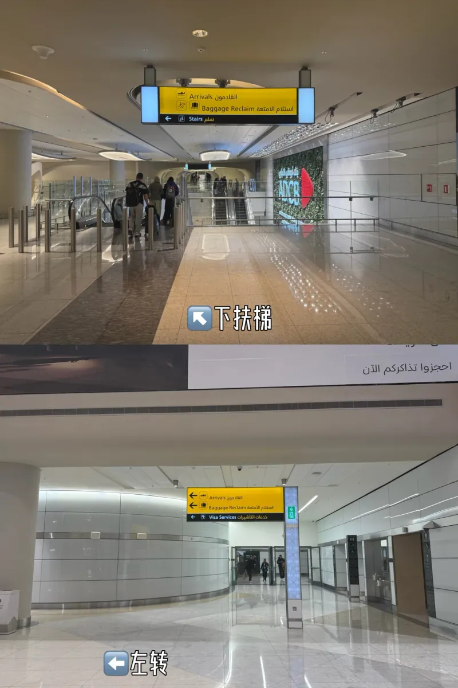

Uwanja wa Ndege wa Kimataifa wa Zayed wa Abu Dhabi (**AUH**) ulifungua Terminal A mwishoni mwa 2023, ukichanganya T1, T2 na T3 za zamani kuwa jengo moja lenye umbo la X. Kwa wasafiri kutoka China ni lango la mji mkuu wa Emirati na pia hatua ya kupita kuelekea Dubai au Msikiti Mkuu wa Sheikh Zayed — ambayo inamaanisha saa ya kwanza baada ya kutua hutumika kujibu maswali yale yale machache: nipite upande gani sasa, niache wapi mizigo yangu, nipateje kadi ya usafiri, na basi la Dubai linaondoka kwenye mlango upi.

Ikilinganishwa na Dubai, Terminal A ni uwanja wa ndege rahisi zaidi kupita ndani yake: jengo lina uti mmoja, kwa hiyo wasili, kuchukua mizigo na kutoka hufanya mstari karibu ulionyooka. Sehemu ngumu si mwelekeo bali chaguo — e-gates au dawati la mikono, kushoto au kulia kwenye ukumbi wa wasili, kadi ya fedha au ya kijani ya Hafilat. Kinachofuata kinapitia mfululizo mzima kwa mpangilio utakaokutana nao.

## 1. Baada ya kutua: fuata alama za njano

Kitu cha kwanza unachokiona ndani ya terminal ni mstari wa alama za njano zenye **Arrivals (القادمون)** kwa rangi nyeusi. Alama za Zayed ni Kiarabu pamoja na Kiingereza, na mpangilio wa rangi hufanya kazi: njano kwa wasili na mizigo, bluu kwa uhamishaji, kijani kwa kutoka. Hata bila kusoma neno lolote, kufuata rangi kunakufikisha.

Endelea moja kwa moja kando ya korido yenye kuta za kioo. Hakuna zamu na hakuna gari la kusogeza watu kwenye sehemu hii — Terminal A inaelekeza abiria wanaowasili moja kwa moja kuelekea udhibiti wa pasipoti, na kuna vyoo na chumba cha kunyonyesha kando pekee.

Mbele zaidi, alama zinagawanya **Arrivals** kutoka **Transfers**: wasafiri wanaokwenda Abu Dhabi na kuchukua mizigo wanachukua upande wa njano, wakati wanaounganisha bila kuingia nchini wanachukua upande wa bluu. Ikiwa pasi yako ya kupanda ina tayari ndege inayofuata na mizigo yako imesafirishwa moja kwa moja, fuata bluu na ubaki ndani ya eneo la ndege.

Baada ya mgawanyo unashuka kwa eskaleta, na vibao vikubwa vya miji pande zote mbili. Mikokoteni inaweza kutumia lifti iliyo kando, kwa hiyo hakuna haja ya kushindana kubeba sanduku kubwa juu ya hatua.

Chini, pinda kushoto mara moja na ukumbi wa pasipoti unaonekana. Alama hapa zinaongeza mstari mdogo wa kijani kwa **Visa Services (خدمات التأشيرات)** — huo ni upande wa visa ya kuwasili na matatizo ya visa; wasili wa kawaida wanaendelea kufuata Arrivals.

## 2. Udhibiti wa pasipoti: e-gates au dawati

Ukumbi unagawanyika katika njia mbili zinazofanana, na huu ndio uamuzi mmoja unaofaa kufanywa kabla ya kujiunga na foleni.

- **Mbele moja kwa moja: e-gates.** Skani pasipoti yako, acha kamera ilinganishe uso wako, na lango linafunguka — sekunde kama kumi kwa jumla. Inafaa wasafiri wenye pasipoti ya kibayometriki ambayo taarifa zake ziko tayari kwenye mfumo.
- **Kulia: madawati ya mikono.** Chaguo sahihi wakati mashine haikusomi, pasipoti haina chip, unasafiri na watoto, au unahitaji muhuri. Madawati yamehesabiwa kuanzia 25 kuelekea juu na skrini zinaonyesha **Foreign Passports**.

Ikiwa ni ziara yako ya kwanza, au pasipoti ni mpya, usisimame kwenye lango ukijaribu mara kwa mara — chukua dawati, ambalo kwa kawaida ni haraka kuliko kutatua tatizo. Maafisa mara chache huuliza zaidi ya pasipoti, alama ya kidole na mtazamo wa kamera. Ukumbi ni mpana kiasi kwamba hata ndege kadhaa kubwa zikiwasili kwa wakati mmoja mara chache husukuma foleni kupita dakika ishirini.

## 3. Mizigo: pata mkanda wako kwenye skrini

Baada ya udhibiti wa pasipoti ni ukumbi wa mizigo. Alama zinaweka **Baggage Reclaim 8–10** kwenye paneli moja na zinaelekeza kando kwenye **Oversize Baggage** — bodi za kuteleza kwenye mawimbi, viti vya watoto na masanduku makubwa kupita kiasi hazitoki kwenye mikanda ya kawaida na zina dawati lao.

Kila mkanda una skrini juu yake inayoonyesha nambari ya ndege, mahali ilipotoka na hali. Kwenye mkanda 7 kwenye picha, Hainan Airlines **HU433** kutoka Haikou na Etihad **EY022** kutoka Toronto zote zinashusha mizigo kwenye mkanda mmoja. Tazama juu kwa nambari ya ndege yako badala ya kufuata umati.

Unaposubiri, maliza mambo mawili: kama simu yako imeunganishwa kwenye Wi-Fi ya bure ya uwanja wa ndege (Terminal A inaomba nambari ya simu ili kutuma msimbo kwa SMS, na nambari za China kwa ujumla zinafanya kazi), na kama sehemu inayofuata ya safari yako inahitaji tiketi kununuliwa mapema.

## 4. Kutoka: kushoto au kulia

Fuata alama za kijani za **EXIT (مخرج)** baada ya kuchukua mizigo yako; mlango mmoja wa kiotomatiki unafungukia ukumbi wa wasili. Zayed inagawanya kazi za ukumbi kushoto na kulia, na kujua ipi ni ipi kunaokoa matembezi mengi ya kwenda na kurudi.

Ukiangalia upande wa kutoka:

| Mwelekeo | Kilicho hapo |
| --- | --- |
| ⬅️ Kushoto | Maegesho, madawati ya kukodisha magari, teksi, ofisi ya vitu vilivyopotea, huduma za wageni |
| ➡️ Kulia | Uhifadhi wa mizigo, mabasi, madawati ya kadi za usafiri, limousine na usafiri wa uwanja wa ndege |

Kinyume na milango kuna mstari wa nguzo nyekundu za sanamu zenye viti vya café; ATM na kubadilisha fedha ziko nyuma yao. Alama ya bluu ya juu kwenye eneo hili inaorodhesha maegesho, vitu vilivyopotea, uhifadhi wa mizigo na mabasi kwa mtazamo mmoja, na bango la mwanga la **AED Exchange / ATM** ndiyo mahali pazuri zaidi pa kutoa pesa taslimu — viwango vya uwanja wa ndege ni vya kawaida, kwa hiyo chukua tu kile unachohitaji kwa usafiri wa siku hiyo.

## 5. Uhifadhi wa mizigo: bei kwa muda

Ikiwa huna kwenda jijini moja kwa moja — tuseme unataka Msikiti Mkuu kwanza, au unaenda Dubai — mizigo yako inahitaji mahali pa kukaa. Uhifadhi uko upande wa kulia wa ukumbi wa wasili, ukiwa na alama ya **Excess Baggage Company**, na rundo la violezo vya ukubwa vya kadibodi nje (kuanzia AED 20 kwa kitu kidogo hadi AED 40 kwa kikubwa) na nguzo nyeupe yenye alama ya Baggage Storage.

Gharama zinaendana na muda, na kiwango cha kila siku baada ya saa 72. Ubao unafaa kupigwa picha:

| Muda wa kuhifadhi | Bei kwa kitu (AED) |
| --- | --- |
| Hadi saa 3 | 35 |
| Hadi saa 12 | 55 |
| Hadi saa 24 | 75 |
| Hadi saa 48 | 105 |
| Hadi saa 72 | 140 |
| Zaidi ya saa 72 | +25 kwa siku |

Kuna punguzo kwa wingi: **punguzo la 10% kuanzia vitu 10, 15% kuanzia 20**. Bei ni kwa kitu kimoja — sanduku moja au begi moja — kwa hiyo kuunganisha vitu kabla ya kuvikabidhi kunafaa juhudi.

## 6. Kadi ya Hafilat: fedha au kijani

Mabasi ya Abu Dhabi yanatumia kadi ya **Hafilat** na hayapokei pesa taslimu ndani, kama vile Dubai inavyotumia Nol. Dawati la Integrated Transport Centre (ITC) na mashine za kujiongezea salio za kujihudumia ziko upande wa kulia wa ukumbi wa wasili, kwa hiyo pata kadi uwanja wa ndege badala ya kutafuta kituo mjini.

Kadi mbili, zinazochaguliwa kwa urefu wa kukaa:

| Kadi | Ada ya kutoa | Uhalali | Ongezo la chini | Maelezo |
| --- | --- | --- | --- | --- |
| Fedha | Bure | Siku 30 | AED 10 | Chaguo la kawaida kwa kukaa muda mfupi; kadi yenyewe haigharimu kitu |
| Kijani | AED 10 | Miaka 16 | AED 10 | Kwa wakazi na wageni wanaorudi; salio halirejeshwi |

Tahadhari moja: wafanyakazi wanaweza kukata kodi ndogo kutoka kiasi unachokabidhi (wasafiri wametozwa kodi ya AED 3 kwa ongezo la AED 30), kwa hiyo usihesabu salio hadi nauli ya mwisho. Kadi za fedha zinaisha baada ya siku 30 na salio pamoja nazo, kwa hiyo litumie kabla ya kuruka nyumbani.

## 7. Basi la A10 hadi Msikiti Mkuu wa Sheikh Zayed

Msikiti Mkuu wa Sheikh Zayed ni kituo cha lazima cha Abu Dhabi na uwanja wa ndege una basi la moja kwa moja, **A10**, bila kubadilisha. Kituo kiko kulia unapotoka **Gate 7** kwenye ukumbi wa wasili; skrini ya bluu kwenye jukwaa inaonyesha **Bus Stops (محطة الحافلات)**.

Vizuizi hutenganisha njia na alama ndogo inaonyesha **Bus Waiting Area**. A10 ya kwenda msikitini inashiriki eneo na njia za jiji, kwa hiyo jiunge na foleni sahihi — kuondoka si mara kwa mara na kukosa moja hugharimu nusu saa.

A10 kwa nambari:

| Kipengele | Maelezo |
| --- | --- |
| Nauli | AED 4, kadi ya Hafilat pekee — hakuna pesa taslimu ndani |
| Muda wa safari | Takriban dakika 45–55 |
| Mzunguko | Kila dakika 30–40 |
| Saa | Takriban 05:00–23:30 |
| Kituo | Sheikh Zayed Grand Mosque |

Kituo si lango la msikiti: ni matembezi ya takriban mita 800 hadi lango la wageni. Kuingia ni bure lakini kunahitaji kuweka nafasi kwenye tovuti rasmi; saa za kufungua ni 09:00–22:00 Jumamosi hadi Alhamisi na 16:30–22:00 Ijumaa, na hufungwa wakati wa sala. Mavazi yanayotakiwa ni mikono mirefu na suruali, na wanawake wanahitaji kitambaa cha kichwa — kununua kimoja uwanja wa ndege ni rahisi kuliko kukodisha langoni.

## 8. Teksi, kuagiza usafiri kwa programu na basi la kwenda Dubai

**Teksi** zinachukua abiria upande wa kushoto wa kutoka na zinafanya kazi kwa mita. Kutoka uwanja wa ndege hadi katikati ya Abu Dhabi (Corniche) ni takriban AED 60–80 kulingana na saa na msongamano; jioni na nyakati za sala za Ijumaa kuna magari machache.

**Kuagiza usafiri kwa programu**: **Careem** ndiyo kiwango cha kawaida cha hapa, bei inakaribia teksi lakini nauli inafungwa wakati wa kuweka nafasi, jambo linaloondoa wasiwasi wowote kuhusu kuzunguka njia ndefu. Uber inafanya kazi Abu Dhabi pia lakini ina wigo mdogo. Maeneo ya kuchukua abiria hufuata programu na kwa kawaida yako kwenye maeneo maalum nje ya wasili.

**Mabasi ya kwenda Dubai**: dawati la tiketi na kituo maalum viko upande wa kulia wa ukumbi wa wasili, safari inachukua takriban saa 1.5, na kuondoka ni mara kwa mara — angalia dawati kwa ratiba ya sasa. Maelezo ya njia hiyo (nauli, wapi kupanda, na jinsi ya kurudi) yana mwongozo wake, uliounganishwa chini.

## 9. Mambo madogo yanayosaidia siku ya kwanza

- **Alama za lugha mbili**: Kiarabu na Kiingereza kote, na rangi inashinda maandishi — njano kwa wasili, bluu kwa uhamishaji, kijani kwa kutoka.
- **Tofauti ya saa**: UAE iko saa nne nyuma ya Beijing, kwa hiyo weka simu yako kwenye muda wa kiotomatiki na uepuke kukosea kusoma muda wa kupanda.
- **Plagi**: za mtindo wa Uingereza zenye pini tatu (type G), kama Hong Kong; plagi za China bara zinahitaji adapter.
- **Mavazi**: terminal ina kiyoyozi kikubwa, kwa hiyo beba koti jepesi; msikiti unataka kinyume chake, mabega na magoti yafunikwe.
- **Maji**: kuna visima vya maji ya kunywa kwenye ukumbi wa wasili, kwa hiyo chupa inayotumika tena inaokoa kununua maji.

Nauli, saa za kufungua na maeneo ya madawati yanatoka kwenye machapisho ya uwanja wa ndege na waendeshaji pamoja na maelezo ya mwandishi mwenyewe; angalia tovuti rasmi na madawati siku hiyo.

## Viungo vinavyohusiana

- **Kwenye tovuti hii**: [Zayed International Airport (AUH)](/airport/AUH), [United Arab Emirates (AE)](/country/AE), [Mwongozo wa basi la Abu Dhabi–Dubai](/blog/abu-dhabi-dubai-bus-guide)
- **Wikipedia**: [Zayed International Airport](https://en.wikipedia.org/wiki/Zayed_International_Airport)
- **Baidu Baike**: [Abu Dhabi International Airport](https://baike.baidu.com/item/%E9%98%BF%E5%B8%83%E6%89%8E%E6%AF%94%E5%9B%BD%E9%99%85%E6%9C%BA%E5%9C%BA)
- **Tovuti ya uwanja wa ndege**: [Zayed International Airport](https://www.zayedinternationalairport.ae/)
- **Mabasi na kadi za usafiri**: [Abu Dhabi Integrated Transport Centre (ITC)](https://www.itc.gov.ae/)

Chanzo cha picha: picha za mwandishi mwenyewe. Nauli, bei za uhifadhi na mzunguko ni kama zilivyoandikwa kwenye madawati wakati picha zilipigwa na zinaweza kubadilika.
