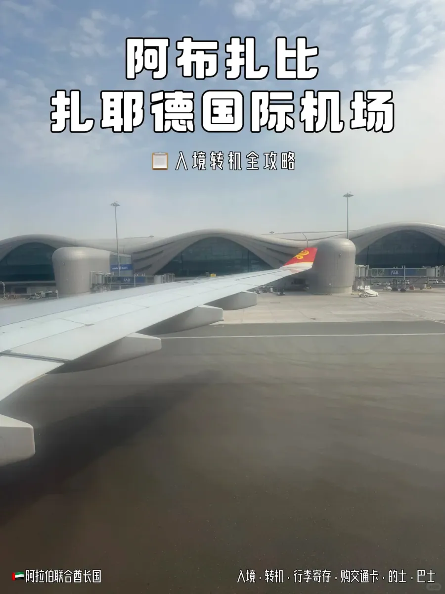

Abu Dabi'nin Zayed Uluslararası Havalimanı (**AUH**), 2023 sonunda Terminal A'yı açarak eski T1, T2 ve T3'ü X biçimli tek bir binada birleştirdi. Çin'den gelen yolcular için burası hem BAE başkentine açılan kapı hem de Dubai'ye veya Şeyh Zayid Ulu Camii'ne atılan bir adım — bu da inişten sonraki ilk saatin aynı birkaç soruya yanıt aramakla geçmesi anlamına geliyor: şimdi hangi yöne, bavullarımı nereye bırakabilirim, ulaşım kartını nasıl alırım ve Dubai otobüsü hangi kapıdan kalkıyor.

Dubai'ye kıyasla Terminal A'da yürümek daha kolay: binanın tek bir omurgası var, dolayısıyla varış, bagaj alım ve çıkış neredeyse düz bir çizgi oluşturuyor. Zor olan yön değil, seçim — e-kapılar mı manuel gişe mi, varış salonunda sola mı sağa mı, gümüş mü yeşil Hafilat kartı mı. Aşağıda tüm sıralama, karşınıza çıkacağı düzende anlatılıyor.

## 1. İnişten sonra: sarı tabelaları izleyin

Terminalin içinde ilk gördüğünüz şey, siyah harflerle **Arrivals (القادمون)** yazan bir sıra sarı tabela olacak. Zayed'de tabelalar Arapça ve İngilizce; renk kodlaması işi yapıyor: varış ve bagaj için sarı, aktarmalar için mavi, çıkışlar için yeşil. Tek kelime okumasanız bile rengi izlemek sizi oraya götürür.

Cam duvarlı koridor boyunca düz devam edin. Bu bölümde ne dönüş ne de yürüyen bant var — Terminal A gelen yolcuları doğrudan pasaport kontrolüne yönlendiriyor; yalnızca yanda tuvaletler ve emzirme odası var.

İleride tabelalar **Arrivals** ile **Transfers** olarak ayrılıyor: Abu Dabi'ye giren ve bavullarını alan yolcular sarı tarafı, ülkeye girmeden aktarma yapanlar mavi tarafı kullanıyor. Biniş kartınızda sonraki uçuş zaten varsa ve bavullarınız aktarmalı gönderildiyse maviyi izleyin ve hava tarafında kalın.

Ayrımdan sonra, iki yanında büyük şehir reklam panoları olan bir yürüyen merdivenden iniyorsunuz. Arabalar yandaki asansörü kullanabilir, büyük bir valizi basamaklara taşımak zorunda değilsiniz.

Alt katta bir kez sola dönün, pasaport salonu karşınızda. Buradaki tabelalara **Visa Services (خدمات التأشيرات)** için küçük bir yeşil çizgi eklenmiş — burası kapıda vize ve vize sorunları için ayrılan taraf; normal gelen yolcular Arrivals'ı izlemeye devam ediyor.

## 2. Pasaport kontrolü: e-kapılar veya gişe

Salon iki paralel güzergâha ayrılıyor ve kuyruğa girmeden önce verilmesi gereken tek karar bu.

- **Düz ileride: e-kapılar.** Pasaportunuzu okutun, kameranın yüzünüzü eşleştirmesine izin verin ve kapı açılsın — toplamda on küsur saniye. Biyometrik pasaportu olan ve bilgileri sistemde kayıtlı yolcular için uygun.
- **Sağda: manuel gişeler.** Makine sizi okuyamadığında, pasaportta çip yoksa, çocuklarla seyahat ediyorsanız veya damga gerekiyorsa doğru seçim. Gişeler 25'ten başlayarak numaralanmış ve ekranlarda **Foreign Passports** yazıyor.

İlk ziyaretinizse veya pasaport yeniyse, bir kapıda tekrar tekrar denemek yerine gişeye gidin; bu genellikle sorun gidermekten daha hızlı. Görevliler nadiren pasaport, parmak izi ve kameraya bir bakıştan fazlasını ister. Salon o kadar geniş ki aynı anda birkaç geniş gövdeli uçak inse bile kuyruk nadiren yirmi dakikayı geçiyor.

## 3. Bagaj: bandınızı ekranda bulun

Pasaport kontrolünün ardından bagaj salonu geliyor. Tabelalar **Baggage Reclaim 8–10**'u tek panelde topluyor ve ayrıca **Oversize Baggage** yönünü gösteriyor — sörf tahtaları, bebek arabaları ve büyük kutular normal bantlardan çıkmıyor, kendi gişeleri var.

Her bandın üstünde uçuş numarası, kalkış yeri ve durumu gösteren bir ekran var. Fotoğraftaki 7 numaralı bantta Hainan Airlines'ın Haikou'dan gelen **HU433** uçuşu ile Etihad'ın Toronto'dan gelen **EY022** uçuşu aynı banda boşaltılıyor. Kalabalığı takip etmek yerine uçuş numaranız için yukarı bakın.

Beklerken iki şeyi halledin: telefonunuz ücretsiz havalimanı Wi-Fi'sine bağlanmış mı (Terminal A kod göndermek için cep telefonu numarası istiyor ve Çin numaraları genellikle çalışıyor) ve yolculuğunuzun sonraki bacağı için önceden alınmış bir bilet gerekiyor mu.

## 4. Çıkış: sola veya sağa

Bavullarınızı aldıktan sonra yeşil **EXIT (مخرج)** tabelalarını izleyin; bir dizi otomatik kapı varış salonuna açılıyor. Zayed salonun işlevlerini sola ve sağa ayırıyor; hangisinin ne olduğunu bilmek gereksiz gidip gelmeleri önlüyor.

Çıkışa dönük olarak:

| Yön | Neler var |
| --- | --- |
| ⬅️ Sol | Otopark, araç kiralama gişeleri, taksiler, kayıp eşya, misafir hizmetleri |
| ➡️ Sağ | Bagaj emaneti, otobüsler, ulaşım kartı gişeleri, limuzin ve havalimanı transferleri |

Kapıların karşısında kafe oturma alanı olan bir sıra kırmızı heykelsi sütun var; ATM'ler ve döviz bürosu bunların arkasında. Bu bölgedeki mavi asma tabela otopark, kayıp eşya, bagaj emaneti ve otobüsleri tek bakışta listeliyor; **AED Exchange / ATM** reklam panosu nakit çekmek için en elverişli yer — havalimanındaki kurlar olağan, bu yüzden yalnızca günün ulaşımı için gereken kadar çekin.

## 5. Bagaj emaneti: zaman dilimlerine göre fiyat

Hemen şehre gitmeyecekseniz — örneğin önce Ulu Camii'yi görmek istiyorsanız veya Dubai'ye devam edecekseniz — bavullarınızın kalacak bir yere ihtiyacı var. Emanet, varış salonunun sağ tarafında, **Excess Baggage Company** tabelasıyla; dışarıda bir yığın karton boyut şablonu (küçük bir eşya için 20 AED'den büyük bir eşya için 40 AED'ye kadar) ve üzerinde Baggage Storage yazan beyaz bir sütun var.

Ücretler zaman dilimlerine göre ve 72 saatten sonra günlük tarife uygulanıyor. Panonun fotoğrafını çekmeye değer:

| Depolama süresi | Eşya başına fiyat (AED) |
| --- | --- |
| 3 saate kadar | 35 |
| 12 saate kadar | 55 |
| 24 saate kadar | 75 |
| 48 saate kadar | 105 |
| 72 saate kadar | 140 |
| 72 saatten fazla | Günlük +25 |

Adede göre indirim var: **10 adetten itibaren %10, 20 adetten itibaren %15**. Fiyatlandırma eşya başına — bir valiz veya bir çanta — bu yüzden eşyaları teslim etmeden önce birleştirmek zahmete değer.

## 6. Hafilat kartı: gümüş veya yeşil

Abu Dabi otobüsleri **Hafilat** kartıyla çalışıyor ve Dubai'nin Nol'u gibi araçta nakit kabul etmiyor. Entegre Ulaşım Merkezi (ITC) gişesi ve self-servis yükleme makineleri varış salonunun sağında; kartı şehirde bir satış noktası aramak yerine havalimanında alın.

Kalış süresine göre seçilen iki kart:

| Kart | Düzenleme ücreti | Geçerlilik | Asgari yükleme | Notlar |
| --- | --- | --- | --- | --- |
| Gümüş | Ücretsiz | 30 gün | 10 AED | Kısa konaklamaların varsayılanı; kartın kendisi ücretsiz |
| Yeşil | 10 AED | 16 yıl | 10 AED | Oturanlar ve sık gelen ziyaretçiler için; bakiye iade edilmez |

Bir uyarı: görevliler verdikleri tutardan küçük bir vergi kesebilir (yolculardan 30 AED'lik yüklemede 3 AED vergi alınmış), bu yüzden bakiyeyi son ücrete kadar hesaplamayın. Gümüş kartlar 30 gün sonra bakiyeleriyle birlikte sona eriyor, eve uçmadan önce harcayın.

## 7. Şeyh Zayid Ulu Camii'ne A10 otobüsü

Şeyh Zayid Ulu Camii Abu Dabi'nin vazgeçilmez durağı ve havalimanından aktarmasız doğrudan bir otobüs var: **A10**. Durak, varış salonundaki **Kapı 7**'den çıkınca sağda; perondaki mavi bir ekranda **Bus Stops (محطة الحافلات)** yazıyor.

Bariyerler güzergâhları ayırıyor ve küçük bir tabela **Bus Waiting Area**'yı gösteriyor. Camiye giden A10 şehir içi hatlarla aynı bölgeyi paylaşıyor, doğru kuyruğa girin — kalkışlar sık değil ve kaçırmak yarım saate mal oluyor.

A10 rakamlarla:

| Kalem | Ayrıntı |
| --- | --- |
| Ücret | 4 AED, yalnızca Hafilat kartı — araçta nakit yok |
| Yolculuk süresi | Yaklaşık 45–55 dakika |
| Sıklık | 30–40 dakikada bir |
| Saatler | Kabaca 05.00–23.30 |
| Durak | Şeyh Zayid Ulu Camii |

Durak caminin girişi değil: ziyaretçi girişine yaklaşık 800 m yürüyüş var. Giriş ücretsiz ama resmî web sitesinden rezervasyon gerekiyor; açılış saatleri cumartesiden perşembeye 09.00–22.00, cuma 16.30–22.00 ve namaz vakitlerinde kapalı. Kıyafet kuralı uzun kollu ve pantolon; kadınların başörtüsü olmalı — havalimanında almak kapıda kiralamaktan daha kolay.

## 8. Taksiler, uygulama çağrıları ve Dubai'ye otobüs

**Taksiler** çıkışın solunda yolcu alıyor ve taksimetreyle çalışıyor. Havalimanından Abu Dabi merkezine (Corniche) saat ve trafiğe göre kabaca 60–80 AED; akşamları ve cuma namazı vakitlerinde daha az araç oluyor.

**Uygulama üzerinden çağırma**: yerel standart **Careem**, fiyatı taksiye yakın ama ücret rezervasyon anında sabitlendiği için güzergâh uzatma endişesi kalmıyor. Uber de Abu Dabi'de çalışıyor ancak kapsama alanı daha dar. Alış noktaları uygulamayı takip ediyor ve genellikle varış dışındaki ayrılmış ceplerde.

**Dubai'ye otobüsler**: bilet gişesi ve ayrılmış peron varış salonunun sağında, yolculuk yaklaşık 1,5 saat sürüyor ve kalkışlar sık — güncel tarife için gişeye bakın. Bu güzergâhın ayrıntıları (ücretler, nereden binileceği ve nasıl dönüleceği) aşağıda bağlantısı verilen ayrı rehberde.

## 9. İlk gün işinize yarayacak küçük şeyler

- **İki dilli tabelalar**: baştan sona Arapça ve İngilizce; renk metinden daha etkili — varışlar sarı, aktarmalar mavi, çıkışlar yeşil.
- **Saat farkı**: BAE Pekin'in dört saat gerisinde, bu yüzden telefonunuzu otomatik saate alın ve biniş saatini yanlış okumaktan kaçının.
- **Prizler**: Hong Kong'daki gibi İngiliz tipi üç uçlu (tip G); anakara Çin fişleri için adaptör gerekiyor.
- **Kıyafet**: terminalde klima yoğun, yanınıza ince bir kat alın; cami ise tam tersini istiyor, omuzlar ve dizler kapalı olmalı.
- **Su**: varış salonunda içme suyu çeşmeleri var, yeniden doldurulabilir bir şişe su almanızı önler.

Ücretler, açılış saatleri ve gişe konumları havalimanı ve işletme yayınları ile yazarın kendi notlarından alınmıştır; resmî siteleri ve gün içinde gişeleri kontrol edin.

## İlgili bağlantılar

- **Bu sitede**: [Zayed Uluslararası Havalimanı (AUH)](/airport/AUH), [Birleşik Arap Emirlikleri (AE)](/country/AE), [Abu Dabi–Dubai otobüs rehberi](/blog/abu-dhabi-dubai-bus-guide)
- **Wikipedia**: [Zayed Uluslararası Havalimanı](https://en.wikipedia.org/wiki/Zayed_International_Airport)
- **Baidu Baike**: [Abu Dabi Uluslararası Havalimanı](https://baike.baidu.com/item/%E9%98%BF%E5%B8%83%E6%89%8E%E6%AF%94%E5%9B%BD%E9%99%85%E6%9C%BA%E5%9C%BA)
- **Havalimanı web sitesi**: [Zayed Uluslararası Havalimanı](https://www.zayedinternationalairport.ae/)
- **Otobüsler ve ulaşım kartları**: [Abu Dabi Entegre Ulaşım Merkezi (ITC)](https://www.itc.gov.ae/)

Görsel kaynağı: yazarın kendi fotoğrafları. Ücretler, depolama fiyatları ve sıklıklar fotoğraflar çekildiğinde gişelerde ilan edildiği gibidir ve değişebilir.
