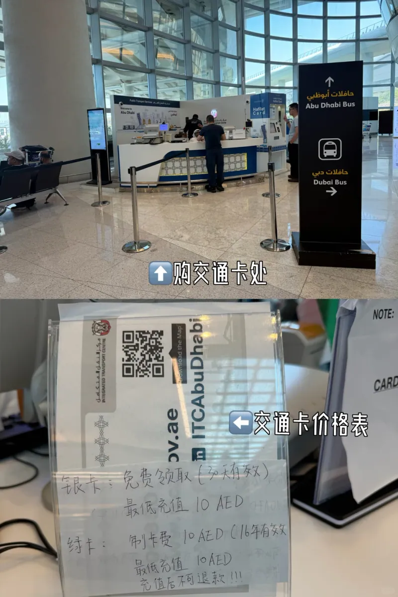

Міжнародний аеропорт Заїд (**AUH**) в Абу-Дабі відкрив Термінал A наприкінці 2023 року, об'єднавши старі T1, T2 і T3 в одну будівлю у формі літери X. Для мандрівників із Китаю це водночас ворота до столиці еміратів і проміжна точка на шляху до Дубая чи Великої мечеті шейха Заїда, а отже, перша година після прильоту минає в пошуках відповідей на ті самі кілька запитань: куди тепер іти, де залишити валізи, як отримати транспортну картку й від яких дверей вирушає автобус до Дубая.

Порівняно з Дубаєм Терміналом A ходити простіше: у будівлі одна вісь, тож прибуття, видача багажу й вихід утворюють майже пряму лінію. Складнощі не в орієнтуванні, а у виборі — електронні ворота чи звичайна стійка, ліворуч чи праворуч у залі прибуття, срібна чи зелена картка Hafilat. Далі описано всю послідовність у тому порядку, у якому ви її зустрінете.

## 1. Після прильоту: йдіть за жовтими вказівниками

Перше, що ви побачите в терміналі, — низка жовтих вказівників із чорним написом **Прибуття (القادمون)**. У Заїді всі таблички арабською та англійською, і головну роботу виконує колір: жовтий — прибуття й багаж, синій — трансфер, зелений — вихід. Навіть не прочитавши жодного слова, за кольором ви дійдете куди треба.

Йдіть прямо коридором зі скляними стінами. На цій ділянці немає ні поворотів, ні траволатора — Термінал A скеровує пасажирів, що прибули, просто до паспортного контролю, а збоку є лише туалети й кімната матері та дитини.

Далі вказівники розділяють **Прибуття** й **Трансфер**: ті, хто їде до Абу-Дабі й забирає багаж, ідуть жовтим боком, а ті, хто пересідає, не в'їжджаючи до країни, — синім. Якщо на посадковому талоні вже вказано наступний рейс, а багаж зареєстровано до кінцевого пункту, йдіть синім і залишайтеся в стерильній зоні.

Після розділення ви спускаєтеся ескалатором, обабіч якого — великі світлові панелі з видами міста. Візки можна перевозити ліфтом поруч, тож тягнути велику валізу сходами не доведеться.

Унизу поверніть один раз ліворуч — і з'явиться зал паспортного контролю. Тут на вказівниках додається маленька зелена смуга **Візові послуги (خدمات التأشيرات)** — це бік для візи за прибуттям і візових питань; решта пасажирів іде далі за вказівниками «Прибуття».

## 2. Паспортний контроль: електронні ворота чи стійка

Зал поділяється на два паралельні маршрути, і це єдине рішення, яке варто ухвалити до того, як стати в чергу.

- **Прямо: електронні ворота.** Відскануйте паспорт, дайте камері звірити обличчя — і ворота відчиняться; усе це за якихось десять секунд. Підходить мандрівникам із біометричним паспортом, дані якого вже є в системі.
- **Праворуч: звичайні стійки.** Правильний вибір, якщо автомат не зчитує вас, у паспорті немає чіпа, ви подорожуєте з дітьми або вам потрібен штамп. Стійки пронумеровані від 25 і вище, а на екранах написано **Іноземні паспорти**.

Якщо ви тут уперше або паспорт новий, не стійте біля воріт, повторюючи спроби знову й знову, — ідіть до стійки, це зазвичай швидше, ніж намагатися полагодити автомат. Офіцери рідко просять більше, ніж паспорт, відбиток пальця і погляд у камеру. Зал настільки широкий, що навіть кілька прильотів широкофюзеляжних літаків одночасно рідко розтягують чергу довше ніж на двадцять хвилин.

## 3. Багаж: знайдіть свою стрічку на екрані

За паспортним контролем — зал видачі багажу. На одній панелі вказівників зібрано **Видача багажу 8–10**, а окремо вказано **Негабаритний багаж**: серфборди, дитячі візки й надвеликі коробки не виїжджають на звичайних стрічках і мають окрему стійку.

Над кожною стрічкою є екран із номером рейсу, пунктом вильоту й статусом. На стрічці 7 на фото розвантажуються одразу рейс Hainan Airlines **HU433** з Хайкоу і рейс Etihad **EY022** з Торонто. Дивіться вгору на номер свого рейсу, а не йдіть за натовпом.

Поки чекаєте, з'ясуйте дві речі: чи підключився телефон до безкоштовного Wi-Fi аеропорту (Термінал A просить номер мобільного, щоб надіслати код, і китайські номери зазвичай працюють) і чи не потрібен для наступної частини подорожі квиток, куплений заздалегідь.

## 4. Вихід: ліворуч чи праворуч

Після отримання багажу йдіть за зеленими вказівниками **Вихід (مخرج)**; одні автоматичні двері ведуть до залу прибуття. У Заїді функції залу поділені на ліворуч і праворуч, і розуміння, що де — це економія безлічі кроків туди й назад.

Якщо стояти обличчям до виходу:

| Напрямок | Що там |
| --- | --- |
| ⬅️ Ліворуч | Парковка, стійки прокату авто, таксі, бюро знахідок, стійка обслуговування гостей |
| ➡️ Праворуч | Камера схову, автобуси, стійки транспортних карток, лімузини й аеропортові трансфери |

Навпроти дверей — низка червоних скульптурних колон із місцями для кафе; за ними розташовані банкомати й пункт обміну валют. Синій вказівник над зоною одним поглядом перелічує парковку, бюро знахідок, камеру схову й автобуси, а світлова панель **AED Exchange / ATM** — найзручніше місце, щоб зняти готівку; курс в аеропорту звичайний, тож знімайте лише те, що потрібно на транспорт цього дня.

## 5. Камера схову: ціна за часовими проміжками

Якщо ви не їдете до міста одразу — скажімо, спершу хочете до Великої мечеті або прямуєте далі до Дубая, — валізам потрібне місце. Камера схову розташована праворуч у залі прибуття, з написом **Excess Baggage Company**; зовні стоїть стос картонних шаблонів розміру (від 20 дирхамів за малу річ до 40 дирхамів за велику) і біла колона з написом «Камера схову».

Оплата нараховується за часовими проміжками, а після 72 годин діє добовий тариф. Табло варто сфотографувати:

| Термін зберігання | Ціна за одиницю (дирхамів) |
| --- | --- |
| До 3 годин | 35 |
| До 12 годин | 55 |
| До 24 годин | 75 |
| До 48 годин | 105 |
| До 72 годин | 140 |
| Понад 72 години | +25 за добу |

Є знижки за кількість: **10% від 10 одиниць, 15% від 20**. Ціна за одиницю — одна валіза або одна сумка, тож варто докласти зусиль і об'єднати речі, перш ніж здавати їх.

## 6. Картка Hafilat: срібна чи зелена

Автобуси Абу-Дабі працюють за карткою **Hafilat** і не приймають готівку в салоні, так само як Дубай — за карткою Nol. Стійка Центру інтегрованого транспорту (ITC) і автомати самообслуговування для поповнення розташовані праворуч у залі прибуття, тож отримайте картку в аеропорту, а не шукайте пункт продажу в місті.

Дві картки — обирайте за тривалістю перебування:

| Картка | Плата за видачу | Термін дії | Мінімальне поповнення | Примітки |
| --- | --- | --- | --- | --- |
| Срібна | Безкоштовно | 30 днів | 10 дирхамів | Стандартний вибір для короткої поїздки; сама картка нічого не коштує |
| Зелена | 10 дирхамів | 16 років | 10 дирхамів | Для резидентів і тих, хто приїздить повторно; залишок не повертається |

Одне застереження: працівники можуть утримати невеликий податок із суми, яку ви передаєте (з мандрівників брали 3 дирхами податку з поповнення на 30 дирхамів), тож не розраховуйте баланс до останнього проїзду. Срібні картки діють 30 днів, і залишок на них згорає разом із терміном, тож витратьте його до повернення додому.

## 7. Автобус A10 до Великої мечеті шейха Заїда

Велика мечеть шейха Заїда — обов'язковий пункт у Абу-Дабі, і з аеропорту до неї є прямий автобус **A10** без пересадок. Зупинка праворуч, якщо вийти з **виходу 7** у залі прибуття; на платформі синій екран із написом **Зупинки автобусів (محطة الحافلات)**.

Маршрути розділені бар'єрами, а невеликий знак позначає **Зону очікування автобусів**. A10 до мечеті стоїть у тій самій зоні, що й міські маршрути, тож станьте в правильну чергу — рейси нечасті, і пропущений коштує пів години.

A10 в цифрах:

| Пункт | Деталі |
| --- | --- |
| Вартість | 4 дирхами, лише картка Hafilat — готівку в салоні не приймають |
| Час у дорозі | Близько 45–55 хвилин |
| Частота | Кожні 30–40 хвилин |
| Години роботи | Приблизно 05:00–23:30 |
| Зупинка | Велика мечеть шейха Заїда |

Зупинка — це не вхід до мечеті: до входу для відвідувачів іти близько 800 м. Вхід безкоштовний, але потрібне бронювання на офіційному сайті; години роботи — 09:00–22:00 з суботи по четвер і 16:30–22:00 у п'ятницю, з перервами під час молитов. Дрес-код — довгі рукави й штани, а жінкам потрібна хустка; купити її в аеропорту простіше, ніж орендувати біля входу.

## 8. Таксі, виклик авто й автобус до Дубая

**Таксі** стоять ліворуч від виходу й їздять за лічильником. Від аеропорту до центру Абу-Дабі (Корніш) — приблизно 60–80 дирхамів залежно від часу й дорожньої ситуації; увечері та під час п'ятничних молитов машин менше.

**Виклик авто**: **Careem** — місцевий стандарт; ціни близькі до таксі, але вартість фіксується під час замовлення, тож можна не хвилюватися через об'їзди. Uber у Абу-Дабі теж працює, але має менше покриття. Місця посадки вказуються в застосунку й зазвичай розташовані на спеціальних майданчиках біля залу прибуття.

**Автобуси до Дубая**: каса й окрема зупинка розташовані праворуч у залі прибуття, поїздка триває близько 1,5 години, а рейси часті — уточніть актуальний розклад у касі. Подробиці цього маршруту (вартість, звідки відправлятися й як повертатися) зібрано в окремому путівнику, посилання нижче.

## 9. Дрібниці, які допоможуть першого дня

- **Двомовні вказівники**: арабська та англійська всюди, і колір важливіший за текст — жовтий для прибуття, синій для трансферу, зелений для виходу.
- **Різниця в часі**: ОАЕ відстають від Пекіна на чотири години, тож увімкніть автоматичне визначення часу й не переплутайте час посадки.
- **Розетки**: британські триконтактні (тип G), як у Гонконгу; китайські материкові вилки потребують перехідника.
- **Одяг**: у терміналі сильно працює кондиціонер, тож візьміть легкий верх; у мечеті потрібно навпаки — прикриті плечі й коліна.
- **Вода**: у залі прибуття є питні фонтанчики, тож багаторазова пляшка позбавить потреби купувати воду.

Вартість проїзду, години роботи й розташування стійок узяті з публікацій аеропорту й операторів та з власних нотаток автора; уточнюйте на офіційних сайтах і на стійках того ж дня.

## Пов'язані посилання

- **На цьому сайті**: [Міжнародний аеропорт Заїд (AUH)](/airport/AUH), [Об'єднані Арабські Емірати (AE)](/country/AE), [Путівник автобусами між Абу-Дабі та Дубаєм](/blog/abu-dhabi-dubai-bus-guide)
- **Вікіпедія**: [Міжнародний аеропорт Заїд](https://en.wikipedia.org/wiki/Zayed_International_Airport)
- **Baidu Baike**: [Міжнародний аеропорт Абу-Дабі](https://baike.baidu.com/item/%E9%98%BF%E5%B8%83%E6%89%8E%E6%AF%94%E5%9B%BD%E9%99%85%E6%9C%BA%E5%9C%BA)
- **Сайт аеропорту**: [Міжнародний аеропорт Заїд](https://www.zayedinternationalairport.ae/)
- **Автобуси й транспортні картки**: [Центр інтегрованого транспорту Абу-Дабі (ITC)](https://www.itc.gov.ae/)

Джерело зображень: власні фотографії автора. Вартість проїзду, ціни зберігання й частота рейсів наведені за оголошеннями на стійках на момент фотографування й можуть змінитися.
