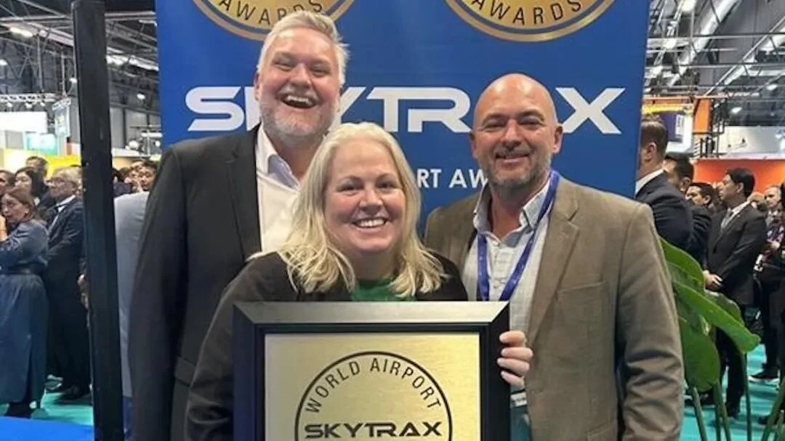

阿德莱德机场（ADL）在伦敦公布的 Skytrax 世界机场奖中拿下两个奖项：首次获得“澳洲及太平洋地区最佳机场员工”奖，并五年内第四次获评“澳洲及太平洋地区最佳区域机场”。两个奖项一个看人，一个看整体，恰好覆盖了一座机场最难被量化、也最容易被旅客感知的部分。

对南澳州来说，这份成绩单出现在一个扩张的节点上：2025 年，阿德莱德机场的旅客吞吐量首次突破 900 万人次，国际旅行是主要推动力，过去一年增长超过 20%；新航线陆续开通，6 亿澳元的“飞行计划”扩建工程也已启动。下面把奖项、客流与工程三件事分开讲。

## 一、两个奖，两种分量

“最佳机场员工”是首次拿到。这个奖项表彰的是幕后默默付出的工作人员——他们塑造了旅客的出行体验，却很少出现在宣传画面里。阿德莱德机场总经理考克斯（Brenton Cox）说：“最佳机场员工奖对我们意义非凡。我们的愿景是成为每个人都喜爱的机场——无缝衔接、便捷高效——而机场的每一名员工都为实现这一愿景做出了巨大贡献。”

“最佳区域机场”则是五年内第四次获得。区域机场奖把机场作为一个整体来评价，涵盖设施、流程与服务；五年四度进入这一位置，说明它依靠的不是某一年的偶然表现，而是一套稳定的运营。

此次获奖也使阿德莱德跻身全球领先的区域机场之列，与巴黎奥利（Orly）机场、美国辛辛那提（Cincinnati）机场和印度班加罗尔（Bangalore）机场等齐名。

## 二、员工奖表彰的是哪些人

按机场方面的说法，这个奖项表彰的是让旅客的一天更美好的人。具体包括：

- 客户服务团队
- 志愿人员大使
- 航空公司员工
- 清洁工
- 保安人员
- 零售人员

这几类岗位有一个共同点：他们与旅客的接触时间最长，也最能在细节上决定一次出行的感受——问路时有没有人答、行李卡住时有没有人帮、安检排队时有没有人疏导。

考克斯提到，团队在“让旅客的一天更美好”计划中投入了大量精力，“该计划已转化为提升旅客体验的举措”。换句话说，员工奖不是一次评选的巧合，而是长期培训与授权的结果。

## 三、900 万人次与新航线

2025 年，阿德莱德机场的旅客吞吐量首次突破 900 万人次。国际旅行是主要推动力，过去一年增长超过 20%。

航线网络也在同步扩张，表列为新增与即将开通的航线：

| 航空公司 | 航线 | 状态 |
| --- | --- | --- |
| 美联航（United Airlines） | 旧金山 | 新增 |
| 澳航（Qantas） | 奥克兰 | 新增 |
| 新西兰航空（Air New Zealand） | 基督城 | 新增 |
| 印尼亚洲航空（Indonesia AirAsia） | 巴厘岛 | 新增 |
| 中国东方航空 | 上海 | 即将开通 |

几条航线指向不同方向的客流：旧金山对应北美西海岸的商务与探亲需求，奥克兰与基督城把南澳与新西兰的几座城市连得更紧，巴厘岛是澳洲人最熟悉的度假目的地之一。最值得单独一提的是上海：中国东方航空即将开通飞往上海的航班，这会进一步加强阿德莱德机场的国际航线网络。

对往来中澳的旅客来说，这条航线的意义在于把“一次转机”变成“一次直飞”的选项；在它开通之前，从中国出发前往阿德莱德，多数行程仍需要一次中转。

## 四、6 亿澳元的“飞行计划”

一项耗资 6 亿澳元的大型基础设施升级工程已在幕后启动。工程名为“飞行计划”（Project Flight），内容包括扩大登机区、增设登机口、升级安检系统，目标是优化旅客的出行体验。

这三项内容对应三个常见痛点：登机区拥挤、登机口不够用、安检排队。扩建不会一夜完成，但方向很清楚——先把瓶颈最大的环节扩容。对旅客来说，这类工程的检验标准也很简单：下一次在高峰时段从阿德莱德出发，候机区是否有座位、登机口是否够用、安检是否更快。

## 五、对旅客意味着什么

Skytrax 的奖项根据来自 100 多个国家和地区旅客的反馈评估，内容涵盖从办理登机手续和安检，到购物和登机等各个方面。这意味着榜单上的位置反映的是旅客在真实出行中的感受，而不是评审团的印象。

如果你计划飞阿德莱德，两个奖项的参考价值在于服务预期：员工服务与区域机场体验处在同组前列；但它们不改变航班时刻、票价和签证要求。上海航线开通后，从中国出发的选择会变多；在那之前，留足转机时间是更实际的建议。

## 相关链接

- **本站页面**：[阿德莱德国际机场（ADL）](/zh/airport/ADL)、[澳大利亚（AU）](/zh/country/AU)
- **维基百科**：[阿德莱德机场](https://zh.wikipedia.org/wiki/%E9%98%BF%E5%BE%B7%E8%8E%B1%E5%BE%B7%E6%9C%BA%E5%9C%BA)
- **百度百科**：[阿德莱德机场](https://baike.baidu.com/item/%E9%98%BF%E5%BE%B7%E8%8E%B1%E5%BE%B7%E6%9C%BA%E5%9C%BA)

图片来源：AUFUN。奖项名称与评选口径以 Skytrax 公布为准；航班、航线与工程进度，请以航空公司和机场官方渠道为准。
