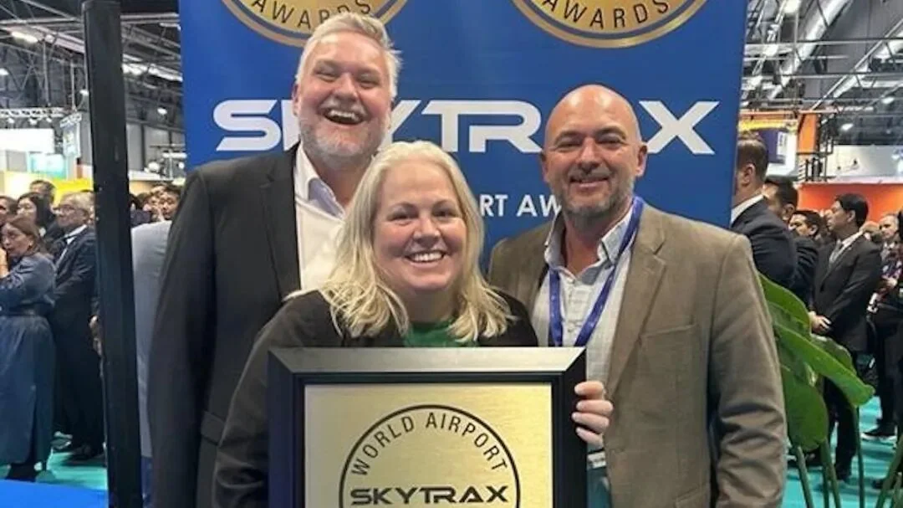

Аеропорт Аделаїди (ADL) отримав дві нагороди на Skytrax World Airport Awards, оголошених у Лондоні: «Найкращий персонал аеропорту в Австралії та Тихоокеанському регіоні» — уперше, і «Найкращий регіональний аеропорт Австралії та Тихоокеанського регіону» — учетверте за п'ять років. Одна нагорода стосується людей, інша — всієї роботи аеропорту; разом вони охоплюють те, що найважче виміряти й найлегше відчути мандрівникові.

Для Південної Австралії цей результат припав на час розширення. У 2025 році аеропорт уперше обслужив понад дев'ять мільйонів пасажирів, і головним драйвером стали міжнародні поїздки, що зросли більш ніж на 20% за рік. Додано нові маршрути, а розширення вартістю 600 млн австралійських доларів під назвою Project Flight уже почалося. Нагороди, пасажиропотік і будівництво варто розглядати окремо.

## Дві нагороди, дві міри ваги

Нагорода за персонал — перша в історії. Ця категорія відзначає людей, які працюють за лаштунками й формують відчуття подорожі, не потрапляючи на рекламні фото. Брентон Кокс, генеральний менеджер аеропорту, сказав: «Нагорода "Найкращий персонал аеропорту" означає для нас дуже багато. Наша мета — бути аеропортом, який усі люблять, зручним і ефективним, і кожен наш працівник доклався до цього. Наші команди вклали багато в програму "зробити день мандрівника кращим", і це перетворилося на покращення, які відчувають пасажири".»

«Найкращий регіональний аеропорт» — четверта перемога за п'ять років. Ця категорія оцінює аеропорт загалом, разом з інфраструктурою, процесами й обслуговуванням, і чотири перемоги за п'ять років свідчать про стабільну роботу, а не про один вдалий рік.

Результат також ставить Аделаїду поруч із провідними регіональними аеропортами світу — у компанії Париж-Орлі, Цинциннаті у США та Бангалора в Індії.

## Кому адресована нагорода за персонал

За словами аеропорту, нагорода віддає шану людям, які роблять день мандрівника кращим. Список конкретний:

- Команди обслуговування клієнтів
- Волонтери-амбасадори
- Працівники авіакомпаній
- Прибиральники
- Працівники безпеки
- Продавці

Спільне для всіх цих ролей — час віч-на-віч із пасажирами, і саме там відбуваються дрібниці, які вирішують подорож: чи хтось відповість на запитання, чи допоможе, коли застрягне валіза, чи хтось керує чергою на безпеці.

Кокс каже, що команди вклали багато в програму "зробити день мандрівника кращим", і вона "перетворилася на покращення досвіду пасажирів". Іншими словами, нагорода за персонал — не випадковість одного туру оцінювання; вона виглядає як результат тривалого навчання й надання працівникам на передовій свободи діяти.

## Дев'ять мільйонів пасажирів і нові маршрути

У 2025 році аеропорт уперше перевищив дев'ять мільйонів пасажирів. Головним драйвером були міжнародні поїздки, що зросли більш ніж на 20% за рік.

Водночас розширювалася маршрутна мережа; у таблиці — нові й майбутні маршрути:

| Авіакомпанія | Маршрут | Статус |
| --- | --- | --- |
| United Airlines | Сан-Франциско | Новий |
| Qantas | Окленд | Новий |
| Air New Zealand | Крайстчерч | Новий |
| Indonesia AirAsia | Балі | Новий |
| China Eastern | Шанхай | Незабаром |

Маршрути ведуть у різні боки. Сан-Франциско обслуговує ділові та сімейні поїздки на західне узбережжя США; Окленд і Крайстчерч наближають Південну Австралію до головних міст Нової Зеландії; Балі — один із найзвичніших курортів для австралійських мандрівників. Найбільше варто стежити за Шанхаєм: майбутній рейс China Eastern ще більше зміцнить міжнародну мережу аеропорту.

Для тих, хто подорожує між Китаєм і Австралією, цей маршрут перетворює пересадку на прямий варіант. Доти більшість поїздок із Китаю до Аделаїди, як і раніше, передбачають одну зупинку.

## Project Flight і 600 мільйонів австралійських доларів

Велика модернізація інфраструктури вартістю 600 млн австралійських доларів уже почалася за лаштунками. Вона має назву Project Flight і передбачає розширення зони посадки, додаткові виходи й оновлення систем безпеки — з метою покращити досвід пасажирів.

Ці три пункти відповідають на три звичні скарги: переповнена зона посадки, замало виходів і черга на безпеці. Усе це не станеться за одну ніч, але напрямок зрозумілий — спершу розширити найвужче місце процесу. Для мандрівників перевірка така сама проста: наступного разу, коли вилетите з Аделаїди в пікову годину, чи є місця в зоні очікування, чи є вихід для вашого рейсу і чи швидше працює безпека?

## Що це означає для мандрівників

Skytrax визначає переможців за відгуками мандрівників із понад 100 країн, що охоплюють усе від реєстрації й безпеки до магазинів і посадки. Тож місце в рейтингу відображає те, як пасажири відчували аеропорт у реальних поїздках, а не враження журі.

Якщо ви летите до Аделаїди, дві нагороди корисні як сигнал про рівень сервісу: персонал і регіональний досвід — серед лідерів галузі. Вони не змінюють розклади, тарифи чи візові правила. Коли відкриється маршрут до Шанхая, мандрівники з Китаю матимуть більше вибору; доти практичніша порада — залишати достатньо часу на пересадку.

## Пов'язані посилання

- **На цьому сайті**: [Аеропорт Аделаїди (ADL)](/airport/ADL), [Австралія (AU)](/country/AU)
- **Вікіпедія**: [Аеропорт Аделаїди](https://en.wikipedia.org/wiki/Adelaide_Airport)
- **Baidu Baike**: [Аеропорт Аделаїди](https://baike.baidu.com/item/%E9%98%BF%E5%BE%B7%E8%8E%B1%E5%BE%B7%E6%9C%BA%E5%9C%BA)

Джерело зображення: AUFUN. Назви нагород і критерії наведено за публікаціями Skytrax; щодо рейсів, маршрутів і ходу будівництва перевіряйте канали авіакомпаній та самого аеропорту.
