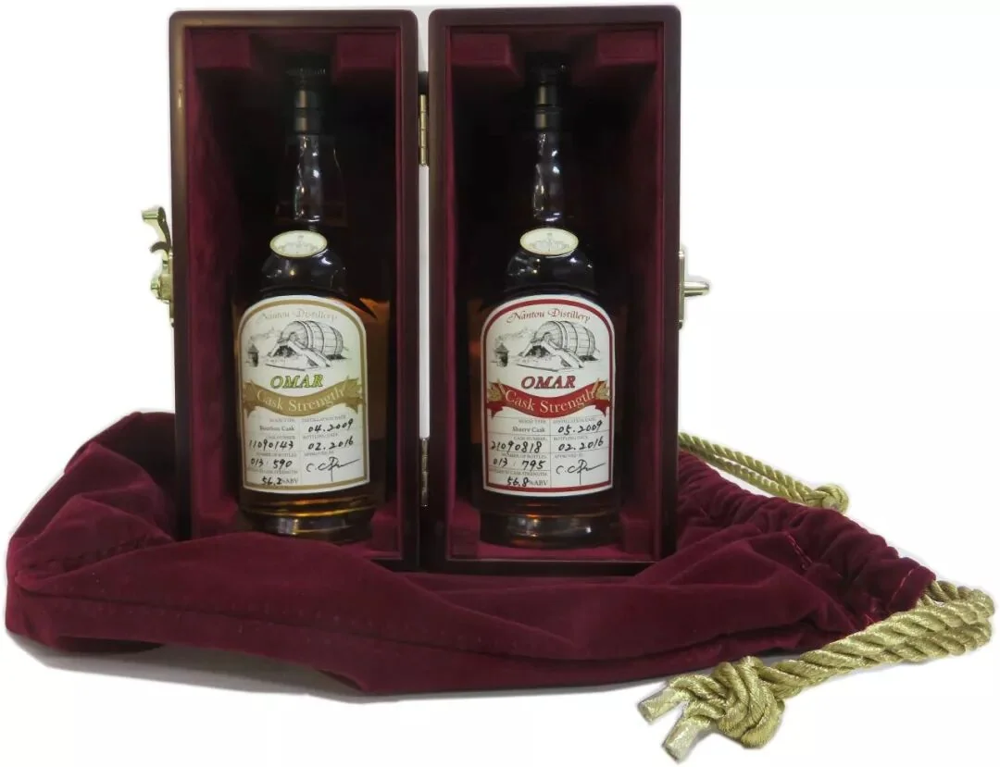
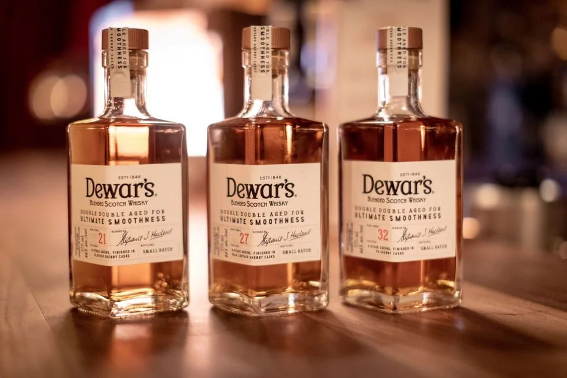

Čínský Nový rok 2020 roztřídil oblíbené destinace podle doby letu: Taipei, Bangkok, Singapur a Sapporo do čtyř hodin; Londýn, Glasgow a Moskva na osm až deset; New York, Vancouver a Sydney ještě dál. To rozpětí je zároveň mapou regálů s bezcelními lihovinami: čím delší let, tím větší šance, že na regálu stojí age statement nebo single cask, který doma nekoupíte.

Tento průvodce jde stejným pořadím, letiště po letišti, všímá si provozovatele, lahví, které stojí za to vzít, i ceny na visačce, a na konci se věnuje tomu, jak vybírat. Ceny jsou záznamy z ledna 2020 při tehdejším kurzu; kvóty a měny se od té doby pohnuly, ale logika ne.

## 1. Proč si travel retail zaslouží vlastní pohled

Prvním důvodem jsou exkluzivní stáčení: objem travel retailu umožní palírně naplnit samostatnou várku. Dewar's Double Double se v roce 2019 uvedl výhradně v Changi, jeho 21, 27 a 32letá verze všechny v 500 ml; Glenlivet vytvořil čtrnáctiletou Oloroso-sherry pro tchajwanský bezcelní kanál; Jura Time existuje jen pro travel retail; Caperdonich 25 Peated se objevil v Glasgow. Když letiště propásnete, druhá šance často nepřijde.

Druhým jsou cask strength a single casks: dvě 200ml lahve OMAR Oloroso v Taoyuanu jsou single casks s čísly sudu a lahve psanými ručně; Craigellachie 39 na Heathrow je cask strength, bez chill filtrace a s přírodní barvou. Třetím je daň: duty free odečítá dovozní clo i místní spotřební daň, takže letištní visačky často podstřelují ceny ve městě – vlastní web Changi tvrdí až 60 procent proti městu.

## 2. Než odletíte: limity a základní pravidla

Začněte limitem. Bezcelní limit při vstupu do pevninské Číny závisel na tom, kdo cestuje; tabákový limit byl pro všechny stejný.

| Cestující | Lihoviny nad 12 % alkoholu | Tabák |
| --- | --- | --- |
| Obyvatelé Hongkongu a Macaa a obyvatelé pevniny cestující soukromě do Hongkongu nebo Macaa | 1 lahev (do 0,75 litru) | 400 cigaret, 100 doutníků, 500 g tabáku |
| Ostatní cestující z pevniny | 2 lahve (do 1,5 litru) | Stejně jako výše |

Pro běžného cestovatele z pevniny je 1,5 litru zhruba dvě 700ml lahve; cokoli nad to je nutné deklarovat.

## 3. Do čtyř hodin: Taipei, Bangkok, Singapur, Sapporo

**Taoyuan** je v tomto pásmu nejvíc místní zastávkou: duty free tu provozuje TTL, Taiwan Tobacco and Liquor Corporation, a její palírna Nantou udělala z OMARu jméno na soutěžích. Dva sety stojí za zastavení u pultu: dvojice 200ml Oloroso single casks cask strength s ručně psanými čísly sudu a lahve (2 200 NT$, asi 507 RMB) a single malt Oloroso zrající přes čtyři roky (1 100 NT$, asi 254 RMB). Obchody Taiwan Wine and Tobacco od Ever Rich ve třetím patře T1–T3 nabízejí asijskou exkluzivitu Glenlivet 14 let za 1 450 NT$ (asi 334 RMB).

**Bangkok** patří King Power, která má pět letištních obchodů – Don Mueang, Suvarnabhumi, Phuket, Chiang Mai a Hat Yai – a čtyři městské prodejny, kde zaregistrujete pas a zpáteční let, vyzvednete kupony a nakupujete s vyzvednutím na letišti. Whiska tu není nijak pozoruhodná: Royal Salute 21 let 700 ml asi za 820 RMB, zhruba o 50 RMB pod domácím průměrem; Chita 700 ml asi 450 RMB; Martell Noblige jeden litr asi 610 RMB, přibližně o 100 RMB méně. Stojí za to na dárky, ne na vlastní regál.

**Singapurské Changi** funguje v jiném měřítku: novoroční kampaň zlevnila vybrané lahve a web přijímal objednávky od 30 dnů do 12 hodin před odletem s vyzvednutím na T1–T4. Singapurský zákon povoluje odlétajícím cestujícím 10 litrů lihovin, i když při příletu do Číny stále platí čínský limit 1,5 litru.

Vynikají tři exkluzivity Changi: Raffles 1915 Gin (85 S$, asi 436 RMB), připomínající sté výročí Singapore Slingu vytvořeného v hotelu Raffles v roce 1915 a v roce 2015 smíchaný s londýnským Smithem; Dewar's Double Double ve třech 500ml verzích – Oloroso-finished 21 (125 S$, asi 640 RMB), Palo Cortado 27 (220 S$, asi 1 129 RMB) a Pedro Ximénez 32 (345 S$, asi 1 770 RMB), přičemž 32 a 21 získaly první a třetí místo mezi blended Scotch na IWC 2019; a jednorázové kusy jako Armagnac z roku 1980 a Balvenie 21 Madeira Cask.

**Sapporo New Chitose** zastupuje Japonsko. Brána Hokkaida má onsen ve čtvrtém patře domácího terminálu (1 500 ¥, asi 94 RMB). Japonské obchody vracejí daň, takže pokud se vám hodí jen letiště, jsou tam Yoichi a Miyagikyo bez age statementu za 4 200 ¥ každý (asi 266 RMB), i když Rakuten je uvádí kolem 5 500 ¥; případnou slevu si potvrďte u kasy.

## 4. Osm až deset hodin: Londýn, Glasgow, Moskva

**Londýnské Heathrow** hraje největší show: lví tanec na úvodní stránce, festivalové akce od 14. ledna do začátku února a žádná skutečná sleva na lihoviny – ale Bůh bohatství bloudí T2 až T5 s poukázkami World Duty Free na 2,50 £. Samotný World Duty Free přijímá objednávky online od měsíce do 24 hodin před odletem a účtuje nižší cenu, pokud do vyzvednutí klesne.

Británie je domovem whisky. Craigellachie 39 let stojí 3 499 £ (asi 32 000 RMB): destilovaný v roce 1980, zrající v opakovaně použitých bourbonových sudech a dokončený v roce 2019, jen 138 lahví na světě, cask strength, bez chill filtrace a s přírodní barvou – nejstarší Craigellachie v prodeji. Palírna postavená v roce 1891 leží ve středním Speyside, přes most od Macallanu, a dlouho zásobovala Dewar's a White Horse pro míchání – odtud „skrytá palírna“. Příjemnější pro peněženku: Midleton Very Rare 2003 (125 £, asi 1 139 RMB) a gin The Lakes Explorer (32,50 £, asi 256 RMB).

**Glasgow**, rovněž World Duty Free, přidává poukaz na 5 £ za útratu 75 £. Caperdonich 25 Peated (478 £, asi 4 340 RMB) je jediná uzavřená palírna v patnáctilahvové řadě Secret Speyside: poslední spirit v roce 2002, areál zbořen v roce 2011. Fettercairn 27 (405 £, asi 3 677 RMB) pochází z palírny postavené v roce 1824, kdysi poslední ve východním Highlands, která od poloviny padesátých let používala chlazení vodním prstencem. Jura Time 21 (149 £, asi 1 329 RMB) je travel-retailová polovina dvojice Time and Tide – není na Heathrow, potvrzeno v Glasgow.

**Moskevské Domodědovo** bylo branou do evropské země, kterou čínští cestovatelé toho jara navštěvovali nejvíc – geograficky vzato. Největší ruské letiště je hubem S7 a VIM a My Duty Free přijímá předobjednávky k vyzvednutí, obvykle levněji. Kupuje se vodka: Legend of Kremlin (41 €, asi 318 RMB), destilovaná pětkrát a tak hladká, že nemá obilnou palčivost, a Organika Life (140 €, asi 1 070 RMB), keramická lahev vody z Bajkalu s příchutí Sagan-Dalia.

## 5. Deset hodin a více: New York, Vancouver, Sydney

**New York JFK** má šest terminálů propojených AirTrainem a změna terminálu znamená znovu projít bezpečnostní kontrolou. Air China, China Southern, Singapore Airlines a Delta se shlukují v T4, na území DFS a v největším letištním duty free, ale předobjednávka tu není.

**Vancouver** má obchody World Duty Free v mezinárodním a americkém terminálu, s asi 20 procenty slevy na dvě lahve k čínskému Novému roku. Wayne Gretzky 99 Proof (107 C$, asi 564 RMB) je třetí small-batch vydání dokončené ve vlastních sudech Cabernet Sauvignon z panství; litrový Crown Royal je ve stejné akci.

**Sydney** tvrdí, že má největší bezcelní halu na světě: 8 000 metrů čtverečních Heinemannu v T1, s online objednávkami až 48 hodin předem. Hellyers Road 10 let Slightly Peated (118 A$, asi 558 RMB) vyhrál cenu pro nejlepší australskou whisky na ADSA 2018 a nejlepší australský single malt na World Whiskies Awards 2019; Limeburners Sherry Cask (140 A$, asi 662 RMB) používá západoaustralský ječmen a sherry finish; Archie Rose Rye Malt (100 A$, asi 473 RMB) používá sladované žito.

## 6. Jak vybírat: stáří, sud, velikost lahve, přestupy

Stáří není jediná proměnná: v rámci jedné palírny záleží typ sudu víc než pár let navíc. Glenlivet 14 je celý Oloroso, takže sušené ovoce a koření sedí nad alkoholem; Yoichi NAS vrství rašelinu a sladkost dubu. Nejprve zvolte styl sudu, potom stáří.

Sherry a bourbon jsou dvě hlavní cesty: sherry dává sušené ovoce, ořechy, čokoládu a koření (OMARovy sherry sudy, Glendronach, Dewar's Double Double 21), bourbon dává vanilku, smetanu a čistší sladkost (Yoichi, Miyagikyo, Archie Rose rye). Cask strength znamená 55 procent a víc a s vodou se otevírá.

Velikost lahve se řídí limitem: litrovky (Martell Noblige, Crown Royal) stojí méně za centilitr, ale víc celkem, 500 ml se hodí na první ochutnání a dvě 700ml lahve se přesně vejdou do 1,5 litru.

Přestupy jsou místo, kde lidé narazí. Bezcelní lihoviny se kupují po bezpečnostní kontrole a zalepují do sáčku chráněného proti manipulaci; další bezpečnostní kontrola, nebo americký požadavek na znovu odbavení zavazadel před domácím přestupem, může znamenat ztrátu lahve. Nakupujte pokud možno na posledním úseku a ověřte, že tranzitní letiště přijímá bezpečnostně uzavřené tekutiny. Předobjednávka pomáhá tam, kde existuje: Changi 30 dnů až 12 hodin, Heathrow a Glasgow měsíc až 24 hodin, Sydney 48 hodin; JFK žádnou nemá.

## Související odkazy

- **Na tomto webu**: [Londýn Heathrow (LHR)](/airport/LHR), [Singapur Changi (SIN)](/airport/SIN), [Bangkok Suvarnabhumi (BKK)](/airport/BKK), [Spojené království (GB)](/country/GB), [Singapur (SG)](/country/SG), [Thajsko (TH)](/country/TH)
- **Wikipedie**: [Whisky](https://en.wikipedia.org/wiki/Whisky), [Bezcelní obchod](https://en.wikipedia.org/wiki/Duty-free_shop)
- **Baidu Baike**: [Whisky](https://baike.baidu.com/item/%E5%A8%81%E5%A3%AB%E5%BF%8C), [Bezcelní obchod](https://baike.baidu.com/item/%E5%85%8D%E7%A8%8E%E5%BA%97)

Zdroj obrázků: Whisky Magazine a letištní a bezcelní provozovatelé. Ceny a sortiment jsou záznamy z ledna 2020; limity a pravidla pro tekutiny stanovuje celní správa cílové země a letecká společnost, proto si před cestou zkontrolujte web provozovatele.
