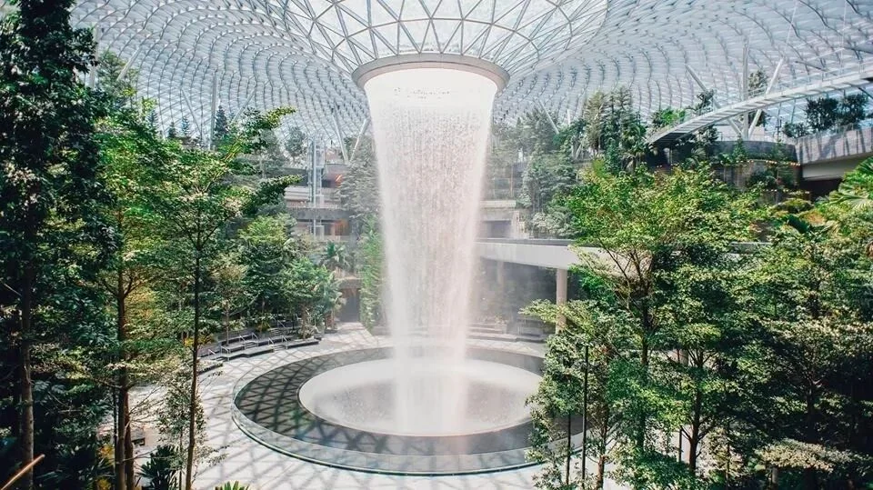

Chinese New Year 2020 sorted popular destinations by flight time: Taipei, Bangkok, Singapore and Sapporo within four hours; London, Glasgow and Moscow at eight to ten; New York, Vancouver and Sydney beyond. That spread is also a shelf map for duty-free spirits: the longer the flight, the likelier the shelf holds an age statement or single cask you cannot buy at home.

This guide follows that order, airport by airport, noting the operator, the bottles worth taking and the price on the tag, then closes on how to choose. Prices are January 2020 records at the exchange rate of the day; quotas and currencies have moved since, but the logic has not.

## 1. Why travel retail deserves its own look

The first reason is exclusive bottling: travel retail's volume lets a distillery fill a separate run. Dewar's Double Double launched exclusively at Changi in 2019, its 21, 27 and 32 year old all in 500ml; Glenlivet made an Oloroso-sherry 14 year old for Taiwan's duty-free channel; Jura's Time is travel retail only; Caperdonich 25 Peated turned up at Glasgow. Miss the airport and the second chance often does not come.

The second is cask strength and single casks: OMAR's two 200ml Oloroso bottles at Taoyuan are single casks, with cask and bottle numbers written by hand; Craigellachie 39 at Heathrow is cask strength, non-chill-filtered and natural colour. The third is tax: duty-free removes import duty and local consumption tax, so airport tags often undercut city retail — Changi's own site claims up to 60 per cent against town.

## 2. Before you fly: allowances and ground rules

Start with the allowance. The duty-free limit on entry to mainland China depended on who was travelling; the tobacco limit was the same for everyone.

| Traveller | Spirits over 12% ABV | Tobacco |
| --- | --- | --- |
| Hong Kong and Macau residents, and mainland residents travelling to Hong Kong or Macau privately | 1 bottle (under 0.75 litres) | 400 cigarettes, 100 cigars, 500g tobacco |
| Other mainland travellers | 2 bottles (under 1.5 litres) | As above |

For an ordinary mainland traveller, 1.5 litres is roughly two 700ml bottles; anything above that must be declared.

## 3. Under four hours: Taipei, Bangkok, Singapore, Sapporo

**Taoyuan** is the most local stop in this band: TTL, the Taiwan Tobacco and Liquor Corporation, runs the duty-free shop, and its Nantou distillery has made OMAR a name at competitions. Two sets are worth the counter: a pair of 200ml Oloroso cask-strength single casks with handwritten cask and bottle numbers (NT$2,200, about RMB 507), and a single malt Oloroso matured over four years (NT$1,100, about RMB 254). Ever Rich's Taiwan Wine and Tobacco shops on T1–T3's third floor push an Asia-exclusive Glenlivet 14 year old at NT$1,450 (about RMB 334).

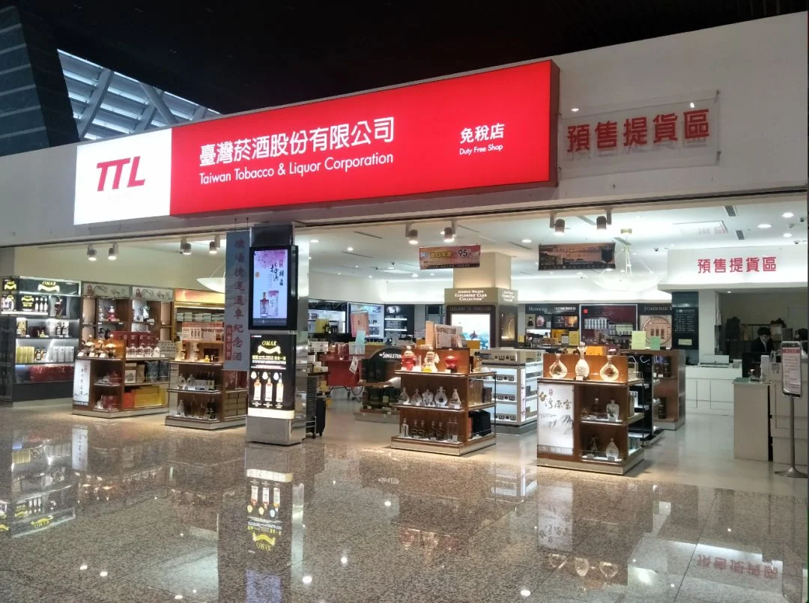

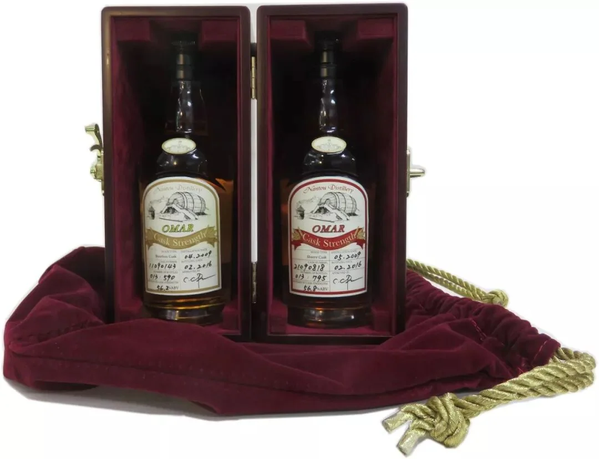

**Bangkok** belongs to King Power, with five airport shops — Don Mueang, Suvarnabhumi, Phuket, Chiang Mai and Hat Yai — and four city stores where you register your passport and return flight, collect coupons and shop for airport pickup. The whisky is unremarkable: Royal Salute 21 year old 700ml at about RMB 820, some RMB 50 under the domestic average; Chita 700ml about RMB 450; Martell Noblige one litre about RMB 610, roughly RMB 100 less. Worth it for gifts, not for your own shelf.

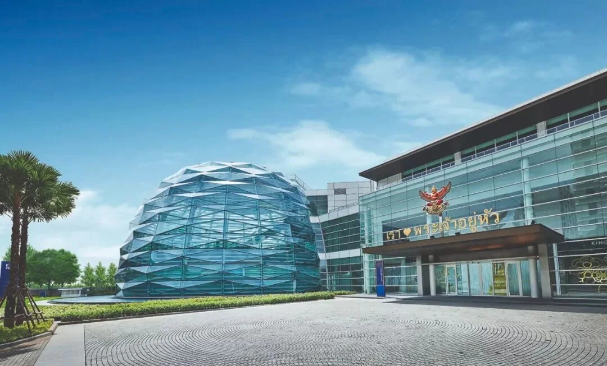

**Singapore Changi** works on another scale: the Chinese New Year campaign discounted selected bottles, and the website took orders from 30 days to 12 hours before departure with pickup at T1–T4. Singapore law allows departing passengers 10 litres of liquor, though the 1.5-litre Chinese allowance still applies on arrival.

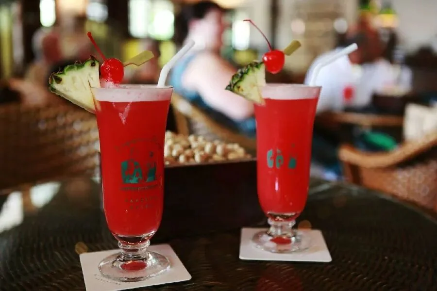

Three Changi exclusives stand out: Raffles 1915 Gin (S$85, about RMB 436), marking the centenary of the Singapore Sling created at Raffles Hotel in 1915 and blended with London's Smith in 2015; Dewar's Double Double in three 500ml expressions — Oloroso-finished 21 (S$125, about RMB 640), Palo Cortado 27 (S$220, about RMB 1,129) and Pedro Ximénez 32 (S$345, about RMB 1,770), with the 32 and the 21 taking first and third for blended Scotch at the 2019 IWC; and one-offs such as a 1980 Armagnac and Balvenie 21 Madeira Cask.

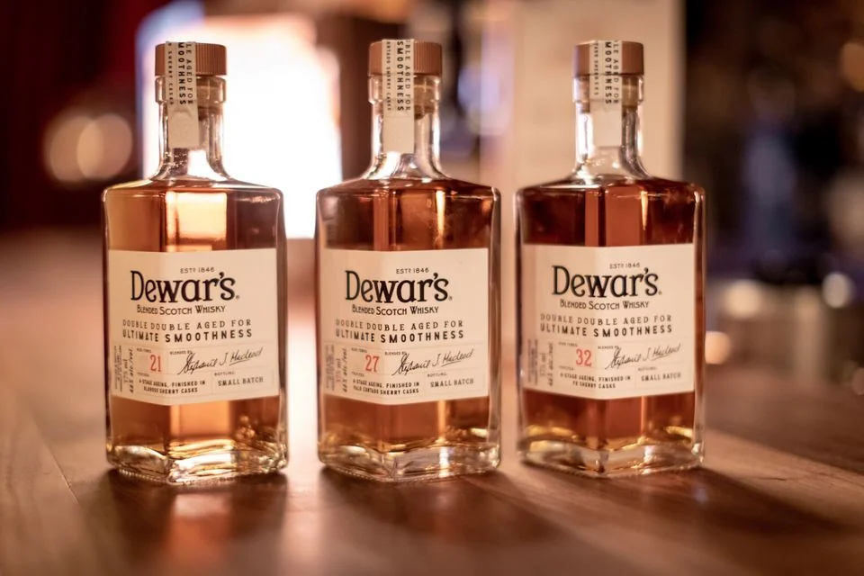

**Sapporo New Chitose** stands in for Japan. Hokkaido's gateway has an onsen on the domestic terminal's fourth floor (¥1,500, about RMB 94). Japanese shops offer tax refunds, so if only the airport fits, the no-age-statement Yoichi and Miyagikyo are there at ¥4,200 each (about RMB 266), though Rakuten lists them around ¥5,500; confirm any discount at the till.

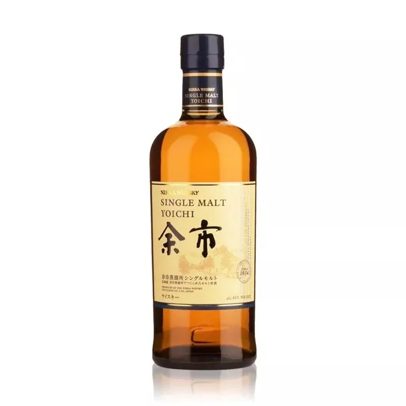

## 4. Eight to ten hours: London, Glasgow, Moscow

**London Heathrow** puts on the biggest show: a lion dance on the homepage, festival events from 14 January to early February, and no real discount on spirits — but the God of Wealth roams T2 to T5 with £2.50 World Duty Free vouchers. World Duty Free itself takes online orders from a month to 24 hours before departure and charges the lower price if it falls by collection.

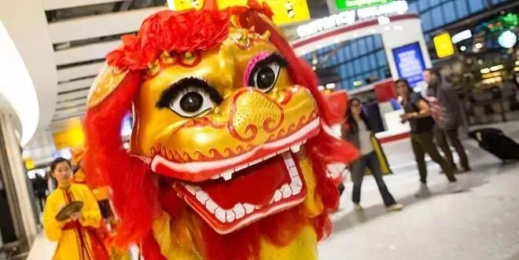

Britain is whisky's home. Craigellachie 39 year old costs £3,499 (about RMB 32,000): distilled in 1980, matured in refill bourbon and finished in 2019, only 138 bottles worldwide, cask strength, non-chill-filtered and natural colour — the oldest Craigellachie on sale. The distillery, built in 1891, sits in central Speyside a bridge from Macallan and has long supplied Dewar's and White Horse for blending, hence "the hidden distillery". Softer on the wallet: Midleton Very Rare 2003 (£125, about RMB 1,139) and The Lakes Explorer gin (£32.50, about RMB 256).

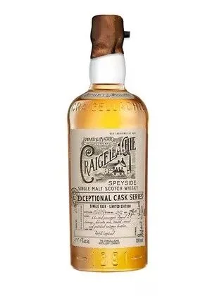

**Glasgow**, also World Duty Free, adds a £5 voucher for £75 spent. Caperdonich 25 Peated (£478, about RMB 4,340) is the only closed distillery in the 15-bottle Secret Speyside range: last spirit in 2002, site demolished in 2011. Fettercairn 27 (£405, about RMB 3,677) comes from a distillery built in 1824, once the last in the eastern Highlands, using water-ring cooling from the mid-1950s. Jura Time 21 (£149, about RMB 1,329) is the travel-retail half of Time and Tide — not at Heathrow, confirmed at Glasgow.

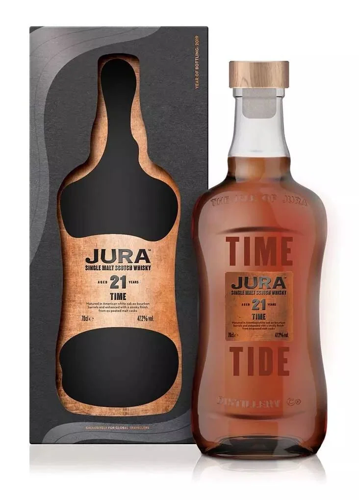

**Moscow Domodedovo** was the gateway to the European country Chinese travellers visited most that spring, geographically speaking. Russia's largest airport is the S7 and VIM hub, and My Duty Free takes pre-orders for pickup, usually cheaper. Vodka is the buy: Legend of Kremlin (€41, about RMB 318), distilled five times and smooth enough to have no grain burn, and Organika Life (€140, about RMB 1,070), a ceramic bottle of Lake Baikal water flavoured with Sagan-Dalia.

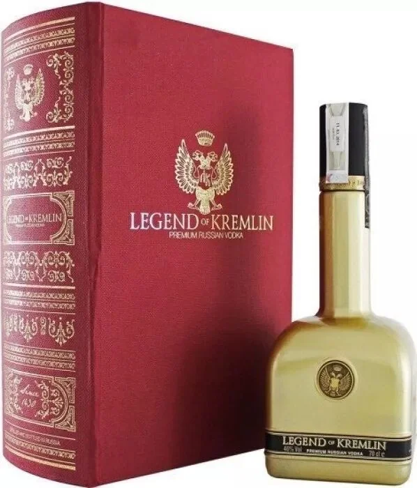

## 5. Ten hours and beyond: New York, Vancouver, Sydney

**New York JFK** spreads six terminals linked by AirTrain, and a terminal change means clearing security again. Air China, China Southern, Singapore Airlines and Delta cluster in T4, DFS territory and the airport's largest duty-free, but there is no pre-order.

**Vancouver** has World Duty Free shops in the international and US terminals, with about 20 per cent off two bottles for Chinese New Year. Wayne Gretzky 99 Proof (C$107, about RMB 564) is a third small-batch release finished in the estate's own Cabernet Sauvignon casks; one-litre Crown Royal is on the same deal.

**Sydney** claims the world's largest duty-free hall: Heinemann's 8,000 square metres in T1, with online orders up to 48 hours out. Hellyers Road 10 year old Slightly Peated (A$118, about RMB 558) won best Australian whisky at the 2018 ADSA and best Australian single malt at the 2019 World Whiskies Awards; Limeburners Sherry Cask (A$140, about RMB 662) uses Western Australian barley and a sherry finish; Archie Rose Rye Malt (A$100, about RMB 473) uses malted rye.

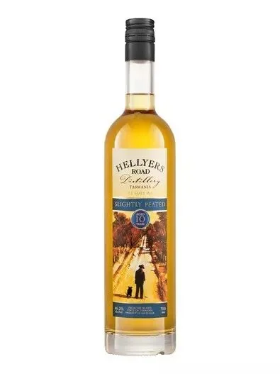

## 6. How to choose: age, cask, bottle size, connections

Age is not the only variable: within one distillery, cask type matters more than a few more years. Glenlivet 14 is all Oloroso, so dried fruit and spice sit over the alcohol; Yoichi NAS layers peat and oak sweetness. Fix the cask style first and the age second.

Sherry and bourbon are the two main roads: sherry gives dried fruit, nuts, chocolate and spice (OMAR's sherry casks, Glendronach, Dewar's Double Double 21), bourbon gives vanilla, cream and cleaner sweetness (Yoichi, Miyagikyo, Archie Rose rye). Cask strength means 55 per cent or more and opens up with water.

Bottle size follows the allowance: litre bottles (Martell Noblige, Crown Royal) cost less per centilitre but more in total, 500ml suits a first taste, and two 700ml bottles fit exactly inside 1.5 litres.

Connections are where people come unstuck. Duty-free spirits are bought after security and sealed in a tamper-evident bag; another security check, or the US requirement to re-check bags before a domestic connection, can mean losing the bottle. Buy on the last leg where possible and confirm the transit airport accepts security-sealed liquid. Pre-ordering helps where it exists: Changi 30 days to 12 hours, Heathrow and Glasgow a month to 24 hours, Sydney 48 hours; JFK has none.

## Related links

- **On this site**: [London Heathrow (LHR)](/airport/LHR), [Singapore Changi (SIN)](/airport/SIN), [Bangkok Suvarnabhumi (BKK)](/airport/BKK), [United Kingdom (GB)](/country/GB), [Singapore (SG)](/country/SG), [Thailand (TH)](/country/TH)
- **Wikipedia**: [Whisky](https://en.wikipedia.org/wiki/Whisky), [Duty-free shop](https://en.wikipedia.org/wiki/Duty-free_shop)
- **Baidu Baike**: [Whisky](https://baike.baidu.com/item/%E5%A8%81%E5%A3%AB%E5%BF%8C), [Duty-free shop](https://baike.baidu.com/item/%E5%85%8D%E7%A8%8E%E5%BA%97)

Image source: Whisky Magazine and airport and duty-free operators. Prices and ranges are January 2020 records; allowances and liquid rules are set by the destination customs authority and the airline, so check the operator's site before you travel.
