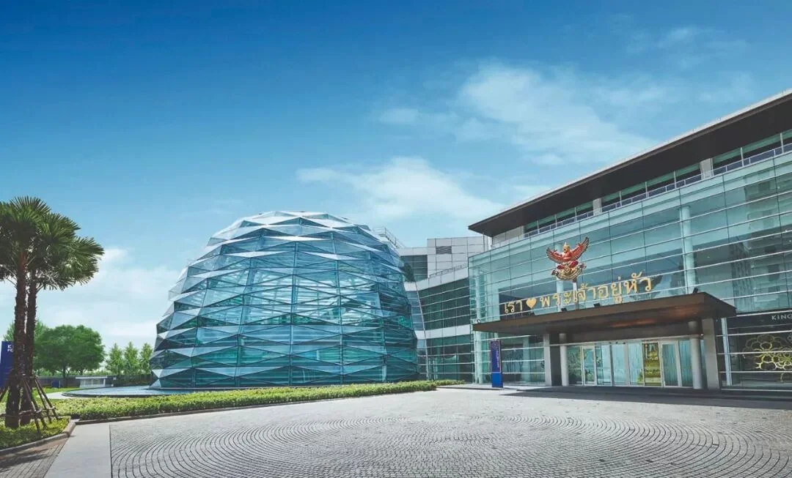

Tahun Baru Imlek 2020 mengurutkan destinasi populer berdasarkan waktu terbang: Taipei, Bangkok, Singapura, dan Sapporo dalam empat jam; London, Glasgow, dan Moskow pada delapan hingga sepuluh jam; New York, Vancouver, dan Sydney lebih jauh. Sebaran itu juga menjadi peta rak untuk minuman keras bebas bea: semakin panjang penerbangan, semakin besar kemungkinan rak menyimpan pernyataan usia atau single cask yang tidak dapat Anda beli di rumah.

Panduan ini mengikuti urutan itu, bandara demi bandara, mencatat operator, botol yang layak diambil, dan harga pada label, lalu ditutup dengan cara memilih. Harga adalah catatan Januari 2020 pada kurs saat itu; kuota dan mata uang telah berubah sejak itu, tetapi logikanya tidak.

## 1. Mengapa ritel perjalanan layak ditinjau sendiri

Alasan pertama adalah pembotolan eksklusif: volume ritel perjalanan memungkinkan penyulingan mengisi produksi terpisah. Dewar's Double Double diluncurkan secara eksklusif di Changi pada 2019, dengan edisi 21, 27, dan 32 tahun semuanya dalam 500 ml; Glenlivet membuat edisi 14 tahun Oloroso-sherry untuk kanal bebas bea Taiwan; Jura's Time hanya tersedia di ritel perjalanan; Caperdonich 25 Peated muncul di Glasgow. Jika Anda melewatkan bandara, kesempatan kedua sering tidak datang.

Yang kedua adalah cask strength dan single cask: dua botol Oloroso 200 ml OMAR di Taoyuan adalah single cask, dengan nomor cask dan botol ditulis tangan; Craigellachie 39 di Heathrow adalah cask strength, non-chill-filtered, dan warna alami. Yang ketiga adalah pajak: bebas bea menghapus bea masuk dan pajak konsumsi lokal, sehingga label bandara sering lebih murah daripada ritel kota — situs Changi sendiri mengklaim hingga 60 persen lebih murah dibanding kota.

## 2. Sebelum terbang: batas dan aturan dasar

Mulailah dengan batas bebas bea. Batas bebas bea saat masuk Tiongkok daratan bergantung pada siapa yang bepergian; batas tembakau sama untuk semua orang.

| Pelancong | Minuman keras di atas 12% ABV | Tembakau |
| --- | --- | --- |
| Penduduk Hong Kong dan Makau, serta penduduk daratan yang bepergian ke Hong Kong atau Makau secara pribadi | 1 botol (di bawah 0,75 liter) | 400 batang rokok, 100 cerutu, 500 g tembakau |
| Pelancong daratan lainnya | 2 botol (di bawah 1,5 liter) | Seperti di atas |

Bagi pelancong daratan biasa, 1,5 liter kira-kira dua botol 700 ml; apa pun di atas itu harus dideklarasikan.

## 3. Di bawah empat jam: Taipei, Bangkok, Singapura, Sapporo

**Taoyuan** adalah perhentian paling lokal di rentang ini: TTL, Taiwan Tobacco and Liquor Corporation, menjalankan toko bebas bea, dan penyulingan Nantou-nya telah membuat OMAR menjadi nama di kompetisi. Dua set layak dibeli: sepasang single cask Oloroso cask strength 200 ml dengan nomor cask dan botol tulisan tangan (NT$2.200, sekitar RMB 507), dan single malt Oloroso yang dimatangkan lebih dari empat tahun (NT$1.100, sekitar RMB 254). Toko Taiwan Wine and Tobacco milik Ever Rich di lantai tiga T1–T3 menawarkan Glenlivet 14 tahun eksklusif Asia seharga NT$1.450 (sekitar RMB 334).

**Bangkok** milik King Power, dengan lima toko bandara — Don Mueang, Suvarnabhumi, Phuket, Chiang Mai, dan Hat Yai — dan empat toko kota tempat Anda mendaftarkan paspor dan penerbangan pulang, mendapatkan kupon, dan berbelanja untuk diambil di bandara. Whisky-nya biasa saja: Royal Salute 21 tahun 700 ml sekitar RMB 820, sekitar RMB 50 di bawah rata-rata domestik; Chita 700 ml sekitar RMB 450; Martell Noblige satu liter sekitar RMB 610, sekitar RMB 100 lebih murah. Layak untuk hadiah, bukan untuk rak Anda sendiri.

**Singapura Changi** bekerja pada skala lain: kampanye Tahun Baru Imlek mendiskon botol tertentu, dan situs web menerima pesanan dari 30 hari hingga 12 jam sebelum keberangkatan dengan pengambilan di T1–T4. Hukum Singapura mengizinkan penumpang yang berangkat membawa 10 liter minuman keras, meskipun batas Tiongkok 1,5 liter tetap berlaku saat tiba.

Tiga eksklusif Changi menonjol: Raffles 1915 Gin (S$85, sekitar RMB 436), menandai seratus tahun Singapore Sling yang diciptakan di Raffles Hotel pada 1915 dan dicampur dengan Smith dari London pada 2015; Dewar's Double Double dalam tiga ekspresi 500 ml — Oloroso-finished 21 (S$125, sekitar RMB 640), Palo Cortado 27 (S$220, sekitar RMB 1.129), dan Pedro Ximénez 32 (S$345, sekitar RMB 1.770), dengan edisi 32 dan 21 meraih peringkat pertama dan ketiga untuk blended Scotch pada IWC 2019; dan edisi satu kali seperti Armagnac 1980 dan Balvenie 21 Madeira Cask.

**Sapporo New Chitose** mewakili Jepang. Gerbang Hokkaido memiliki onsen di lantai empat terminal domestik (¥1.500, sekitar RMB 94). Toko Jepang menawarkan pengembalian pajak, jadi jika hanya bandara yang memungkinkan, Yoichi dan Miyagikyo tanpa pernyataan usia tersedia seharga ¥4.200 masing-masing (sekitar RMB 266), meskipun Rakuten mencantumkannya sekitar ¥5.500; konfirmasikan diskon apa pun di kasir.

## 4. Delapan hingga sepuluh jam: London, Glasgow, Moskow

**London Heathrow** menampilkan pertunjukan terbesar: tarian singa di beranda, acara festival dari 14 Januari hingga awal Februari, dan tidak ada diskon nyata untuk minuman keras — tetapi Dewa Kekayaan berkeliaran di T2 hingga T5 dengan voucher World Duty Free £2,50. World Duty Free sendiri menerima pesanan online dari satu bulan hingga 24 jam sebelum keberangkatan dan mengenakan harga yang lebih rendah jika turun saat pengambilan.

Britania adalah rumah whisky. Craigellachie 39 tahun berharga £3.499 (sekitar RMB 32.000): disuling pada 1980, dimatangkan dalam refill bourbon dan difinishing pada 2019, hanya 138 botol di seluruh dunia, cask strength, non-chill-filtered, dan warna alami — Craigellachie tertua yang dijual. Penyulingan yang dibangun pada 1891 ini berada di jantung Speyside, sejembatan dari Macallan, dan telah lama memasok Dewar's dan White Horse untuk blending, karena itu disebut “penyulingan tersembunyi”. Yang lebih ringan di kantong: Midleton Very Rare 2003 (£125, sekitar RMB 1.139) dan The Lakes Explorer gin (£32,50, sekitar RMB 256).

**Glasgow**, juga World Duty Free, menambahkan voucher £5 untuk belanja £75. Caperdonich 25 Peated (£478, sekitar RMB 4.340) adalah satu-satunya penyulingan yang tutup dalam rangkaian Secret Speyside 15 botol: spirit terakhir pada 2002, situsnya dibongkar pada 2011. Fettercairn 27 (£405, sekitar RMB 3.677) berasal dari penyulingan yang dibangun pada 1824, pernah menjadi yang terakhir di dataran tinggi timur, menggunakan pendinginan water-ring sejak pertengahan 1950-an. Jura Time 21 (£149, sekitar RMB 1.329) adalah separuh ritel perjalanan dari Time and Tide — tidak ada di Heathrow, dikonfirmasi di Glasgow.

**Moskow Domodedovo** adalah gerbang ke negara Eropa yang paling sering dikunjungi pelancong Tiongkok musim semi itu, secara geografis. Bandara terbesar Rusia ini adalah hub S7 dan VIM, dan My Duty Free menerima pre-order untuk pengambilan, biasanya lebih murah. Vodka adalah pilihan utama: Legend of Kremlin (€41, sekitar RMB 318), disuling lima kali dan cukup halus sehingga tidak ada rasa terbakar biji-bijian, dan Organika Life (€140, sekitar RMB 1.070), botol keramik berisi air Danau Baikal yang diberi rasa Sagan-Dalia.

## 5. Sepuluh jam dan lebih: New York, Vancouver, Sydney

**New York JFK** tersebar di enam terminal yang dihubungkan AirTrain, dan pergantian terminal berarti melewati keamanan lagi. Air China, China Southern, Singapore Airlines, dan Delta berkumpul di T4, wilayah DFS dan bebas bea terbesar bandara, tetapi tidak ada pre-order.

**Vancouver** memiliki toko World Duty Free di terminal internasional dan AS, dengan diskon sekitar 20 persen untuk dua botol pada Tahun Baru Imlek. Wayne Gretzky 99 Proof (C$107, sekitar RMB 564) adalah rilis small-batch ketiga yang difinishing dalam cask Cabernet Sauvignon milik estate itu sendiri; Crown Royal satu liter mendapat penawaran yang sama.

**Sydney** mengklaim aula bebas bea terbesar di dunia: 8.000 meter persegi milik Heinemann di T1, dengan pesanan online hingga 48 jam sebelumnya. Hellyers Road 10 tahun Slightly Peated (A$118, sekitar RMB 558) memenangkan whisky Australia terbaik pada ADSA 2018 dan single malt Australia terbaik pada World Whiskies Awards 2019; Limeburners Sherry Cask (A$140, sekitar RMB 662) menggunakan jelai Australia Barat dan finish sherry; Archie Rose Rye Malt (A$100, sekitar RMB 473) menggunakan rye yang dimalt.

## 6. Cara memilih: usia, cask, ukuran botol, koneksi

Usia bukan satu-satunya variabel: dalam satu penyulingan, jenis cask lebih penting daripada beberapa tahun tambahan. Glenlivet 14 seluruhnya Oloroso, sehingga buah kering dan rempah berada di atas alkohol; Yoichi NAS melapisi gambut dan manisnya kayu ek. Tetapkan gaya cask lebih dahulu dan usia kemudian.

Sherry dan bourbon adalah dua jalan utama: sherry memberikan buah kering, kacang, cokelat, dan rempah (cask sherry OMAR, Glendronach, Dewar's Double Double 21), bourbon memberikan vanila, krim, dan manis yang lebih bersih (Yoichi, Miyagikyo, Archie Rose rye). Cask strength berarti 55 persen atau lebih dan terbuka dengan air.

Ukuran botol mengikuti batas: botol satu liter (Martell Noblige, Crown Royal) lebih murah per sentiliter tetapi lebih mahal secara total, 500 ml cocok untuk cicip pertama, dan dua botol 700 ml pas di dalam 1,5 liter.

Koneksi adalah tempat orang tersandung. Minuman keras bebas bea dibeli setelah keamanan dan disegel dalam kantong anti-rusak; pemeriksaan keamanan lain, atau persyaratan AS untuk memeriksa ulang bagasi sebelum koneksi domestik, dapat berarti kehilangan botol. Belilah pada etape terakhir jika memungkinkan dan konfirmasikan bahwa bandara transit menerima cairan bersegel keamanan. Pre-order membantu jika tersedia: Changi 30 hari hingga 12 jam, Heathrow dan Glasgow satu bulan hingga 24 jam, Sydney 48 jam; JFK tidak punya.

## Tautan terkait

- **Di situs ini**: [London Heathrow (LHR)](/airport/LHR), [Singapura Changi (SIN)](/airport/SIN), [Bangkok Suvarnabhumi (BKK)](/airport/BKK), [Britania Raya (GB)](/country/GB), [Singapura (SG)](/country/SG), [Thailand (TH)](/country/TH)
- **Wikipedia**: [Whisky](https://en.wikipedia.org/wiki/Whisky), [Toko bebas bea](https://en.wikipedia.org/wiki/Duty-free_shop)
- **Baidu Baike**: [Whisky](https://baike.baidu.com/item/%E5%A8%81%E5%A3%AB%E5%BF%8C), [Toko bebas bea](https://baike.baidu.com/item/%E5%85%8D%E7%A8%8E%E5%BA%97)

Sumber gambar: Whisky Magazine serta operator bandara dan bebas bea. Harga dan pilihan adalah catatan Januari 2020; batas dan aturan cairan ditetapkan oleh otoritas bea cukai tujuan dan maskapai, jadi periksa situs operator sebelum berangkat.
