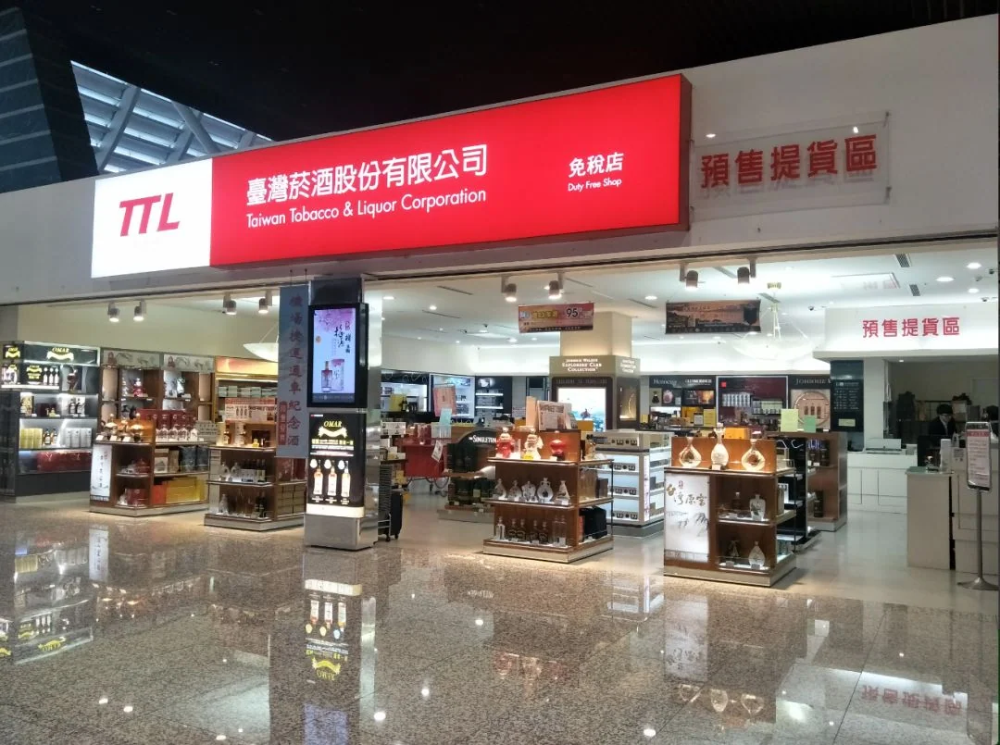
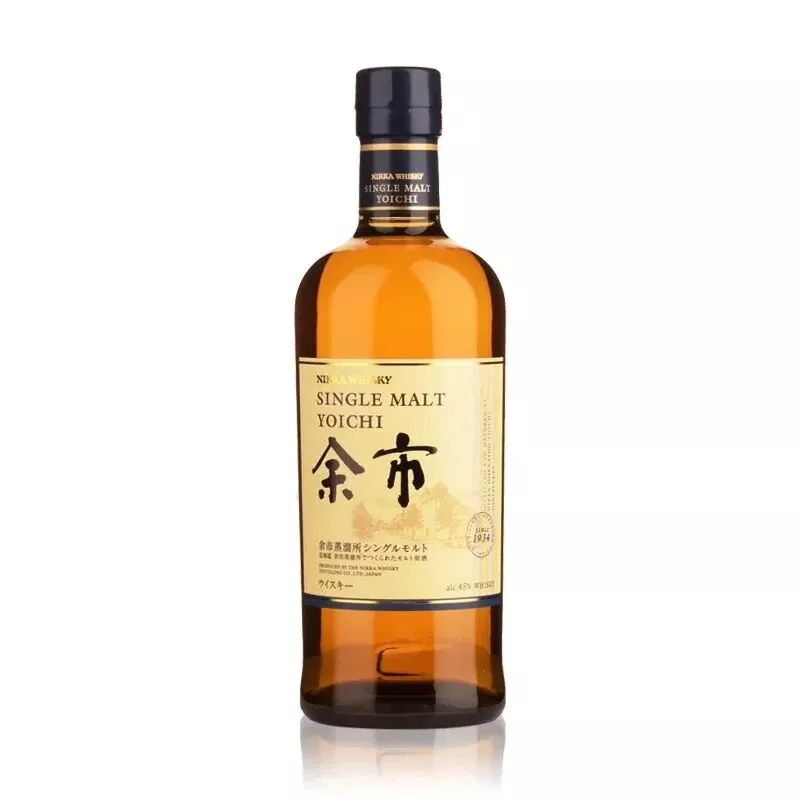
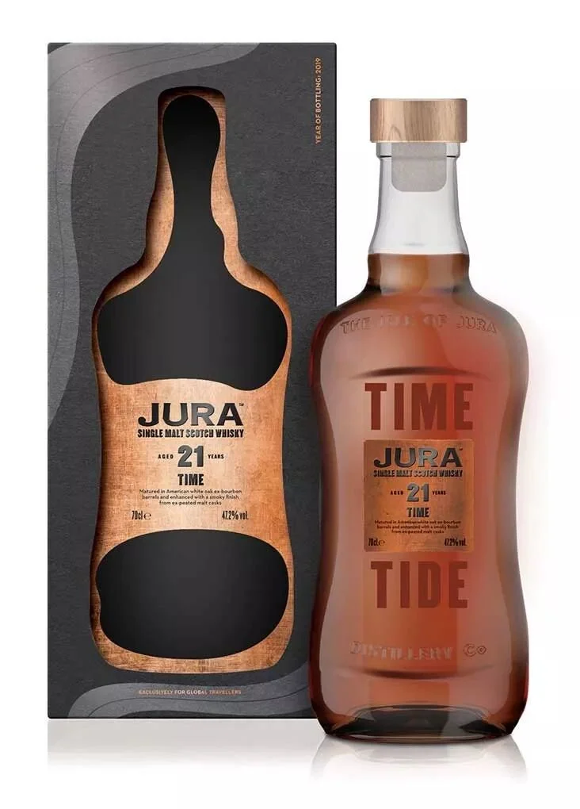

2020年の旧正月、人気の渡航先はフライト時間で整理されていました。台北、バンコク、シンガポール、札幌は4時間以内、ロンドン、グラスゴー、モスクワは8〜10時間、ニューヨーク、バンクーバー、シドニーはそれ以上です。この分布は免税蒸留酒の棚の地図でもあります。フライトが長いほど、自国では買えない熟成年数表記やシングルカスクが棚に並ぶ可能性が高くなります。

このガイドはその順番に沿って、空港ごとに運営会社、買う価値のあるボトル、値札の価格を記し、最後に選び方をまとめます。価格は2020年1月時点の記録で、当時の為替レートによるものです。割当量や通貨はその後変わりましたが、考え方は変わっていません。

## 1. トラベルリテールを別に見る価値がある理由

第一の理由は限定ボトリングです。トラベルリテールの販売量があるからこそ、蒸留所は別ロットを充填できます。Dewar's Double Doubleは2019年にチャンギで限定発売され、21年、27年、32年はいずれも500mlでした。Glenlivetは台湾の免税チャネル向けにオロロソ・シェリーの14年を造り、JuraのTimeはトラベルリテール限定、Caperdonich 25 Peatedはグラスゴーに登場しました。空港で逃すと、二度目のチャンスはなかなか来ません。

第二はカスクストレングスとシングルカスクです。桃園のOMARの200mlオロロソ2本はシングルカスクで、カスク番号とボトル番号が手書きされています。ヒースローのCraigellachie 39はカスクストレングス、非冷却濾過、無着色です。第三は税制です。免税店では輸入関税と現地の消費税が除かれるため、空港の値札は市街の小売価格を下回ることがよくあります。チャンギの公式サイトは市街より最大60%安いと謳っています。

## 2. 搭乗前に：免税範囲と基本ルール

まず免税範囲からです。中国本土への入国時の免税限度は旅行者の区分によって異なり、たばこの限度は全員同じでした。

| 旅行者 | アルコール度数12%超の蒸留酒 | たばこ |
| --- | --- | --- |
| 香港・マカオ居住者、および香港・マカオへ個人旅行する中国本土居住者 | 1本（0.75リットル未満） | 紙巻きたばこ400本、葉巻100本、刻みたばこ500g |
| その他の中国本土の旅行者 | 2本（1.5リットル未満） | 上記と同じ |

一般的な中国本土の旅行者にとって、1.5リットルは700mlのボトル約2本です。それを超える分は申告が必要です。

## 3. 4時間以内：台北、バンコク、シンガポール、札幌

**桃園**はこの時間帯で最も地元色の強い立ち寄り先です。台湾菸酒公司（TTL）が免税店を運営し、南投蒸留所はOMARをコンテストで有名にしました。カウンターで押さえたいのは2セットです。200mlのオロロソ・カスクストレングス・シングルカスク2本組は、カスク番号とボトル番号が手書きで（NT$2,200、約RMB 507）、4年以上熟成させたシングルモルト・オロロソはNT$1,100（約RMB 254）です。T1〜T3の3階にあるEver Richの台湾菸酒店では、アジア限定のGlenlivet 14年をNT$1,450（約RMB 334）で推しています。

**バンコク**はKing Powerの独壇場で、空港店が5店（ドンムアン、スワンナプーム、プーケット、チェンマイ、ハートヤイ）、市街店が4店あり、パスポートと帰国便を登録してクーポンを受け取り、空港受け取りで買い物ができます。ウイスキーは目立つものではありません。Royal Salute 21年700mlが約RMB 820で国内平均より約RMB 50安く、Chita 700mlが約RMB 450、Martell Noblige 1リットルが約RMB 610で約RMB 100安い程度です。ギフトには向きますが、自分の棚に置くほどのものではありません。

**シンガポール・チャンギ**は規模が違います。旧正月キャンペーンでは一部のボトルが割引され、公式サイトでは出発の30日前から12時間前まで注文を受け付け、T1〜T4で受け取れました。シンガポール法では出国旅客に10リットルの酒類が認められていますが、入国時には中国の1.5リットル免税範囲が適用されます。

チャンギ限定品は3つ際立っています。Raffles 1915 Gin（S$85、約RMB 436）は、1915年にラッフルズホテルで生まれたシンガポール・スリングの100周年を記念し、2015年にロンドンのSmithとブレンドしたものです。Dewar's Double Doubleは500mlの3種類、オロロソ仕上げの21年（S$125、約RMB 640）、Palo Cortadoの27年（S$220、約RMB 1,129）、Pedro Ximénezの32年（S$345、約RMB 1,770）で、32年と21年は2019年IWCのブレンデッド・スコッチ部門で1位と3位を獲得しました。さらに1980年アルマニャックやBalvenie 21 Madeira Caskといった単発品もあります。

**札幌・新千歳**は日本代表です。北海道の玄関口には国内線ターミナル4階に温泉があり（¥1,500、約RMB 94）、日本の店では免税還付が受けられます。空港でしか買えない場合は、ノンエイジのYoichiとMiyagikyoが各¥4,200（約RMB 266）で並んでいますが、楽天では約¥5,500で掲載されているため、割引があるかレジで確認してください。

## 4. 8〜10時間：ロンドン、グラスゴー、モスクワ

**ロンドン・ヒースロー**は最も大がかりな演出をします。ホームページに獅子舞、1月14日から2月初旬までフェスティバルイベントが行われ、蒸留酒自体に実質的な割引はありませんが、招財神がT2〜T5を回り、£2.50のWorld Duty Free券を配ります。World Duty Free自体は出発の1か月前から24時間前までオンライン注文を受け付け、受け取り時に価格が下がっていれば安い方の価格で請求します。

英国はウイスキーの本場です。Craigellachie 39年は£3,499（約RMB 32,000）です。1980年蒸留、リフィルバーボン樽で熟成し2019年にフィニッシュ、世界で138本のみ、カスクストレングス、非冷却濾過、無着色で、販売中のCraigellachieでは最古です。1891年創業の蒸留所はスペイサイド中心部、Macallanから橋1つほどの場所にあり、長くDewar'sやWhite Horseのブレンド用原酒を供給してきたため「隠れた蒸留所」と呼ばれます。手頃なところではMidleton Very Rare 2003（£125、約RMB 1,139）やThe Lakes Explorer Gin（£32.50、約RMB 256）があります。

**グラスゴー**もWorld Duty Freeで、£75の購入につき£5のクーポンが付きます。Caperdonich 25 Peated（£478、約RMB 4,340）は、15本のSecret Speysideシリーズの中で唯一の閉鎖蒸留所の商品です。最後の蒸留は2002年、施設は2011年に解体されました。Fettercairn 27（£405、約RMB 3,677）は1824年創業の蒸留所のもので、かつて東ハイランドで最後の蒸留所でした。1950年代半ばからはウォーターリング冷却を使っています。Jura Time 21（£149、約RMB 1,329）はTime and Tideのトラベルリテール版で、ヒースローにはなく、グラスゴーで確認できました。

**モスクワ・ドモジェドヴォ**は、地理的に見れば、その春に中国の旅行者が最も多く訪れたヨーロッパ国の玄関口でした。ロシア最大の空港はS7とVIMのハブで、My Duty Freeでは受け取り前提の事前注文ができ、通常は安くなります。買うべきはウォッカです。Legend of Kremlin（€41、約RMB 318）は5回蒸留され、穀物の刺激がほとんどないほど滑らかです。Organika Life（€140、約RMB 1,070）はバイカル湖の水にSagan-Daliaを香りづけした陶器ボトルです。

## 5. 10時間以上：ニューヨーク、バンクーバー、シドニー

**ニューヨークJFK**は6つのターミナルがAirTrainで結ばれ、ターミナルを移動するには保安検査をやり直す必要があります。中国国際航空、中国南方航空、シンガポール航空、デルタはT4に集まり、そこはDFSの領域で空港最大の免税店ですが、事前注文はできません。

**バンクーバー**は国際線ターミナルと米国線ターミナルにWorld Duty Freeがあり、旧正月には2本購入で約20%引きでした。Wayne Gretzky 99 Proof（C$107、約RMB 564）は、自社所有のカベルネ・ソーヴィニヨン樽でフィニッシュした少量生産の第3弾です。1リットルのCrown Royalも同じ特典の対象です。

**シドニー**は世界最大の免税ホールを謳っています。T1にあるHeinemannの8,000平方メートルで、オンライン注文は48時間前まで可能です。Hellyers Road 10年Slightly Peated（A$118、約RMB 558）は2018年ADSAで最優秀オーストラリア・ウイスキー、2019年World Whiskies Awardsで最優秀オーストラリア・シングルモルトを受賞しました。Limeburners Sherry Cask（A$140、約RMB 662）は西オーストラリア産大麦とシェリー樽フィニッシュ、Archie Rose Rye Malt（A$100、約RMB 473）はモルトライ麦を使っています。

## 6. 選び方：熟成年数、カスク、ボトルサイズ、乗り継ぎ

熟成年数だけが変数ではありません。同じ蒸留所の中では、数年の差よりカスクの種類の方が重要です。Glenlivet 14はすべてオロロソ樽なので、ドライフルーツとスパイスがアルコールの上に重なります。Yoichi NASはピートとオークの甘さを層にします。まずカスクのスタイルを決め、次に熟成年数を決めましょう。

シェリーとバーボンが2本の幹線です。シェリーはドライフルーツ、ナッツ、チョコレート、スパイスを与え（OMARのシェリー樽、Glendronach、Dewar's Double Double 21）、バーボンはバニラ、クリーム、より澄んだ甘さを与えます（Yoichi、Miyagikyo、Archie Roseのライ麦）。カスクストレングスは55%以上で、水を加えると香りが開きます。

ボトルサイズは免税範囲に合わせます。1リットル瓶（Martell Noblige、Crown Royal）は100mlあたりの単価が安い代わりに総額が高くなり、500mlは最初の一杯に適し、700mlを2本なら1.5リットルにちょうど収まります。

つまずきやすいのは乗り継ぎです。免税の蒸留酒は保安検査後に購入し、開封証付きの袋に入れられます。もう一度保安検査がある場合や、アメリカのように国内線乗り継ぎ前に荷物を再検査する必要がある場合、ボトルを失うことがあります。できるだけ最後の区間で買い、乗り継ぎ空港が保安検査済みの液体を受け入れるか確認してください。事前注文ができるところでは活用しましょう。チャンギは30日前から12時間前、ヒースローとグラスゴーは1か月前から24時間前、シドニーは48時間前までです。JFKにはありません。

## 関連リンク

- **このサイト内**：[ロンドン・ヒースロー (LHR)](/airport/LHR)、[シンガポール・チャンギ (SIN)](/airport/SIN)、[バンコク・スワンナプーム (BKK)](/airport/BKK)、[イギリス (GB)](/country/GB)、[シンガポール (SG)](/country/SG)、[タイ (TH)](/country/TH)
- **Wikipedia**：[ウイスキー](https://en.wikipedia.org/wiki/Whisky)、[免税店](https://en.wikipedia.org/wiki/Duty-free_shop)
- **百度百科**：[ウイスキー](https://baike.baidu.com/item/%E5%A8%81%E5%A3%AB%E5%BF%8C)、[免税店](https://baike.baidu.com/item/%E5%85%8D%E7%A8%8E%E5%BA%97)

画像出典：Whisky Magazine、空港および免税店運営会社。価格と品揃えは2020年1月時点の記録です。免税範囲と液体の規制は目的地の税関と航空会社が定めるため、旅行前に運営会社のサイトで確認してください。
