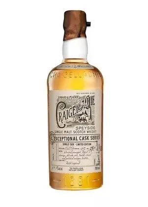

Chinees Nieuwjaar 2020 rangschikte populaire bestemmingen naar vluchtduur: Taipei, Bangkok, Singapore en Sapporo binnen vier uur; Londen, Glasgow en Moskou op acht tot tien uur; New York, Vancouver en Sydney daarbuiten. Die spreiding is ook een schapkaart voor gedistilleerde dranken uit de belastingvrije winkel: hoe langer de vlucht, hoe groter de kans dat het schap een leeftijdsaanduiding of een single cask bevat die je thuis niet kunt kopen.

Deze gids volgt die volgorde, luchthaven voor luchthaven, en noemt per stop de exploitant, de flessen die de moeite waard zijn en de prijs op het kaartje, om af te sluiten met hoe je kiest. De prijzen zijn registraties van januari 2020 tegen de wisselkoers van die dag; quota en valuta's zijn sindsdien verschoven, maar de logica niet.

## 1. Waarom reisdetailhandel een eigen blik verdient

De eerste reden is exclusieve botteling: het volume van reisdetailhandel stelt een distilleerderij in staat een aparte serie te vullen. Dewar's Double Double werd in 2019 exclusief bij Changi gelanceerd, met de 21-, 27- en 32-jarige alle in 500 ml; Glenlivet maakte een 14-jarige Oloroso-sherry voor het belastingvrije kanaal van Taiwan; Jura's Time is alleen in de reisdetailhandel verkrijgbaar; Caperdonich 25 Peated dook op in Glasgow. Mis je de luchthaven, dan komt de tweede kans vaak niet.

De tweede is cask strength en single casks: OMAR's twee flessen Oloroso van 200 ml in Taoyuan zijn single casks, met vat- en flesnummers met de hand geschreven; Craigellachie 39 op Heathrow is cask strength, niet koud gefilterd en natuurlijk van kleur. De derde is belasting: duty-free haalt invoerrechten en lokale verbruiksbelasting weg, waardoor luchthavenprijzen vaak onder de stadsdetailhandel liggen — de eigen site van Changi claimt tot 60 procent voordeel ten opzichte van de stad.

## 2. Voor je vliegt: invoerlimieten en spelregels

Begin bij de invoerlimiet. De belastingvrije limiet bij binnenkomst in vasteland-China hing af van wie er reisde; de tabakslimiet was voor iedereen gelijk.

| Reiziger | Sterke drank boven 12% alcohol | Tabak |
| --- | --- | --- |
| Inwoners van Hongkong en Macau, en inwoners van het vasteland die privé naar Hongkong of Macau reizen | 1 fles (minder dan 0,75 liter) | 400 sigaretten, 100 sigaren, 500 g tabak |
| Overige reizigers van het vasteland | 2 flessen (minder dan 1,5 liter) | Zoals hierboven |

Voor een gewone reiziger van het vasteland is 1,5 liter ruwweg twee flessen van 700 ml; alles daarboven moet worden aangegeven.

## 3. Minder dan vier uur: Taipei, Bangkok, Singapore, Sapporo

**Taoyuan** is de meest lokale stop in deze categorie: TTL, de Taiwan Tobacco and Liquor Corporation, exploiteert de belastingvrije winkel, en de Nantou-distilleerderij heeft van OMAR een naam gemaakt in wedstrijden. Twee sets zijn de toonbank waard: een paar single casks van 200 ml Oloroso op cask strength met handgeschreven vat- en flesnummers (NT$ 2.200, ongeveer RMB 507), en een single malt Oloroso van vier jaar rijping (NT$ 1.100, ongeveer RMB 254). De Taiwan Wine and Tobacco-winkels van Ever Rich op de derde verdieping van T1–T3 promoten een Azië-exclusieve Glenlivet 14 jaar voor NT$ 1.450 (ongeveer RMB 334).

**Bangkok** is het domein van King Power, met vijf luchthavenwinkels — Don Mueang, Suvarnabhumi, Phuket, Chiang Mai en Hat Yai — en vier stadswinkels waar je je paspoort en terugvlucht registreert, coupons verzamelt en shopt voor ophalen op de luchthaven. De whisky is weinig bijzonder: Royal Salute 21 jaar 700 ml voor ongeveer RMB 820, zo'n RMB 50 onder het binnenlandse gemiddelde; Chita 700 ml ongeveer RMB 450; Martell Noblige één liter ongeveer RMB 610, ruwweg RMB 100 minder. De moeite waard voor cadeaus, niet voor je eigen schap.

**Singapore Changi** werkt op een andere schaal: de campagne rond Chinees Nieuwjaar gaf korting op geselecteerde flessen, en de website nam bestellingen aan van 30 dagen tot 12 uur voor vertrek, met ophalen op T1–T4. De Singaporese wet staat vertrekkende passagiers 10 liter sterke drank toe, al geldt bij aankomst nog steeds de Chinese limiet van 1,5 liter.

Drie Changi-exclusieven springen eruit: Raffles 1915 Gin (S$ 85, ongeveer RMB 436), ter markering van het honderdjarig bestaan van de Singapore Sling, in 1915 bedacht in Raffles Hotel en in 2015 geblend met Smith uit Londen; Dewar's Double Double in drie uitvoeringen van 500 ml — Oloroso-afgewerkte 21 (S$ 125, ongeveer RMB 640), Palo Cortado 27 (S$ 220, ongeveer RMB 1.129) en Pedro Ximénez 32 (S$ 345, ongeveer RMB 1.770), waarbij de 32 en de 21 eerste en derde werden bij de blended Scotch op de IWC van 2019; en eenmalige bottelingen zoals een Armagnac uit 1980 en Balvenie 21 Madeira Cask.

**Sapporo New Chitose** vertegenwoordigt Japan. De toegangspoort van Hokkaido heeft een onsen op de vierde verdieping van de binnenlandse terminal (¥ 1.500, ongeveer RMB 94). Japanse winkels geven belasting terug, dus als alleen de luchthaven past, staan de Yoichi en Miyagikyo zonder leeftijdsaanduiding daar voor ¥ 4.200 per stuk (ongeveer RMB 266), hoewel Rakuten ze rond ¥ 5.500 vermeldt; controleer eventuele korting bij de kassa.

## 4. Acht tot tien uur: Londen, Glasgow, Moskou

**Londen Heathrow** zet de grootste show neer: een leeuwendans op de homepage, festivalevenementen van 14 januari tot begin februari, en geen echte korting op sterke drank — maar de God van de Rijkdom dwaalt van T2 tot T5 rond met waardebonnen van £ 2,50 voor World Duty Free. World Duty Free zelf neemt online bestellingen aan van een maand tot 24 uur voor vertrek en rekent de lagere prijs als die tegen de tijd van ophalen is gedaald.

Groot-Brittannië is het thuisland van whisky. Craigellachie 39 jaar kost £ 3.499 (ongeveer RMB 32.000): gedistilleerd in 1980, gerijpt op refill bourbon en in 2019 afgewerkt, slechts 138 flessen wereldwijd, cask strength, niet koud gefilterd en natuurlijk van kleur — de oudste Craigellachie die te koop is. De distilleerderij, gebouwd in 1891, ligt in centraal Speyside op een brug afstand van Macallan en levert al lang aan Dewar's en White Horse voor het blenden, vandaar "the hidden distillery". Vriendelijker voor de portemonnee: Midleton Very Rare 2003 (£ 125, ongeveer RMB 1.139) en The Lakes Explorer gin (£ 32,50, ongeveer RMB 256).

**Glasgow**, eveneens World Duty Free, geeft een waardebon van £ 5 bij £ 75 besteding. Caperdonich 25 Peated (£ 478, ongeveer RMB 4.340) is de enige gesloten distilleerderij in de Secret Speyside-reeks van 15 flessen: de laatste spirit in 2002, het terrein in 2011 gesloopt. Fettercairn 27 (£ 405, ongeveer RMB 3.677) komt van een distilleerderij uit 1824, ooit de laatste in de oostelijke Highlands, die vanaf halverwege de jaren vijftig waterringkoeling gebruikt. Jura Time 21 (£ 149, ongeveer RMB 1.329) is de reisdetailhelft van Time and Tide — niet op Heathrow, wel bevestigd in Glasgow.

**Moskou Domodedovo** was dat voorjaar de toegangspoort tot het Europese land dat Chinese reizigers het meest bezochten, geografisch gezien. De grootste luchthaven van Rusland is de hub van S7 en VIM, en My Duty Free neemt voorbestellingen aan voor ophalen, meestal goedkoper. Wodka is de aankoop: Legend of Kremlin (€ 41, ongeveer RMB 318), vijf keer gedistilleerd en zo zacht dat er geen graanbrand in zit, en Organika Life (€ 140, ongeveer RMB 1.070), een keramische fles met Baikalwater op smaak gebracht met Sagan-Dalia.

## 5. Tien uur en meer: New York, Vancouver, Sydney

**New York JFK** telt zes terminals die door de AirTrain zijn verbonden, en een terminalwissel betekent opnieuw door de beveiliging. Air China, China Southern, Singapore Airlines en Delta clusteren in T4, DFS-gebied en de grootste belastingvrije winkel van de luchthaven, maar voorbestellen is er niet mogelijk.

**Vancouver** heeft World Duty Free-winkels in de internationale terminal en de Amerikaanse terminal, met ongeveer 20 procent korting op twee flessen voor Chinees Nieuwjaar. Wayne Gretzky 99 Proof (C$ 107, ongeveer RMB 564) is een derde small-batch-release, afgewerkt op de eigen Cabernet Sauvignon-vaten van het landgoed; Crown Royal van één liter valt onder dezelfde actie.

**Sydney** claimt de grootste belastingvrije hal ter wereld: 8.000 vierkante meter van Heinemann in T1, met online bestellingen tot 48 uur vooraf. Hellyers Road 10 jaar Slightly Peated (A$ 118, ongeveer RMB 558) won beste Australische whisky bij de ADSA van 2018 en beste Australische single malt bij de World Whiskies Awards van 2019; Limeburners Sherry Cask (A$ 140, ongeveer RMB 662) gebruikt gerst uit West-Australië en een sherry-finish; Archie Rose Rye Malt (A$ 100, ongeveer RMB 473) gebruikt gemoute rogge.

## 6. Hoe je kiest: leeftijd, vat, flesgrootte, overstappen

Leeftijd is niet de enige variabele: binnen één distilleerderij doet het vattype meer ter zake dan een paar jaar extra. Glenlivet 14 is volledig Oloroso, waardoor gedroogd fruit en specerijen boven de alcohol hangen; Yoichi NAS legt turf en eikenhoutzoetheid in lagen. Kies eerst de vatstijl en pas daarna de leeftijd.

Sherry en bourbon zijn de twee hoofdwegen: sherry geeft gedroogd fruit, noten, chocolade en specerijen (OMAR's sherryvaten, Glendronach, Dewar's Double Double 21), bourbon geeft vanille, room en een schonere zoetheid (Yoichi, Miyagikyo, Archie Rose rye). Cask strength betekent 55 procent of meer en opent zich met water.

De flesgrootte volgt de invoerlimiet: flessen van een liter (Martell Noblige, Crown Royal) kosten minder per centiliter maar meer in totaal, 500 ml past bij een eerste kennismaking, en twee flessen van 700 ml passen precies binnen 1,5 liter.

Bij overstappen gaat het mis. Sterke drank uit de belastingvrije winkel wordt na de beveiliging gekocht en in een sabotagebestendige zak verzegeld; nog een beveiligingscontrole, of de Amerikaanse eis om bagage opnieuw te controleren voor een binnenlandse overstap, kan betekenen dat je de fles kwijt bent. Koop waar mogelijk op het laatste traject en bevestig dat de overstapluchthaven verzegelde vloeistoffen accepteert. Voorbestellen helpt waar het bestaat: Changi 30 dagen tot 12 uur, Heathrow en Glasgow een maand tot 24 uur, Sydney 48 uur; JFK heeft het niet.

## Gerelateerde links

- **Op deze site**: [Londen Heathrow (LHR)](/airport/LHR), [Singapore Changi (SIN)](/airport/SIN), [Bangkok Suvarnabhumi (BKK)](/airport/BKK), [Verenigd Koninkrijk (GB)](/country/GB), [Singapore (SG)](/country/SG), [Thailand (TH)](/country/TH)
- **Wikipedia**: [Whisky](https://en.wikipedia.org/wiki/Whisky), [Belastingvrije winkel](https://en.wikipedia.org/wiki/Duty-free_shop)
- **Baidu Baike**: [Whisky](https://baike.baidu.com/item/%E5%A8%81%E5%A3%AB%E5%BF%8C), [Belastingvrije winkel](https://baike.baidu.com/item/%E5%85%8D%E7%A8%8E%E5%BA%97)

Beeldbron: Whisky Magazine en luchthaven- en duty-free-exploitanten. Prijzen en assortiment zijn registraties van januari 2020; invoerlimieten en vloeistofregels worden bepaald door de douane van de bestemming en de luchtvaartmaatschappij, dus controleer de site van de exploitant voor je reist.
