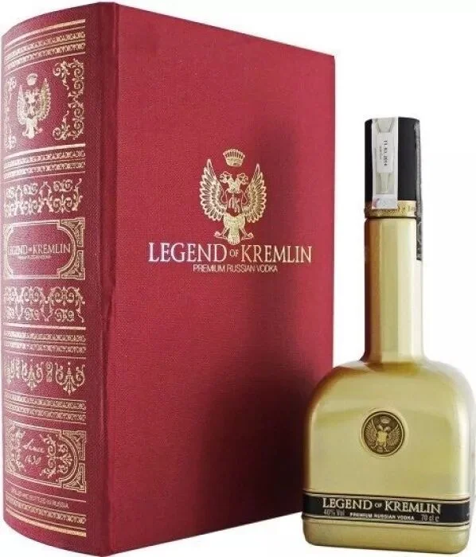

Chiński Nowy Rok 2020 uporządkował popularne kierunki według czasu lotu: Tajpej, Bangkok, Singapur i Sapporo w ciągu czterech godzin; Londyn, Glasgow i Moskwa na osiem do dziesięciu; Nowy Jork, Vancouver i Sydney dalej. Ten rozkład to także mapa półek z alkoholami duty free: im dłuższy lot, tym większa szansa, że na półce stoi butelka z oznaczeniem wieku lub z pojedynczej beczki, której nie kupisz w domu.

Ten przewodnik idzie tym porządkiem, lotnisko po lotnisku, notując operatora, butelki warte zabrania i cenę na metce, a na końcu podpowiada, jak wybierać. Ceny to zapis ze stycznia 2020 roku według ówczesnego kursu; limity i waluty zmieniły się od tego czasu, ale logika nie.

## 1. Dlaczego travel retail zasługuje na osobne spojrzenie

Pierwszym powodem są ekskluzywne rozlewy: skala travel retail pozwala destylarni zapełnić osobną partię. Dewar's Double Double zadebiutował wyłącznie w Changi w 2019 roku, a jego wersje 21-, 27- i 32-letnie miały pojemność 500 ml; Glenlivet stworzył 14-letnią wersję z beczek po sherry Oloroso dla tajwańskiego kanału duty free; Jura Time jest dostępna wyłącznie w travel retail; Caperdonich 25 Peated pojawił się w Glasgow. Jeśli przegapisz lotnisko, druga szansa często się nie pojawia.

Drugi to moc beczki i pojedyncze beczki: dwie 200-mililitrowe butelki OMAR Oloroso w Taoyuan pochodzą z pojedynczych beczek, z numerem beczki i butelki zapisanym ręcznie; Craigellachie 39 na Heathrow ma moc beczki, nie jest filtrowane na zimno i ma naturalny kolor. Trzeci to podatek: duty free znosi cło importowe i lokalny podatek konsumpcyjny, więc metki na lotniskach często są niższe niż w sklepach w mieście — strona Changi twierdzi, że nawet 60 procent taniej niż w mieście.

## 2. Przed lotem: limity i podstawowe zasady

Zacznij od limitu. Limit bezcłowy przy wjeździe do Chin kontynentalnych zależał od tego, kto podróżował; limit tytoniu był taki sam dla wszystkich.

| Podróżny | Alkohole powyżej 12% ABV | Tytoń |
| --- | --- | --- |
| Mieszkańcy Hongkongu i Makau oraz mieszkańcy kontynentu podróżujący prywatnie do Hongkongu lub Makau | 1 butelka (poniżej 0,75 litra) | 400 papierosów, 100 cygar, 500 g tytoniu |
| Pozostali podróżni z kontynentu | 2 butelki (poniżej 1,5 litra) | Jak wyżej |

Dla zwykłego podróżnego z kontynentu 1,5 litra to mniej więcej dwie butelki po 700 ml; wszystko powyżej trzeba zadeklarować.

## 3. Poniżej czterech godzin: Tajpej, Bangkok, Singapur, Sapporo

**Taoyuan** to najbardziej lokalny przystanek w tym przedziale: TTL, Tajwańska Korporacja Tytoniu i Alkoholu, prowadzi sklep duty free, a jej destylarnia Nantou zrobiła z OMAR markę rozpoznawalną na konkursach. Dwa zestawy są warte podejścia do lady: para 200-mililitrowych butelek z pojedynczych beczek Oloroso o mocy beczki, z ręcznie zapisanymi numerami beczki i butelki (NT$2 200, około 507 RMB), oraz single malt Oloroso leżakowany ponad cztery lata (NT$1 100, około 254 RMB). Sklepy Taiwan Wine and Tobacco sieci Ever Rich na trzecim piętrze terminali T1–T3 polecają ekskluzywną dla Azji 14-letnią Glenlivet za NT$1 450 (około 334 RMB).

**Bangkok** należy do King Power, z pięcioma sklepami na lotniskach — Don Mueang, Suvarnabhumi, Phuket, Chiang Mai i Hat Yai — oraz czterema sklepami w mieście, gdzie rejestrujesz paszport i lot powrotny, odbierasz kupony i robisz zakupy z odbiorem na lotnisku. Whisky nie zachwyca: Royal Salute 21 lat 700 ml za około 820 RMB, jakieś 50 RMB poniżej średniej krajowej; Chita 700 ml około 450 RMB; Martell Noblige litr około 610 RMB, mniej więcej 100 RMB taniej. Warto na prezenty, nie na własną półkę.

**Singapur Changi** działa w innej skali: kampania z okazji chińskiego Nowego Roku obejmowała zniżki na wybrane butelki, a strona przyjmowała zamówienia od 30 dni do 12 godzin przed odlotem, z odbiorem na terminalach T1–T4. Singapurskie prawo pozwala odlatującym pasażerom zabrać 10 litrów alkoholu, choć chiński limit 1,5 litra nadal obowiązuje przy wjeździe.

Trzy ekskluzywne pozycje Changi wyróżniają się: Raffles 1915 Gin (S$85, około 436 RMB), upamiętniający setną rocznicę Singapore Slingu stworzonego w hotelu Raffles w 1915 roku i zmieszany w 2015 roku z londyńskim Smithem; Dewar's Double Double w trzech wariantach po 500 ml — 21 finiszowana w Oloroso (S$125, około 640 RMB), 27 Palo Cortado (S$220, około 1 129 RMB) i 32 Pedro Ximénez (S$345, około 1 770 RMB), przy czym 32 i 21 zajęły pierwsze i trzecie miejsce w kategorii blended Scotch na IWC 2019; oraz pojedyncze wydania, takie jak armaniak z 1980 roku i Balvenie 21 Madeira Cask.

**Sapporo New Chitose** reprezentuje Japonię. Brama Hokkaido ma onsen na czwartym piętrze terminala krajowego (¥1 500, około 94 RMB). Japońskie sklepy oferują zwrot podatku, więc jeśli pasuje ci tylko lotnisko, znajdziesz tam Yoichi i Miyagikyo bez oznaczenia wieku po ¥4 200 za sztukę (około 266 RMB), choć Rakuten podaje je za około ¥5 500; potwierdź ewentualną zniżkę przy kasie.

## 4. Osiem do dziesięciu godzin: Londyn, Glasgow, Moskwa

**Londyn Heathrow** urządza największe widowisko: taniec lwa na stronie głównej, wydarzenia świąteczne od 14 stycznia do początku lutego i żadnej realnej zniżki na alkohole — ale Bóg Bogactwa krąży między T2 a T5 z kuponami World Duty Free po £2,50. Sam World Duty Free przyjmuje zamówienia online od miesiąca do 24 godzin przed odlotem i nalicza niższą cenę, jeśli spadnie ona przed odbiorem.

Wielka Brytania to dom whisky. Craigellachie 39 lat kosztuje £3 499 (około 32 000 RMB): destylowana w 1980 roku, dojrzewająca w beczkach po bourbonie z ponownego użycia i finiszowana w 2019 roku, tylko 138 butelek na świecie, moc beczki, bez filtracji na zimno, naturalny kolor — najstarsza Craigellachie w sprzedaży. Destylarnia, zbudowana w 1891 roku, leży w środkowym Speyside, rzut beretem od Macallana, i od dawna dostarcza whisky do mieszania dla Dewar's i White Horse, stąd przydomek „ukryta destylarnia”. Łagodniejsze dla portfela: Midleton Very Rare 2003 (£125, około 1 139 RMB) i gin The Lakes Explorer (£32,50, około 256 RMB).

**Glasgow**, również World Duty Free, dorzuca kupon £5 za wydane £75. Caperdonich 25 Peated (£478, około 4 340 RMB) to jedyna zamknięta destylarnia w 15-butelkowej serii Secret Speyside: ostatni spirytus w 2002 roku, zakład rozebrany w 2011. Fettercairn 27 (£405, około 3 677 RMB) pochodzi z destylarni zbudowanej w 1824 roku, niegdyś ostatniej we wschodnich Highlands, stosującej od połowy lat 50. chłodzenie pierścieniem wodnym. Jura Time 21 (£149, około 1 329 RMB) to travel-retailowa połowa zestawu Time and Tide — nie ma jej na Heathrow, potwierdzono ją w Glasgow.

**Moskwa Domodiedowo** była bramą do europejskiego kraju, który chińscy podróżni odwiedzali najczęściej tamtej wiosny, geograficznie rzecz biorąc. Największe lotnisko Rosji jest hubem S7 i VIM, a My Duty Free przyjmuje zamówienia wstępne z odbiorem, zwykle taniej. Wódka to główny zakup: Legend of Kremlin (€41, około 318 RMB), destylowana pięć razy i wystarczająco gładka, by nie mieć piekącego posmaku zboża, oraz Organika Life (€140, około 1 070 RMB), ceramiczna butelka wody z Bajkału z dodatkiem Sagan-Dalia.

## 5. Dziesięć godzin i więcej: Nowy Jork, Vancouver, Sydney

**Nowy Jork JFK** dzieli się na sześć terminali połączonych AirTrain, a zmiana terminala oznacza ponowne przejście kontroli bezpieczeństwa. Air China, China Southern, Singapore Airlines i Delta skupiają się w T4, na terenie DFS i największego duty free na lotnisku, ale nie ma zamówień wstępnych.

**Vancouver** ma sklepy World Duty Free w terminalu międzynarodowym i amerykańskim, z około 20 procent zniżki na dwie butelki z okazji chińskiego Nowego Roku. Wayne Gretzky 99 Proof (C$107, około 564 RMB) to trzecie wydanie małej partii finiszowane w beczkach Cabernet Sauvignon z własnej posiadłości; litrowa Crown Royal jest w tej samej ofercie.

**Sydney** twierdzi, że ma największą halę duty free na świecie: 8 000 metrów kwadratowych Heinemanna w T1, z zamówieniami online na 48 godzin przed lotem. Hellyers Road 10 lat Slightly Peated (A$118, około 558 RMB) zdobyła tytuł najlepszej australijskiej whisky na ADSA 2018 i najlepszego australijskiego single malta na World Whiskies Awards 2019; Limeburners Sherry Cask (A$140, około 662 RMB) używa jęczmienia z Australii Zachodniej i finiszu w beczkach po sherry; Archie Rose Rye Malt (A$100, około 473 RMB) powstaje ze słodowanego żyta.

## 6. Jak wybierać: wiek, beczka, pojemność, przesiadki

Wiek nie jest jedyną zmienną: w obrębie jednej destylarni typ beczki znaczy więcej niż kilka dodatkowych lat. Glenlivet 14 jest w całości z Oloroso, więc suszone owoce i przyprawy leżą na alkoholu; Yoichi NAS układa torf i słodycz dębu warstwami. Najpierw ustal styl beczki, potem wiek.

Sherry i bourbon to dwie główne drogi: sherry daje suszone owoce, orzechy, czekoladę i przyprawy (beczki po sherry OMAR, Glendronach, Dewar's Double Double 21), bourbon daje wanilię, śmietankę i czystszą słodycz (Yoichi, Miyagikyo, żyto Archie Rose). Moc beczki oznacza 55 procent i więcej; taka whisky otwiera się po dodaniu wody.

Pojemność butelki wynika z limitu: litrowe butelki (Martell Noblige, Crown Royal) kosztują mniej za centylitr, ale więcej łącznie; 500 ml to dobry rozmiar na pierwszy raz, a dwie butelki po 700 ml mieszczą się dokładnie w 1,5 litra.

Przy przesiadkach ludzie najczęściej wpadają w kłopoty. Alkohole duty free kupuje się za kontrolą bezpieczeństwa i zamyka w torbie z zabezpieczeniem przed otwarciem; kolejna kontrola bezpieczeństwa albo amerykański wymóg ponownego sprawdzenia bagażu przed krajowym lotem łączonym może oznaczać utratę butelki. Kupuj na ostatnim odcinku, jeśli to możliwe, i potwierdź, że lotnisko tranzytowe akceptuje płyny zamknięte po kontroli. Zamawianie z góry pomaga tam, gdzie jest dostępne: Changi od 30 dni do 12 godzin, Heathrow i Glasgow od miesiąca do 24 godzin, Sydney 48 godzin; JFK nie oferuje go wcale.

## Powiązane linki

- **Na tej stronie**: [Londyn Heathrow (LHR)](/airport/LHR), [Singapur Changi (SIN)](/airport/SIN), [Bangkok Suvarnabhumi (BKK)](/airport/BKK), [Wielka Brytania (GB)](/country/GB), [Singapur (SG)](/country/SG), [Tajlandia (TH)](/country/TH)
- **Wikipedia**: [Whisky](https://en.wikipedia.org/wiki/Whisky), [Sklep bezcłowy](https://en.wikipedia.org/wiki/Duty-free_shop)
- **Baidu Baike**: [Whisky](https://baike.baidu.com/item/%E5%A8%81%E5%A3%AB%E5%BF%8C), [Sklep bezcłowy](https://baike.baidu.com/item/%E5%85%8D%E7%A8%8E%E5%BA%97)

Źródło zdjęć: Whisky Magazine oraz operatorzy lotnisk i sklepów duty free. Ceny i asortyment to zapisy ze stycznia 2020 roku; limity i zasady dotyczące płynów ustala urząd celny miejsca docelowego i linia lotnicza, więc przed podróżą sprawdź stronę operatora.
