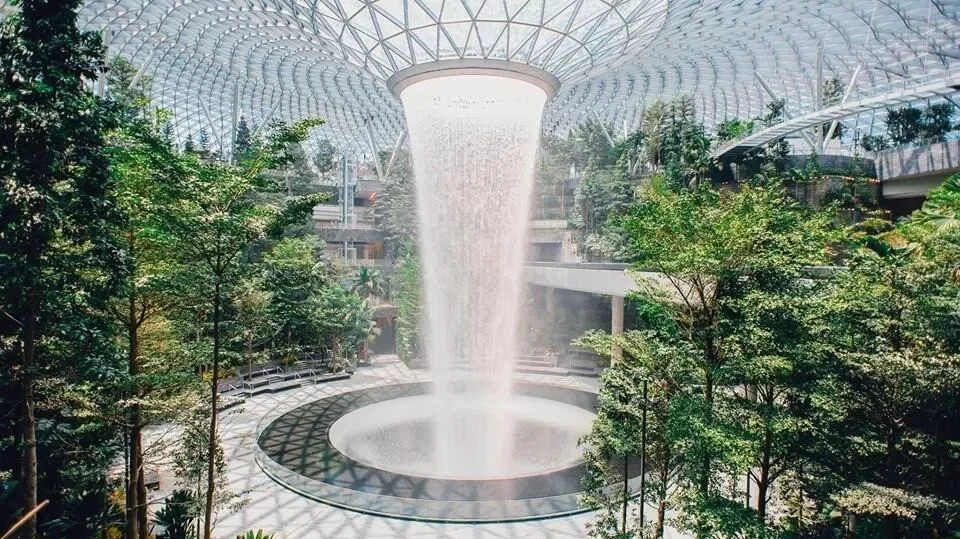

Китайский Новый год 2020 года разложил популярные направления по времени полёта: Тайбэй, Бангкок, Сингапур и Саппоро — в пределах четырёх часов; Лондон, Глазго и Москва — восемь-десять; Нью-Йорк, Ванкувер и Сидней — дальше. Эта раскладка одновременно является картой полок с крепким алкоголем в дьюти-фри: чем длиннее полёт, тем вероятнее, что на полке найдётся возрастной виски или односолодовый эксклюзив, который нельзя купить дома.

Гид следует этому порядку, аэропорт за аэропортом, отмечая оператора, бутылки, которые стоит взять, и цену на ценнике, а в конце — как выбирать. Цены — записи января 2020 года по курсу того дня; квоты и валюты с тех пор изменились, но логика — нет.

## 1. Почему трэвел-ритейл заслуживает отдельного взгляда

Первая причина — эксклюзивный розлив: объёмы трэвел-ритейла позволяют винокурне сделать отдельную партию. Dewar's Double Double вышел эксклюзивно в Чанги в 2019 году, его 21-, 27- и 32-летние версии — все в бутылках 500 мл; Glenlivet сделал 14-летний виски в бочках из-под олоросо для тайваньского дьюти-фри; Jura Time существует только в трэвел-ритейле; Caperdonich 25 Peated объявился в Глазго. Пропустите аэропорт — и второго шанса часто не будет.

Вторая — cask strength и односолодовые бочки: две бутылки OMAR по 200 мл в олоросо в Таоюане — это сингл-каски, номера бочки и бутылки написаны от руки; Craigellachie 39 в Хитроу — cask strength, без холодной фильтрации и натурального цвета. Третья — налог: дьюти-фри убирает импортную пошлину и местный акциз, поэтому ценники в аэропорту часто ниже городской розницы — сайт самого Чанги обещает до 60% экономии по сравнению с городом.

## 2. Перед полётом: нормы и основные правила

Начните с нормы. Лимит беспошлинного ввоза в материковый Китай зависел от того, кто едет; лимит на табак был одинаковым для всех.

| Путешественник | Крепкий алкоголь свыше 12% | Табак |
| --- | --- | --- |
| Жители Гонконга и Макао, а также жители материка, едущие в Гонконг или Макао частным порядком | 1 бутылка (до 0,75 литра) | 400 сигарет, 100 сигар, 500 г табака |
| Остальные путешественники с материка | 2 бутылки (до 1,5 литра) | Как выше |

Для обычного путешественника с материка 1,5 литра — это примерно две бутылки по 700 мл; всё, что сверх, нужно декларировать.

## 3. До четырёх часов: Тайбэй, Бангкок, Сингапур, Саппоро

**Таоюань** — самая локальная остановка в этой группе: дьюти-фри управляет TTL, Тайваньская табачная и ликёроводочная корпорация, а её винокурня в Наньтоу сделала OMAR известным на конкурсах. Два набора стоят внимания: пара бутылок по 200 мл Oloroso cask strength, односолодовых, с написанными от руки номерами бочки и бутылки (NT$2 200, около 507 юаней), и односолодовый Oloroso четырёхлетней выдержки (NT$1 100, около 254 юаней). Магазины Taiwan Wine and Tobacco сети Ever Rich на третьем этаже T1–T3 продвигают эксклюзивный для Азии Glenlivet 14 лет за NT$1 450 (около 334 юаней).

**Бангкок** принадлежит King Power: пять магазинов в аэропортах — Донмыанг, Суварнабхуми, Пхукет, Чиангмай и Хатъяй — и четыре городских магазина, где регистрируют паспорт и обратный рейс, получают купоны и покупают с выдачей в аэропорту. Виски там непримечательный: Royal Salute 21 лет 700 мл — около 820 юаней, примерно на 50 юаней ниже средней цены по стране; Chita 700 мл — около 450 юаней; Martell Noblige литр — около 610 юаней, примерно на 100 юаней меньше. Стоит брать для подарков, а не для собственной полки.

**Сингапурский Чанги** работает в другом масштабе: кампания к Китайскому Новому году давала скидки на отдельные бутылки, а сайт принимал заказы за 30 дней — 12 часов до вылета с получением в T1–T4. Закон Сингапура разрешает вылетающим пассажирам 10 литров алкоголя, хотя китайская норма 1,5 литра всё равно действует по прибытии.

Три эксклюзива Чанги выделяются: Raffles 1915 Gin (S$85, около 436 юаней), выпущенный к столетию коктейля Singapore Sling, созданного в отеле Raffles в 1915 году и смешанного с лондонским Smith в 2015-м; Dewar's Double Double в трёх выражениях по 500 мл — Oloroso-finished 21 (S$125, около 640 юаней), Palo Cortado 27 (S$220, около 1 129 юаней) и Pedro Ximénez 32 (S$345, около 1 770 юаней), причём 32-летний и 21-летний заняли первое и третье места среди купажированных шотландских виски на IWC 2019; и разовые релизы вроде Armagnac 1980 года и Balvenie 21 Madeira Cask.

**Новый Титосэ в Саппоро** представляет Японию. Ворота Хоккайдо имеют онсэн на четвёртом этаже внутреннего терминала (¥1 500, около 94 юаней). Японские магазины возвращают налог, поэтому если подходит только аэропорт, там есть Yoichi и Miyagikyo без указания возраста по ¥4 200 (около 266 юаней), хотя Rakuten показывает их примерно за ¥5 500; уточняйте скидку на кассе.

## 4. Восемь-десять часов: Лондон, Глазго, Москва

**Лондонский Хитроу** устраивает самое большое шоу: танец льва на главной странице, праздничные события с 14 января до начала февраля и никакой реальной скидки на крепкий алкоголь — зато по T2–T5 ходит Бог богатства с ваучерами World Duty Free на £2,50. Сам World Duty Free принимает онлайн-заказы за месяц — 24 часа до вылета и берёт меньшую цену, если она упадёт к моменту получения.

Британия — родина виски. Craigellachie 39 лет стоит £3 499 (около 32 000 юаней): дистиллирован в 1980 году, выдержан в бочках из-под бурбона повторного использования и доведён в 2019-м, всего 138 бутылок в мире, cask strength, без холодной фильтрации и натурального цвета — самый старый Craigellachie в продаже. Винокурня, построенная в 1891 году, стоит в центре Спейсайда в одном мосту от Macallan и долго поставляла виски для купажей Dewar's и White Horse, отсюда прозвище „скрытая винокурня“. Подешевле: Midleton Very Rare 2003 (£125, около 1 139 юаней) и The Lakes Explorer gin (£32,50, около 256 юаней).

**Глазго**, тоже World Duty Free, добавляет ваучер £5 за £75 покупки. Caperdonich 25 Peated (£478, около 4 340 юаней) — единственная закрытая винокурня в наборе Secret Speyside из 15 бутылок: последний спирт получен в 2002 году, площадка снесена в 2011-м. Fettercairn 27 (£405, около 3 677 юаней) происходит с винокурни, построенной в 1824 году и когда-то последней в восточном Хайленде, где с середины 1950-х используют охлаждение водяным кольцом. Jura Time 21 (£149, около 1 329 юаней) — трэвел-ритейл-половина серии Time and Tide: в Хитроу его нет, в Глазго подтверждён.

**Московский Домодедово** был воротами в европейскую страну, которую китайские путешественники чаще всего посещали той весной, если смотреть по географии. Крупнейший аэропорт России — хаб S7 и VIM, а My Duty Free принимает предзаказы с выдачей, обычно дешевле. Брать стоит водку: Legend of Kremlin (€41, около 318 юаней), дистиллированную пять раз и настолько мягкую, что нет жжения от зерна, и Organika Life (€140, около 1 070 юаней) в керамической бутылке с водой Байкала, ароматизированной саган-дайля.

## 5. Десять часов и больше: Нью-Йорк, Ванкувер, Сидней

**Нью-Йорк JFK** раскинулся на шесть терминалов, связанных AirTrain, и смена терминала означает повторный досмотр. Air China, China Southern, Singapore Airlines и Delta сосредоточены в T4 — территории DFS и крупнейшего дьюти-фри аэропорта, но предзаказа там нет.

В **Ванкувере** магазины World Duty Free есть в международном и американском терминалах, а к Китайскому Новому году давали около 20% скидки на две бутылки. Wayne Gretzky 99 Proof (C$107, около 564 юаней) — третий малый релиз, доведённый в собственных бочках из-под Cabernet Sauvignon хозяйства; литровый Crown Royal идёт по той же акции.

**Сидней** претендует на крупнейший в мире зал дьюти-фри: 8 000 квадратных метров Heinemann в T1, онлайн-заказы принимают за 48 часов. Hellyers Road 10 лет Slightly Peated (A$118, около 558 юаней) получил звание лучшего австралийского виски на ADSA 2018 и лучшего австралийского односолодового на World Whiskies Awards 2019; Limeburners Sherry Cask (A$140, около 662 юаней) использует ячмень Западной Австралии и выдержку в шерри; Archie Rose Rye Malt (A$100, около 473 юаней) делают из пророщенной ржи.

## 6. Как выбирать: возраст, бочка, объём, пересадки

Возраст — не единственная переменная: внутри одной винокурни тип бочки важнее нескольких дополнительных лет. Glenlivet 14 полностью выдержан в олоросо, поэтому сухофрукты и специи лежат поверх алкоголя; Yoichi NAS наслаивает торф и дубовую сладость. Сначала определите стиль бочки, возраст — вторым.

Шерри и бурбон — две главные дороги: шерри даёт сухофрукты, орехи, шоколад и специи (шерри-бочки OMAR, Glendronach, Dewar's Double Double 21), бурбон — ваниль, сливки и более чистую сладость (Yoichi, Miyagikyo, рожь Archie Rose). Cask strength означает 55% и выше и раскрывается с водой.

Объём бутылки следует за нормой: литровые бутылки (Martell Noblige, Crown Royal) дешевле за сантилитр, но дороже в сумме, 500 мл подходят для первого знакомства, а две бутылки по 700 мл ровно укладываются в 1,5 литра.

Пересадки — место, где люди попадают впросак. Дьюти-фри-алкоголь покупают после досмотра и запечатывают в защищённый пакет; ещё один досмотр или американское требование повторно сдать багаж перед внутренним рейсом могут означать потерю бутылки. По возможности покупайте на последнем отрезке и уточняйте, принимает ли транзитный аэропорт жидкость в защищённой упаковке. Предзаказ помогает там, где он есть: Чанги — от 30 дней до 12 часов, Хитроу и Глазго — от месяца до 24 часов, Сидней — 48 часов; в JFK его нет.

## Полезные ссылки

- **На этом сайте**: [Лондонский Хитроу (LHR)](/airport/LHR), [Сингапурский Чанги (SIN)](/airport/SIN), [Бангкок Суварнабхуми (BKK)](/airport/BKK), [Великобритания (GB)](/country/GB), [Сингапур (SG)](/country/SG), [Таиланд (TH)](/country/TH)
- **Википедия**: [Виски](https://en.wikipedia.org/wiki/Whisky), [Магазин беспошлинной торговли](https://en.wikipedia.org/wiki/Duty-free_shop)
- **Baidu Baike**: [Виски](https://baike.baidu.com/item/%E5%A8%81%E5%A3%AB%E5%BF%8C), [Магазин беспошлинной торговли](https://baike.baidu.com/item/%E5%85%8D%E7%A8%8E%E5%BA%97)

Источник изображений: Whisky Magazine, аэропорты и операторы дьюти-фри. Цены и ассортимент — записи января 2020 года; нормы и правила провоза жидкости устанавливают таможня страны назначения и авиакомпания, поэтому перед поездкой проверяйте сайт оператора.
