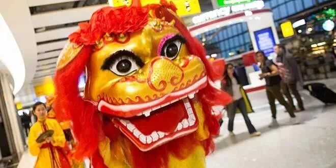

Inför det kinesiska nyåret 2020 sorterades populära resmål efter flygtid: Taipei, Bangkok, Singapore och Sapporo inom fyra timmar; London, Glasgow och Moskva på åtta till tio; New York, Vancouver och Sydney bortom det. Den spridningen är också en hyllkarta för taxfree-sprit: ju längre flygning, desto större chans att hyllan har en åldersangivelse eller ett single cask som du inte kan köpa hemma.

Den här guiden följer den ordningen, flygplats för flygplats, och noterar operatören, buteljerna som är värda att ta med och priset på etiketten, och avslutar med hur du väljer. Priserna är noteringar från januari 2020 till dåvarande växelkurs; kvoter och valutor har rört sig sedan dess, men logiken har inte gjort det.

## 1. Varför resehandeln förtjänar en egen titt

Det första skälet är exklusiv buteljering: resehandelns volymer gör att ett destilleri kan fylla en separat sats. Dewar's Double Double lanserades exklusivt på Changi 2019, där 21-, 27- och 32-åringarna alla kom i 500 ml; Glenlivet gjorde en 14-årig Oloroso-sherry för Taiwans taxfreekanal; Jura's Time finns bara i resehandeln; Caperdonich 25 Peated dök upp i Glasgow. Missar du flygplatsen kommer den andra chansen ofta inte.

Det andra är cask strength och single casks: OMAR:s två 200 ml Oloroso-flaskor på Taoyuan är single casks, med fat- och flasknummer skrivna för hand; Craigellachie 39 på Heathrow är cask strength, icke-kylfiltrerad och naturlig färg. Det tredje är skatten: taxfree tar bort importtull och lokal konsumtionsskatt, så flygplatsens prislappar ligger ofta under stadens detaljhandel – Changis egen sajt hävdar upp till 60 procent jämfört med stan.

## 2. Innan du flyger: kvoter och grundregler

Börja med kvoten. Taxfreegränsen vid inresa till det kinesiska fastlandet berodde på vem som reste; tobaksgränsen var densamma för alla.

| Resenär | Sprit över 12 % ABV | Tobak |
| --- | --- | --- |
| Invånare i Hongkong och Macau, samt fastlandsbor som reser till Hongkong eller Macau privat | 1 flaska (under 0,75 liter) | 400 cigarretter, 100 cigarrer, 500 g tobak |
| Övriga fastlandsresenärer | 2 flaskor (under 1,5 liter) | Som ovan |

För en vanlig fastlandsresenär är 1,5 liter ungefär två 700 ml-flaskor; allt därutöver måste deklareras.

## 3. Under fyra timmar: Taipei, Bangkok, Singapore, Sapporo

**Taoyuan** är det mest lokala stoppet i det här intervallet: TTL, Taiwan Tobacco and Liquor Corporation, driver taxfreebutiken, och dess destilleri i Nantou har gjort OMAR till ett namn i tävlingar. Två set är värda disken: ett par 200 ml Oloroso cask strength single casks med handskrivna fat- och flasknummer (2 200 NT$, cirka 507 yuan), och en single malt Oloroso som mognat i över fyra år (1 100 NT$, cirka 254 yuan). Ever Richs butiker Taiwan Wine and Tobacco på tredje våningen i T1–T3 säljer en Asien-exklusiv Glenlivet 14 år för 1 450 NT$ (cirka 334 yuan).

**Bangkok** tillhör King Power, med fem butiker på flygplatserna – Don Mueang, Suvarnabhumi, Phuket, Chiang Mai och Hat Yai – och fyra stadsbutiker där du registrerar pass och returflyg, hämtar kuponger och handlar för upphämtning på flygplatsen. Whiskyn är intetsägande: Royal Salute 21 år 700 ml för cirka 820 yuan, cirka 50 yuan under det inhemska genomsnittet; Chita 700 ml cirka 450 yuan; Martell Noblige en liter cirka 610 yuan, ungefär 100 yuan mindre. Värt det för presenter, inte för din egen hylla.

**Singapore Changi** arbetar i en annan skala: kampanjen för kinesiska nyåret gav rabatt på utvalda flaskor, och webbplatsen tog emot beställningar från 30 dagar till 12 timmar före avgång med upphämtning i T1–T4. Singaporiansk lag tillåter avgående passagerare 10 liter sprit, men den kinesiska kvoten på 1,5 liter gäller fortfarande vid ankomst.

Tre Changi-exklusiva buteljer sticker ut: Raffles 1915 Gin (S$85, cirka 436 yuan), som markerar hundraårsjubileet av Singapore Sling som skapades på Raffles Hotel 1915 och blandades med Londons Smith 2015; Dewar's Double Double i tre 500 ml-uttryck – Oloroso-finish 21 (S$125, cirka 640 yuan), Palo Cortado 27 (S$220, cirka 1 129 yuan) och Pedro Ximénez 32 (S$345, cirka 1 770 yuan), där 32:an och 21:an tog första och tredje plats för blended Scotch vid IWC 2019; och unika buteljer som en Armagnac från 1980 och Balvenie 21 Madeira Cask.

**Sapporo New Chitose** får representera Japan. Hokkaidos port har ett onsen på inrikesterminalens fjärde våning (1 500 yen, cirka 94 yuan). Japanska butiker erbjuder skatteåterbäring, så om bara flygplatsen passar finns de ålderslösa Yoichi och Miyagikyo där för 4 200 yen styck (cirka 266 yuan), även om Rakuten listar dem kring 5 500 yen; bekräfta eventuell rabatt i kassan.

## 4. Åtta till tio timmar: London, Glasgow, Moskva

**London Heathrow** ställer till med den största showen: ett lejondans på startsidan, festevenemang från 14 januari till början av februari och ingen egentlig rabatt på sprit – men förmögenhetsguden vandrar mellan T2 och T5 med värdecheckar på £2,50 från World Duty Free. World Duty Free tar själva emot onlinebeställningar från en månad till 24 timmar före avgång och tar ut det lägre priset om det sjunker före upphämtningen.

Storbritannien är whiskyns hem. Craigellachie 39 år kostar £3 499 (cirka 32 000 yuan): destillerad 1980, mognad på refill bourbon-fat och finish 2019, endast 138 flaskor världen över, cask strength, icke-kylfiltrerad och naturlig färg – den äldsta Craigellachie som säljs. Destilleriet, byggt 1891, ligger i centrala Speyside en bro från Macallan och har länge levererat till Dewar's och White Horse för blandning, därav "det dolda destilleriet". Snällare mot plånboken: Midleton Very Rare 2003 (£125, cirka 1 139 yuan) och The Lakes Explorer gin (£32,50, cirka 256 yuan).

**Glasgow**, också World Duty Free, bjuder på en värdecheck på £5 för varje £75 du handlar för. Caperdonich 25 Peated (£478, cirka 4 340 yuan) är det enda nedlagda destilleriet i Secret Speyside-serien på 15 buteljer: sista destilleringen 2002, anläggningen riven 2011. Fettercairn 27 (£405, cirka 3 677 yuan) kommer från ett destilleri byggt 1824, en gång det sista i östra Highlands, med vattenringskylning från mitten av 1950-talet. Jura Time 21 (£149, cirka 1 329 yuan) är resehandelns hälft av Time and Tide – inte på Heathrow, bekräftad i Glasgow.

**Moskva Domodedovo** var porten till det europeiska land som kinesiska resenärer besökte mest den våren, geografiskt sett. Rysslands största flygplats är navet för S7 och VIM, och My Duty Free tar emot förbeställningar för upphämtning, oftast billigare. Vodka är köpet: Legend of Kremlin (€41, cirka 318 yuan), destillerad fem gånger och slät nog att inte ha någon spannmålsskärpa, och Organika Life (€140, cirka 1 070 yuan), en keramisk flaska med vatten från Bajkalsjön smaksatt med Sagan-Dalia.

## 5. Tio timmar och längre: New York, Vancouver, Sydney

**New York JFK** har sex terminaler sammanknutna av AirTrain, och ett terminalbyte innebär att du måste igenom säkerhetskontrollen igen. Air China, China Southern, Singapore Airlines och Delta samlas i T4, DFS territorium och flygplatsens största taxfreebutik, men det finns ingen förbeställning.

**Vancouver** har World Duty Free-butiker i den internationella terminalen och USA-terminalen, med cirka 20 procents rabatt på två flaskor till det kinesiska nyåret. Wayne Gretzky 99 Proof (C$107, cirka 564 yuan) är den tredje small batch-utgåvan, finishad på egendomens egna Cabernet Sauvignon-fat; Crown Royal i enlitersflaska ingår i samma erbjudande.

**Sydney** hävdar att man har världens största taxfreehall: Heinemanns 8 000 kvadratmeter i T1, med onlinebeställningar upp till 48 timmar i förväg. Hellyers Road 10 år Slightly Peated (A$118, cirka 558 yuan) vann bästa australiska whisky vid ADSA 2018 och bästa australiska single malt vid World Whiskies Awards 2019; Limeburners Sherry Cask (A$140, cirka 662 yuan) använder korn från Western Australia och sherryfinish; Archie Rose Rye Malt (A$100, cirka 473 yuan) använder maltad råg.

## 6. Hur du väljer: ålder, fat, flaskstorlek, byten

Åldern är inte den enda variabeln: inom ett och samma destilleri betyder fattypen mer än några extra år. Glenlivet 14 är helt Oloroso, så torkad frukt och kryddor ligger över alkoholen; Yoichi NAS varvar torv och eksötma. Bestäm fatstilen först och åldern sedan.

Sherry och bourbon är de två huvudvägarna: sherry ger torkad frukt, nötter, choklad och kryddor (OMAR:s sherryfat, Glendronach, Dewar's Double Double 21), bourbon ger vanilj, grädde och renare sötma (Yoichi, Miyagikyo, Archie Rose råg). Cask strength betyder 55 procent eller mer och öppnar upp sig med vatten.

Flaskstorleken följer kvoten: enlitersflaskor (Martell Noblige, Crown Royal) kostar mindre per centiliter men mer totalt, 500 ml passar för en första smak, och två 700 ml-flaskor ryms precis inom 1,5 liter.

Det är vid byten det går fel. Taxfreesprit köps efter säkerhetskontrollen och förseglas i en manipuleringssäker påse; ännu en säkerhetskontroll, eller USA:s krav att checka in väskorna igen före en inrikes anslutning, kan innebära att flaskan försvinner. Köp på sista sträckan där det är möjligt och bekräfta att transitflygplatsen accepterar säkerhetsförseglad vätska. Förbeställning hjälper där den finns: Changi 30 dagar till 12 timmar, Heathrow och Glasgow en månad till 24 timmar, Sydney 48 timmar; JFK har ingen.

## Relaterade länkar

- **På den här sajten**: [London Heathrow (LHR)](/airport/LHR), [Singapore Changi (SIN)](/airport/SIN), [Bangkok Suvarnabhumi (BKK)](/airport/BKK), [Storbritannien (GB)](/country/GB), [Singapore (SG)](/country/SG), [Thailand (TH)](/country/TH)
- **Wikipedia**: [Whisky](https://en.wikipedia.org/wiki/Whisky), [Taxfreebutik](https://en.wikipedia.org/wiki/Duty-free_shop)
- **Baidu Baike**: [Whisky](https://baike.baidu.com/item/%E5%A8%81%E5%A3%AB%E5%BF%8C), [Taxfreebutik](https://baike.baidu.com/item/%E5%85%8D%E7%A8%8E%E5%BA%97)

Bildkälla: Whisky Magazine samt flygplats- och taxfreeoperatörer. Priser och sortiment är noteringar från januari 2020; kvoter och regler för vätskor fastställs av destinationslandets tullmyndighet och flygbolaget, så kontrollera operatörens sajt innan du reser.
