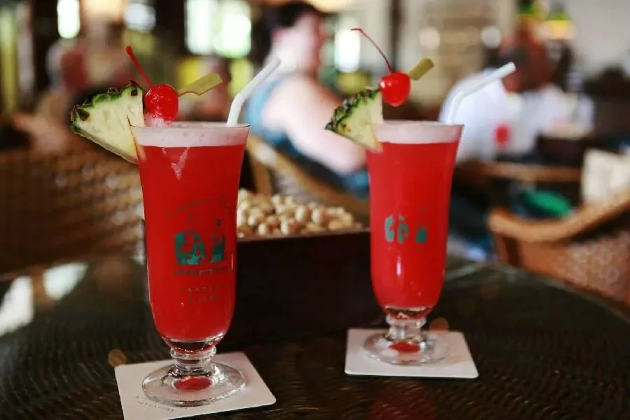

ตรุษจีนปี 2020 จัดจุดหมายยอดนิยมตามเวลาเที่ยวบิน: ไทเป กรุงเทพฯ สิงคโปร์ และซัปโปโรภายในสี่ชั่วโมง ลอนดอน กลาสโกว์ และมอสโกที่แปดถึงสิบชั่วโมง นิวยอร์ก แวนคูเวอร์ และซิดนีย์เกินกว่านั้น ช่วงเวลานี้ยังเป็นแผนที่ชั้นวางสุราปลอดภาษีด้วย: ยิ่งเที่ยวบินยาว ชั้นวางยิ่งมีแนวโน้มจะมี age statement หรือ single cask ที่ซื้อที่บ้านไม่ได้

คู่มือนี้เรียงตามลำดับนั้น ทีละสนามบิน โดยระบุผู้ประกอบการ ขวดที่คุ้มค่า และราคาบนป้าย จากนั้นปิดท้ายด้วยวิธีเลือก ราคาเป็นบันทึกเดือนมกราคม 2020 ตามอัตราแลกเปลี่ยนของวันนั้น โควตาและสกุลเงินเปลี่ยนไปแล้วตั้งแต่นั้น แต่ตรรกะยังเหมือนเดิม

## 1. ทำไม travel retail จึงควรค่าแก่การมองแยก

เหตุผลแรกคือการบรรจุขวดแบบพิเศษ: ปริมาณของ travel retail ทำให้โรงกลั่นสามารถผลิตรุ่นแยกได้ Dewar's Double Double เปิดตัวเฉพาะที่ชางงีในปี 2019 โดยรุ่น 21, 27 และ 32 ปีทั้งหมดขนาด 500 มล. Glenlivet ทำรุ่น Oloroso-sherry 14 ปีสำหรับช่องทางปลอดภาษีของไต้หวัน Jura's Time มีเฉพาะ travel retail ส่วน Caperdonich 25 Peated ปรากฏที่กลาสโกว์ หากพลาดที่สนามบิน โอกาสครั้งที่สองมักไม่มา

เหตุผลที่สองคือ cask strength และ single cask: ขวด OMAR Oloroso ขนาด 200 มล. สองขวดที่เถาหยวนเป็น single cask โดยเขียนหมายเลขถังและหมายเลขขวดด้วยมือ Craigellachie 39 ที่ฮีทโธรว์เป็น cask strength ไม่กรองเย็น และสีธรรมชาติ เหตุผลที่สามคือภาษี: ปลอดภาษีตัดภาษีนำเข้าและภาษีบริโภคท้องถิ่น ราคาที่สนามบินจึงมักถูกกว่าร้านในเมือง — เว็บไซต์ของชางงีเองอ้างว่าถูกกว่าถึง 60% เมื่อเทียบกับในเมือง

## 2. ก่อนบิน: โควตาและกฎพื้นฐาน

เริ่มจากโควตา ขีดจำกัดปลอดภาษีเมื่อเข้าจีนแผ่นดินใหญ่ขึ้นอยู่กับผู้เดินทาง ส่วนขีดจำกัดยาสูบเหมือนกันสำหรับทุกคน

| ผู้เดินทาง | สุราเกิน 12% ABV | ยาสูบ |
| --- | --- | --- |
| ผู้พำนักในฮ่องกงและมาเก๊า และผู้พำนักจีนแผ่นดินใหญ่ที่เดินทางไปฮ่องกงหรือมาเก๊าแบบส่วนตัว | 1 ขวด (ต่ำกว่า 0.75 ลิตร) | บุหรี่ 400 มวน ซิการ์ 100 มวน ใบยาสูบ 500 กรัม |
| ผู้เดินทางจากจีนแผ่นดินใหญ่อื่น ๆ | 2 ขวด (ต่ำกว่า 1.5 ลิตร) | เช่นเดียวกับข้างต้น |

สำหรับผู้เดินทางทั่วไปจากจีนแผ่นดินใหญ่ 1.5 ลิตรคือประมาณสองขวดขนาด 700 มล. สิ่งที่เกินกว่านั้นต้องสำแดง

## 3. ต่ำกว่าสี่ชั่วโมง: ไทเป กรุงเทพฯ สิงคโปร์ ซัปโปโร

**เถาหยวน** เป็นจุดที่ท้องถิ่นที่สุดในช่วงนี้: TTL หรือ Taiwan Tobacco and Liquor Corporation บริหารร้านปลอดภาษี และโรงกลั่นหนานโถวของบริษัททำให้ OMAR เป็นชื่อที่รู้จักในการแข่งขัน มีสองชุดที่คุ้มค่าเดินไปที่เคาน์เตอร์: single cask Oloroso cask strength ขนาด 200 มล. จำนวนสองขวดพร้อมหมายเลขถังและหมายเลขขวดเขียนด้วยมือ (NT$2,200 ประมาณ 507 หยวน) และ single malt Oloroso ที่บ่มสี่ปี (NT$1,100 ประมาณ 254 หยวน) ร้าน Taiwan Wine and Tobacco ของ Ever Rich บนชั้นสามของ T1–T3 ดัน Glenlivet 14 ปีรุ่นพิเศษเฉพาะเอเชียราคา NT$1,450 (ประมาณ 334 หยวน)

**กรุงเทพฯ** เป็นของ King Power มีร้านในสนามบินห้าแห่ง — ดอนเมือง สุวรรณภูมิ ภูเก็ต เชียงใหม่ และหาดใหญ่ — และร้านในเมืองสี่แห่งที่คุณลงทะเบียนหนังสือเดินทางและเที่ยวบินขากลับ รับคูปอง แล้วเลือกซื้อเพื่อรับที่สนามบิน วิสกี้ไม่โดดเด่น: Royal Salute 21 ปี 700 มล. ราคาประมาณ 820 หยวน ถูกกว่าค่าเฉลี่ยในประเทศราว 50 หยวน; Chita 700 มล. ประมาณ 450 หยวน; Martell Noblige หนึ่งลิตรประมาณ 610 หยวน ถูกกว่าราว 100 หยวน คุ้มสำหรับเป็นของขวัญ ไม่ใช่สำหรับชั้นวางของคุณเอง

**สิงคโปร์ชางงี** ทำงานอีกสเกลหนึ่ง: แคมเปญตรุษจีนลดราคาขวดที่เลือก และเว็บไซต์รับสั่งซื้อตั้งแต่ 30 วันถึง 12 ชั่วโมงก่อนออกเดินทาง รับสินค้าที่ T1–T4 กฎหมายสิงคโปร์อนุญาตให้ผู้โดยสารขาออกนำสุราได้ 10 ลิตร แม้โควตาจีน 1.5 ลิตรยังใช้เมื่อเดินทางถึง

รุ่นพิเศษสามรุ่นของชางงีโดดเด่น: Raffles 1915 Gin (S$85 ประมาณ 436 หยวน) ฉลองครบรอบหนึ่งร้อยปีของ Singapore Sling ที่สร้างขึ้นที่โรงแรม Raffles ในปี 1915 และผสมกับ Smith ของลอนดอนในปี 2015; Dewar's Double Double สามรุ่นขนาด 500 มล. — Oloroso-finished 21 (S$125 ประมาณ 640 หยวน), Palo Cortado 27 (S$220 ประมาณ 1,129 หยวน) และ Pedro Ximénez 32 (S$345 ประมาณ 1,770 หยวน) โดยรุ่น 32 และ 21 คว้าอันดับหนึ่งและสามในหมวด blended Scotch ที่ IWC 2019; และรุ่นพิเศษเฉพาะเช่น Armagnac ปี 1980 และ Balvenie 21 Madeira Cask

**ซัปโปโรนิวชิโตเสะ** เป็นตัวแทนญี่ปุ่น ประตูสู่ฮอกไกโดมีออนเซ็นบนชั้นสี่ของอาคารผู้โดยสารในประเทศ (¥1,500 ประมาณ 94 หยวน) ร้านในญี่ปุ่นคืนภาษี ดังนั้นหากไปได้แค่สนามบิน ก็มี Yoichi และ Miyagikyo แบบไม่มี age statement ในราคา ¥4,200 ต่อขวด (ประมาณ 266 หยวน) แม้ Rakuten ระบุราคาราว ¥5,500 ควรยืนยันส่วนลดที่เคาน์เตอร์จ่ายเงิน

## 4. แปดถึงสิบชั่วโมง: ลอนดอน กลาสโกว์ มอสโก

**ลอนดอนฮีทโธรว์** จัดเต็มที่สุด: การเชิดสิงโตบนหน้าแรก กิจกรรมเทศกาลตั้งแต่ 14 มกราคมถึงต้นกุมภาพันธ์ และไม่มีส่วนลดจริงสำหรับสุรา — แต่เทพเจ้าแห่งความมั่งคั่งเดินวน T2 ถึง T5 พร้อมบัตรกำนัล World Duty Free มูลค่า £2.50 World Duty Free เองรับสั่งซื้อออนไลน์ตั้งแต่หนึ่งเดือนถึง 24 ชั่วโมงก่อนออกเดินทาง และคิดราคาที่ต่ำกว่าหากราคาลดลงเมื่อถึงเวลารับสินค้า

อังกฤษเป็นบ้านของวิสกี้ Craigellachie 39 ปีราคา £3,499 (ประมาณ 32,000 หยวน): กลั่นในปี 1980 บ่มในถัง bourbon ที่ใช้แล้วและฟินิชในปี 2019 มีเพียง 138 ขวดทั่วโลก เป็น cask strength ไม่กรองเย็น และสีธรรมชาติ — เป็น Craigellachie ที่เก่าที่สุดที่วางจำหน่าย โรงกลั่นที่สร้างในปี 1891 ตั้งอยู่ในใจกลางสเปย์ไซด์ ห่างจาก Macallan เพียงสะพานเดียว และผลิตให้ Dewar's และ White Horse สำหรับการผสมมาเป็นเวลานาน จึงได้ชื่อว่า «โรงกลั่นที่ซ่อนอยู่» รุ่นที่เบากว่าสำหรับกระเป๋าเงิน: Midleton Very Rare 2003 (£125 ประมาณ 1,139 หยวน) และยิน The Lakes Explorer (£32.50 ประมาณ 256 หยวน)

**กลาสโกว์** ก็เป็น World Duty Free และเพิ่มบัตรกำนัล £5 เมื่อใช้จ่าย £75 Caperdonich 25 Peated (£478 ประมาณ 4,340 หยวน) เป็นโรงกลั่นปิดแห่งเดียวในชุด Secret Speyside 15 ขวด: กลั่นครั้งสุดท้ายในปี 2002 โรงงานถูกรื้อในปี 2011 Fettercairn 27 (£405 ประมาณ 3,677 หยวน) มาจากโรงกลั่นที่สร้างในปี 1824 เคยเป็นแห่งสุดท้ายในที่ราบสูงตะวันออก ใช้ระบบทำความเย็นแบบวงแหวนน้ำตั้งแต่กลางทศวรรษ 1950 Jura Time 21 (£149 ประมาณ 1,329 หยวน) เป็นครึ่งหนึ่งของ Time and Tide ที่มีเฉพาะ travel retail — ไม่มีที่ฮีทโธรว์ ยืนยันที่กลาสโกว์

**มอสโกโดโมเดโดโว** เป็นประตูสู่ประเทศยุโรปที่นักเดินทางจีนไปเยือนมากที่สุดในฤดูใบไม้ผลินั้นในทางภูมิศาสตร์ สนามบินที่ใหญ่ที่สุดของรัสเซียเป็นศูนย์กลางของ S7 และ VIM และ My Duty Free รับสั่งจองล่วงหน้าเพื่อรับสินค้า ซึ่งมักถูกกว่า วอดก้าคือของที่ควรซื้อ: Legend of Kremlin (€41 ประมาณ 318 หยวน) กลั่นห้าครั้งและนุ่มพอที่จะไม่มีความเผ็ดของธัญพืช และ Organika Life (€140 ประมาณ 1,070 หยวน) ขวดเซรามิกบรรจุน้ำจากทะเลสาบไบคาลปรุงรสด้วย Sagan-Dalia

## 5. สิบชั่วโมงขึ้นไป: นิวยอร์ก แวนคูเวอร์ ซิดนีย์

**นิวยอร์ก JFK** มีหกอาคารผู้โดยสารเชื่อมด้วย AirTrain และการเปลี่ยนอาคารหมายถึงต้องผ่านการรักษาความปลอดภัยอีกครั้ง Air China, China Southern, Singapore Airlines และ Delta รวมตัวอยู่ที่ T4 ซึ่งเป็นพื้นที่ของ DFS และร้านปลอดภาษีที่ใหญ่ที่สุดของสนามบิน แต่ไม่มีการสั่งจองล่วงหน้า

**แวนคูเวอร์** มีร้าน World Duty Free ในอาคารระหว่างประเทศและอาคารสหรัฐฯ โดยมีส่วนลดประมาณ 20% เมื่อซื้อสองขวดสำหรับตรุษจีน Wayne Gretzky 99 Proof (C$107 ประมาณ 564 หยวน) เป็นรุ่น small-batch รุ่นที่สาม ฟินิชในถัง Cabernet Sauvignon ของไร่องุ่นเอง; Crown Royal หนึ่งลิตรอยู่ในดีลเดียวกัน

**ซิดนีย์** อ้างว่ามีโถงปลอดภาษีที่ใหญ่ที่สุดในโลก: Heinemann ขนาด 8,000 ตารางเมตรใน T1 รับสั่งซื้อออนไลน์ได้ถึง 48 ชั่วโมงก่อนเดินทาง Hellyers Road 10 ปี Slightly Peated (A$118 ประมาณ 558 หยวน) ชนะรางวัลวิสกี้ออสเตรเลียยอดเยี่ยมที่ ADSA 2018 และ single malt ออสเตรเลียยอดเยี่ยมที่ World Whiskies Awards 2019; Limeburners Sherry Cask (A$140 ประมาณ 662 หยวน) ใช้ข้าวบาร์เลย์จากออสเตรเลียตะวันตกและฟินิชในถังเชอร์รี่; Archie Rose Rye Malt (A$100 ประมาณ 473 หยวน) ใช้ข้าวไรย์มอลต์

## 6. วิธีเลือก: อายุ ถังบ่ม ขนาดขวด และการต่อเครื่อง

อายุไม่ใช่ตัวแปรเดียว: ภายในโรงกลั่นเดียว ประเภทถังสำคัญกว่าอายุที่มากกว่าสองสามปี Glenlivet 14 เป็น Oloroso ทั้งหมด ผลไม้แห้งและเครื่องเทศจึงอยู่เหนือแอลกอฮอล์ Yoichi NAS ให้ทั้งพีตและความหวานจากโอ๊กซ้อนกัน กำหนดสไตล์ถังก่อน แล้วค่อยดูอายุ

เชอร์รี่และ bourbon เป็นถนนสายหลักสองสาย: เชอร์รี่ให้ผลไม้แห้ง ถั่ว ช็อกโกแลต และเครื่องเทศ (ถังเชอร์รี่ของ OMAR, Glendronach, Dewar's Double Double 21) bourbon ให้วานิลลา ครีม และความหวานที่สะอาดกว่า (Yoichi, Miyagikyo, ข้าวไรย์ Archie Rose) cask strength หมายถึง 55% ขึ้นไป และเปิดรสด้วยการเติมน้ำ

ขนาดขวดตามโควตา: ขวดหนึ่งลิตร (Martell Noblige, Crown Royal) ถูกกว่าต่อเซนติลิตรแต่แพงกว่าโดยรวม 500 มล. เหมาะกับการลองครั้งแรก และสองขวด 700 มล. พอดีกับ 1.5 ลิตร

การต่อเครื่องคือจุดที่คนมักติดปัญหา สุราปลอดภาษีซื้อหลังผ่านรักษาความปลอดภัยและบรรจุในถุงที่ตรวจจับการเปิดได้ การตรวจรักษาความปลอดภัยอีกครั้ง หรือข้อกำหนดของสหรัฐฯ ที่ต้องตรวจกระเป๋าใหม่ก่อนต่อเครื่องในประเทศ อาจหมายถึงการเสียขวดไป ควรซื้อในช่วงสุดท้ายของเส้นทางหากเป็นไปได้ และยืนยันว่าสนามบินเปลี่ยนเครื่องยอมรับของเหลวที่ปิดผนึกหลังตรวจแล้ว การสั่งจองล่วงหน้าช่วยได้ในที่ที่มี: ชางงี 30 วันถึง 12 ชั่วโมง ฮีทโธรว์และกลาสโกว์หนึ่งเดือนถึง 24 ชั่วโมง ซิดนีย์ 48 ชั่วโมง ส่วน JFK ไม่มี

## ลิงก์ที่เกี่ยวข้อง

- **ในเว็บไซต์นี้**: [ลอนดอนฮีทโธรว์ (LHR)](/airport/LHR), [สิงคโปร์ชางงี (SIN)](/airport/SIN), [กรุงเทพฯ สุวรรณภูมิ (BKK)](/airport/BKK), [สหราชอาณาจักร (GB)](/country/GB), [สิงคโปร์ (SG)](/country/SG), [ไทย (TH)](/country/TH)
- **Wikipedia**: [วิสกี้](https://en.wikipedia.org/wiki/Whisky), [ร้านปลอดภาษี](https://en.wikipedia.org/wiki/Duty-free_shop)
- **Baidu Baike**: [วิสกี้](https://baike.baidu.com/item/%E5%A8%81%E5%A3%AB%E5%BF%8C), [ร้านปลอดภาษี](https://baike.baidu.com/item/%E5%85%8D%E7%A8%8E%E5%BA%97)

ที่มาของภาพ: Whisky Magazine และผู้ประกอบการสนามบินและร้านปลอดภาษี ราคาและรุ่นต่าง ๆ เป็นบันทึกเดือนมกราคม 2020 โควตาและกฎของเหลวกำหนดโดยหน่วยงานศุลกากรปลายทางและสายการบิน จึงควรตรวจสอบเว็บไซต์ของผู้ประกอบการก่อนเดินทาง
