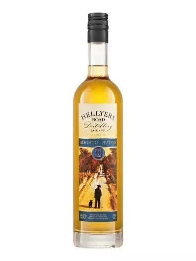

На китайський Новий рік 2020 року популярні напрямки впорядкували за тривалістю перельоту: Тайбей, Бангкок, Сінгапур і Саппоро — у межах чотирьох годин; Лондон, Глазго й Москва — вісім-десять; Нью-Йорк, Ванкувер і Сідней — далі. Цей розподіл водночас є картою полиць для безмитних міцних напоїв: чим довший переліт, тим імовірніше, що на полиці стоїть пляшка із зазначеним віком або з окремої бочки, якої вдома не купиш.

Цей путівник іде тим самим порядком, аеропорт за аеропортом, позначаючи оператора, пляшки, які варто взяти, і ціну на ціннику, а наприкінці — як обирати. Ціни — це записи січня 2020 року за тодішнім курсом; квоти й валюти з того часу змінилися, але логіка — ні.

## 1. Чому тревел-рітейл заслуговує окремої уваги

Перша причина — ексклюзивний розлив: обсяги тревел-рітейлу дозволяють винокурні зробити окрему партію. Dewar's Double Double уперше вийшов ексклюзивно в Changi у 2019 році, і всі три випуски — 21, 27 і 32 роки — були в пляшках по 500 мл; Glenlivet створив 14-річний віскі в бочках з-під хересу Oloroso для безмитного каналу Тайваню; Jura Time існує лише в тревел-рітейлі; Caperdonich 25 Peated з'явився в Глазго. Пропустиш аеропорт — друга нагода часто вже не випадає.

Друга — бочкова міцність і віскі з окремих бочок: дві пляшки OMAR по 200 мл у бочках з-під Oloroso в Таоюані — це віскі з окремих бочок, з номерами бочки й пляшки, написаними від руки; Craigellachie 39 у Хітроу — бочкової міцності, без холодної фільтрації та натурального кольору. Третя — податки: дьюті-фрі знімає ввізне мито й місцевий акциз, тож аеропортові цінники часто нижчі за міські — сайт самого Changi обіцяє до 60 відсотків економії порівняно з містом.

## 2. Перед польотом: норми й основні правила

Почнімо з норми. Ліміт безмитного ввезення при в'їзді до материкового Китаю залежав від того, хто подорожує; ліміт на тютюн був однаковий для всіх.

| Мандрівник | Міцні напої понад 12% алкоголю | Тютюн |
| --- | --- | --- |
| Жителі Гонконгу й Макао, а також жителі материка, які приватно подорожують до Гонконгу чи Макао | 1 пляшка (менш як 0,75 літра) | 400 цигарок, 100 сигар, 500 г тютюну |
| Інші мандрівники з материка | 2 пляшки (менш як 1,5 літра) | Як вище |

Для звичайного мандрівника з материка 1,5 літра — це приблизно дві пляшки по 700 мл; усе, що понад це, треба декларувати.

## 3. До чотирьох годин: Тайбей, Бангкок, Сінгапур, Саппоро

**Таоюань** — найбільш місцева зупинка в цьому діапазоні: безмитним магазином керує TTL, Тайванська тютюново-алкогольна корпорація, і її винокурня в Наньтоу зробила OMAR відомим на конкурсах. Два набори варті уваги біля прилавка: пара пляшок по 200 мл бочкової міцності з-під Oloroso, кожна з окремої бочки, з написаними від руки номерами бочки й пляшки (NT$2 200, приблизно 507 юанів), і односолодовий віскі в бочках з-під Oloroso, витриманий понад чотири роки (NT$1 100, приблизно 254 юани). Крамниці Taiwan Wine and Tobacco мережі Ever Rich на третьому поверсі T1–T3 пропонують 14-річний Glenlivet, ексклюзивний для Азії, за NT$1 450 (приблизно 334 юани).

**Бангкок** належить King Power: п'ять аеропортових магазинів — у Донмиангу, Суварнабхумі, на Пхукеті, у Чіангмаї й Хат'яї — і чотири міські крамниці, де реєструють паспорт і зворотний квиток, отримують купони й купують із отриманням в аеропорту. Віскі тут нічим не вирізняється: Royal Salute 21 року, 700 мл, приблизно 820 юанів — десь на 50 юанів нижче за середню ціну по країні; Chita, 700 мл, приблизно 450 юанів; Martell Noblige, один літр, приблизно 610 юанів — приблизно на 100 юанів дешевше. Варто для подарунків, а не для власної полиці.

**Сінгапурський Чангі** працює в іншому масштабі: новорічна кампанія давала знижки на окремі пляшки, а сайт приймав замовлення від 30 днів до 12 годин до вильоту з отриманням у T1–T4. Закон Сінгапуру дозволяє пасажирам на виліт 10 літрів алкоголю, щоправда, китайська норма 1,5 літра все одно діє під час прибуття.

Три ексклюзиви Changi варті уваги: Raffles 1915 Gin (S$85, приблизно 436 юанів), випущений на честь сторіччя коктейлю Singapore Sling, створеного в готелі Raffles 1915 року; джин купажували з лондонським Smith у 2015-му. Далі Dewar's Double Double у трьох випусках по 500 мл — 21 рік у бочках з-під Oloroso (S$125, приблизно 640 юанів), 27 років у Palo Cortado (S$220, приблизно 1 129 юанів) і 32 роки в Pedro Ximénez (S$345, приблизно 1 770 юанів), причому 32-річний і 21-річний посіли перше й третє місця серед купажованих шотландських віскі на IWC 2019. А також поодинокі речі, як-от арманьяк 1980 року й Balvenie 21 Madeira Cask.

**Новий Тітосе в Саппоро** представляє Японію. У цих воротах Хоккайдо є онсен на четвертому поверсі внутрішнього терміналу (¥1 500, приблизно 94 юани). Японські магазини повертають податок, тож якщо вам підходить лише аеропорт, Yoichi і Miyagikyo без зазначення віку є там по ¥4 200 кожен (приблизно 266 юанів), хоча Rakuten показує їх близько ¥5 500; уточнюйте знижку на касі.

## 4. Вісім-десять годин: Лондон, Глазго, Москва

**Лондонський Хітроу** влаштовує найбільше шоу: танець лева на головній сторінці, святкові події з 14 січня до початку лютого і жодних справжніх знижок на міцні напої — зате Бог багатства ходить терміналами від T2 до T5 з ваучерами World Duty Free на £2,50. Сам World Duty Free приймає онлайн-замовлення від місяця до 24 годин до вильоту й бере меншу ціну, якщо вона знизиться до моменту отримання.

Британія — дім віскі. Craigellachie 39 років коштує £3 499 (приблизно 32 000 юанів): дистильований 1980 року, витриманий у багаторазових бурбонних бочках і доведений 2019 року, лише 138 пляшок у світі, бочкової міцності, без холодної фільтрації та натурального кольору — найстаріший Craigellachie у продажу. Винокурня, збудована 1891 року, стоїть у центрі Спейсайду, за міст від Macallan, і давно постачає Dewar's і White Horse для купажування — звідси й «прихована винокурня». М'якше для гаманця: Midleton Very Rare 2003 (£125, приблизно 1 139 юанів) і джин The Lakes Explorer (£32,50, приблизно 256 юанів).

**Глазго**, теж World Duty Free, додає ваучер на £5 за кожні £75 витрат. Caperdonich 25 Peated (£478, приблизно 4 340 юанів) — єдина закрита винокурня в наборі Secret Speyside із 15 пляшок: останній спирт зварили 2002 року, а майданчик знесли 2011-го. Fettercairn 27 (£405, приблизно 3 677 юанів) походить із винокурні, збудованої 1824 року, колись останньої у східному Гайлендсі, яка з середини 1950-х охолоджує воду кільцем. Jura Time 21 (£149, приблизно 1 329 юанів) — тревел-рітейлова половина серії Time and Tide; у Хітроу його немає, у Глазго — підтверджено.

**Московське Домодєдово** було воротами до європейської країни, яку тієї весни китайські мандрівники відвідували найчастіше — географічно кажучи. Найбільший аеропорт Росії — це хаб S7 і VIM, а My Duty Free приймає попередні замовлення з отриманням у магазині, зазвичай дешевше. Купувати варто горілку: Legend of Kremlin (€41, приблизно 318 юанів) — п'ять перегонок, настільки м'яка, що не відчувається зернового пекучого присмаку, і Organika Life (€140, приблизно 1 070 юанів) — керамічна пляшка води з Байкалу зі смаком саган-дайлі.

## 5. Десять годин і більше: Нью-Йорк, Ванкувер, Сідней

**Нью-Йоркський JFK** розкиданий на шість терміналів, з'єднаних AirTrain, і зміна терміналу означає повторне проходження контролю безпеки. Air China, China Southern, Singapore Airlines і Delta скупчуються в T4 — володіннях DFS і найбільшому дьюті-фрі аеропорту, але попереднього замовлення там немає.

**Ванкувер** має магазини World Duty Free в міжнародному терміналі й терміналі США, зі знижкою близько 20 відсотків на дві пляшки до китайського Нового року. Wayne Gretzky 99 Proof (C$107, приблизно 564 юани) — третій випуск малої партії, доведений у бочках з-під каберне совіньйон із власного маєтку; літровий Crown Royal — за тією ж акцією.

**Сідней** заявляє про найбільшу у світі залу дьюті-фрі: 8 000 квадратних метрів Heinemann у T1, з онлайн-замовленнями не пізніше ніж за 48 годин. Hellyers Road 10 років Slightly Peated (A$118, приблизно 558 юанів) виграв звання найкращого австралійського віскі на ADSA 2018 і найкращого австралійського односолодового віскі на World Whiskies Awards 2019; Limeburners Sherry Cask (A$140, приблизно 662 юани) використовує ячмінь із Західної Австралії та хересну витримку; Archie Rose Rye Malt (A$100, приблизно 473 юани) роблять із солодженого жита.

## 6. Як обирати: вік, бочка, об'єм пляшки, пересадки

Вік — не єдина змінна: у межах однієї винокурні тип бочки важить більше, ніж кілька додаткових років. Glenlivet 14 — суцільно Oloroso, тож сухофрукти й спеції лежать поверх алкоголю; Yoichi без зазначення віку нашаровує торф і дубову солодкість. Спершу визначте стиль бочки, а вік — потім.

Херес і бурбон — дві головні дороги: херес дає сухофрукти, горіхи, шоколад і спеції (хересні бочки OMAR, Glendronach, Dewar's Double Double 21), бурбон — ваніль, вершки й чистішу солодкість (Yoichi, Miyagikyo, житній Archie Rose). Бочкова міцність означає 55 відсотків і більше й розкривається з водою.

Об'єм пляшки випливає з норми: літрові пляшки (Martell Noblige, Crown Royal) коштують менше за сантилітр, але більше загалом; 500 мл підходить для першого знайомства, а дві пляшки по 700 мл точно вкладаються в 1,5 літра.

Пересадки — те місце, де люди спотикаються. Безмитні міцні напої купують після контролю безпеки й запечатують у пакет, що показує несанкціоноване відкриття; ще одна перевірка безпеки або американська вимога повторно перевіряти багаж перед внутрішнім рейсом можуть означати втрату пляшки. Купуйте на останньому відрізку, де це можливо, і підтвердьте, що транзитний аеропорт приймає запечатані рідини. Попереднє замовлення допомагає там, де воно є: Changi — від 30 днів до 12 годин, Хітроу й Глазго — від місяця до 24 годин, Сідней — 48 годин; у JFK такого немає.

## Пов'язані посилання

- **На цьому сайті**: [Лондон Хітроу (LHR)](/airport/LHR), [Сінгапур Чангі (SIN)](/airport/SIN), [Бангкок Суварнабхумі (BKK)](/airport/BKK), [Велика Британія (GB)](/country/GB), [Сінгапур (SG)](/country/SG), [Таїланд (TH)](/country/TH)
- **Вікіпедія**: [Віскі](https://en.wikipedia.org/wiki/Whisky), [Магазин безмитної торгівлі](https://en.wikipedia.org/wiki/Duty-free_shop)
- **Baidu Baike**: [Віскі](https://baike.baidu.com/item/%E5%A8%81%E5%A3%AB%E5%BF%8C), [Магазин безмитної торгівлі](https://baike.baidu.com/item/%E5%85%8D%E7%A8%8E%E5%BA%97)

Джерело зображень: Whisky Magazine, оператори аеропортів і магазинів дьюті-фрі. Ціни й асортимент — записи січня 2020 року; норми й правила перевезення рідин встановлюють митниця країни призначення та авіакомпанія, тож перевіряйте сайт оператора перед поїздкою.
