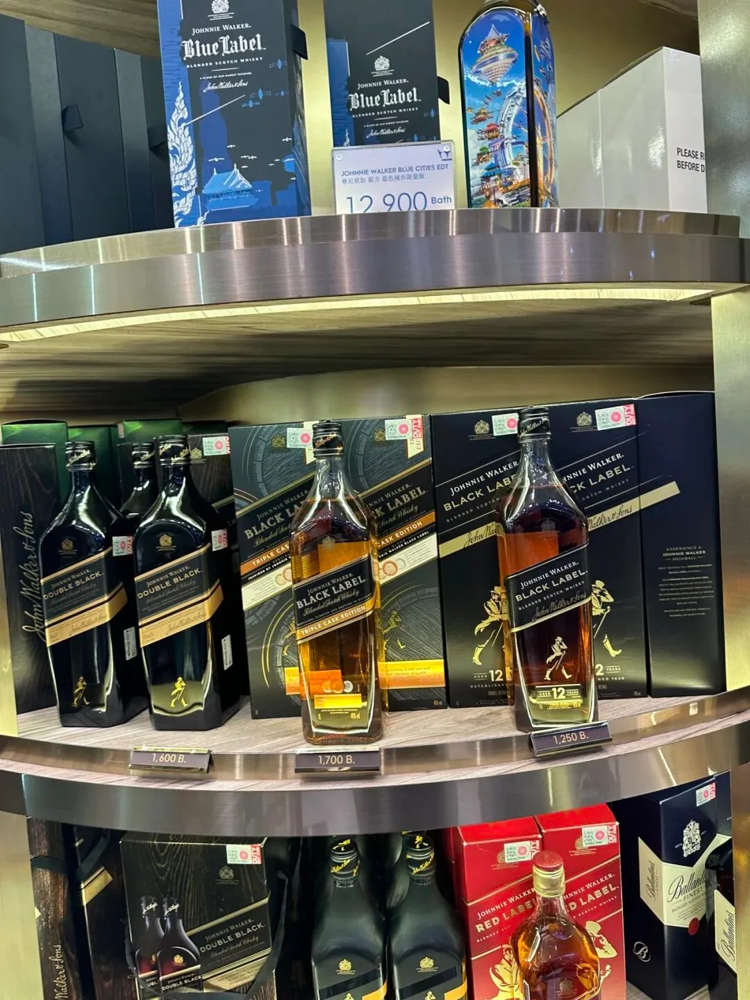

২০২৩ সালের জুলাইয়ে আন্তর্জাতিক উড়ান ঘুরে দাঁড়াচ্ছিল, আর বিমানবন্দরের ডিউটি-ফ্রি তার পুরনো জীবনের কিছুটা ফিরে পাচ্ছিল। চীনের ভেতরে আন্তর্জাতিক প্রস্থান-দোকানগুলো তিন বছর ধরে গড়ে তোলা হাইনানের সমুদ্রতীরবর্তী ডিউটি-ফ্রি বাজারের চেয়ে এখনো পিছিয়ে ছিল, কিন্তু অন্তত দরজাগুলো আবার খোলা ছিল।

তিন বছর আগে, যখন শেষ বিমানবন্দর-গাইডটি লেখা হয়, ধরে নেওয়া হয়েছিল মহামারি দুই-তিন মাসেই শেষ হবে আর সেই গ্রীষ্মেই আমরা আবার পৃথিবী জুড়ে উড়ব। এখন ভ্রমণে মদের বাজার অন্যরকম দেখায়: জাপানি হুইস্কির দাম বেশি আর তা রেশনিং করা, চীনা ডিউটি-ফ্রি পরিচালকরা নতুন বিমানবন্দরগুলোকে ফ্ল্যাগশিপ এলাকা হিসেবে দেখে, আর দক্ষিণ-পূর্ব এশিয়ার তাক যথেষ্ট গোছানো ও সাধারণ। এই সফরের তিনটি বিমানবন্দর — বেইজিং দাশিং, ওসাকা কানসাই ও চিয়াং মাই — তিনটি ভিন্ন অবস্থার প্রতিনিধিত্ব করে।

## ১. বেইজিং দাশিং: নতুন বিমানবন্দরের নতুন তাক

দাশিং ২০১৯ সালে খোলে এবং উত্তর চীনের একটি প্রধান আন্তর্জাতিক হাব। সীমান্ত আবার খোলার পর থেকে এর আন্তর্জাতিক উড়ান ধীরে ধীরে ফিরেছে, চায়না সাউদার্ন ও চায়না ইস্টার্ন রুট যোগ করেছে; নতুন বিমানবন্দর হিসেবে এখানেই সানরাইজ ও সিডিএফ একটি প্রধান অবস্থান গড়তে চায়, ভালো হুইস্কির আরও ভালো বরাদ্দ নিশ্চিত করার আশায়।

তাকটি তিনটি বোতলে দাঁড়িয়ে আছে। ডিওয়ার'স ৩২ বছরের ট্যাগে সিএনওয়াই ৩,৫৫৫, অথচ তাওবাও ফ্ল্যাগশিপ দোকানে দেশীয় রেফারেন্স দাম সিএনওয়াই ৬,২০০: ডাবল ডাবল চার-পর্যায়ের সিরিজটি দুর্লভ মজুত ব্যবহার করে যা আর বহু বছর টিকবে না, আর এই বয়স ও ব্যাচের আকারে থাকতে থাকতেই নেওয়া উচিত।

গ্লেনড্রোনাখ ১৯৯৪-এর ট্যাগ সিএনওয়াই ৫,২৪৫ — ডিউটি-ফ্রি চ্যানেলের একচেটিয়া, ১,৩১০ বোতল, ভারী শেরি সিঙ্গেল কাস্ক, কাঠের বাক্সে, আর স্পষ্ট উপহার। ফেটারকেয়ার্ন ২৩ সিএনওয়াই ২,০৭০, অথচ দেশীয় চ্যানেলে ২২ বছরেরটিরই দাম ইতিমধ্যে সিএনওয়াই ৩,০০০-এর বেশি; কোনো পয়েন্ট বা ছাড়ের আগেই সিএনওয়াই ২,০০০-র সামান্য বেশি দামের এই অফিসিয়াল ওবি তিনটির মধ্যে মূল্যের দিক থেকে সেরা।

## ২. ওসাকা কানসাই: সংস্কারের মাঝামাঝি একটি তাক

চার বছর পরে কানসাইয়ে ফিরে যে বাক্যটি খাপ খায় তা হলো "আরেক পৃথিবী"। বিমানবন্দরটি এক্সপোর আগে বড় মাপে সংস্কার করছে, আর এয়ারসাইডে ঠিকঠাক খাবারও ছিল না; ডিউটি-ফ্রি ও বিলাস দোকানগুলো পালা করে খুলছিল আর বন্ধ হচ্ছিল, আর সাপ্তাহিক লটারিতে যে সানটোরি ২৫ বছরের আসত তা বহুদিন দেখা যায়নি। কিন্তু এটি তবু জাপান।

ইয়োইচি ও মিয়াগিকিও গ্রান্দে প্রতিটি ¥১০,০০০ (প্রায় ৫২০ আরএমবি)। বয়স-লেবেলহীন এই নিক্কা সিঙ্গেল মল্টগুলো একসময় ¥৫,০০০ থেকে ¥৬,০০০ পরিসরে থাকত; এখন এগুলো ¥১০,০০০ আর প্রায়ই পাওয়া যায় না, জনপ্রতি এক বোতল। বয়স-লেবেল আরও দূরে — ইয়োইচি ১০ জাপানি বোতল-দোকানে আর ফিরেই আসেনি। জাপানি ডিস্টিলারিগুলো কিছু সক্ষমতা ফিরিয়েছে, কিন্তু চাহিদা আরও দ্রুত বেড়েছে।

এই তাকের বিস্ময় হলো শোচু। তেনশি নো ইউওয়াকু, কাস্কে ম্যাচিউর করা একটি শোচু, ¥৪,০৫০ (প্রায় ২৪০ আরএমবি), কাগোশিমার নিশিশুজো থেকে, যাদের মুক্তি না পাওয়া হুইস্কি ডিস্টিলারি ওনতাকে ঠিক শেরি কাস্কের জন্যই পরিচিত; এটি সত্যিই দশ বছরের শেরি-কাস্ক শোচু। যে জাপানি হুইস্কি চান তা যখন থাকে না, এটি আরেকটি দরজা খোলে।

সাকে-ও আছে — আইডব্লিউএ ৫, হাক্কাইসান ও গেক্কেইকান সবই জানার যোগ্য, দাম মাঝারি থেকে বেশির দিকে, আর ট্যাগ যত বেশি, তা তত বেশি মূল্যের হতে চায়।

## ৩. চিয়াং মাই: নামার সময়ই একটি বোতল কিনুন

সিঙ্গাপুর ও কুয়ালালামপুরের মতো হাবের বাইরে দক্ষিণ-পূর্ব এশিয়ার বিমানবন্দরগুলো কমদামি হুইস্কি বিরলই দেয়, আর মাঝেমধ্যে "সীমিত সংস্করণ" সাধারণত জনি ওয়াকার ব্লু-র কোনো দেশীয় সংস্করণ — ২০১৯ সালে হো চি মিন সিটিতে পোর্ট এলেন ব্লু লেবেল পাওয়া সত্যিই ভাগ্যের ব্যাপার ছিল। কিন্তু এই শহরগুলোতে টার্মিনালের বাইরে প্রায় সবকিছুরই দাম বেশি, তাই আগমন হলে একটি বোতল কিনে সঙ্গে নিয়ে চলা বুদ্ধিমানের কাজ।

চিয়াং মাইয়ের তাক টিকিয়ে রেখেছে জনি ওয়াকার, ডিওয়ার'স, রয়্যাল স্যালুট ও ব্যালান্টাইন'স — পূর্ণ পরিসর, ন্যায্য দাম। ছবিতে ব্লু লেবেল সিটিজ এডিশন থাই বাত ১২,৯০০, ডাবল ব্ল্যাক ১,৬০০, আর ব্ল্যাক লেবেল ১,২৫০ থেকে ১,৭০০; পথের জন্য এক বোতল গ্রিন লেবেল — এভাবেই অনেক ভ্রমণকারী দক্ষিণ-পূর্ব এশিয়ার পানীয়ের দাম সামলান। বিদেশি বন্ধুদের চীনা মদের সঙ্গে পরিচয় করাতে একই তাকে মাউতাই বা শুইজিংফাং আছে।

## ৪. ২০২০ ও ২০২৩: ট্রাভেল রিটেইলে কী বদলাল

২০২০ সালের গাইডের বিমানবন্দরগুলো ছিল একচেটিয়া বয়স ও সীমিত সিঙ্গেল কাস্কের মঞ্চ: ক্রেগেলাখি ৩৯, ক্যাপারডোনিখ ২৫, চাঙ্গি-একচেটিয়া ডিওয়ার'স ডাবল ডাবল। ২০২৩-এ একচেটিয়া এখনো আছে — গ্লেনড্রোনাখ ১৯৯৪ কেবল ডিউটি-ফ্রি চ্যানেলের বোতলবন্দি, ডিওয়ার'স ৩২ এখনো তাকে — কিন্তু গল্পটা সরে গেছে দামের ফারাক ও সরবরাহে।

দাশিং ফারাকটা সবচেয়ে স্পষ্টভাবে দেখায়: ডিওয়ার'স ৩২-এর জন্য সিএনওয়াই ৩,৫৫৫, দেশে সিএনওয়াই ৬,২০০। কানসাই সরবরাহের দিকটা দেখায়: ইয়োইচি ও মিয়াগিকিও ¥৫,০০০–৬,০০০ থেকে ¥১০,০০০-এ উঠেছে, এক বোতলের সীমাসহ। চিয়াং মাই কোনো বিস্ময় দেয় না, ন্যায্য দাম দেয়। তিন বছরে দেশীয় ডিউটি-ফ্রি তার সম্পদ হাইনান ও নতুন বিমানবন্দরের দিকে ঠেলে দিয়েছে, আর আন্তর্জাতিক প্রস্থান-দোকানগুলো এখনো ধরা মেলাচ্ছে; জাপানি সক্ষমতা ফিরেছে, কিন্তু চাহিদা আরও দ্রুত বেড়েছে, আর বয়স-লেবেলহীন বোতলবন্দিই এখন "তুলনামূলক সস্তার" সীমা। বিমানবন্দর আর সস্তার সমার্থক নয়। প্রশ্নটা হলো সঠিক মজুত থাকার সময় সঠিক জায়গায় থাকা।

## ৫. ব্যবহারিক টীকা: ভাতা, সংযোগ, চেক-ইন ব্যাগ

ভাতার বিপরীতে বোতল গুনুন। মূল ভূখণ্ড চীনে প্রবেশে মূল ভূখণ্ডের ভ্রমণকারীরা ১২% ABV-এর বেশি ২ বোতল মদ শুল্কমুক্ত আনতে পারেন (১.৫ লিটারের কম), অথচ হংকং ও মাকাওয়ের বাসিন্দা এবং ব্যক্তিগতভাবে হংকং বা মাকাও ভ্রমণকারী মূল ভূখণ্ডের বাসিন্দারা পান ১ বোতল (০.৭৫ লিটারের কম); তামাক ৪০০ সিগারেট।

সংযোগই যেখানে ভুল হয়। ডিউটি-ফ্রি মদ নিরাপত্তার পরে কেনা হয় ও টেম্পার-এভিডেন্ট ব্যাগে সিল করা হয়; সংযোগে আরেকটি নিরাপত্তা তল্লাশি লাগলে, বা — যুক্তরাষ্ট্রের মতো — অভ্যন্তরীণ লেগের আগে ব্যাগ আবার চেক করা হলে, ব্যাগটি কেড়ে নেওয়া হতে পারে। টাকা দেওয়ার আগে ট্রানজিট বিমানবন্দর নিরাপত্তা-সিল করা তরল গ্রহণ করে কিনা নিশ্চিত করুন, আর সম্ভব হলে সরাসরি উড়ুন।

চেক-ইন ব্যাগে মদ নিয়ে এয়ারলাইন্স নিজের নিয়ম ঠিক করে আর উচ্চ মাত্রার স্পিরিট ঘোষণা করতে হয়; বোতল কাপড়ে মুড়ে ফাঁকা জায়গা রাখা কেস শক্ত করে ভরার চেয়ে নিরাপদ।

দাম যাচাই করে নেওয়া পরিশ্রমের যোগ্য। ওড়ার আগে দেশীয় ই-কমার্স ও ফ্ল্যাগশিপ-দোকানের দাম টুকে নিন এবং তাকের সামনে সিদ্ধান্ত নিন; দাশিং ট্যাগে দেশীয় রেফারেন্স দাম ছাপে — এটি অনুকরণের যোগ্য অভ্যাস।

## সম্পর্কিত লিংক

- **এই সাইটে**: [ওসাকা কানসাই (KIX)](/airport/KIX), [জাপান (JP)](/country/JP), [চীন (CN)](/country/CN), [থাইল্যান্ড (TH)](/country/TH)
- **উইকিপিডিয়া**: [বেইজিং দাশিং আন্তর্জাতিক বিমানবন্দর](https://en.wikipedia.org/wiki/Beijing_Daxing_International_Airport), [কানসাই আন্তর্জাতিক বিমানবন্দর](https://en.wikipedia.org/wiki/Kansai_International_Airport), [চিয়াং মাই আন্তর্জাতিক বিমানবন্দর](https://en.wikipedia.org/wiki/Chiang_Mai_International_Airport)
- **বাইদু বাইকে**: [বেইজিং দাশিং আন্তর্জাতিক বিমানবন্দর](https://baike.baidu.com/item/%E5%8C%97%E4%BA%AC%E5%A4%A7%E5%85%B4%E5%9B%BD%E9%99%85%E6%9C%BA%E5%9C%BA), [কানসাই আন্তর্জাতিক বিমানবন্দর](https://baike.baidu.com/item/%E5%85%B3%E8%A5%BF%E5%9B%BD%E9%99%85%E6%9C%BA%E5%9C%BA), [চিয়াং মাই আন্তর্জাতিক বিমানবন্দর](https://baike.baidu.com/item/%E6%B8%85%E8%BF%88%E5%9B%BD%E9%99%85%E6%9C%BA%E5%9C%BA)

ছবির সূত্র: WhiskyENJOY। দাম ও পরিসর ২০২৩ সালের জুলাইয়ের রেকর্ড; ভাতা, তরলের নিয়ম ও এয়ারলাইন্সের ব্যাগেজ নীতি শুল্ক, বিমানবন্দর ও বাহক যেভাবে প্রকাশ করে সেই অনুযায়ী, তাই ভ্রমণের আগে পরিচালকের সাইট দেখে নিন।
