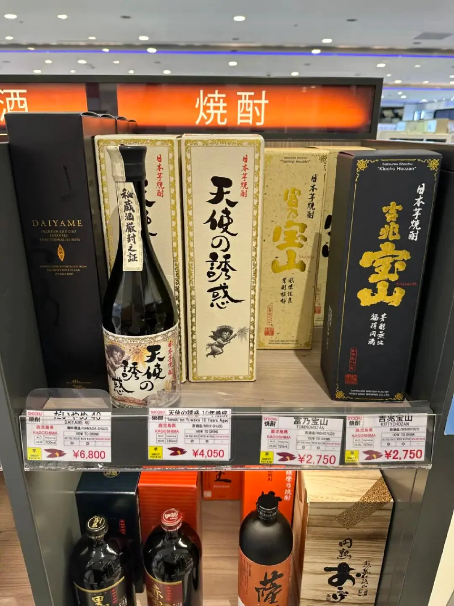

En julio de 2023 los vuelos internacionales se recuperaban y el duty-free del aeropuerto recuperaba algo de su antigua vida. Dentro de China, las tiendas de salidas internacionales seguían por detrás del mercado duty-free offshore de Hainan, cultivado durante tres años, pero al menos las puertas volvían a estar abiertas.

Cuando se escribió la última guía de aeropuertos, tres años antes, se daba por hecho que la pandemia terminaría en dos o tres meses y que ese verano volveríamos a volar por el mundo. Viajando ahora, el mercado de destilados parece distinto: el whisky japonés cuesta más y está racionado, los operadores duty-free chinos tratan los aeropuertos nuevos como territorio insignia y las estanterías del sudeste asiático siguen ordenadas y sin sorpresas. Tres aeropuertos de este viaje —Pekín Daxing, Osaka Kansai y Chiang Mai— representan tres estados diferentes.

## 1. Pekín Daxing: la nueva estantería de un aeropuerto nuevo

Daxing abrió en 2019 y es un centro internacional clave para el norte de China. Desde que se reabrió la frontera, sus vuelos internacionales han vuelto poco a poco, con China Southern y China Eastern añadiendo rutas; como aeropuerto nuevo, también es donde Sunrise y CDF pretenden construir una posición principal, con la esperanza de asegurarse mejores asignaciones de buen whisky.

Tres botellas sostienen la estantería. Dewar's 32 años está etiquetado a 3.555 CNY frente a un precio de referencia nacional de 6.200 CNY en la tienda insignia de Taobao: la serie Double Double de cuatro etapas usa existencias raras que quizá no sean sostenibles muchos años más, y con esta edad y este tamaño de lote merece la pena llevárselo mientras esté.

Glendronach 1994 está etiquetado a 5.245 CNY: una exclusiva del canal duty-free de 1.310 botellas, single cask con mucho sherry, en caja de madera, y el regalo obvio. Fettercairn 23 cuesta 2.070 CNY, mientras que el de 22 años en los canales nacionales ya cuesta más de 3.000 CNY; este OB oficial a poco más de 2.000 CNY, antes de cualquier punto o descuento, es la mejor relación calidad-precio de los tres.

## 2. Osaka Kansai: una estantería en plena reforma

Al volver a Kansai después de cuatro años, la frase que encaja es “otro mundo”. El aeropuerto se está reformando a gran escala antes de la exposición, y en la zona restringida no había ni una comida decente; las tiendas duty-free y de lujo abrían y cerraban por turnos, y el Suntory de 25 años que solía aparecer en una lotería semanal no se veía desde hacía mucho tiempo. Pero esto sigue siendo Japón.

Yoichi y Miyagikyo Grande cuestan ¥10.000 cada uno (unos 520 RMB). Estos single malts de Nikka sin declaración de edad solían estar en la franja de ¥5.000 a ¥6.000; ahora cuestan ¥10.000 y a menudo no hay, una botella por persona. Las declaraciones de edad quedan aún más lejos: Yoichi 10 simplemente no ha vuelto a aparecer en las tiendas japonesas. Las destilerías japonesas han recuperado parte de la capacidad, pero la demanda ha crecido más rápido.

El shochu es la sorpresa de esta estantería. Tenshi no Yuwaku, un shochu madurado en barrica, cuesta ¥4.050 (unos 240 RMB), de Nishishuzo, en Kagoshima, cuya destilería de whisky no lanzada, Ontake, es conocida precisamente por sus barricas de sherry; este es un auténtico shochu de diez años en barrica de sherry. Cuando el whisky japonés que quieres no está, abre otra puerta.

El sake también está: IWA 5, Hakkaisan y Gekkeikan merecen conocerse, con precios de modestos a serios, y cuanto más alta es la etiqueta, más suele valer la pena.

## 3. Chiang Mai: compra una botella a la llegada

Fuera de centros como Singapur y Kuala Lumpur, los aeropuertos del sudeste asiático rara vez ofrecen whisky con buena relación calidad-precio, y la ocasional “edición limitada” suele ser una edición nacional de Johnnie Walker Blue; encontrar un Port Ellen Blue Label en Ciudad Ho Chi Minh en 2019 se consideró verdadera suerte. Pero en estas ciudades casi todo lo que hay fuera de la terminal cuesta más, así que comprar una botella en llegadas y llevarla contigo es una decisión sensata.

La estantería de Chiang Mai se sostiene con Johnnie Walker, Dewar's, Royal Salute y Ballantine's: gamas completas, precios justos. En la fotografía, la Blue Label Cities Edition cuesta 12.900 THB, la Double Black 1.600 y la Black Label va de 1.250 a 1.700; una botella de Green Label para el camino es como muchos viajeros sobreviven a los precios de las bebidas en el sudeste asiático. Para introducir a los amigos extranjeros en los destilados chinos, Moutai o Shuijingfang están en la misma estantería.

## 4. 2020 y 2023: qué cambió en el travel retail

Los aeropuertos de la guía de 2020 eran escenarios de edades exclusivas y single casks limitados: Craigellachie 39, Caperdonich 25, el Dewar's Double Double exclusivo de Changi. En 2023 las exclusivas siguen existiendo —Glendronach 1994 es un embotellado solo para el canal duty-free, Dewar's 32 sigue en la estantería—, pero la historia se ha desplazado a las diferencias de precio y al suministro.

Daxing declara la diferencia con más claridad: 3.555 CNY por Dewar's 32 frente a 6.200 CNY en casa. Kansai muestra el lado de la oferta: Yoichi y Miyagikyo suben de ¥5.000–6.000 a ¥10.000, con límite de una botella. Chiang Mai no ofrece sorpresas y sí precios justos. En tres años el duty-free nacional empujó sus recursos hacia Hainan y los aeropuertos nuevos, mientras las tiendas de salidas internacionales aún se ponen al día; la capacidad japonesa ha vuelto, pero la demanda subió más rápido, y los embotellados sin declaración de edad son ahora el límite de lo “relativamente asequible”. El aeropuerto ya no es sinónimo de barato. Es cuestión de estar en el lugar correcto cuando el stock correcto está allí.

## 5. Notas prácticas: franquicia, conexiones, equipaje facturado

Cuenta las botellas frente a la franquicia. A la entrada en China continental, los viajeros de China continental pueden llevar 2 botellas de destilados de más de 12 % vol. libres de impuestos (menos de 1,5 litros), mientras que los residentes de Hong Kong y Macao y los residentes de China continental que viajan a Hong Kong o Macao por cuenta propia pueden llevar 1 botella (menos de 0,75 litros); el tabaco son 400 cigarrillos.

Las conexiones son donde sale mal. Los destilados duty-free se compran después de la seguridad y se sellan en una bolsa inviolable; si una conexión exige otro control de seguridad, o —como en Estados Unidos— las maletas se vuelven a facturar antes de un tramo nacional, la bolsa puede ser retirada. Confirma que el aeropuerto de tránsito acepta líquidos sellados por seguridad antes de pagar, y vuela directo cuando puedas.

En el equipaje facturado, las aerolíneas fijan sus propias normas sobre alcohol y los destilados de alta graduación deben declararse; envolver las botellas en ropa y dejar espacio para que se expandan es más seguro que apretar la maleta.

Comparar precios merece el esfuerzo. Anota los precios del comercio electrónico nacional y de las tiendas insignia antes de volar y decide en la estantería; que Daxing imprima el precio de referencia nacional en la etiqueta es una práctica que merece copiarse.

## Enlaces relacionados

- **En este sitio**: [Osaka Kansai (KIX)](/airport/KIX), [Japón (JP)](/country/JP), [China (CN)](/country/CN), [Tailandia (TH)](/country/TH)
- **Wikipedia**: [Aeropuerto Internacional de Pekín Daxing](https://en.wikipedia.org/wiki/Beijing_Daxing_International_Airport), [Aeropuerto Internacional de Kansai](https://en.wikipedia.org/wiki/Kansai_International_Airport), [Aeropuerto Internacional de Chiang Mai](https://en.wikipedia.org/wiki/Chiang_Mai_International_Airport)
- **Baidu Baike**: [Aeropuerto Internacional de Pekín Daxing](https://baike.baidu.com/item/%E5%8C%97%E4%BA%AC%E5%A4%A7%E5%85%B4%E5%9B%BD%E9%99%85%E6%9C%BA%E5%9C%BA), [Aeropuerto Internacional de Kansai](https://baike.baidu.com/item/%E5%85%B3%E8%A5%BF%E5%9B%BD%E9%99%85%E6%9C%BA%E5%9C%BA), [Aeropuerto Internacional de Chiang Mai](https://baike.baidu.com/item/%E6%B8%85%E8%BF%88%E5%9B%BD%E9%99%85%E6%9C%BA%E5%9C%BA)

Fuente de las imágenes: WhiskyENJOY. Los precios y las gamas son registros de julio de 2023; las franquicias, las normas sobre líquidos y la política de equipaje de las aerolíneas son las publicadas por la aduana, el aeropuerto y la compañía, así que consulta la web del operador antes de viajar.
