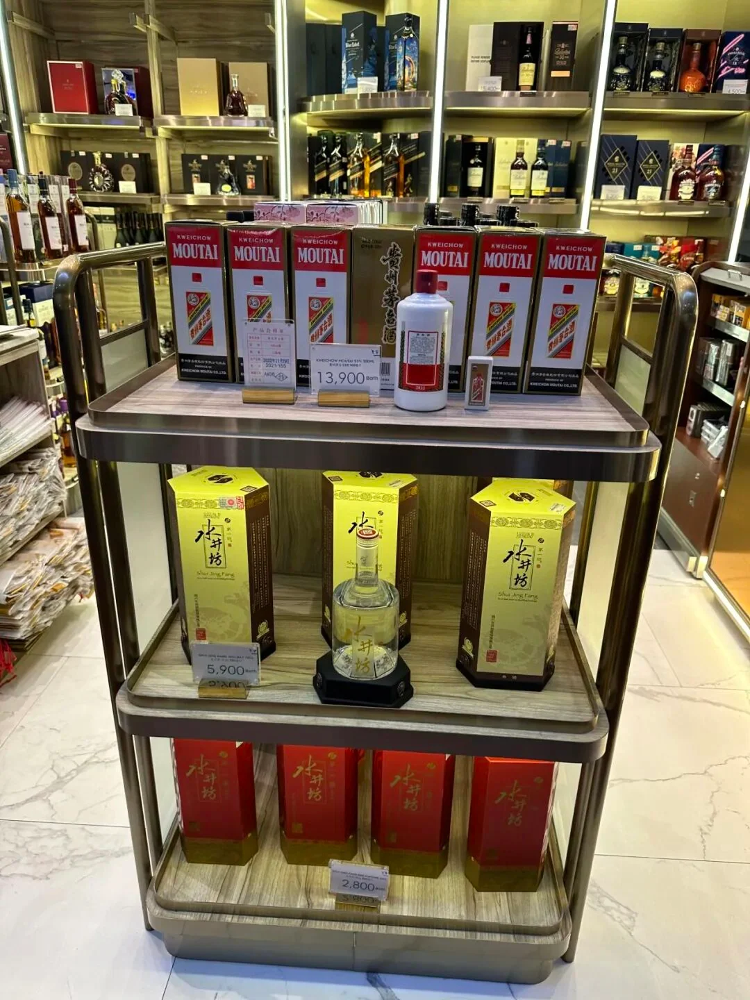

जुलाई 2023 में अंतरराष्ट्रीय उड़ानें लौट रही थीं, और एयरपोर्ट ड्यूटी-फ्री अपनी पुरानी जान का थोड़ा हिस्सा फिर पा रहा था। चीन के भीतर, अंतरराष्ट्रीय प्रस्थान की दुकानें अब भी उस हैनान अपतटीय ड्यूटी-फ्री बाज़ार से पीछे थीं जिसे तीन साल से सँवारा गया था, पर कम से कम दरवाज़े फिर खुले थे।

जब पिछली एयरपोर्ट गाइड लिखी गई थी, तीन साल पहले, तब यह मान लिया गया था कि महामारी दो-तीन महीनों में ख़त्म हो जाएगी और उसी गर्मी तक हम फिर दुनिया भर उड़ान भर रहे होंगे। अब यात्रा करने पर स्पिरिट का बाज़ार अलग दिखता है: जापानी व्हिस्की महँगी है और राशन में है, चीनी ड्यूटी-फ्री ऑपरेटर नए एयरपोर्टों को प्रमुख ठिकाना मानते हैं, और दक्षिण-पूर्व एशिया की अलमारियाँ साफ़-सुथरी पर साधारण बनी हुई हैं। इस यात्रा के तीन एयरपोर्ट — बीजिंग दाशिंग, ओसाका कान्साई और चियांग माई — तीन अलग हालतों के प्रतिनिधि हैं।

## 1. बीजिंग दाशिंग: नए एयरपोर्ट की नई अलमारी

दाशिंग 2019 में खुला और उत्तरी चीन का प्रमुख अंतरराष्ट्रीय हब है। सीमा दोबारा खुलने के बाद से इसकी अंतरराष्ट्रीय उड़ानें धीरे-धीरे लौटी हैं, चाइना सदर्न और चाइना ईस्टर्न ने रूट जोड़े हैं; नया एयरपोर्ट होने के नाते यही वह जगह है जहाँ सनराइज़ और CDF अपना मुख्य ठिकाना बनाना चाहते हैं, इस उम्मीद में कि अच्छी व्हिस्की का बेहतर आवंटन मिल सके।

अलमारी पर तीन बोतलें टिकी हैं। ड्यूअर्स 32 साल पुरानी पर CNY 3,555 का टैग है, जबकि ताओबाओ फ़्लैगशिप स्टोर पर घरेलू संदर्भ मूल्य CNY 6,200 है: डबल डबल की चार-चरणीय श्रृंखला दुर्लभ भंडार का इस्तेमाल करती है, जिसके कई और साल टिकने की गारंटी नहीं, और इस उम्र और बैच आकार पर इसे मौजूद रहते ले लेना बनता है।

ग्लेंड्रोनैक 1994 पर CNY 5,245 का टैग है — ड्यूटी-फ्री चैनल का एक्सक्लूसिव, 1,310 बोतलें, भारी शेरी सिंगल कास्क, लकड़ी के बॉक्स में, और स्पष्ट तोहफ़ा। फेटरकेर्न 23 CNY 2,070 है, जबकि घरेलू चैनलों में 22 साल पुरानी की कीमत पहले ही CNY 3,000 से ऊपर है; यह आधिकारिक OB, CNY 2,000 से थोड़ा ऊपर, किसी भी पॉइंट या छूट से पहले, तीनों में वैल्यू पिक है।

## 2. ओसाका कान्साई: नवीनीकरण के बीच की अलमारी

चार साल बाद कान्साई लौटने पर जो वाक्य सूट करता है वह है "एक और दुनिया"। एयरपोर्ट एक्सपो से पहले बड़े पैमाने पर नवीनीकरण कर रहा है, और एयरसाइड पर ठीक से खाने तक की जगह नहीं थी; ड्यूटी-फ्री और लक्ज़री दुकानें बारी-बारी खुल और बंद हो रही थीं, और जो सनतोरी 25 साल पुरानी हर हफ़्ते की लॉटरी में दिखती थी वह बहुत समय से नहीं दिखी। पर यह अब भी जापान है।

योइची और मियागीक्यो ग्रांदे हर एक ¥10,000 के हैं (लगभग RMB 520)। ये नो-एज-स्टेटमेंट निक्का सिंगल माल्ट पहले ¥5,000 से ¥6,000 के दायरे में हुआ करते थे; अब ¥10,000 पर हैं और अक्सर उपलब्ध ही नहीं होते, एक व्यक्ति को एक बोतल। एज स्टेटमेंट और भी दूर हैं — योइची 10 जापानी बोतल की दुकानों में बस लौटा ही नहीं। जापानी डिस्टिलरियों ने कुछ क्षमता बहाल की है, पर माँग ज़्यादा तेज़ी से बढ़ी है।

इस अलमारी पर शोचू अचानक मिलने वाली चीज़ है। तेंशी नो युवाकु, कास्क में परिपक्व शोचू, ¥4,050 का है (लगभग RMB 240), कागोशिमा की निशिशुज़ो से, जिसकी अभी जारी न हुई व्हिस्की डिस्टिलरी ओंताके ठीक शेरी कास्क के लिए जानी जाती है; यह असली दस साल पुराना शेरी-कास्क शोचू है। जब मनचाही जापानी व्हिस्की वहाँ न हो, तो यह दूसरा दरवाज़ा खोल देता है।

साके भी है — IWA 5, हक्काइसान और गेक्केइकान सभी जानने लायक हैं, कीमतें साधारण से गंभीर तक, और टैग जितना ऊँचा, उतना ही ज़्यादा वह लायक होता है।

## 3. चियांग माई: आगमन पर बोतल खरीदें

सिंगापुर और कुआलालंपुर जैसे हबों के बाहर दक्षिण-पूर्व एशिया के एयरपोर्ट कम ही अच्छी कीमत की व्हिस्की देते हैं, और कभी-कभार दिखने वाला "सीमित संस्करण" आमतौर पर जॉनी वॉकर ब्लू का देश-संस्करण होता है — 2019 में हो ची मिन्ह सिटी में पोर्ट एलेन ब्लू लेबल मिलना सचमुच किस्मत की बात थी। पर इन शहरों में टर्मिनल के बाहर लगभग हर चीज़ महँगी है, इसलिए आगमन पर एक बोतल खरीदकर साथ रखना समझदारी है।

चियांग माई की अलमारी जॉनी वॉकर, ड्यूअर्स, रॉयल सैल्यूट और बैलेंटाइन्स से टिकी है — पूरी रेंज, उचित दाम। तस्वीर में ब्लू लेबल सिटीज़ एडिशन THB 12,900 का है, डबल ब्लैक 1,600, और ब्लैक लेबल 1,250 से 1,700 तक; रास्ते के लिए ग्रीन लेबल की एक बोतल — दक्षिण-पूर्व एशिया में ड्रिंक के दाम काटने का यही तरीका कई यात्री अपनाते हैं। विदेशी दोस्तों को चीनी स्पिरिट से मिलाना हो तो माउताई या शुईजिंगफ़ांग उसी अलमारी पर हैं।

## 4. 2020 और 2023: ट्रैवल रिटेल में क्या बदला

2020 की गाइड के एयरपोर्ट विशेष उम्र और सीमित सिंगल कास्क के मंच थे: क्रेगेलैकी 39, कैपरडोनिक 25, चांगी-एक्सक्लूसिव ड्यूअर्स डबल डबल। 2023 में एक्सक्लूसिव बने हुए हैं — ग्लेंड्रोनैक 1994 सिर्फ़ ड्यूटी-फ्री चैनल की बॉटलिंग है, ड्यूअर्स 32 अब भी अलमारी पर है — पर कहानी अब कीमत के अंतर और आपूर्ति की ओर मुड़ गई है।

दाशिंग यह अंतर सबसे साफ़ बताता है: ड्यूअर्स 32 के लिए CNY 3,555, घर पर CNY 6,200। कान्साई आपूर्ति का पक्ष दिखाता है: योइची और मियागीक्यो ¥5,000–6,000 से ¥10,000 तक, एक बोतल की सीमा के साथ। चियांग माई कोई चौंकाने वाली बात नहीं, उचित दाम। तीन साल में घरेलू ड्यूटी-फ्री ने अपने संसाधन हैनान और नए एयरपोर्टों की ओर धकेले, जबकि अंतरराष्ट्रीय प्रस्थान की दुकानें अब भी पीछा कर रही हैं; जापानी क्षमता लौटी है, पर माँग तेज़ी से बढ़ी, और नो-एज-स्टेटमेंट बॉटलिंग अब "अपेक्षाकृत किफ़ायती" की सीमा है। एयरपोर्ट अब सस्ते का पर्याय नहीं है। सवाल यह है कि सही माल मौजूद हो तो आप सही जगह पर हों।

## 5. व्यावहारिक बातें: भत्ता, कनेक्शन, चेक-इन बैग

बोतलें भत्ते के हिसाब से गिनें। मुख्यभूमि चीन में प्रवेश पर मुख्यभूमि यात्री 12% ABV से ज़्यादा की 2 बोतलें स्पिरिट ड्यूटी-फ्री ला सकते हैं (1.5 लीटर से कम), जबकि हांगकांग और मकाऊ के निवासी और निजी रूप से हांगकांग या मकाऊ जाने वाले मुख्यभूमि निवासी 1 बोतल (0.75 लीटर से कम) पाते हैं; तंबाकू 400 सिगरेट।

कनेक्शन पर ही गड़बड़ होती है। ड्यूटी-फ्री स्पिरिट सुरक्षा जाँच के बाद खरीदी जाती है और छेड़छाड़ दिखाने वाले बैग में सील होती है; अगर कनेक्शन पर एक और सुरक्षा जाँच पड़े, या — जैसा अमेरिका में होता है — घरेलू लेग से पहले बैग दोबारा जाँचे जाएँ, तो बैग छिन सकता है। भुगतान से पहले पक्का करें कि ट्रांज़िट एयरपोर्ट सुरक्षा-सील किया तरल स्वीकार करता है, और जहाँ हो सके सीधी उड़ान लें।

चेक-इन बैगेज में शराब पर एयरलाइनें अपने नियम बनाती हैं और तेज़ स्पिरिट घोषित करनी पड़ती है; बोतलों को कपड़ों में लपेटना और फैलने की जगह छोड़ना केस को कसकर भरने से ज़्यादा सुरक्षित है।

कीमत जाँचना मेहनत के लायक है। उड़ान से पहले घरेलू ई-कॉमर्स और फ़्लैगशिप स्टोर के दाम नोट करें और अलमारी पर फ़ैसला करें; दाशिंग का टैग पर घरेलू संदर्भ मूल्य छापना नकल के लायक तरीका है।

## संबंधित लिंक

- **इस साइट पर**: [ओसाका कान्साई (KIX)](/airport/KIX), [जापान (JP)](/country/JP), [चीन (CN)](/country/CN), [थाईलैंड (TH)](/country/TH)
- **विकिपीडिया**: [बीजिंग दाशिंग अंतरराष्ट्रीय हवाई अड्डा](https://en.wikipedia.org/wiki/Beijing_Daxing_International_Airport), [कान्साई अंतरराष्ट्रीय हवाई अड्डा](https://en.wikipedia.org/wiki/Kansai_International_Airport), [चियांग माई अंतरराष्ट्रीय हवाई अड्डा](https://en.wikipedia.org/wiki/Chiang_Mai_International_Airport)
- **बाइदू बाइके**: [बीजिंग दाशिंग अंतरराष्ट्रीय हवाई अड्डा](https://baike.baidu.com/item/%E5%8C%97%E4%BA%AC%E5%A4%A7%E5%85%B4%E5%9B%BD%E9%99%85%E6%9C%BA%E5%9C%BA), [कान्साई अंतरराष्ट्रीय हवाई अड्डा](https://baike.baidu.com/item/%E5%85%B3%E8%A5%BF%E5%9B%BD%E9%99%85%E6%9C%BA%E5%9C%BA), [चियांग माई अंतरराष्ट्रीय हवाई अड्डा](https://baike.baidu.com/item/%E6%B8%85%E8%BF%88%E5%9B%BD%E9%99%85%E6%9C%BA%E5%9C%BA)

चित्र स्रोत: WhiskyENJOY। कीमतें और रेंज जुलाई 2023 के रिकॉर्ड हैं; भत्ते, तरल के नियम और एयरलाइन की सामान नीति सीमा शुल्क, एयरपोर्ट और वाहक जैसा प्रकाशित करते हैं, इसलिए यात्रा से पहले ऑपरेटर की साइट देखें।
