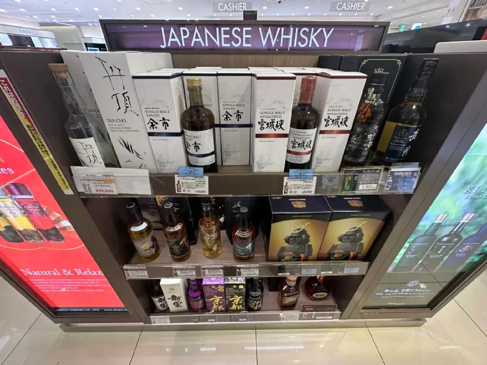

2023年7月、国際線は回復しつつあり、空港の免税店もかつての活気を少し取り戻していました。中国国内では、国際線出発エリアの店舗は、3年間育てられてきた海南の離島免税市場にまだ後れを取っていましたが、少なくとも扉は再び開いていました。

前回の空港ガイドを書いた3年前には、パンデミックは2〜3か月で終わり、その夏にはまた世界中を飛び回っているだろうという前提がありました。今旅してみると、蒸留酒市場の様子は変わっています。ジャパニーズウイスキーは値上がりして割当制になり、中国の免税事業者は新しい空港を旗艦店の場ととらえ、東南アジアの棚は整然としているものの目新しさに欠けます。今回の旅で訪れた3つの空港、北京大興、大阪関西、チェンマイは、3つの異なる状態を表しています。

## 1. 北京大興：新しい空港の新しい棚

大興は2019年に開業し、中国北部の重要な国際ハブです。国境が再開してから国際線は徐々に戻り、中国南方航空と中国東方航空が路線を追加しました。新しい空港だけに、SunriseとCDFが主要拠点を築こうとしており、良いウイスキーの割当をより多く確保することを狙っています。

棚を支えるのは3本です。Dewar's 32年はCNY 3,555で、淘宝の旗艦店では国内参考価格CNY 6,200です。Double Doubleの4段階シリーズは貴重な原酒を使うため、あと何年も供給を続けられるとは限りません。この年数とロットサイズなら、あるうちに買う価値があります。

Glendronach 1994はCNY 5,245です。免税チャネル限定の1,310本で、シェリー樽の濃厚なシングルカスク、木箱入りで、贈り物としてわかりやすい選択です。Fettercairn 23はCNY 2,070で、国内チャネルの22年はすでにCNY 3,000を超えます。CNY 2,000強の公式OBは、ポイントや割引を除いても3本の中で最もお買い得です。

## 2. 大阪関西：改装中の棚

4年ぶりに関西に戻ると、ぴったりくる言葉は「別世界」です。空港は万博を前に大規模な改装中で、エアサイドではまともな食事すら取れませんでした。免税店や高級ブランド店は次々に開店と閉店を繰り返し、かつて毎週の抽選に登場していたサントリー25年は長らく見かけません。それでもここは日本です。

YoichiとMiyagikyo Grandeは各¥10,000（約RMB 520）です。ノンエイジのニッカ・シングルモルトはかつて¥5,000〜6,000の帯にありましたが、今は¥10,000で、しかも買えないことが多く、1人1本の制限があります。熟成年数表記はさらに遠く、Yoichi 10年は日本のボトルショップにまったく戻ってきていません。日本の蒸留所は生産能力をある程度回復しましたが、需要の伸びの方が速かったのです。

この棚の意外な主役は焼酎です。樽熟成焼酎の天使の誘惑は¥4,050（約RMB 240）で、鹿児島の西酒造の製品です。同社の未稼働のウイスキー蒸留所、御岳はシェリー樽で知られており、これはまさに10年熟成のシェリー樽焼酎です。欲しいジャパニーズウイスキーがないとき、別の扉を開いてくれます。

日本酒もあります。IWA 5、八海山、月桂冠はいずれも知っておく価値があり、価格は手頃なものから本格的なものまで幅があります。値札が高いほど、価値も高い傾向があります。

## 3. チェンマイ：到着時に1本買う

シンガポールやクアラルンプールのようなハブを除けば、東南アジアの空港でお得なウイスキーはほとんどありません。たまにある「限定版」も、たいていはJohnnie Walker Blueの国別エディションです。2019年にホーチミン市でPort EllenのBlue Labelを見つけたのは、本当に運が良かったと言えます。ただ、これらの都市では空港の外のほとんどすべてが高くつくため、到着ロビーで1本買って持ち歩くのは合理的な判断です。

チェンマイの棚を支えているのはJohnnie Walker、Dewar's、Royal Salute、Ballantine'sで、ラインナップは充実し価格も妥当です。写真ではBlue Label Cities EditionがTHB 12,900、Double Blackが1,600、Black Labelが1,250から1,700です。Green Labelを1本買って旅先に持っていくのは、東南アジアの酒の値段をやり過ごす多くの旅行者の方法です。外国の友人に中国の蒸留酒を紹介するなら、同じ棚に茅台や水井坊もあります。

## 4. 2020年と2023年：トラベルリテールは何が変わったか

2020年のガイドに登場した空港は、限定熟成年数や限定シングルカスクの舞台でした。Craigellachie 39、Caperdonich 25、チャンギ限定のDewar's Double Doubleなどです。2023年も限定品は存在します。Glendronach 1994は免税チャネル限定のボトリングで、Dewar's 32年もまだ棚にあります。しかし主役は価格差と供給に移りました。

大興はその差を最もわかりやすく示しています。Dewar's 32年がCNY 3,555、国内ではCNY 6,200です。関西は供給側を示します。YoichiとMiyagikyoは¥5,000〜6,000から¥10,000に上がり、1人1本の制限が付きました。チェンマイは驚きがなく、価格は妥当です。3年の間に、国内の免税事業者は資源を海南と新空港に寄せ、国際線出発エリアの店舗はまだ追いつこうとしています。日本の生産能力は戻りましたが需要はそれ以上に伸び、ノンエイジ表記が今や「比較的手頃」の限界です。空港はもはや安さの代名詞ではありません。適切な在庫があるときに、適切な場所にいるかどうかの問題です。

## 5. 実用メモ：免税範囲、乗り継ぎ、預け荷物

ボトルは免税範囲と照らし合わせて数えます。中国本土への入国時、中国本土の旅行者はアルコール度数12%超の蒸留酒を2本まで免税で持ち込めます（1.5リットル未満）。香港・マカオ居住者、および香港・マカオへ個人旅行する中国本土居住者は1本（0.75リットル未満）です。たばこは紙巻き400本です。

問題が起きるのは乗り継ぎです。免税の蒸留酒は保安検査後に購入し、開封証付きの袋に入れられます。乗り継ぎでもう一度保安検査が必要な場合や、アメリカのように国内線に乗る前に荷物を再検査する場合、袋を取り上げられることがあります。支払う前に、乗り継ぎ空港が保安検査済みの液体を受け入れるか確認し、できるだけ直行便を使いましょう。

預け荷物については、航空会社が酒類の規則を独自に定めており、高アルコール度数の蒸留酒は申告が必要です。ボトルを衣類で包み、膨らむ余裕を残す方が、ケースをきつく詰めるより安全です。

価格の確認は手間をかける価値があります。搭乗前に国内のECサイトと旗艦店の価格を控え、棚の前で判断しましょう。大興が値札に国内参考価格を印刷しているのは、見習うべきやり方です。

## 関連リンク

- **このサイト内**：[大阪関西 (KIX)](/airport/KIX)、[日本 (JP)](/country/JP)、[中国 (CN)](/country/CN)、[タイ (TH)](/country/TH)
- **Wikipedia**：[北京大興国際空港](https://en.wikipedia.org/wiki/Beijing_Daxing_International_Airport)、[関西国際空港](https://en.wikipedia.org/wiki/Kansai_International_Airport)、[チェンマイ国際空港](https://en.wikipedia.org/wiki/Chiang_Mai_International_Airport)
- **百度百科**：[北京大興国際空港](https://baike.baidu.com/item/%E5%8C%97%E4%BA%AC%E5%A4%A7%E5%85%B4%E5%9B%BD%E9%99%85%E6%9C%BA%E5%9C%BA)、[関西国際空港](https://baike.baidu.com/item/%E5%85%B3%E8%A5%BF%E5%9B%BD%E9%99%85%E6%9C%BA%E5%9C%BA)、[チェンマイ国際空港](https://baike.baidu.com/item/%E6%B8%85%E8%BF%88%E5%9B%BD%E9%99%85%E6%9C%BA%E5%9C%BA)

画像出典：WhiskyENJOY。価格と品揃えは2023年7月時点の記録です。免税範囲、液体の規制、航空会社の手荷物規定は税関、空港、航空会社の公表によるため、旅行前に運営会社のサイトで確認してください。
