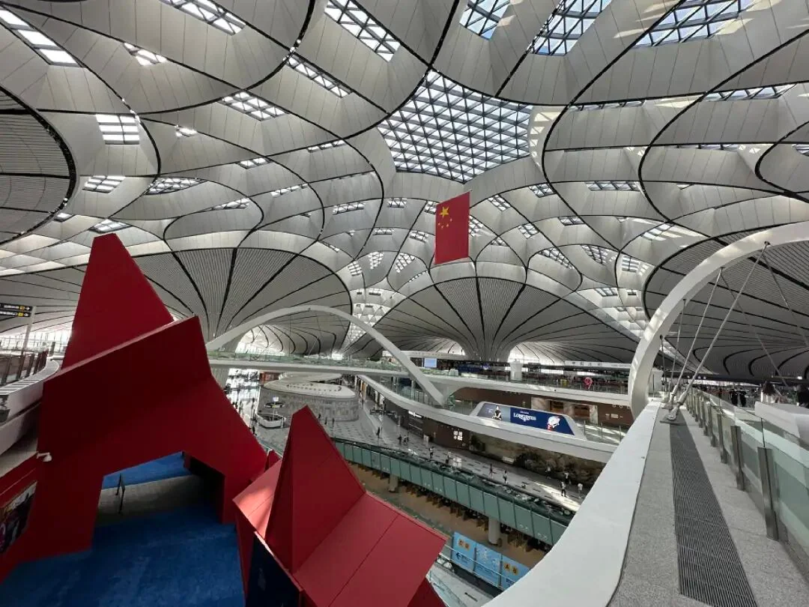
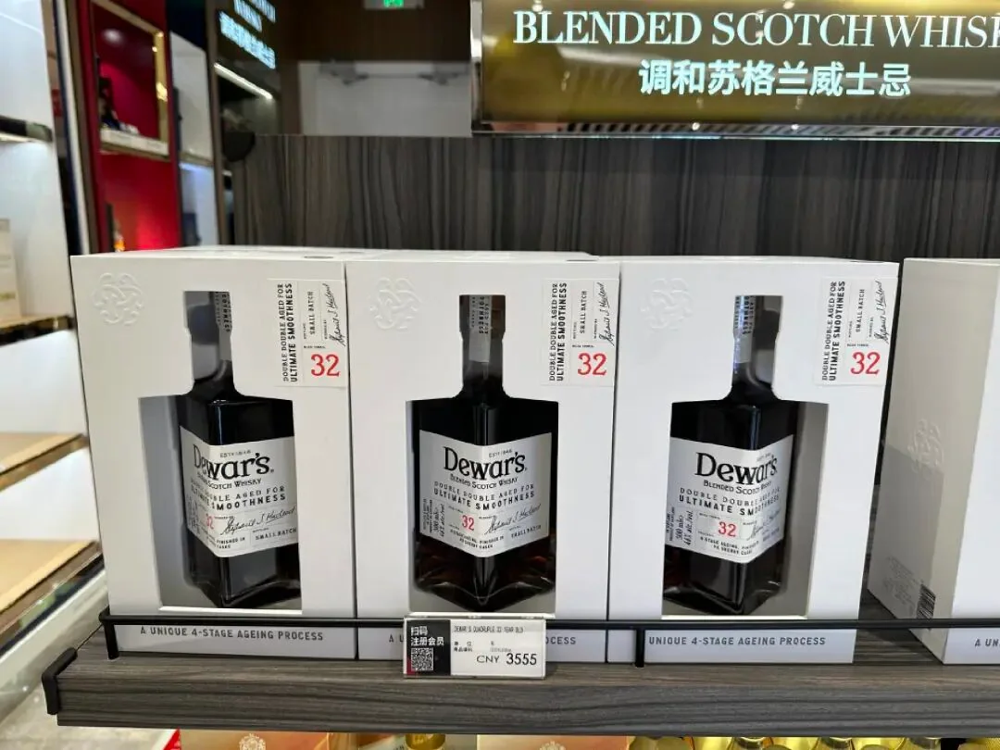
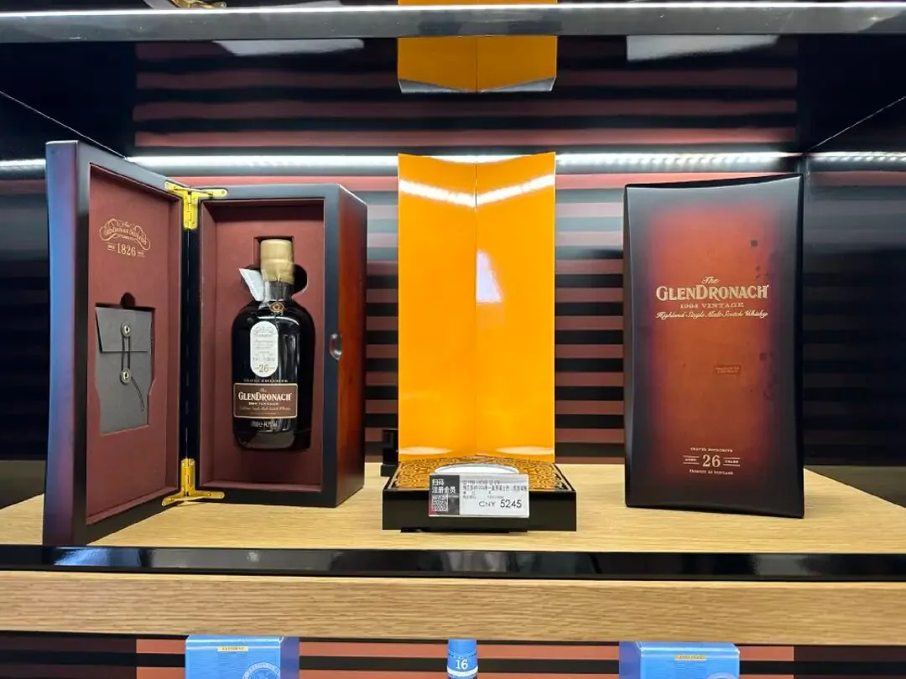
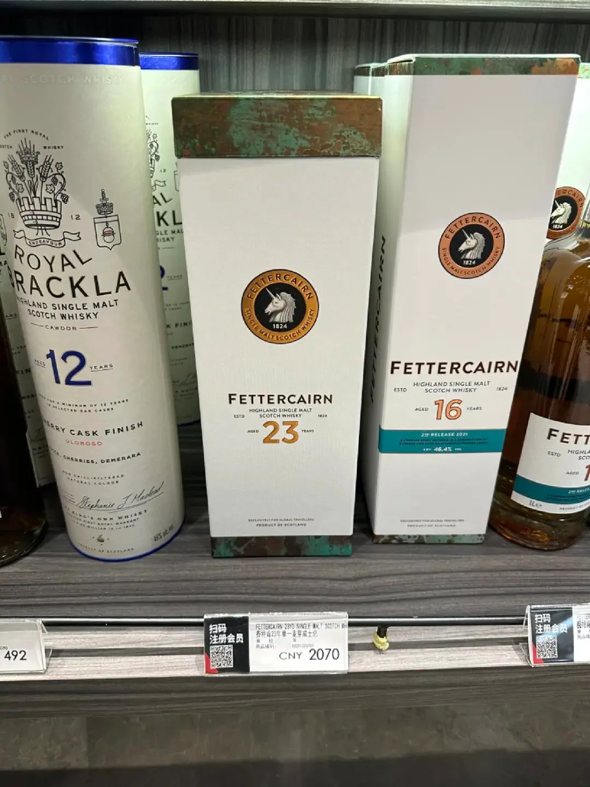
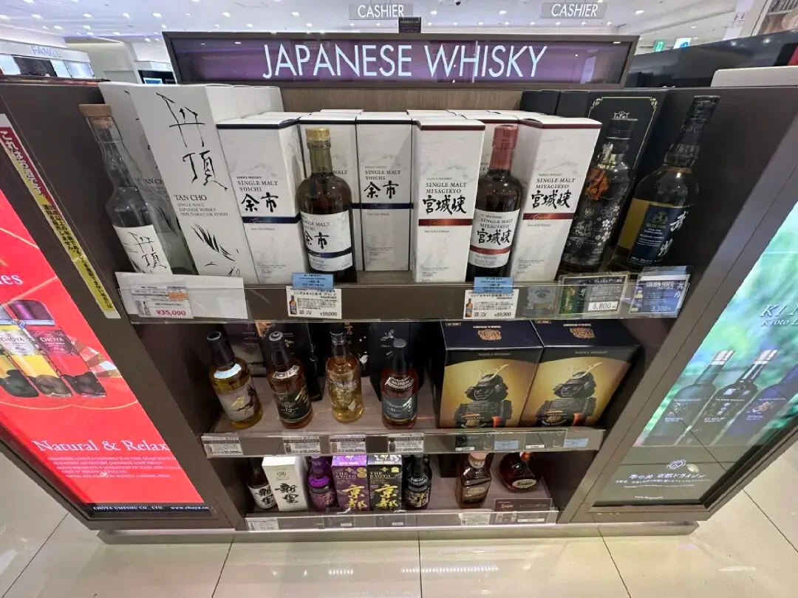
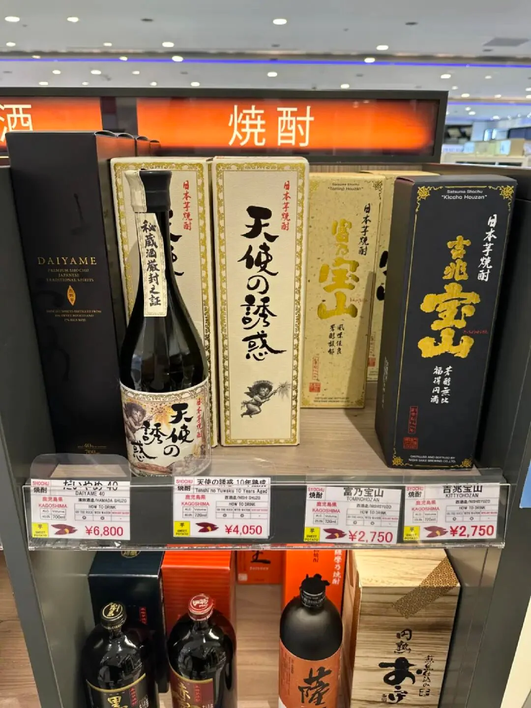
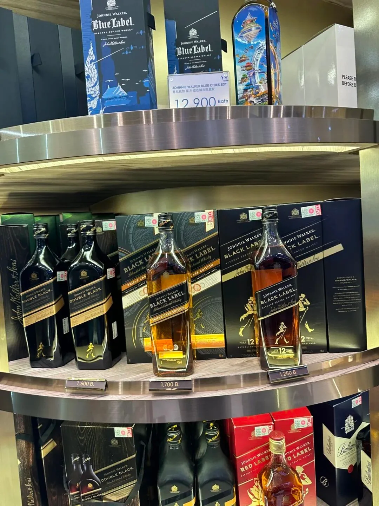
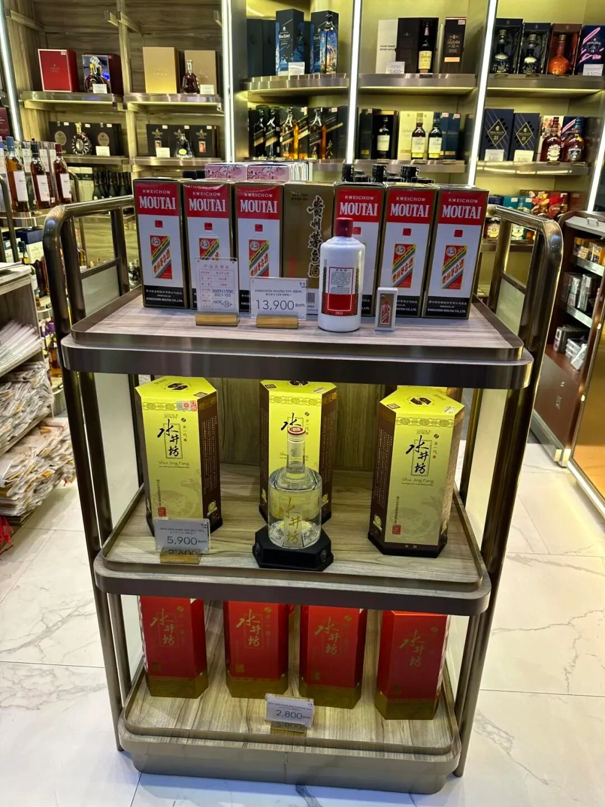

2023 年 7 月，国际航班在逐步恢复，机场免税店也慢慢恢复了一丝元气。在国内，国际出港免税店还比不上这三年精心耕耘的海南免税港，但终究是迈出了开门那一步。

三年前写机场指南时，我们还以为疫情两三个月就会过去，那年夏天就能接着满世界飞。三年后再出门，酒类市场已经换了一副面貌：日本威士忌涨了价还限购，中国免税运营商把新机场当成主阵地，东南亚的货架依旧整齐而平淡。这次走了三座机场——北京大兴、大阪关西、清迈，刚好代表三种状态。

## 一、北京大兴：新机场的新货架

大兴机场 2019 年投运，是华北地区重要的国际枢纽。疫情放开后，它的国际航班逐步恢复，南航与东航会从这里新开不少国际航线；作为一座新机场，日上/CDF 之后也会把这里当作主要阵地，希望能拿到更多好酒配额。

货架上的三瓶酒撑起了门面。帝王 32 年标价 3555 元，国内参考价 6200 元（淘宝官方旗舰店）：这套 Double Double 四次陈酿系列用了不少再过几年可能就无法维持的珍稀酒液，高年份、小批量，货架上有就值得拿。

格兰多纳 1994 标价 5245 元，免税通路限定、限量 1310 瓶，还配一只敦实的木盒，重雪利单桶的风格是送礼首选；费特肯 23 年标价 2070 元，而国内通路的 22 年都要 3000 多，23 年的官方 OB 卖 2000 出头，叠加积分或折扣更划算。

## 二、大阪关西：翻新中的货架

时隔 4 年再到关西机场，最贴切的词是恍如隔世。为筹备世博会，机场在大规模翻新，隔离区内连一顿像样的饭都吃不到，免税店与大牌店关关停停；每周抽选的三得利 25 年，已经很久没见到了。但这里毕竟是日本。

余市与宫城峡的 Grande 各标 10000 日元（约 520 元）。这两支无年份的 Nikka 单麦以前在 5000 到 6000 日元档，如今涨到 1 万日元还经常买不到，每人限购一瓶；年份款更不必说，余市 10 年就没在日本酒铺里重新见过。日本几家大厂恢复了一些产能，但需求涨得更快。

烧酎是这排货架上的意外。天使の诱惑橡木桶熟成烧酎标 4050 日元（约 240 元），背后是鹿儿岛赫赫有名的西酒造，旗下那家尚未发售的威士忌酒厂叫御岳 Ontake，最擅长的正是雪利桶；这一支是货真价实雪利桶熟成 10 年的烧酎。找不到称心的日威时，它可以打开另一扇门。

清酒也在，岩 IWA5、八海山、月桂冠都是响当当的名字，价格丰俭由人，价签标得越高的通常越值。

## 三、清迈：到达大厅先买一瓶

东南亚机场，除了新加坡、吉隆坡这样的枢纽，很难找到物美价廉的威士忌，偶尔出现的“限定版”多半是蓝方的国家限定——2019 年在胡志明机场找到 PORT ELLEN 蓝方限定，那真算撞大运。但这里常有“出了机场，哪儿哪儿喝酒都贵”的情况，所以在到达大厅买一瓶拎着，不失为一个好办法。

清迈的货架由尊尼获加、帝王、皇家礼炮、百龄坛这些品牌撑着，品种齐全、价格公道。照片里蓝方城市限定标价 12,900 泰铢，双黑 1,600 泰铢，黑方 1,250 到 1,700 泰铢；从机场拎一瓶绿方上路，是很多人对付东南亚酒价的办法。想给外国友人普及中国酒文化，可以捎一瓶茅台或水井坊，同一排货架上就有。

## 四、2020 与 2023：旅行零售变了什么

2020 年那份指南里的机场，是独家年份与限量单桶的舞台：魁列奇 39 年、Caperdonich 25 年、樟宜独家上市的帝王 Double Double。2023 年，独家依然存在——格兰多纳 1994 是免税通路限定，帝王 32 年仍在货架上——但故事的重心换成了价差与供给。

大兴把价差写得最直白：一瓶帝王 32 年，3555 元对 6200 元；关西的余市、宫城峡从 5000 到 6000 日元涨到 1 万日元，还要限购一瓶；清迈没有惊喜，价格却公道。三年里，国内免税把资源压向海南与新机场，国际出港店还在补课；日本威士忌的产能回来了，需求涨得更快，无年份款成了“能相对平价买到”的极限。机场不再是“便宜”的代名词，而是“你能不能在正确的时间遇到正确的货”。

## 五、实用笔记：额度、转机与托运

额度要按瓶算。入境内地，12 度以上酒精饮料，内地旅客免税 2 瓶（1.5 升以下），港澳地区居民及因私往来港澳的内地居民 1 瓶（0.75 升以下）；烟草 400 支。买之前先算清楚这一程能带多少。

转机是最容易踩坑的一环。免税酒在安检之后购买、装在密封防拆袋里；如果中转需要重新安检，或者像美国那样入境后转国内段必须重新托运，密封袋可能被收走。买之前先确认中转机场是否接受安检后购买的液体，能直飞就直飞。

托运时，酒精饮料各航司都有规定，高酒精度要申报；用衣物包好、留出膨胀空间，比在箱子里塞满更保险。

比价也值得做。把国内电商与旗舰店的价格记在手机里，现场再决定；大兴的价签直接标出国内参考价，这种做法值得推广。

## 相关链接

- **本站页面**：[大阪关西国际机场（KIX）](/zh/airport/KIX)、[日本（JP）](/zh/country/JP)、[中国（CN）](/zh/country/CN)、[泰国（TH）](/zh/country/TH)
- **维基百科**：[北京大兴国际机场](https://zh.wikipedia.org/wiki/%E5%8C%97%E4%BA%AC%E5%A4%A7%E8%88%88%E5%9C%8B%E9%9A%9B%E6%A9%9F%E5%A0%B4)、[关西国际机场](https://zh.wikipedia.org/wiki/%E9%97%9C%E8%A5%BF%E5%9C%8B%E9%9A%9B%E6%A9%9F%E5%A0%B4)、[清迈国际机场](https://zh.wikipedia.org/wiki/%E6%B8%85%E9%82%81%E5%9C%8B%E9%9A%9B%E6%A9%9F%E5%A0%B4)
- **百度百科**：[北京大兴国际机场](https://baike.baidu.com/item/%E5%8C%97%E4%BA%AC%E5%A4%A7%E5%85%B4%E5%9B%BD%E9%99%85%E6%9C%BA%E5%9C%BA)、[关西国际机场](https://baike.baidu.com/item/%E5%85%B3%E8%A5%BF%E5%9B%BD%E9%99%85%E6%9C%BA%E5%9C%BA)、[清迈国际机场](https://baike.baidu.com/item/%E6%B8%85%E8%BF%88%E5%9B%BD%E9%99%85%E6%9C%BA%E5%9C%BA)

图片来源：WhiskyENJOY享威。文中价格与货架为 2023 年 7 月的记录；免税额度、液体规定与航司托运政策以海关、机场与承运航司的最新公告为准，出行前请核对运营方官网。
