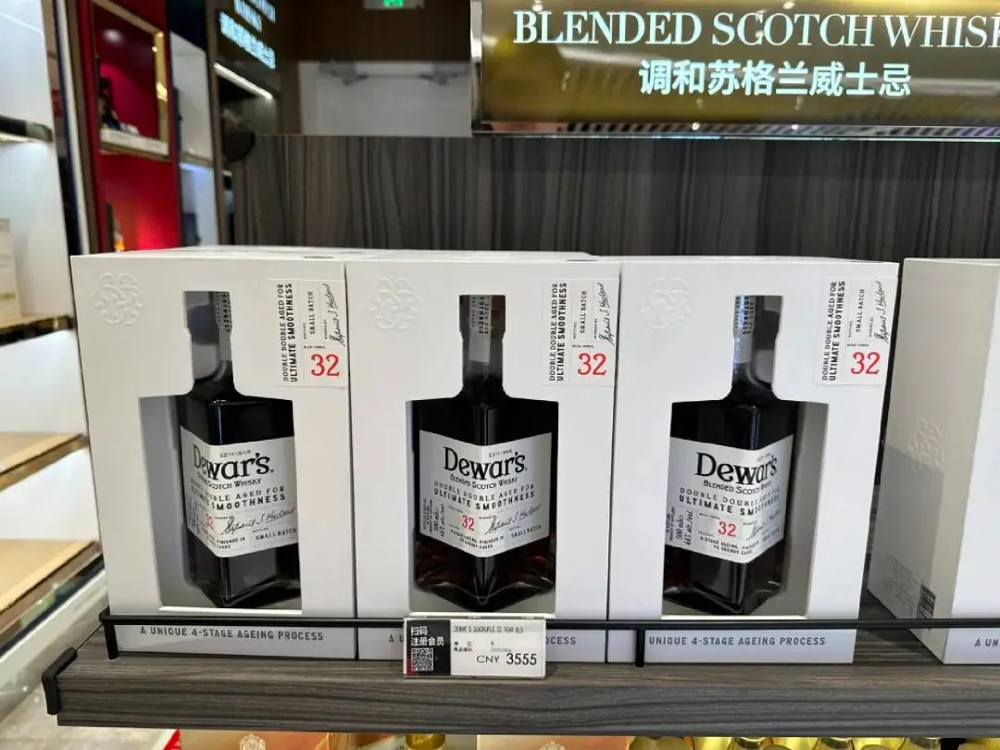
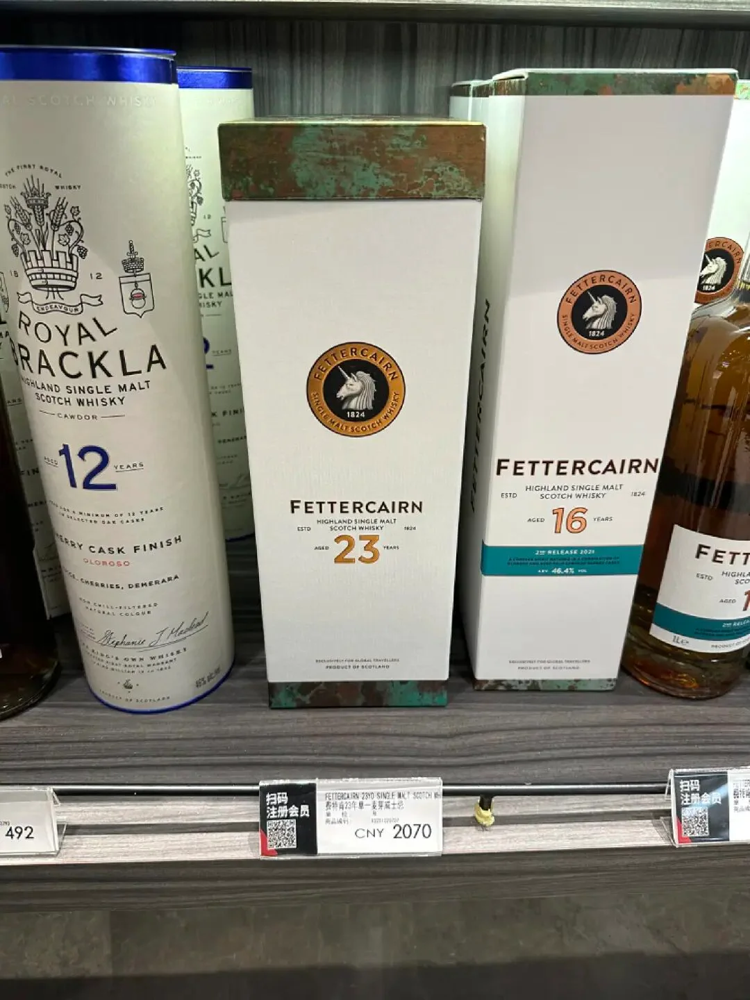

В июле 2023 года международные рейсы восстанавливались, и аэропортовый дьюти-фри понемногу возвращался к прежней жизни. Внутри Китая магазины международного вылета всё ещё отставали от хайнаньского рынка офшорного дьюти-фри, который развивали три года, но хотя бы двери снова были открыты.

Когда писался прошлый гид по аэропортам, за три года до этого, предполагалось, что пандемия закончится через два-три месяца и к тому лету мы снова будем летать по миру. Сейчас рынок крепкого алкоголя выглядит иначе: японский виски подорожал и продаётся по норме, китайские операторы дьюти-фри относятся к новым аэропортам как к флагманам, а полки Юго-Восточной Азии остаются аккуратными и непримечательными. Три аэропорта этой поездки — Пекин-Дасин, Осака-Кансай и Чиангмай — представляют три разных состояния.

## 1. Пекин-Дасин: новая полка нового аэропорта

Дасин открылся в 2019 году и является ключевым международным хабом северного Китая. После открытия границ международные рейсы постепенно вернулись, China Southern и China Eastern добавили маршруты; как новый аэропорт он ещё и место, где Sunrise и CDF намерены построить главную позицию в надежде получать лучшие квоты на хороший виски.

Полку держат три бутылки. Dewar's 32 лет стоит 3 555 CNY при внутренней справочной цене 6 200 CNY в флагманском магазине на Taobao: четырёхступенчатая серия Double Double использует редкие запасы, которых может не хватить на многие годы, и в этом возрасте и объёме партии её стоит брать, пока она есть.

Glendronach 1994 стоит 5 245 CNY — эксклюзив канала дьюти-фри, 1 310 бутылок, насыщенный шерри-сингл-каск в деревянной коробке, очевидный подарок. Fettercairn 23 — 2 070 CNY, тогда как 22-летний во внутренних каналах уже стоит больше 3 000 CNY; этот официальный OB чуть дороже 2 000 CNY, до любых баллов и скидок, — лучший по соотношению цены и качества из трёх.

## 2. Осака-Кансай: полка в разгар ремонта

Вернувшись в Кансай через четыре года, точнее всего сказать «другой мир». Аэропорт масштабно ремонтируется перед выставкой, и в стерильной зоне не было даже приличной еды; магазины дьюти-фри и люкса открывались и закрывались по очереди, а Suntory 25 лет, который раньше появлялся в еженедельной лотерее, давно не видели. Но это по-прежнему Япония.

Yoichi и Miyagikyo Grande стоят по ¥10 000 (около 520 юаней). Эти односолодовые Nikka без указания возраста раньше держались в диапазоне ¥5 000–6 000; теперь они по ¥10 000 и часто недоступны — по одной бутылке в руки. Возрастные релизы ещё дальше: Yoichi 10 просто не вернулся в японские винные магазины. Японские винокурни восстановили часть мощностей, но спрос рос быстрее.

Сётю — сюрприз этой полки. Tenshi no Yuwaku, сётю, выдержанное в бочках, стоит ¥4 050 (около 240 юаней), от кагосимской Nishishuzo, чья невыпущенная винокурня Ontake известна именно шерри-бочками; это настоящее десятилетнее сётю из шерри-бочки. Когда нужного японского виски нет, открывается другая дверь.

Саке тоже есть — IWA 5, Hakkaisan и Gekkeikan стоит знать, цены от скромных до серьёзных, и чем выше ценник, тем чаще он оправдан.

## 3. Чиангмай: купите бутылку по прилёте

За пределами таких хабов, как Сингапур и Куала-Лумпур, аэропорты Юго-Восточной Азии редко предлагают выгодный виски, а случайное «limited edition» обычно оказывается страновой версией Johnnie Walker Blue — найти Port Ellen Blue Label в Хошимине в 2019 году считалось настоящей удачей. Но в этих городах почти всё за пределами терминала стоит дороже, поэтому купить бутылку в зоне прилёта и везти с собой — разумный ход.

Полку Чиангмая держат Johnnie Walker, Dewar's, Royal Salute и Ballantine's — полные линейки, справедливые цены. На фотографии Blue Label Cities Edition стоит 12 900 THB, Double Black — 1 600, а Black Label — от 1 250 до 1 700; бутылка Green Label в дорогу — так многие путешественники переживают юго-восточноазиатские цены на алкоголь. Чтобы познакомить иностранных друзей с китайским крепким алкоголем, на той же полке стоят Moutai или Shuijingfang.

## 4. 2020 и 2023: что изменилось в трэвел-ритейле

Аэропорты гида 2020 года были сценой для эксклюзивных возрастов и лимитированных сингл-касков: Craigellachie 39, Caperdonich 25, эксклюзивный для Чанги Dewar's Double Double. В 2023 году эксклюзивы всё ещё есть — Glendronach 1994 разлит только для канала дьюти-фри, Dewar's 32 по-прежнему на полке, — но история сместилась к разнице цен и поставкам.

Дасин показывает разрыв нагляднее всего: 3 555 CNY за Dewar's 32 против 6 200 CNY дома. Кансай показывает сторону предложения: Yoichi и Miyagikyo подорожали с ¥5 000–6 000 до ¥10 000, и не больше бутылки в руки. Чиангмай не предлагает сюрпризов и держит справедливые цены. За три года внутренний дьюти-фри направил ресурсы на Хайнань и новые аэропорты, а магазины международного вылета всё ещё догоняют; японские мощности вернулись, но спрос вырос быстрее, и релизы без указания возраста теперь предел «относительно доступного». Аэропорт больше не синоним дешёвого. Вопрос в том, чтобы оказаться в нужном месте, когда там есть нужный запас.

## 5. Практические заметки: норма, пересадки, сданный багаж

Считайте бутылки против нормы. При въезде в материковый Китай путешественники с материка могут беспошлинно провезти 2 бутылки крепкого алкоголя свыше 12% (до 1,5 литра), а жители Гонконга и Макао и жители материка, едущие в Гонконг или Макао частным порядком, — 1 бутылку (до 0,75 литра); табак — 400 сигарет.

Пересадки — место, где всё идёт не так. Дьюти-фри-алкоголь покупают после досмотра и запечатывают в защищённый пакет; если при пересадке нужен ещё один досмотр или — как в США — багаж повторно проверяют перед внутренним рейсом, пакет могут забрать. Уточните, принимает ли транзитный аэропорт жидкость в защищённой упаковке, прежде чем платить, и по возможности летите прямым рейсом.

В сданном багаже авиакомпании устанавливают свои правила на алкоголь, а крепкий алкоголь нужно декларировать; обернуть бутылки одеждой и оставить место для расширения безопаснее, чем набить чемодан плотно.

Проверка цен стоит усилий. Запишите цены внутренней электронной торговли и флагманских магазинов перед полётом и решайте у полки; практика Дасина печатать внутреннюю справочную цену на ценнике достойна подражания.

## Полезные ссылки

- **На этом сайте**: [Осака-Кансай (KIX)](/airport/KIX), [Япония (JP)](/country/JP), [Китай (CN)](/country/CN), [Таиланд (TH)](/country/TH)
- **Википедия**: [Международный аэропорт Пекин-Дасин](https://en.wikipedia.org/wiki/Beijing_Daxing_International_Airport), [Международный аэропорт Кансай](https://en.wikipedia.org/wiki/Kansai_International_Airport), [Международный аэропорт Чиангмай](https://en.wikipedia.org/wiki/Chiang_Mai_International_Airport)
- **Baidu Baike**: [Международный аэропорт Пекин-Дасин](https://baike.baidu.com/item/%E5%8C%97%E4%BA%AC%E5%A4%A7%E5%85%B4%E5%9B%BD%E9%99%85%E6%9C%BA%E5%9C%BA), [Международный аэропорт Кансай](https://baike.baidu.com/item/%E5%85%B3%E8%A5%BF%E5%9B%BD%E9%99%85%E6%9C%BA%E5%9C%BA), [Международный аэропорт Чиангмай](https://baike.baidu.com/item/%E6%B8%85%E8%BF%88%E5%9B%BD%E9%99%85%E6%9C%BA%E5%9C%BA)

Источник изображений: WhiskyENJOY. Цены и ассортимент — записи июля 2023 года; нормы, правила провоза жидкости и политика авиакомпаний по багажу публикуются таможней, аэропортом и перевозчиком, поэтому перед поездкой проверяйте сайт оператора.
