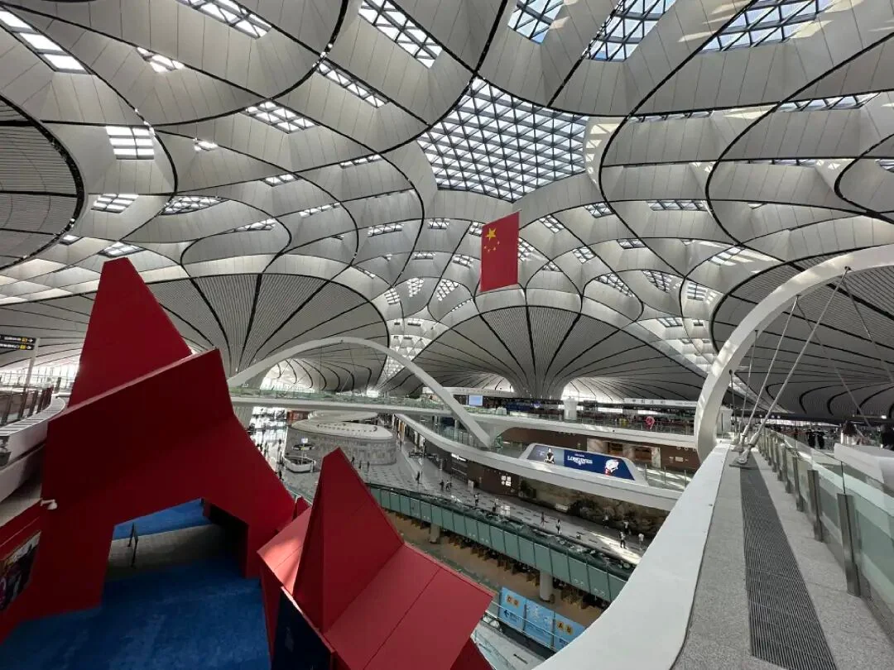

У липні 2023 року міжнародні рейси відновлювалися, і аеропортовий дьюті-фрі повертав собі трохи колишнього життя. Усередині Китаю магазини міжнародних вильотів усе ще відставали від офшорного безмитного ринку Хайнаню, який плекали три роки, але принаймні двері знову були відчинені.

Коли писався попередній аеропортовий путівник, три роки тому, ми припускали, що пандемія закінчиться за два-три місяці й того ж літа ми знову літатимемо світом. Подорожуючи тепер, бачу, що ринок міцних напоїв виглядає інакше: японський віскі коштує дорожче, і його видають за нормою, китайські оператори дьюті-фрі ставляться до нових аеропортів як до флагманської території, а полиці Південно-Східної Азії лишаються охайними й нічим не примітними. Три аеропорти цієї поїздки — пекінський Дасін, Осака-Кансай і Чіангмай — представляють три різні стани.

## 1. Пекінський Дасін: нова полиця нового аеропорту

Дасін відкрився 2019 року й є ключовим міжнародним хабом півночі Китаю. Після відкриття кордону його міжнародні рейси поверталися поступово, China Southern і China Eastern додавали маршрути; як новий аеропорт він також є місцем, де Sunrise і CDF мають намір збудувати головну позицію — сподіваючись отримати кращі розподіли доброго віскі.

Полицю тримають три пляшки. Dewar's 32 років має цінник 3 555 юанів проти довідкової ціни в країні 6 200 юанів у флагманському магазині на Taobao: чотириступенева серія Double Double використовує рідкісні запаси, яких може не вистачити на багато років уперед, тож за такого віку й обсягу партії її варто брати, поки вона є.

Glendronach 1994 має цінник 5 245 юанів — ексклюзив безмитного каналу, 1 310 пляшок, насичений хересний віскі з однієї бочки, у дерев'яній коробці, очевидний подарунок. Fettercairn 23 коштує 2 070 юанів, тоді як 22-річний у внутрішніх каналах уже коштує понад 3 000 юанів; цей офіційний розлив виробника трохи за 2 000 юанів, ще до будь-яких балів чи знижок, — найвигідніша покупка з трьох.

## 2. Осака-Кансай: полиця посеред ремонту

Повернувшись до Кансаю через чотири роки, найточніше сказати: «інший світ». Аеропорт масштабно реконструюється перед виставкою, і в стерильній зоні навіть пристойно поїсти не було; магазини дьюті-фрі й люксові крамниці відкривалися й закривалися по черзі, а 25-річний Suntory, який раніше з'являвся в щотижневій лотереї, давно не траплявся. Але це все ще Японія.

Yoichi і Miyagikyo Grande — по ¥10 000 (приблизно 520 юанів). Ці односолодові віскі Nikka без зазначення віку раніше коштували в діапазоні ¥5 000–6 000; тепер вони по ¥10 000 і часто недоступні — одна пляшка на людину. Віскі із зазначенням віку ще недосяжніші — Yoichi 10 просто не повернувся в японські крамниці. Японські винокурні відновили частину потужностей, але попит зростав швидше.

Сьотю — сюрприз цієї полиці. Tenshi no Yuwaku, сьотю, витримане в бочці, коштує ¥4 050 (приблизно 240 юанів); його робить компанія Nishishuzo з Каґосіми, чия ще не запущена віскі-винокурня Ontake відома саме хересними бочками; це справжнє десятирічне сьотю з хересної бочки. Коли потрібного японського віскі немає, це відчиняє інші двері.

Саке теж є — IWA 5, Hakkaisan і Gekkeikan варті знайомства, за цінами від скромних до серйозних, і що вищий цінник, то більше воно, як правило, того варте.

## 3. Чіангмай: купіть пляшку вже на прибутті

Поза такими хабами, як Сінгапур і Куала-Лумпур, аеропорти Південно-Східної Азії рідко пропонують вигідний віскі, а випадковий «лімітований випуск» зазвичай є країновим виданням Johnnie Walker Blue — знайти Port Ellen Blue Label у Хошиміні 2019 року вважалося справжньою удачею. Але в цих містах майже все поза терміналом коштує дорожче, тож купити пляшку в зоні прибуття й носити її з собою — розумний хід.

Полицю Чіангмая тримають Johnnie Walker, Dewar's, Royal Salute і Ballantine's — повні лінійки, чесні ціни. На фото Blue Label Cities Edition коштує 12 900 батів, Double Black — 1 600, а Black Label — від 1 250 до 1 700; пляшка Green Label у дорогу — це те, як багато мандрівників виживають серед цін на напої в Південно-Східній Азії. Щоб познайомити іноземних друзів із китайськими міцними напоями, на тій самій полиці є Moutai або Shuijingfang.

## 4. 2020 і 2023: що змінилося в тревел-рітейлі

Аеропорти з путівника 2020 року були сценою для ексклюзивних витримок і лімітованих віскі з окремих бочок: Craigellachie 39, Caperdonich 25, ексклюзивний для Changi Dewar's Double Double. У 2023 році ексклюзиви все ще є — Glendronach 1994 розливають лише для безмитного каналу, Dewar's 32 досі на полиці, — але історія змістилася до цінових розривів і постачання.

Дасін показує розрив найнаочніше: 3 555 юанів за Dewar's 32 проти 6 200 юанів удома. Кансай показує бік пропозиції: Yoichi і Miyagikyo подорожчали з ¥5 000–6 000 до ¥10 000, з обмеженням в одну пляшку. Чіангмай не пропонує сюрпризів і має чесні ціни. За три роки внутрішній дьюті-фрі спрямував ресурси на Хайнань і нові аеропорти, а магазини міжнародних вильотів досі наздоганяють; японські потужності повернулися, але попит зростав швидше, і випуски без зазначення віку тепер — межа «відносно доступного». Аеропорт більше не є синонімом дешевизни. Ідеться про те, щоб опинитися в потрібному місці, коли там є потрібний товар.

## 5. Практичні нотатки: норма, пересадки, зданий багаж

Рахуйте пляшки проти норми. Під час в'їзду до материкового Китаю мандрівники з материка можуть безмитно привезти 2 пляшки міцних напоїв понад 12% алкоголю (менш як 1,5 літра), тоді як жителі Гонконгу й Макао та жителі материка, які приватно подорожують до Гонконгу чи Макао, отримують 1 пляшку (менш як 0,75 літра); тютюну — 400 цигарок.

Пересадки — там усе й ламається. Безмитні міцні напої купують після контролю безпеки й запечатують у пакет, що показує несанкціоноване відкриття; якщо пересадка вимагає ще однієї перевірки безпеки або, як у США, багаж повторно перевіряють перед внутрішнім відрізком, пакет можуть забрати. Підтвердьте, що транзитний аеропорт приймає запечатані рідини, перш ніж платити, і летіть прямими рейсами, де можете.

У зданому багажі авіакомпанії встановлюють власні правила щодо алкоголю, а міцні напої треба декларувати; загорнути пляшки в одяг і залишити місце для розширення безпечніше, ніж набивати валізу вщент.

Перевірка цін варта зусиль. Занотуйте ціни внутрішньої електронної комерції та флагманських магазинів перед польотом і вирішуйте біля полиці; те, що Дасін друкує довідкову ціну в країні на ціннику, — практика, яку варто перейняти.

## Пов'язані посилання

- **На цьому сайті**: [Осака-Кансай (KIX)](/airport/KIX), [Японія (JP)](/country/JP), [Китай (CN)](/country/CN), [Таїланд (TH)](/country/TH)
- **Вікіпедія**: [Пекінський міжнародний аеропорт Дасін](https://en.wikipedia.org/wiki/Beijing_Daxing_International_Airport), [Міжнародний аеропорт Кансай](https://en.wikipedia.org/wiki/Kansai_International_Airport), [Міжнародний аеропорт Чіангмай](https://en.wikipedia.org/wiki/Chiang_Mai_International_Airport)
- **Baidu Baike**: [Пекінський міжнародний аеропорт Дасін](https://baike.baidu.com/item/%E5%8C%97%E4%BA%AC%E5%A4%A7%E5%85%B4%E5%9B%BD%E9%99%85%E6%9C%BA%E5%9C%BA), [Міжнародний аеропорт Кансай](https://baike.baidu.com/item/%E5%85%B3%E8%A5%BF%E5%9B%BD%E9%99%85%E6%9C%BA%E5%9C%BA), [Міжнародний аеропорт Чіангмай](https://baike.baidu.com/item/%E6%B8%85%E8%BF%88%E5%9B%BD%E9%99%85%E6%9C%BA%E5%9C%BA)

Джерело зображень: WhiskyENJOY. Ціни й асортимент — записи липня 2023 року; норми, правила перевезення рідин і політика авіакомпаній щодо багажу — такі, як їх публікують митниця, аеропорт і перевізник, тож перевіряйте сайт оператора перед поїздкою.
