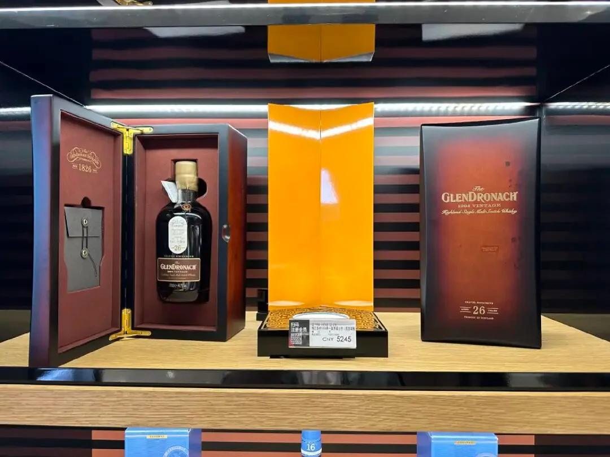

Vào tháng 7 năm 2023, các chuyến bay quốc tế đang phục hồi, và cửa hàng miễn thuế sân bay đang lấy lại chút sức sống cũ. Trong nội địa Trung Quốc, các cửa hàng xuất cảnh quốc tế vẫn chậm hơn thị trường miễn thuế ngoài khơi Hải Nam đã được vun đắp ba năm, nhưng ít nhất cửa đã mở trở lại.

Khi hướng dẫn sân bay trước được viết, ba năm trước, người ta giả định đại dịch sẽ kết thúc trong hai hoặc ba tháng và đến mùa hè đó chúng ta sẽ lại bay khắp thế giới. Đi lại bây giờ, thị trường rượu mạnh trông khác: whisky Nhật đắt hơn và bị phân phối hạn chế, các đơn vị miễn thuế Trung Quốc coi sân bay mới là lãnh địa hàng đầu, và kệ hàng Đông Nam Á vẫn gọn gàng và không có gì đặc sắc. Ba sân bay trong chuyến này — Bắc Kinh Đại Hưng, Osaka Kansai và Chiang Mai — đại diện cho ba trạng thái khác nhau.

## 1. Bắc Kinh Đại Hưng: kệ hàng mới của sân bay mới

Đại Hưng mở cửa năm 2019 và là trung tâm quốc tế trọng điểm của miền bắc Trung Quốc. Kể từ khi biên giới mở lại, các chuyến bay quốc tế dần trở lại, với China Southern và China Eastern bổ sung đường bay; là sân bay mới, đây cũng là nơi Sunrise và CDF dự định xây vị thế chính, với hy vọng giành được phân bổ whisky tốt hơn.

Ba chai làm nên kệ hàng. Dewar's 32 tuổi có giá 3.555 CNY so với giá tham chiếu nội địa 6.200 CNY trên cửa hàng flagship Taobao: dòng Double Double bốn giai đoạn dùng nguồn rượu quý có thể không duy trì được nhiều năm nữa, và với tuổi này cùng quy mô lô này, đáng mua khi còn.

Glendronach 1994 có giá 5.245 CNY — bản độc quyền kênh miễn thuế 1.310 chai, single cask sherry đậm, trong hộp gỗ, và là món quà rõ ràng. Fettercairn 23 giá 2.070 CNY, trong khi bản 22 tuổi ở kênh nội địa đã hơn 3.000 CNY; bản OB chính thức này chỉ hơn 2.000 CNY, trước mọi điểm thưởng hay giảm giá, là lựa chọn đáng giá nhất trong ba chai.

## 2. Osaka Kansai: kệ hàng đang cải tạo

Trở lại Kansai sau bốn năm, cụm từ phù hợp là “một thế giới khác”. Sân bay đang cải tạo quy mô lớn trước thềm triển lãm, và ở khu cách ly thậm chí không có một bữa ăn tử tế; các cửa hàng miễn thuế và hàng hiệu mở rồi đóng luân phiên, và chai Suntory 25 tuổi từng xuất hiện trong đợt xổ số hàng tuần đã lâu không thấy. Nhưng đây vẫn là Nhật Bản.

Yoichi và Miyagikyo Grande mỗi chai 10.000 yên (khoảng 520 nhân dân tệ). Những chai single malt Nikka không ghi tuổi này từng nằm trong khoảng 5.000 đến 6.000 yên; giờ là 10.000 yên và thường không có hàng, mỗi người một chai. Các bản có ghi tuổi còn xa hơn — Yoichi 10 đơn giản là chưa xuất hiện lại trong các cửa hàng rượu Nhật. Các nhà máy chưng cất Nhật đã khôi phục phần nào công suất, nhưng nhu cầu tăng nhanh hơn.

Shochu là điều bất ngờ trên kệ này. Tenshi no Yuwaku, một loại shochu ủ trong thùng, giá 4.050 yên (khoảng 240 nhân dân tệ), đến từ Nishishuzo ở Kagoshima, nơi có nhà máy chưng cất whisky chưa ra mắt Ontake nổi tiếng chính nhờ thùng sherry; đây là shochu ủ thùng sherry mười năm thực sự. Khi không có loại whisky Nhật bạn muốn, nó mở ra một cánh cửa khác.

Sake cũng có — IWA 5, Hakkaisan và Gekkeikan đều đáng biết, giá từ khiêm tốn đến cao, và nhãn càng đắt thì thường càng đáng tiền.

## 3. Chiang Mai: mua một chai khi đến

Ngoài các trung tâm như Singapore và Kuala Lumpur, sân bay Đông Nam Á hiếm khi có whisky giá tốt, và thỉnh thoảng có “bản giới hạn” thường chỉ là bản Johnnie Walker Blue theo quốc gia — tìm được Port Ellen Blue Label ở Thành phố Hồ Chí Minh năm 2019 được coi là may mắn thực sự. Nhưng ở những thành phố này, gần như mọi thứ ngoài nhà ga đều đắt hơn, nên mua một chai ở khu đến và mang theo là nước đi hợp lý.

Kệ hàng Chiang Mai được trụ bởi Johnnie Walker, Dewar's, Royal Salute và Ballantine's — đủ dòng, giá hợp lý. Trong ảnh, Blue Label Cities Edition giá 12.900 THB, Double Black 1.600, và Black Label từ 1.250 đến 1.700; một chai Green Label mang theo đường là cách nhiều du khách sống sót qua giá đồ uống Đông Nam Á. Để giới thiệu rượu Trung Quốc với bạn bè nước ngoài, Moutai hoặc Shuijingfang cũng có trên kệ.

## 4. 2020 và 2023: điều gì đã thay đổi trong bán lẻ du lịch

Các sân bay trong hướng dẫn 2020 là sân khấu cho những bản tuổi độc quyền và single cask giới hạn: Craigellachie 39, Caperdonich 25, Dewar's Double Double độc quyền Changi. Năm 2023, bản độc quyền vẫn tồn tại — Glendronach 1994 là bản chỉ có ở kênh miễn thuế, Dewar's 32 vẫn trên kệ — nhưng câu chuyện đã chuyển sang khoảng cách giá và nguồn cung.

Đại Hưng nói rõ nhất về khoảng cách: 3.555 CNY cho Dewar's 32 so với 6.200 CNY ở nhà. Kansai cho thấy phía nguồn cung: Yoichi và Miyagikyo tăng từ 5.000–6.000 yên lên 10.000 yên, kèm giới hạn một chai. Chiang Mai không có bất ngờ và giá hợp lý. Trong ba năm, miễn thuế nội địa dồn nguồn lực về Hải Nam và các sân bay mới, trong khi cửa hàng xuất cảnh quốc tế vẫn đang bắt kịp; công suất Nhật đã trở lại, nhưng nhu cầu tăng nhanh hơn, và các bản không ghi tuổi giờ là giới hạn của “tương đối phải chăng”. Sân bay không còn là đồng nghĩa với rẻ. Đó là chuyện có mặt đúng chỗ khi đúng lô hàng ở đó.

## 5. Ghi chú thực tế: hạn mức, nối chuyến, hành lý ký gửi

Hãy đếm số chai theo hạn mức. Khi nhập cảnh Trung Quốc đại lục, du khách đại lục được mang miễn thuế 2 chai rượu mạnh trên 12% ABV (dưới 1,5 lít), trong khi cư dân Hồng Kông và Ma Cao cùng cư dân đại lục tự đi Hồng Kông hoặc Ma Cao được 1 chai (dưới 0,75 lít); thuốc lá là 400 điếu.

Nối chuyến là chỗ mọi chuyện hỏng. Rượu mạnh miễn thuế được mua sau an ninh và niêm phong trong túi chống can thiệp; nếu nối chuyến phải qua an ninh lần nữa, hoặc — như ở Hoa Kỳ — hành lý bị kiểm tra lại trước chặng nội địa, túi có thể bị lấy đi. Hãy xác nhận sân bay trung chuyển chấp nhận chất lỏng niêm phong an ninh trước khi trả tiền, và bay thẳng khi có thể.

Trong hành lý ký gửi, các hãng bay tự đặt quy định về rượu và rượu mạnh nồng độ cao phải khai báo; bọc chai trong quần áo và chừa chỗ để giãn nở an toàn hơn là nhồi chặt vali.

Kiểm tra giá là việc đáng làm. Hãy ghi giá thương mại điện tử và cửa hàng flagship nội địa trước khi bay rồi quyết định tại kệ; việc Đại Hưng in giá tham chiếu nội địa lên nhãn là cách làm đáng học.

## Liên kết liên quan

- **Trên trang này**: [Osaka Kansai (KIX)](/airport/KIX), [Nhật Bản (JP)](/country/JP), [Trung Quốc (CN)](/country/CN), [Thái Lan (TH)](/country/TH)
- **Wikipedia**: [Beijing Daxing International Airport](https://en.wikipedia.org/wiki/Beijing_Daxing_International_Airport), [Kansai International Airport](https://en.wikipedia.org/wiki/Kansai_International_Airport), [Chiang Mai International Airport](https://en.wikipedia.org/wiki/Chiang_Mai_International_Airport)
- **Baidu Baike**: [Beijing Daxing International Airport](https://baike.baidu.com/item/%E5%8C%97%E4%BA%AC%E5%A4%A7%E5%85%B4%E5%9B%BD%E9%99%85%E6%9C%BA%E5%9C%BA), [Kansai International Airport](https://baike.baidu.com/item/%E5%85%B3%E8%A5%BF%E5%9B%BD%E9%99%85%E6%9C%BA%E5%9C%BA), [Chiang Mai International Airport](https://baike.baidu.com/item/%E6%B8%85%E8%BF%88%E5%9B%BD%E9%99%85%E6%9C%BA%E5%9C%BA)

Nguồn ảnh: WhiskyENJOY. Giá và danh mục là ghi chép tháng 7 năm 2023; hạn mức, quy định chất lỏng và chính sách hành lý của hãng bay theo công bố của hải quan, sân bay và hãng vận chuyển, nên hãy kiểm tra trang của đơn vị vận hành trước khi đi.
