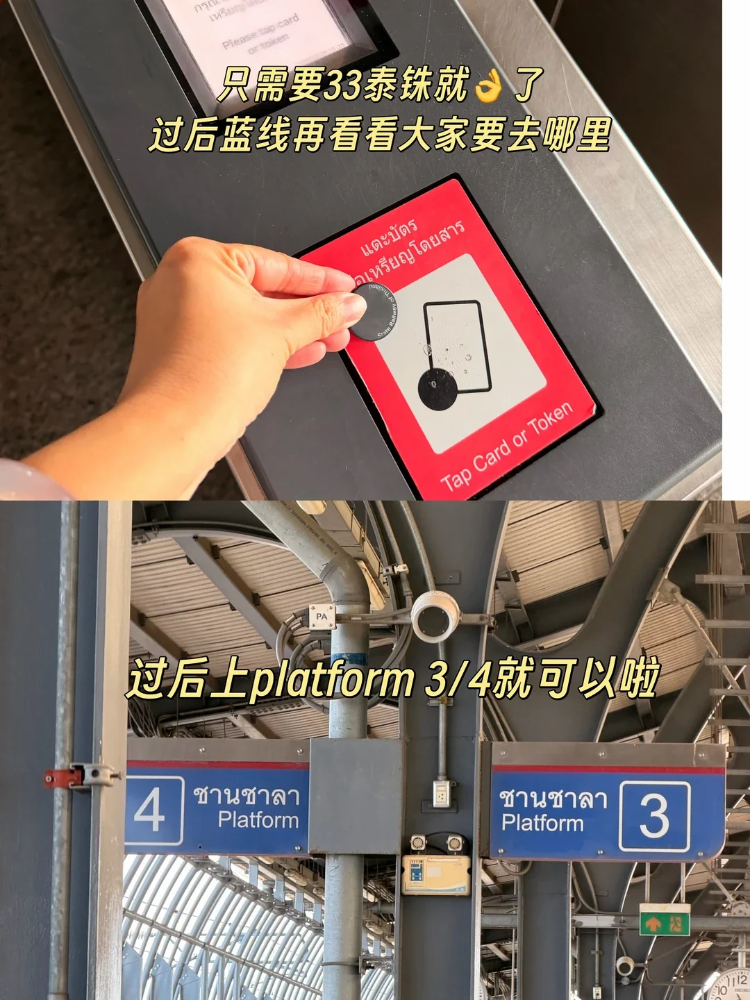

Nejlevnější a vůči dopravním zácpám nejodolnější cesta z Don Mueang (DMK) do centra Bangkoku je **SRT Red Line** (Dark Red Line). Jedna jízda stojí **33 bahtů**, dojedete na **Krung Thep Aphiwat** a tam přestoupíte na MRT Blue Line, abyste se dostali do města.

## Nejdřív jak Red Line funguje

Red Line je bangkocká příměstská železnice a letištní stanice se jmenuje **Don Mueang**. Nevede do centra; vede sever–jih. Směrem na jih zastavuje v Kan Kheha, Lak Si, Thung Song Hong, Bang Khen, Wat Samian Nari a Chatuchak, než dojede na **Krung Thep Aphiwat** (centrální nádraží Bangkoku).

**Cesta do města je tedy: Red Line na Krung Thep Aphiwat, pak přestup na MRT Blue Line.**

## Krok za krokem

### 1. Z příletové haly doleva

Když vyjdete z příletové haly, uvidíte tuto ceduli: **Domestic Terminal (2FL)** a **SRT Red Line / Train Station** vlevo, mezinárodní odlety (3FL) vpravo. **Dejte se vlevo.**

### 2. Kolem 7-Eleven a Starbucks

Po cestě nejdřív mijíte **7-Eleven**, potom **Starbucks**. Chodba je uvnitř a klimatizovaná; prostě jděte s davem.

### 3. Nejezděte červeným eskalátorem

Projdete kolem červeného eskalátoru – **ten vede nahoru do patra domácích odletů, tak na něj nešlapejte**. Dál sledujte cedule „SRT Red Line“.

### 4. Jděte o patro výš, nebo pokračujte v přízemí

Pokud jste v přízemí, vyjeďte eskalátorem do druhého patra; pokud už jste ve druhém patře, jako já, **prostě jděte dál**. Stejně tak můžete zůstat v přízemí a jít celou cestu pěšky; jen pokračujte.

### 5. Hledejte MAGIC Food Park a MYBREW

Jděte dál, dokud neuvidíte ceduli **MAGIC Food Park**, pak odbočte a najdete **MYBREW** coffee. Už jste skoro tam – vedle je plakát Red Line se značkou „460 M.“

### 6. Odbočte vlevo a přejděte lávku

Tady **odbočte vlevo** a pokračujte; přejdete jednu lávku a jste na nádraží.

### 7. Když uvidíte čekací židle, kupte si jízdenku

Řada čekacích židlí znamená, že jste dorazili na nádraží. Nejdřív si kupte jízdenku v automatu.

### 8. V automatu vyberte Krung Thep Aphiwat

Klepněte na **Select your destination** a vyberte **Krung Thep Aphiwat** (to je stanice pro město, pak přestupte na Blue Line). Otvor je označený **Insert coins** a žeton stojí asi **33 bahtů**.

> Plakáty ve stanici inzerovaly akci „nejvýš 20 bahtů, do města za méně než 20 minut“. Jízdné je ve skutečnosti podle vzdálenosti – zkontrolujte, co ukazuje automat.

### 9. Přiložte žeton a jděte na nástupiště 3/4

Vezměte kulatý žeton, přiložte ho k turniketu (Tap Card or Token) a počkejte na **nástupišti 3/4**.

### 10. Asi 17 minut na Krung Thep Aphiwat

Z Don Mueang na Krung Thep Aphiwat je to **7 zastávek, asi 17 minut**. Po příjezdu jděte podle cedulí ven a přestupte na **MRT Blue Line**, abyste se dostali do zbytku města.

## Pozor: vlaky jezdí každých 20 minut

SRT Red Line jezdí zhruba **každých 20 minut**, mnohem méně často než metro ve městě. Než vyrazíte, zkontrolujte odjezdovou tabuli stanice (nebo Google Maps), abyste znali čas příštího odjezdu a nástupiště a nezůstali stát na place.

Protože je spojů málo, **pokud letíte, nechte si aspoň 40 minut rezervu**: 20 minut čekání plus 17 minut jízdy, k tomu přestup a pěší přesun.
