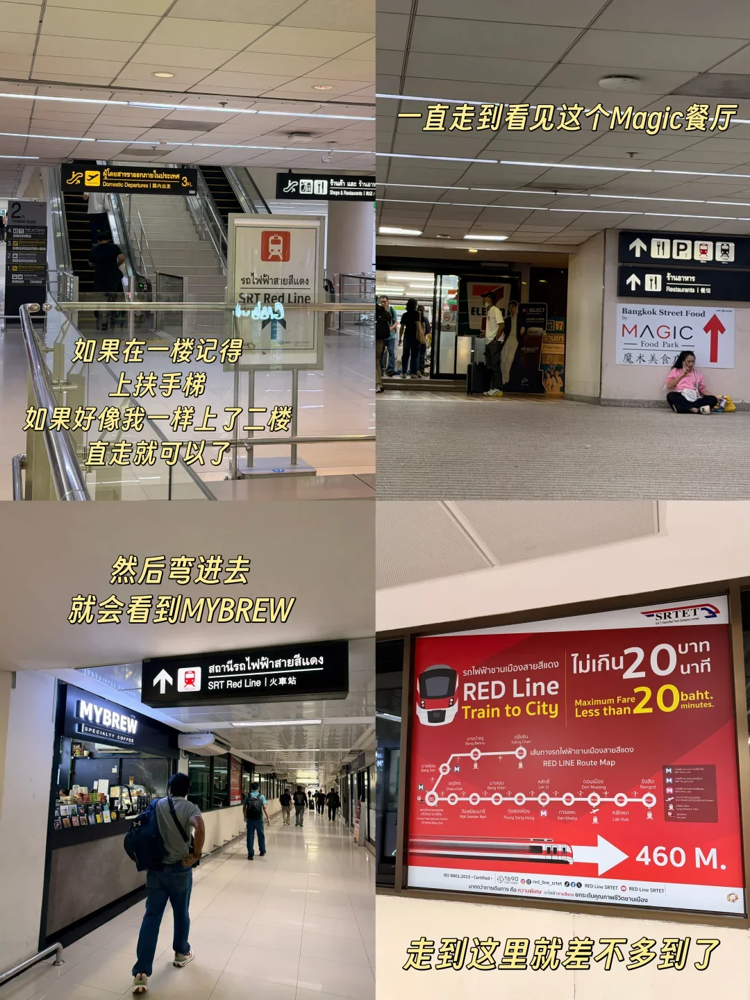

La forma más barata y menos expuesta al tráfico de ir de Don Mueang (DMK) al centro de Bangkok es la **línea roja del SRT** (línea roja oscura). Un trayecto cuesta **33 baht** y viajas hasta **Krung Thep Aphiwat**, donde cambias a la línea azul del MRT para llegar a la ciudad.

## Primero, cómo funciona la línea roja

La línea roja es el ferrocarril suburbano de Bangkok, y la estación del aeropuerto se llama **Don Mueang**. No entra en el centro de la ciudad; va de norte a sur. Hacia el sur hace parada en Kan Kheha, Lak Si, Thung Song Hong, Bang Khen, Wat Samian Nari y Chatuchak antes de llegar a **Krung Thep Aphiwat** (la estación central de Bangkok).

**Así que la forma de entrar en la ciudad es: línea roja hasta Krung Thep Aphiwat y después cambio a la línea azul del MRT.**

## Paso a paso

### 1. Al salir de llegadas, gira a la izquierda

Al salir de la sala de llegadas verás este cartel: **Domestic Terminal (2FL)** y **SRT Red Line / Train Station** a la izquierda, salidas internacionales (3FL) a la derecha. **Ve a la izquierda.**

### 2. Pasa el 7-Eleven y Starbucks

Por el camino pasas primero un **7-Eleven** y luego **Starbucks**. El pasillo es interior y tiene aire acondicionado; solo sigue a la gente.

### 3. No tomes la escalera mecánica roja

Pasarás por una escalera mecánica roja: **esa sube al nivel de salidas nacionales, así que no la tomes**. Sigue los carteles de “SRT Red Line”.

### 4. Sube un nivel o sigue caminando por la planta baja

Si estás en la planta baja, toma la escalera mecánica hasta el nivel 2; si ya estás en el nivel 2, como yo, **solo sigue recto**. También puedes quedarte en la planta baja y caminar todo el trayecto; simplemente sigue adelante.

### 5. Busca MAGIC Food Park y MYBREW

Sigue caminando hasta ver el cartel de **MAGIC Food Park**, entra y encontrarás el café **MYBREW**. Ya casi estás: al lado está el póster de la línea roja con la marca “460 M.”.

### 6. Gira a la izquierda y cruza la pasarela

Aquí **gira a la izquierda** y sigue adelante; cruza una pasarela y habrás llegado a la estación.

### 7. Cuando veas las sillas de espera, compra el billete

Una fila de sillas de espera significa que has llegado a la estación. Compra primero el billete en la máquina.

### 8. En la máquina, elige Krung Thep Aphiwat

Toca **Select your destination** y elige **Krung Thep Aphiwat** (esa es la estación para la ciudad; luego cambia a la línea azul). La ranura está marcada como **Insert coins**, y la ficha cuesta unos **33 baht**.

> Los pósters de la estación han anunciado una promoción de “no más de 20 baht, menos de 20 minutos a la ciudad”. La tarifa es en realidad por distancia: comprueba lo que indica la máquina.

### 9. Pasa la tarjeta y sube a los andenes 3/4

Toma la ficha redonda, pásala por el torno (Tap Card or Token) y espera en el **andén 3/4**.

### 10. Unos 17 minutos hasta Krung Thep Aphiwat

De Don Mueang a Krung Thep Aphiwat hay **7 paradas, unos 17 minutos**. Sigue los carteles de salida al llegar y cambia a la **línea azul del MRT** para el resto de la ciudad.

## Ten en cuenta esto: los trenes pasan cada 20 minutos

La línea roja del SRT pasa aproximadamente **cada 20 minutos**, mucha menos frecuencia que el metro de la ciudad. Antes de salir, consulta la pantalla de salidas de la estación (o Google Maps) para ver la próxima salida y el andén, y no quedarte plantado en el andén.

Como el servicio es escaso, **si vas a tomar un vuelo, deja al menos 40 minutos de margen**: 20 minutos de espera más 17 de viaje, además del transbordo y los paseos.
