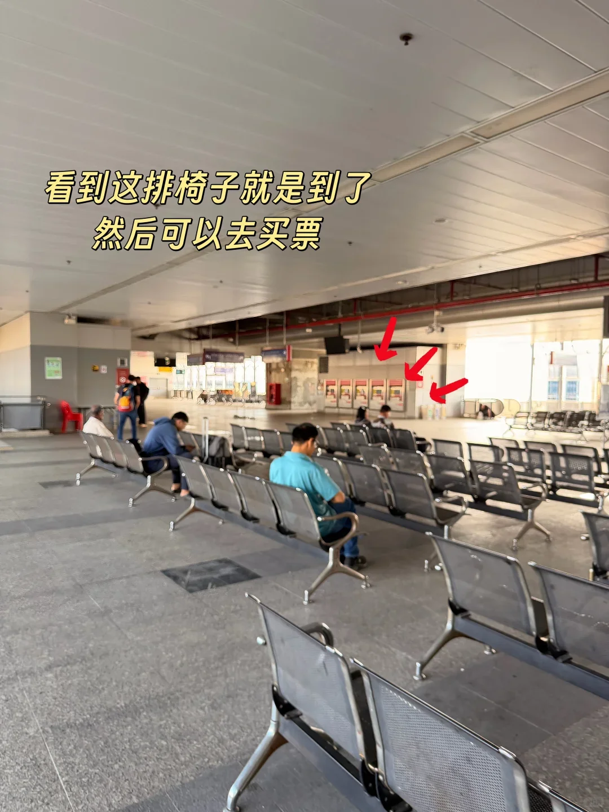

डॉन मुआंग (DMK) से मध्य बैंकॉक पहुँचने का सबसे सस्ता और ट्रैफ़िक से सबसे सुरक्षित रास्ता **एसआरटी रेड लाइन** (डार्क रेड लाइन) है। एक सवारी **33 बात** की पड़ती है, और आप **क्रुंग थेप अफीवात** तक जाते हैं और शहर पहुँचने के लिए एमआरटी ब्लू लाइन में बदलते हैं।

## पहले, रेड लाइन कैसे चलती है

रेड लाइन बैंकॉक की उपनगरीय रेल है, और एयरपोर्ट वाले स्टेशन का नाम **डॉन मुआंग** है। यह शहर के केंद्र तक नहीं जाती; यह उत्तर–दक्षिण चलती है। दक्षिण की ओर बढ़ते हुए यह कान खेहा, लक सी, थुंग सोंग होंग, बांग खेन, वाट समियान नारी और चतुचक पर रुकती है, फिर **क्रुंग थेप अफीवात** (बैंकॉक का मुख्य स्टेशन) पहुँचती है।

**तो शहर में जाने का तरीका है: रेड लाइन से क्रुंग थेप अफीवात, फिर एमआरटी ब्लू लाइन में बदलें।**

## कदम दर कदम

### 1. आगमन से बाहर निकलकर बाएँ मुड़ें

आगमन हॉल से बाहर आते ही आपको यह साइन दिखेगा: बाईं ओर **घरेलू टर्मिनल (2FL)** और **एसआरटी रेड लाइन / ट्रेन स्टेशन**, दाईं ओर अंतरराष्ट्रीय प्रस्थान (3FL)। **बाईं ओर जाएँ।**

### 2. 7-Eleven और स्टारबक्स पार करें

रास्ते में पहले **7-Eleven**, फिर **स्टारबक्स** पड़ता है। गलियारा अंदर से है और वातानुकूलित है; बस भीड़ के पीछे-पीछे चलें।

### 3. लाल एस्केलेटर पर न चढ़ें

आप एक लाल एस्केलेटर के पास से गुज़रेंगे — **वह घरेलू प्रस्थान की मंज़िल पर जाता है, इसलिए उस पर न चढ़ें**। "एसआरटी रेड लाइन" के साइन पर चलते रहें।

### 4. एक मंज़िल ऊपर जाएँ, या भूतल पर चलते रहें

अगर आप भूतल पर हैं तो एस्केलेटर से दूसरी मंज़िल पर जाएँ; अगर आप पहले से दूसरी मंज़िल पर हैं, जैसे मैं था, तो **बस सीधे चलते रहें**। आप भूतल पर ही रहकर पूरा रास्ता पैदल भी तय कर सकते हैं; बस चलते रहें।

### 5. MAGIC Food Park और MYBREW ढूँढ़ें

तब तक चलते रहें जब तक **MAGIC Food Park** का साइन न दिख जाए, फिर मुड़कर अंदर जाएँ और आपको **MYBREW** कॉफ़ी मिल जाएगी। आप लगभग पहुँच ही गए हैं — इसके बगल में ही "460 M." निशान वाला रेड लाइन पोस्टर है।

### 6. बाएँ मुड़ें और स्काईवॉक पार करें

यहाँ **बाएँ मुड़ें** और चलते रहें; एक स्काईवॉक पार करते ही आप स्टेशन पहुँच जाते हैं।

### 7. प्रतीक्षा की कुर्सियाँ दिखें तो टिकट खरीदें

कुर्सियों की एक कतार का मतलब है कि आप स्टेशन पहुँच गए। पहले मशीन से अपना टिकट खरीदें।

### 8. मशीन पर क्रुंग थेप अफीवात चुनें

**Select your destination** पर टैप करें और **क्रुंग थेप अफीवात** चुनें (यही शहर के लिए स्टेशन है, फिर ब्लू लाइन में बदलें)। स्लॉट पर **Insert coins** लिखा है, और टोकन की कीमत लगभग **33 बात** है।

> स्टेशन के पोस्टरों पर "20 बात से ज़्यादा नहीं, शहर तक 20 मिनट से कम" का प्रचार रहा है। किराया असल में दूरी पर आधारित है — मशीन जो दिखाए, वही देखें।

### 9. टैप करें और प्लेटफ़ॉर्म 3/4 पर जाएँ

गोल टोकन लें, गेट पर टैप करें (Tap Card or Token), फिर **प्लेटफ़ॉर्म 3/4** पर प्रतीक्षा करें।

### 10. क्रुंग थेप अफीवात तक लगभग 17 मिनट

डॉन मुआंग से क्रुंग थेप अफीवात **7 स्टॉप, लगभग 17 मिनट** है। आगमन पर बाहर जाने के साइन के पीछे चलें और शहर के बाकी हिस्से के लिए **एमआरटी ब्लू लाइन** में बदलें।

## ध्यान दें: ट्रेनें हर 20 मिनट पर चलती हैं

एसआरटी रेड लाइन लगभग **हर 20 मिनट** पर चलती है, शहर की मेट्रो से बहुत कम। निकलने से पहले स्टेशन की Departures स्क्रीन (या गूगल मैप्स) पर अगली ट्रेन का समय और प्लेटफ़ॉर्म देख लें, ताकि आप प्लेटफ़ॉर्म पर खड़े न रह जाएँ।

चूँकि सेवा विरल है, **अगर आपको उड़ान पकड़नी है तो कम से कम 40 मिनट का बफ़र रखें**: 20 मिनट प्रतीक्षा और 17 मिनट सफ़र, ऊपर से ट्रांसफ़र और पैदल चलना।
