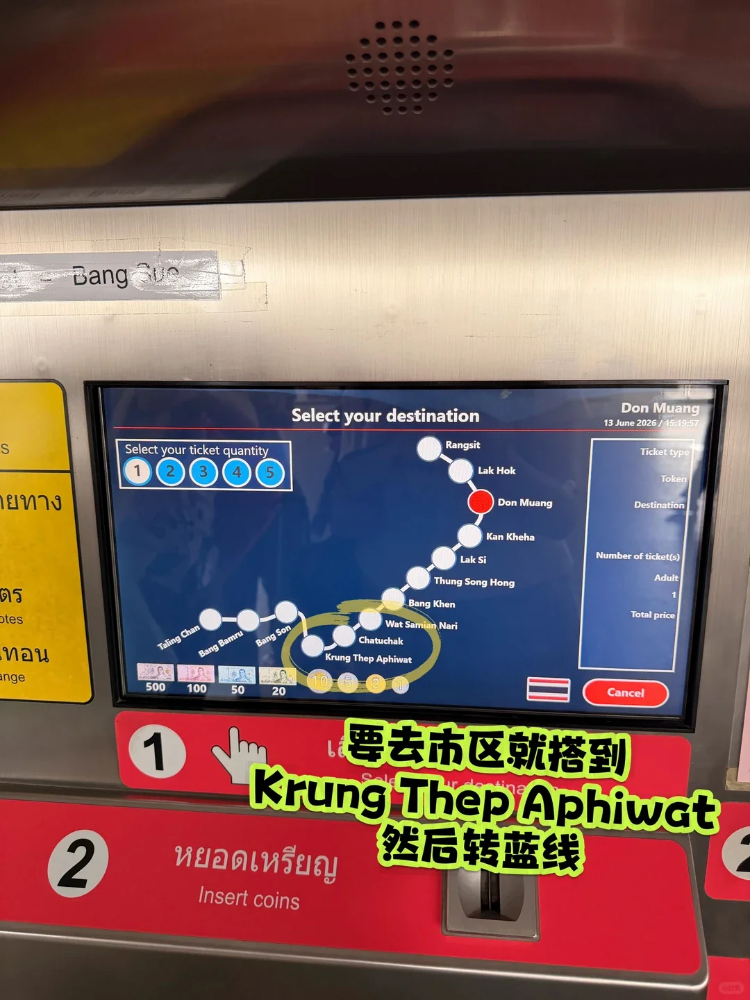

ドンムアン（DMK）からバンコク中心部へ行く最も安く、渋滞に強い方法は**SRTレッドライン**（ダークレッドライン）です。片道**33バーツ**で、**クルンテープ・アピワット**まで乗り、MRTブルーラインに乗り換えて市内へ向かいます。

## まず、レッドラインの仕組み

レッドラインはバンコクの近郊鉄道で、空港駅は**ドンムアン**と呼ばれます。市内中心部には乗り入れず、南北方向に走ります。南へ向かうと、カンケーハー、ラクシー、トゥンソーンホン、バンケン、ワットサミアンナーリー、チャトゥチャックに停まり、**クルンテープ・アピワット**（バンコク中央駅）に到着します。

**つまり市内への行き方は、レッドラインでクルンテープ・アピワットまで行き、MRTブルーラインに乗り換える、です。**

## ステップ・バイ・ステップ

### 1. 到着ロビーを出て左へ

到着ホールを出ると、この看板が見えます。左が**Domestic Terminal (2FL)**と**SRT Red Line / Train Station**、右が国際線出発（3FL）です。**左へ進んでください。**

### 2. セブン-イレブンとスターバックスを通り過ぎる

途中でまず**セブン-イレブン**、次に**スターバックス**を通ります。通路は屋内で空調が効いているので、人波についていけば大丈夫です。

### 3. 赤いエスカレーターには乗らない

赤いエスカレーターがありますが、**それは国内線出発階へ上がるものなので乗らないでください**。「SRT Red Line」の表示に従って進みます。

### 4. 1フロア上がるか、1階を歩き続ける

1階にいる場合はエスカレーターで2階へ上がってください。私のようにすでに2階にいる場合は、**そのまままっすぐ歩いてください**。1階にとどまって全行程を歩くこともできます。とにかく進み続けてください。

### 5. MAGIC Food ParkとMYBREWを探す

**MAGIC Food Park**の看板が見えるまで歩き、中へ入ると**MYBREW**のコーヒーがあります。もうすぐです。その横に「460 M.」の目印があるレッドラインのポスターがあります。

### 6. 左に曲がってスカイウォークを渡る

ここで**左に曲がって**進み続け、スカイウォークを1つ渡れば駅に到着です。

### 7. 待合椅子が見えたらチケットを買う

待合椅子の列が見えたら駅に着いた証拠です。まず券売機でチケットを買います。

### 8. 券売機でクルンテープ・アピワットを選ぶ

**Select your destination**をタップし、**クルンテープ・アピワット**を選びます（市内へ行く駅で、そこからブルーラインに乗り換えます）。投入口は**Insert coins**と表示され、トークンは約**33バーツ**です。

> 駅のポスターには「20バーツ以下、20分未満で市内へ」というキャンペーンが掲示されていました。実際の運賃は距離制なので、券売機の表示を確認してください。

### 9. タップして3/4番ホームへ

丸いトークンを取り、改札でタップ（Tap Card or Token）してから、**3/4番ホーム**で待ちます。

### 10. クルンテープ・アピワットまで約17分

ドンムアンからクルンテープ・アピワットまでは**7駅、約17分**です。到着後は出口の表示に従って外へ出て、市内各所へは**MRTブルーライン**に乗り換えます。

## 注意：電車は20分間隔です

SRTレッドラインはおおよそ**20分ごと**の運行で、市内のメトロよりはるかに本数が少ないです。出発前に駅のDepartures画面（またはGoogleマップ）で次の発車時刻とホームを確認し、ホームで立ち尽くさないようにしてください。

本数が少ないため、**フライトに乗る場合は少なくとも40分の余裕を見てください**。乗り換えと徒歩に加えて、待ち時間20分＋乗車17分が必要です。
