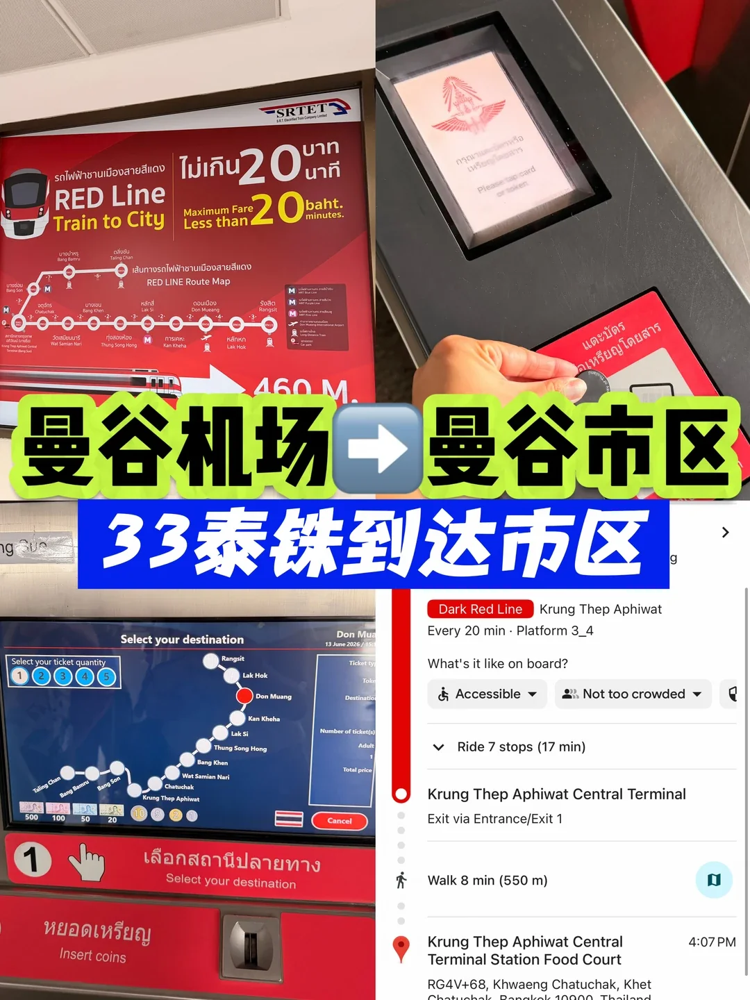

돈므앙 공항(DMK)에서 방콕 시내로 들어가는 가장 저렴하고 막히지 않는 방법은 **SRT 레드라인**(Dark Red Line)입니다. 편도 **33밧**이면 **Krung Thep Aphiwat**까지 간 뒤 MRT 블루라인으로 갈아타 시내에 도착합니다.

## 먼저 레드라인이 어떻게 운행되는지

레드라인은 방콕의 광역 철도이고, 공항 역 이름은 **Don Mueang**입니다. 시내 중심으로 들어가지 않고 남북으로 운행합니다. 남쪽으로 Kan Kheha, Lak Si, Thung Song Hong, Bang Khen, Wat Samian Nari, Chatuchak을 지나 **Krung Thep Aphiwat**(방콕 중앙역)에 도착합니다.

**즉 시내로 가는 방법은 레드라인으로 Krung Thep Aphiwat까지 간 뒤 MRT 블루라인으로 환승하는 것입니다.**

## 단계별 안내

### 1. 도착홀을 나와 왼쪽으로

도착홀을 나서면 이 안내판이 보입니다. 왼쪽에 **Domestic Terminal(2FL)** 과 **SRT Red Line / Train Station**, 오른쪽에 국제선 출발(3FL)이 있습니다. **왼쪽으로 가세요.**

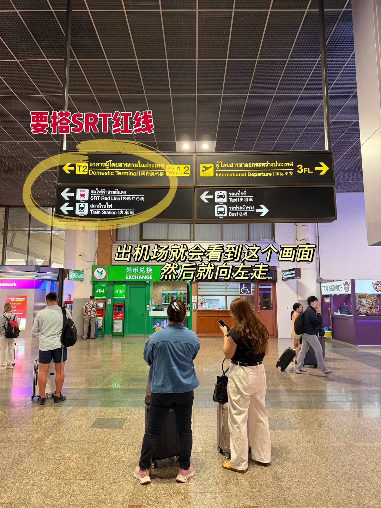

### 2. 7-Eleven과 스타벅스 지나기

가는 길에 먼저 **7-Eleven**을 지나고, 이어서 **스타벅스**를 지납니다. 실내 통로이고 냉방이 되니 사람들을 따라가면 됩니다.

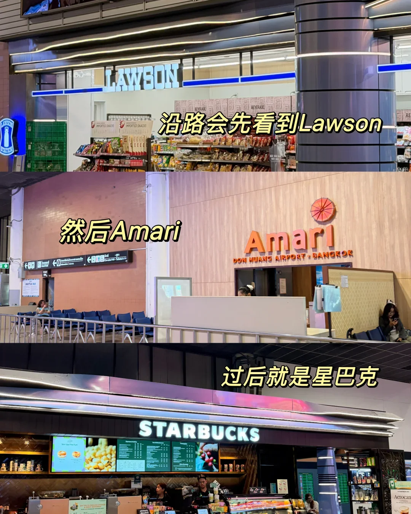

### 3. 빨간 에스컬레이터는 타지 않기

중간에 빨간 에스컬레이터가 나옵니다. **국내선 출발층으로 올라가는 것이니 타지 마세요.** 계속 'SRT Red Line' 표지를 따라가면 됩니다.

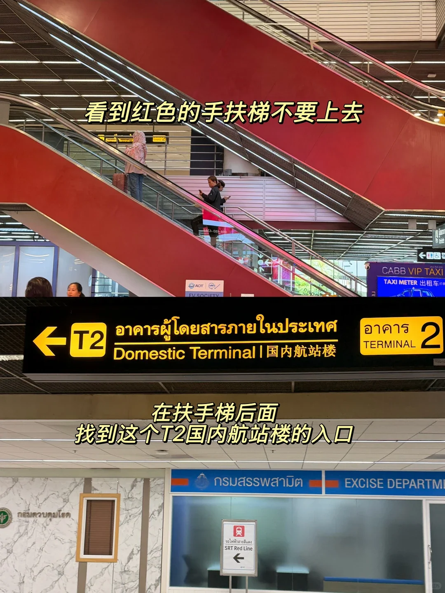

### 4. 한 층 올라가거나, 1층에서 계속 걷기

1층에 있다면 에스컬레이터로 2층에 올라가고, 저처럼 이미 2층이라면 **그냥 직진**하면 됩니다. 1층에서도 그대로 걸어갈 수 있으니 계속 걸어가면 됩니다.

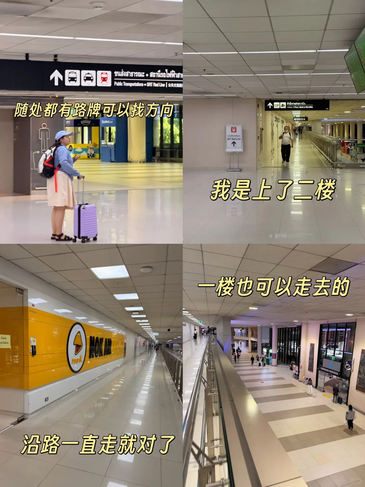

### 5. MAGIC Food Park와 MYBREW 찾기

**MAGIC Food Park(魔米美食廣場)** 간판이 보일 때까지 걷다가 안으로 들어가면 **MYBREW** 커피가 나옵니다. 여기까지 오면 거의 다 온 것이고, 옆에 '460 M.' 표시가 있는 레드라인 포스터가 있습니다.

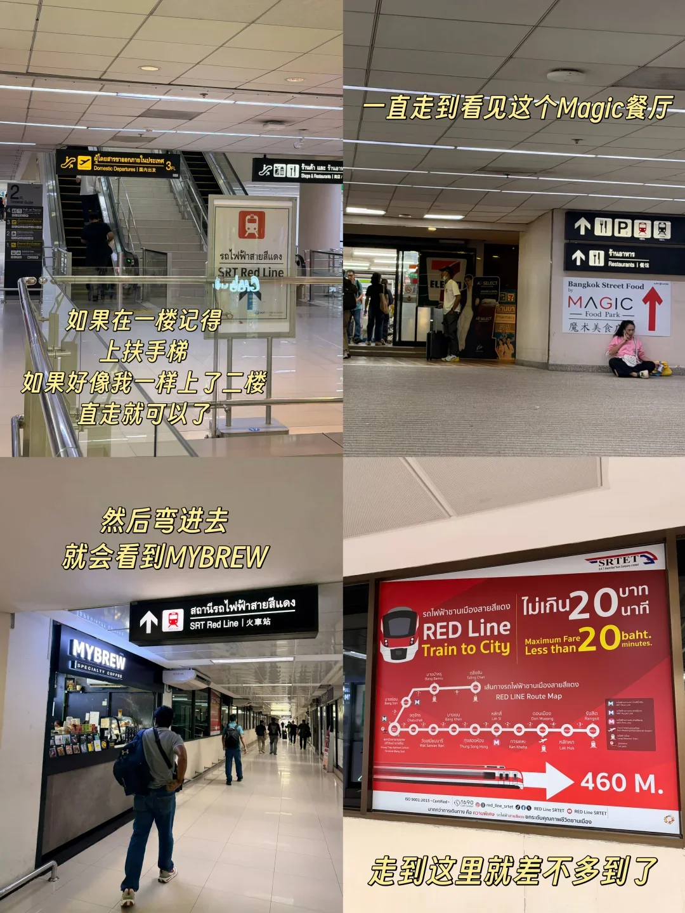

### 6. 왼쪽으로 돌아 스카이워크 건너기

여기서 **왼쪽으로** 돌아 계속 가면 스카이워크 하나를 건너 역에 도착합니다.

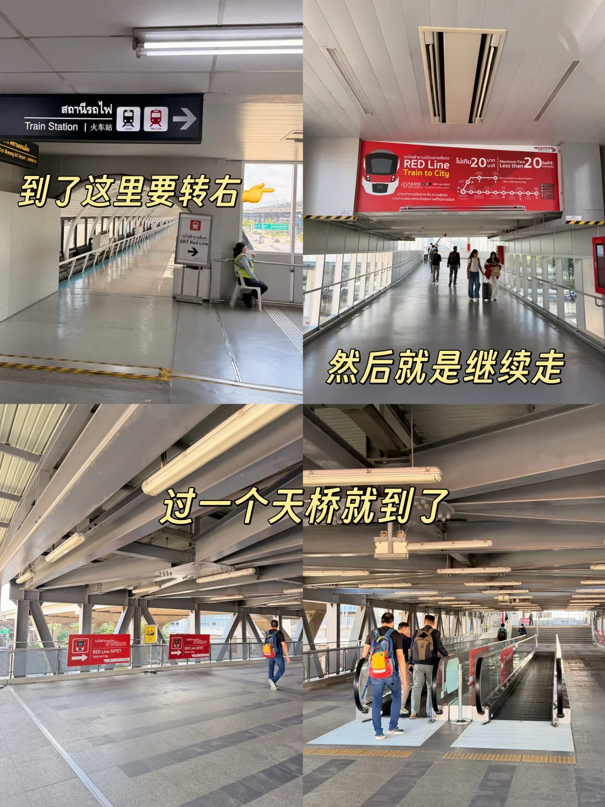

### 7. 대기 의자가 보이면 표부터 사기

대기 의자 줄이 보이면 역에 도착한 것입니다. 먼저 자동발매기에서 표를 사세요.

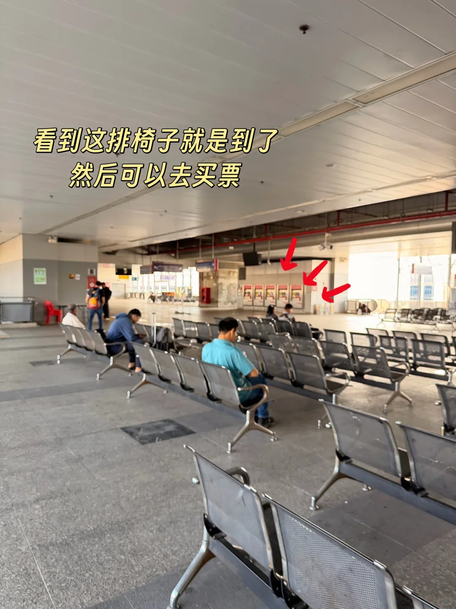

### 8. 발매기에서 Krung Thep Aphiwat 선택

발매기에서 **Select your destination**을 누르고 **Krung Thep Aphiwat**를 고르세요(시내로 가려면 이 역, 이후 블루라인 환승). 동전 투입구에는 **Insert coins**라고 적혀 있고, 토큰은 약 **33밧**입니다.

> 역 안 포스터에는 "최대 20밧, 20분 이내 시내 도착" 프로모션이 붙어 있었습니다. 실제 요금은 거리 기준이니 발매기 표시를 확인하세요.

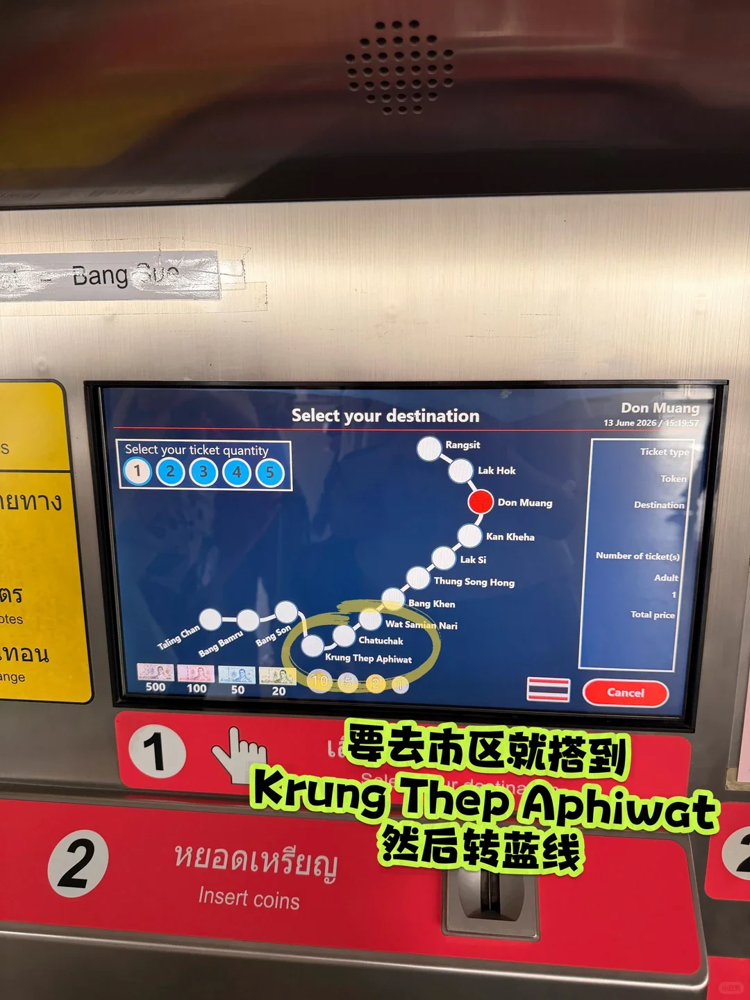

### 9. 토큰 태그 후 3/4번 승강장으로

동그란 토큰을 받아 개찰구에 대고(Tap Card or Token), **3/4번 승강장**에서 기다리면 됩니다.

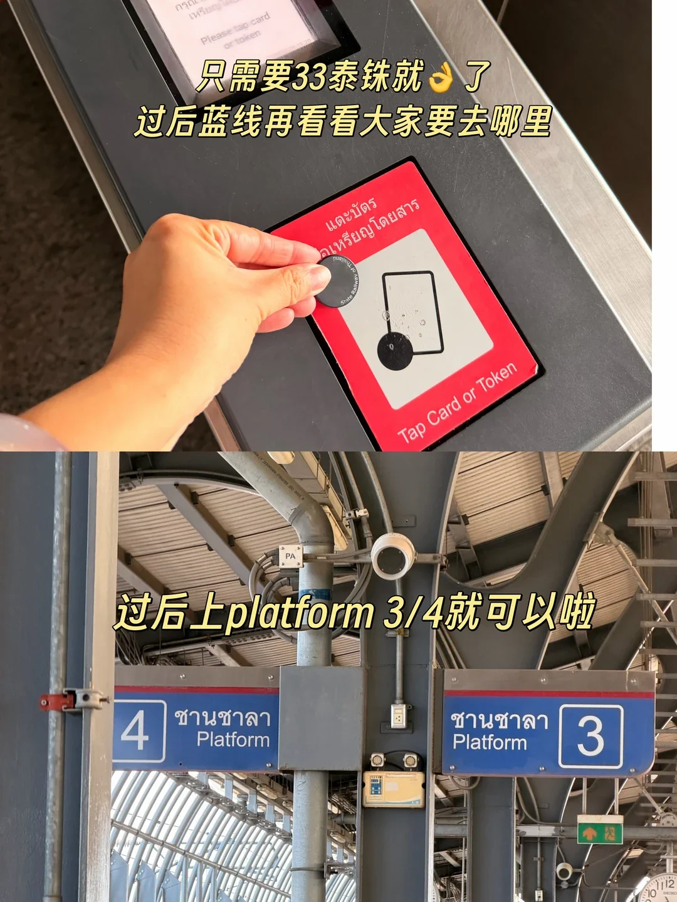

### 10. 약 17분 후 Krung Thep Aphiwat 도착

Don Mueang에서 Krung Thep Aphiwat까지 **7개 역, 약 17분**입니다. 내린 뒤 표지를 따라 나가면 **MRT 블루라인**으로 갈아탈 수 있습니다.

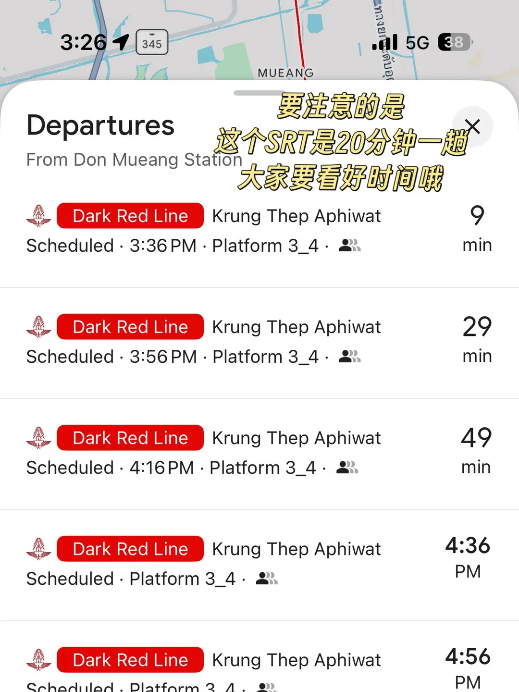

## 꼭 기억할 점: 20분에 한 대

SRT 레드라인은 **약 20분 간격**으로 다녀 시내 지하철보다 훨씬 뜸합니다. 출발 전에 역의 Departures 화면(또는 구글 지도)으로 다음 열차 시각과 승강장을 확인해 승강장에서 헛되이 기다리지 마세요.

배차가 뜸한 만큼 **비행기를 탈 일정이라면 최소 40분의 여유**를 두세요. 대기 20분에 승차 17분, 여기에 환승과 도보 시간이 더해집니다.
