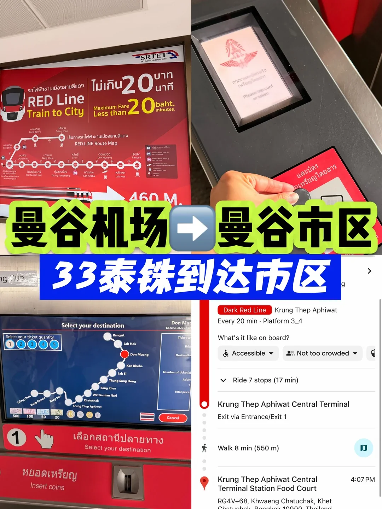

De goedkoopste en meest filevrije manier om van Don Mueang (DMK) naar centraal Bangkok te komen is de **SRT Red Line** (Dark Red Line). Een enkele rit kost **33 baht**, en je rijdt naar **Krung Thep Aphiwat** en stapt daar over op de MRT Blue Line om de stad in te komen.

## Eerst: hoe de Red Line werkt

De Red Line is de voorstadsspoorlijn van Bangkok, en het station bij de luchthaven heet **Don Mueang**. De lijn loopt niet naar het stadscentrum; hij loopt noord–zuid. Richting het zuiden stopt hij bij Kan Kheha, Lak Si, Thung Song Hong, Bang Khen, Wat Samian Nari en Chatuchak voordat hij **Krung Thep Aphiwat** bereikt (het centrale station van Bangkok).

**De route naar de stad is dus: Red Line naar Krung Thep Aphiwat, dan overstappen op de MRT Blue Line.**

## Stap voor stap

### 1. Uit de aankomsthal, linksaf

Als je de aankomsthal verlaat, zie je dit bord: **Domestic Terminal (2FL)** en **SRT Red Line / Train Station** naar links, internationale vertrekken (3FL) naar rechts. **Ga naar links.**

### 2. Langs 7-Eleven en Starbucks

Onderweg kom je eerst langs een **7-Eleven**, daarna langs **Starbucks**. De gang is binnen en airconditioned; volg gewoon de menigte.

### 3. Neem de rode roltrap niet

Je komt langs een rode roltrap — **die gaat omhoog naar de vertrekhal voor binnenlandse vluchten, dus neem hem niet**. Blijf de borden "SRT Red Line" volgen.

### 4. Ga een verdieping omhoog, of blijf op de begane grond lopen

Sta je op de begane grond, neem dan de roltrap naar verdieping 2; ben je al op verdieping 2, zoals ik, **loop dan gewoon rechtdoor**. Je kunt ook op de begane grond blijven en de hele weg lopen; blijf simpelweg doorgaan.

### 5. Zoek MAGIC Food Park en MYBREW

Blijf lopen tot je het bord **MAGIC Food Park** ziet, sla daar af en je vindt **MYBREW**-koffie. Je bent er bijna — ernaast hangt de Red Line-poster met de markering "460 M.".

### 6. Sla linksaf en steek de skywalk over

**Sla hier linksaf** en blijf lopen; steek één skywalk over en je bent bij het station.

### 7. Koop je kaartje bij de wachtstoelen

Een rij wachtstoelen betekent dat je het station hebt bereikt. Koop eerst je kaartje bij de automaat.

### 8. Kies Krung Thep Aphiwat op de automaat

Tik op **Select your destination** en kies **Krung Thep Aphiwat** (dat is het station voor de stad, daarna stap je over op de Blue Line). De gleuf is gemarkeerd met **Insert coins**, en het token kost ongeveer **33 baht**.

> Posters in het station adverteerden met een actie "niet meer dan 20 baht, minder dan 20 minuten naar de stad". De ritprijs is in werkelijkheid afstandgebonden — kijk wat de automaat aangeeft.

### 9. Tik in en ga naar perron 3/4

Neem het ronde token, tik het op de poort (Tap Card or Token) en wacht op **perron 3/4**.

### 10. Ongeveer 17 minuten naar Krung Thep Aphiwat

Van Don Mueang naar Krung Thep Aphiwat zijn het **7 haltes, ongeveer 17 minuten**. Volg bij aankomst de borden naar buiten en stap over op de **MRT Blue Line** voor de rest van de stad.

## Let op: de treinen gaan elke 20 minuten

De SRT Red Line rijdt ongeveer **elke 20 minuten**, veel minder vaak dan de metro in de stad. Controleer voor je vertrekt het vertrekscherm van het station (of Google Maps) voor de volgende vertrektijd en het perron, zodat je niet op het perron blijft staan.

Omdat de dienstregeling schaars is, **moet je, als je een vlucht moet halen, minstens 40 minuten speling inbouwen**: 20 minuten wachten plus 17 minuten rijden, bovenop de overstap en het lopen.
