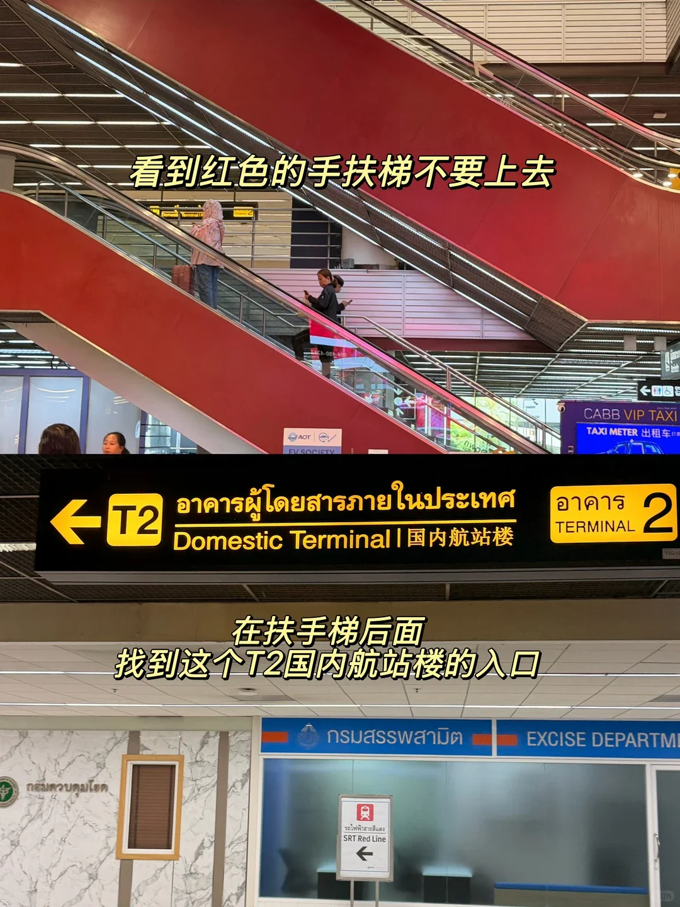

Det billigaste och mest trafiksäkra sättet från Don Mueang (DMK) in till centrala Bangkok är **SRT Red Line** (Dark Red Line). En enkel resa kostar **33 baht**, och du åker till **Krung Thep Aphiwat** och byter till MRT Blue Line för att nå city.

## Först: hur Red Line fungerar

Red Line är Bangkoks förortståg, och flygplatsstationen heter **Don Mueang**. Den går inte in till city; den går nord–syd. Söderut stannar den vid Kan Kheha, Lak Si, Thung Song Hong, Bang Khen, Wat Samian Nari och Chatuchak innan den når **Krung Thep Aphiwat** (Bangkoks centralstation).

**Så vägen in till stan är: Red Line till Krung Thep Aphiwat, sedan byte till MRT Blue Line.**

## Steg för steg

### 1. Ut ur ankomsthallen, sväng vänster

När du lämnar ankomsthallen ser du den här skylten: **Domestic Terminal (2FL)** och **SRT Red Line / Train Station** till vänster, internationella avgångar (3FL) till höger. **Gå åt vänster.**

### 2. Passera 7-Eleven och Starbucks

Längs vägen passerar du först en **7-Eleven**, sedan **Starbucks**. Korridoren är inomhus och luftkonditionerad; följ bara folket.

### 3. Ta inte den röda rulltrappan

Du passerar en röd rulltrappa – **den går upp till inrikes avgångar, så ta den inte**. Fortsätt följa skyltarna mot "SRT Red Line".

### 4. Gå upp en våning, eller fortsätt på bottenvåningen

Om du är på bottenvåningen tar du rulltrappan upp till plan 2; om du redan är på plan 2, som jag var, **fortsätt bara rakt fram**. Du kan lika gärna stanna på bottenvåningen och gå hela vägen; fortsätt bara.

### 5. Leta efter MAGIC Food Park och MYBREW

Fortsätt gå tills du ser skylten **MAGIC Food Park**, sväng sedan in och du hittar kaffet **MYBREW**. Du är nästan framme – bredvid ligger Red Line-affischen med markeringen "460 M.".

### 6. Sväng vänster och gå över skywalken

Här **svänger du vänster** och fortsätter; gå över en skywalk och du är framme vid stationen.

### 7. När du ser väntstolarna, köp din biljett

En rad väntstolar betyder att du har nått stationen. Köp din biljett i automaten först.

### 8. Välj Krung Thep Aphiwat på automaten

Tryck på **Select your destination** och välj **Krung Thep Aphiwat** (det är stationen för city, byt sedan till Blue Line). Facket är märkt **Insert coins**, och token kostar cirka **33 baht**.

> Affischer på stationen har annonserat en kampanj med "högst 20 baht, under 20 minuter till city". Taxan är i själva verket avståndsbaserad – kontrollera vad automaten visar.

### 9. Blippa in och gå till plattform 3/4

Ta den runda token, blippa den vid spärren (Tap Card or Token) och vänta sedan på **plattform 3/4**.

### 10. Cirka 17 minuter till Krung Thep Aphiwat

Don Mueang till Krung Thep Aphiwat är **7 stopp, cirka 17 minuter**. Följ skyltarna ut vid ankomst och byt till **MRT Blue Line** för resten av city.

## Notera detta: tågen går var 20:e minut

SRT Red Line går ungefär **var 20:e minut**, betydligt mer sällan än tunnelbanan i city. Innan du ger dig av, kolla stationens avgångstavla (eller Google Maps) för nästa avgångstid och plattform, så att du inte blir stående på perrongen.

Eftersom trafiken är gles bör du, **om du ska hinna med ett flyg, lägga in minst 40 minuters marginal**: 20 minuters väntan plus 17 minuters åkning, utöver bytet och promenaden.
