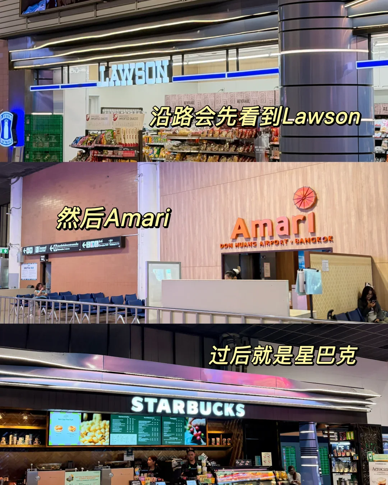

Njia ya bei nafuu zaidi na isiyokwama kwenye msongamano wa magari kutoka Don Mueang (DMK) hadi katikati ya Bangkok ni **SRT Red Line** (Dark Red Line). Safari moja inagharimu **baht 33**, na unasafiri hadi **Krung Thep Aphiwat** kisha unabadilisha kwenda MRT Blue Line ili kufika mjini.

## Kwanza, jinsi Red Line inavyofanya kazi

Red Line ni reli ya viunga vya Bangkok, na kituo cha uwanja wa ndege kinaitwa **Don Mueang**. Haipiti katikati ya mji; inakwenda kaskazini–kusini. Inapoelekea kusini inasimama Kan Kheha, Lak Si, Thung Song Hong, Bang Khen, Wat Samian Nari na Chatuchak kabla ya kufika **Krung Thep Aphiwat** (kituo kikuu cha Bangkok).

**Hivyo njia ya kuingia mjini ni: Red Line hadi Krung Thep Aphiwat, kisha badilisha kwenda MRT Blue Line.**

## Hatua kwa hatua

### 1. Ukitoka eneo la kuwasili, geuka kushoto

Unapotoka kwenye jengo la kuwasili utaona ishara hii: **Domestic Terminal (2FL)** na **SRT Red Line / Train Station** kushoto, safari za kimataifa zinazoondoka (3FL) kulia. **Elekea kushoto.**

### 2. Pita 7-Eleven na Starbucks

Njiani unapita kwanza **7-Eleven**, kisha **Starbucks**. Ukanda uko ndani na una kiyoyozi; fuata tu umati.

### 3. Usipande eskaleta nyekundu

Utapita eskaleta nyekundu — **ile inapanda hadi ghorofa ya safari za ndani zinazoondoka, hivyo usiipande**. Endelea kufuata ishara za "SRT Red Line".

### 4. Panda ghorofa moja, au endelea kutembea kwenye ghorofa ya chini

Kama uko kwenye ghorofa ya chini, panda eskaleta hadi ghorofa ya 2; kama tayari uko ghorofa ya 2, kama nilivyokuwa mimi, **endelea tu moja kwa moja**. Unaweza pia kubaki kwenye ghorofa ya chini na kutembea njia yote; endelea tu.

### 5. Tafuta MAGIC Food Park na MYBREW

Endelea kutembea hadi uone ishara ya **MAGIC Food Park**, kisha geuka na utakuta kahawa ya **MYBREW**. Umekaribia — kando yake kuna bango la Red Line lenye alama ya "460 M.".

### 6. Geuka kushoto na uvuke daraja la anga

Hapa **geuka kushoto** na uendelee; vuka daraja moja la anga na umefika kituoni.

### 7. Uonapo viti vya kusubiri, nunua tiketi yako

Mstari wa viti vya kusubiri unamaanisha umefika kituoni. Nunua tiketi yako kwenye mashine kwanza.

### 8. Kwenye mashine, chagua Krung Thep Aphiwat

Gusa **Select your destination** na uchague **Krung Thep Aphiwat** (hicho ni kituo cha mjini, kisha badilisha kwenda Blue Line). Mwanya umeandikwa **Insert coins**, na tokeni inagharimu takriban **baht 33**.

> Mabango katika kituo yametangaza ofa ya "si zaidi ya baht 20, chini ya dakika 20 hadi mjini". Nauli kwa kweli inategemea umbali — angalia kile mashine inaonyesha.

### 9. Gusa kuingia na uende kwenye jukwaa 3/4

Chukua tokeni ya mviringo, iguse kwenye lango (Tap Card or Token), kisha subiri kwenye **jukwaa 3/4**.

### 10. Takriban dakika 17 hadi Krung Thep Aphiwat

Don Mueang hadi Krung Thep Aphiwat ni **vituo 7, takriban dakika 17**. Fuata ishara za kutoka unapofika na ubadilishe kwenda **MRT Blue Line** kwa sehemu iliyobaki ya mji.

## Zingatia hili: treni zinaondoka kila dakika 20

SRT Red Line inaondoka takriban **kila dakika 20**, mara chache zaidi kuliko metro ya mjini. Kabla ya kuanza safari, angalia skrini ya Safari Zinazoondoka ya kituo (au Google Maps) kwa muda na jukwaa la safari ijayo, ili usibaki umesimama kwenye jukwaa.

Kwa kuwa huduma ni chache, **ikiwa unakwenda kukamata ndege, tenga angalau dakika 40 za ziada**: dakika 20 za kusubiri pamoja na dakika 17 za safari, juu ya kubadilisha na kutembea.
