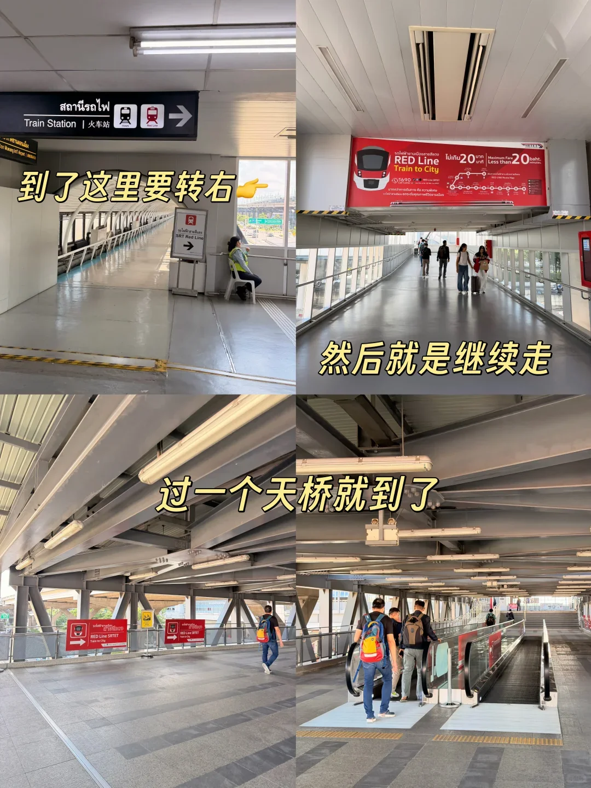

วิธีที่ถูกที่สุดและปลอดการจราจรที่สุดจากดอนเมือง (DMK) เข้าใจกลางกรุงเทพฯ คือ **รถไฟ SRT สายสีแดง** (สายสีแดงเข้ม) หนึ่งเที่ยวราคา **33 บาท** นั่งไปยัง **กรุงเทพอภิวัฒน์** แล้วเปลี่ยนไปรถไฟใต้ดิน MRT สายสีน้ำเงินเพื่อเข้าสู่ตัวเมือง

## ก่อนอื่น สายสีแดงทำงานอย่างไร

สายสีแดงเป็นรถไฟชานเมืองของกรุงเทพฯ และสถานีที่สนามบินชื่อ **ดอนเมือง** ไม่ได้วิ่งเข้าใจกลางเมืองแต่วิ่งเหนือ–ใต้ เมื่อมุ่งหน้าใต้จะจอดที่การเคหะ หลักสี่ ทุ่งสองห้อง บางเขน วัดเสมียนนารี และจตุจักร ก่อนถึง **กรุงเทพอภิวัฒน์** (สถานีกลางกรุงเทพฯ)

**ดังนั้นวิธีเข้าเมืองคือ: นั่งสายสีแดงไปกรุงเทพอภิวัฒน์ แล้วเปลี่ยนไป MRT สายสีน้ำเงิน**

## ทีละขั้นตอน

### 1. ออกจากโถงขาเข้าแล้วเลี้ยวซ้าย

เมื่อออกจากโถงผู้โดยสารขาเข้าจะเห็นป้ายนี้: **Domestic Terminal (2FL)** และ **SRT Red Line / Train Station** ทางซ้าย ส่วนผู้โดยสารขาออกระหว่างประเทศ (3FL) ทางขวา **ให้ไปทางซ้าย**

### 2. ผ่าน 7-Eleven และ Starbucks

ระหว่างทางจะผ่าน **7-Eleven** ก่อน แล้วจึง **Starbucks** ทางเดินอยู่ในอาคารและมีเครื่องปรับอากาศ เพียงเดินตามฝูงชน

### 3. อย่าขึ้นบันไดเลื่อนสีแดง

จะผ่านบันไดเลื่อนสีแดง — **อันนั้นขึ้นไปยังชั้นผู้โดยสารขาออกในประเทศ จึงไม่ต้องขึ้น** ให้ตามป้าย «SRT Red Line» ต่อไป

### 4. ขึ้นไปอีกชั้น หรือเดินต่อที่ชั้นล่าง

หากอยู่ชั้นล่าง ให้ขึ้นบันไดเลื่อนไปชั้น 2; หากอยู่ชั้น 2 แล้วเหมือนผม **ก็เดินตรงต่อไปได้เลย** จะอยู่ชั้นล่างและเดินไปตลอดทางก็ได้เช่นกัน เพียงเดินต่อไป

### 5. มองหา MAGIC Food Park และ MYBREW

เดินต่อไปจนเห็นป้าย **MAGIC Food Park** แล้วเลี้ยวเข้าไปจะพบกาแฟ **MYBREW** ใกล้ถึงแล้ว — ข้าง ๆ มีโปสเตอร์สายสีแดงพร้อมเครื่องหมาย «460 ม.»

### 6. เลี้ยวซ้ายและข้ามทางลอยฟ้า

ตรงนี้ **เลี้ยวซ้าย** แล้วเดินต่อไป ข้ามทางลอยฟ้าหนึ่งแห่งก็ถึงสถานี

### 7. เมื่อเห็นเก้าอี้รอ ให้ซื้อตั๋ว

เก้าอี้รอเรียงเป็นแถวหมายความว่าถึงสถานีแล้ว ให้ซื้อตั๋วจากเครื่องก่อน

### 8. บนเครื่อง เลือกกรุงเทพอภิวัฒน์

แตะ **Select your destination** แล้วเลือก **Krung Thep Aphiwat** (นั่นคือสถานีสำหรับเข้าเมือง จากนั้นเปลี่ยนไปสายสีน้ำเงิน) ช่องใส่ระบุ **Insert coins** และเหรียญโดยสารราคาประมาณ **33 บาท**

> โปสเตอร์ในสถานีโฆษณาโปรโมชัน «ไม่เกิน 20 บาท ถึงเมืองในไม่ถึง 20 นาที» ค่าโดยสารจริงคิดตามระยะทาง — ดูสิ่งที่เครื่องแสดง

### 9. แตะเข้าและไปยังชานชาลา 3/4

รับเหรียญกลม แตะที่ประตู (Tap Card or Token) แล้วรอที่ **ชานชาลา 3/4**

### 10. ประมาณ 17 นาทีถึงกรุงเทพอภิวัฒน์

ดอนเมืองถึงกรุงเทพอภิวัฒน์คือ **7 สถานี ประมาณ 17 นาที** ตามป้ายออกเมื่อถึงแล้ว และเปลี่ยนไป **MRT สายสีน้ำเงิน** เพื่อไปยังส่วนอื่นของเมือง

## ข้อควรทราบ: รถไฟวิ่งทุก 20 นาที

รถไฟ SRT สายสีแดงวิ่งประมาณ **ทุก 20 นาที** น้อยกว่าความถี่ของรถไฟใต้ดินในเมืองมาก ก่อนออกเดินทาง ให้ตรวจหน้าจอขาออกของสถานี (หรือ Google Maps) สำหรับเวลาและชานชาลารถไฟขบวนถัดไป เพื่อไม่ต้องยืนรอเปล่า ๆ บนชานชาลา

เนื่องจากรถออกห่าง **หากต้องขึ้นเครื่องบิน ควรเผื่อเวลาอย่างน้อย 40 นาที**: รอ 20 นาที บวกนั่ง 17 นาที นอกเหนือจากเวลาเปลี่ยนสายและเดิน
