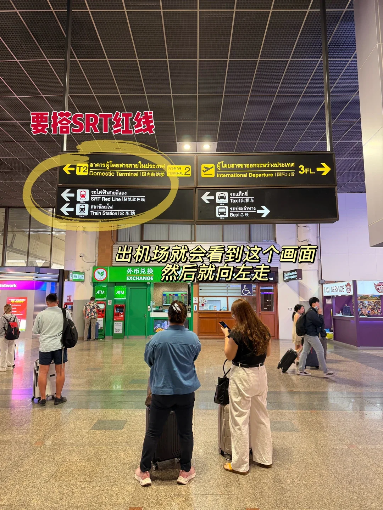
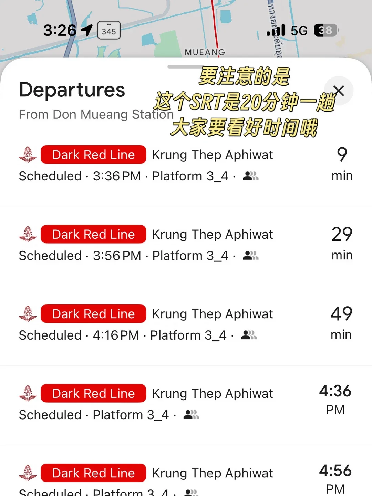

Don Mueang'dan (DMK) Bangkok merkezine en ucuz ve trafikten en az etkilenen yol **SRT Kırmızı Hattı** (Koyu Kırmızı Hat). Tek biniş **33 baht** ve şehre ulaşmak için **Krung Thep Aphiwat**'a gidip MRT Mavi Hattı'na aktarma yapıyorsunuz.

## Önce Kırmızı Hat nasıl çalışıyor

Kırmızı Hat Bangkok'un banliyö demiryolu hattı; havalimanı istasyonunun adı ise **Don Mueang**. Şehir merkezine girmiyor; kuzey-güney yönünde çalışıyor. Güneye giderken Kan Kheha, Lak Si, Thung Song Hong, Bang Khen, Wat Samian Nari ve Chatuchak duraklarında durup **Krung Thep Aphiwat**'a (Bangkok'un merkez istasyonu) ulaşıyor.

**Yani şehre giriş yolu: Kırmızı Hat ile Krung Thep Aphiwat, ardından MRT Mavi Hattı'na aktarma.**

## Adım adım

### 1. Varıştan çıkınca sola dönün

Varış salonundan çıkarken şu tabelayı göreceksiniz: solda **Domestic Terminal (2FL)** ve **SRT Red Line / Train Station**, sağda dış hat kalkışları (3FL). **Sola gidin.**

### 2. 7-Eleven ve Starbucks'ı geçin

Yol boyunca önce bir **7-Eleven**, sonra **Starbucks** geçiyor. Koridor kapalı ve klimalı; sadece kalabalığı takip edin.

### 3. Kırmızı yürüyen merdiveni kullanmayın

Kırmızı bir yürüyen merdiven geçeceksiniz — **o iç hat kalkış katına çıkıyor, kullanmayın**. “SRT Red Line” tabelalarını izlemeye devam edin.

### 4. Bir kat yukarı çıkın veya zemin katta yürümeye devam edin

Zemin kattaysanız yürüyen merdivenle 2. kata çıkın; benim gibi zaten 2. kattaysanız **dümdüz yürüyün**. Zemin katta kalıp yolu tamamen yürüyebilirsiniz de; sadece devam edin.

### 5. MAGIC Food Park ve MYBREW'i arayın

**MAGIC Food Park** tabelasını görene kadar yürüyün, içeri dönün ve **MYBREW** kahvecisini bulacaksınız. Neredeyse geldiniz — yanında “460 M.” işaretli Kırmızı Hat afişi var.

### 6. Sola dönün ve üst geçidi geçin

Burada **sola dönün** ve devam edin; bir üst geçidi geçin, istasyona vardınız.

### 7. Bekleme sandalyelerini gördüğünüzde biletinizi alın

Bir sıra bekleme sandalyesi istasyona ulaştığınız anlamına gelir. Önce makineden biletinizi alın.

### 8. Makinede Krung Thep Aphiwat'ı seçin

**Select your destination** düğmesine dokunun ve **Krung Thep Aphiwat**'ı seçin (şehir için istasyon bu, ardından Mavi Hat'a aktarma yapacaksınız). Yuva **Insert coins** olarak işaretli ve jeton yaklaşık **33 baht**.

> İstasyondaki afişler “20 bahttan fazla değil, şehre 20 dakikadan kısa” kampanyasını duyurmuştu. Ücret aslında mesafeye göre — makinenin gösterdiğini kontrol edin.

### 9. Turnikeden geçin ve 3/4 numaralı peronlara gidin

Yuvarlak jetonu alın, turnikede okutun (Tap Card or Token) ve **3/4 numaralı peronda** bekleyin.

### 10. Krung Thep Aphiwat'a yaklaşık 17 dakika

Don Mueang'dan Krung Thep Aphiwat **7 durak, yaklaşık 17 dakika**. Varışta çıkış tabelalarını izleyin ve şehrin geri kalanı için **MRT Mavi Hattı**'na aktarma yapın.

## Bunu not edin: trenler 20 dakikada bir çalışıyor

SRT Kırmızı Hattı kabaca **20 dakikada bir** çalışıyor, şehirdeki metrodan çok daha seyrek. Yola çıkmadan önce istasyonun Kalkışlar ekranından (veya Google Maps'ten) bir sonraki kalkış saatini ve peronu kontrol edin, peronda öylece kalakalmayın.

Seferler seyrek olduğu için **uçağa yetişiyorsanız en az 40 dakika pay bırakın**: 20 dakika bekleme artı 17 dakika yol, aktarma ve yürüme süresine ek olarak.
