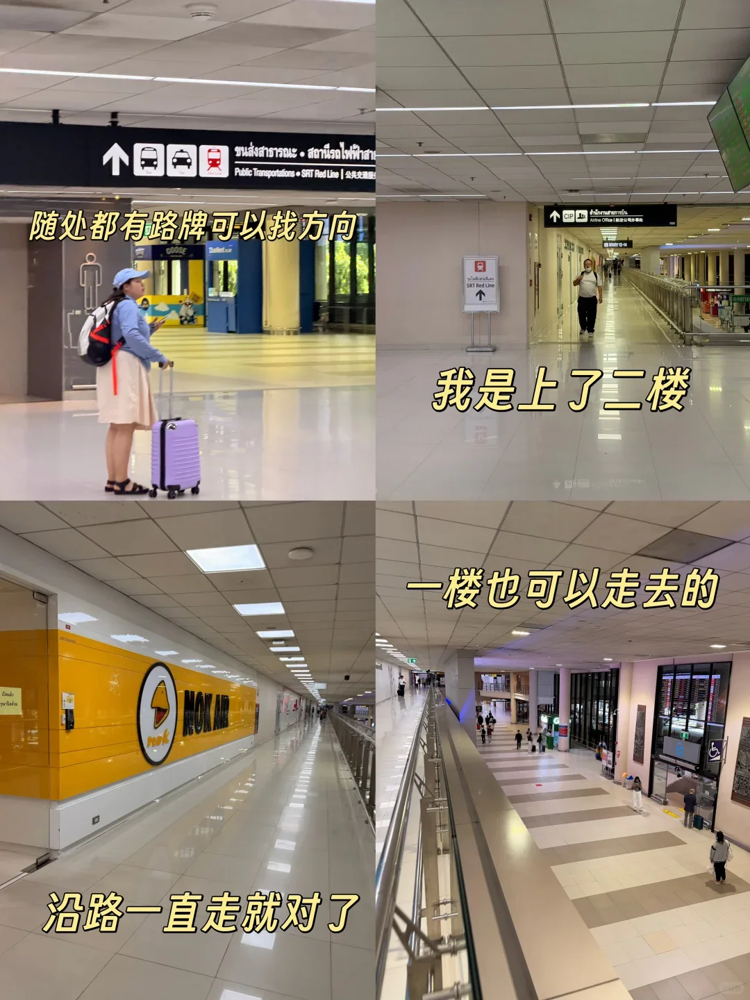

Cách rẻ nhất và ít bị kẹt xe nhất từ Don Mueang (DMK) vào trung tâm Bangkok là **SRT Red Line** (Dark Red Line). Một lượt đi giá **33 baht**, bạn đi đến **Krung Thep Aphiwat** và chuyển sang MRT Blue Line để vào thành phố.

## Đầu tiên, Red Line hoạt động thế nào

Red Line là tuyến đường sắt ngoại ô của Bangkok, và ga sân bay có tên **Don Mueang**. Tuyến không chạy vào trung tâm thành phố mà chạy bắc – nam. Đi về phía nam, tàu dừng ở Kan Kheha, Lak Si, Thung Song Hong, Bang Khen, Wat Samian Nari và Chatuchak trước khi đến **Krung Thep Aphiwat** (ga trung tâm Bangkok).

**Vậy cách vào thành phố là: Red Line đến Krung Thep Aphiwat, rồi chuyển sang MRT Blue Line.**

## Từng bước

### 1. Ra khỏi sảnh đến, rẽ trái

Khi ra khỏi sảnh đến, bạn sẽ thấy biển này: **Domestic Terminal (2FL)** và **SRT Red Line / Train Station** ở bên trái, khởi hành quốc tế (3FL) ở bên phải. **Hãy đi sang trái.**

### 2. Đi qua 7-Eleven và Starbucks

Trên đường, bạn đi qua **7-Eleven** trước, rồi **Starbucks**. Hành lang trong nhà và có điều hòa; chỉ cần đi theo đám đông.

### 3. Đừng đi thang cuốn màu đỏ

Bạn sẽ đi qua một thang cuốn màu đỏ — **thang đó đi lên tầng khởi hành nội địa, nên đừng đi**. Tiếp tục đi theo biển “SRT Red Line”.

### 4. Đi lên một tầng, hoặc tiếp tục đi bộ ở tầng trệt

Nếu bạn đang ở tầng trệt, hãy đi thang cuốn lên tầng 2; nếu đã ở tầng 2 như tác giả, **chỉ cần đi thẳng**. Bạn cũng có thể ở tầng trệt và đi bộ suốt đường; cứ tiếp tục đi.

### 5. Tìm MAGIC Food Park và MYBREW

Tiếp tục đi cho đến khi thấy biển **MAGIC Food Park**, rẽ vào và bạn sẽ thấy quán cà phê **MYBREW**. Bạn gần đến rồi — bên cạnh là tấm áp phích Red Line với dấu “460 M.”.

### 6. Rẽ trái và qua cầu trên cao

Ở đây **rẽ trái** và tiếp tục đi; qua một cây cầu trên cao là bạn đã đến ga.

### 7. Khi thấy ghế chờ, hãy mua vé

Một hàng ghế chờ nghĩa là bạn đã đến ga. Hãy mua vé ở máy trước.

### 8. Trên máy, chọn Krung Thep Aphiwat

Nhấn **Select your destination** và chọn **Krung Thep Aphiwat** (đó là ga vào thành phố, sau đó chuyển sang Blue Line). Khe được ghi **Insert coins**, và token giá khoảng **33 baht**.

> Áp phích trong ga từng quảng cáo chương trình “không quá 20 baht, dưới 20 phút vào thành phố”. Giá vé thực tế tính theo quãng đường — hãy xem máy hiển thị bao nhiêu.

### 9. Quẹt token và lên sân ga 3/4

Lấy token tròn, quẹt lên cổng (Tap Card or Token), rồi chờ ở **sân ga 3/4**.

### 10. Khoảng 17 phút đến Krung Thep Aphiwat

Don Mueang đến Krung Thep Aphiwat là **7 ga, khoảng 17 phút**. Đi theo biển chỉ dẫn ra khi đến và chuyển sang **MRT Blue Line** để đi tiếp trong thành phố.

## Lưu ý: tàu chạy 20 phút một chuyến

SRT Red Line chạy khoảng **20 phút một chuyến**, thưa hơn nhiều so với tàu điện ngầm trong thành phố. Trước khi khởi hành, hãy xem màn hình Departures của ga (hoặc Google Maps) để biết giờ chuyến tiếp theo và sân ga, để không phải đứng chờ trên sân ga.

Vì dịch vụ thưa, **nếu bạn phải bắt chuyến bay, hãy dành ít nhất 40 phút dự phòng**: 20 phút chờ cộng 17 phút đi, chưa tính thời gian chuyển tuyến và đi bộ.
