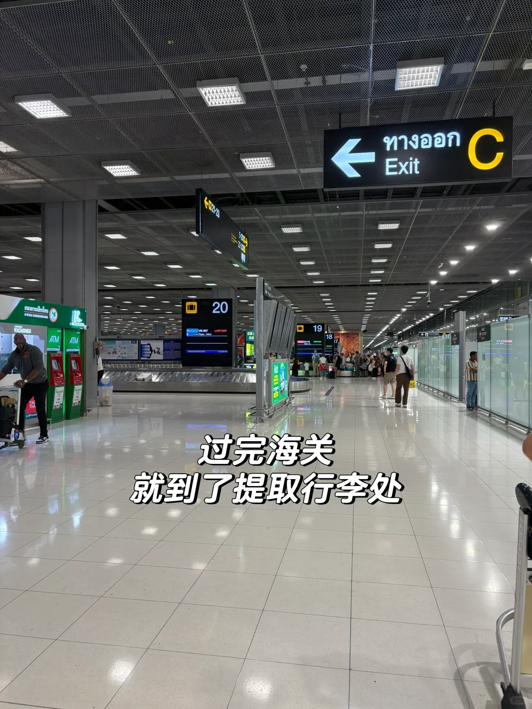

Když přistanete na Suvarnabhumi poprvé, starost je, že nevíte, kterým směrem jít. Tento průvodce rozkládá celou trasu mezinárodního příletu na jeden obrázek na krok, takže se podle něj dá prostě jít – užitečné pro staršího cestovatele letícího sama nebo pro rodinu čekající venku.

## Trasa na jeden řádek

**Z letadla → nástupní most nebo autobus → podle cedulí „Arrivals“ → imigrace → výdej zavazadel → Exit → veřejná část**

> Orientace na Suvarnabhumi je vynikající a **hlavní cedule mají kromě thajštiny a angličtiny i čínštinu**, takže byste se cestou neměli ztratit.

## Krok za krokem

### 1. Z letadla s davem

Obvykle vycházíte nástupním mostem a trasa je jen jedna – jděte za ostatními.

### 2. Jděte dál a hlídejte obrazovku s letem

Kousek dál je obrazovka s vaším letem.

Ukazuje **číslo vašeho letu, město, odkud letíte, a váš zavazadlový pás** (na fotografii níže číslo 14). Číslo si poznamenejte.

### 3. Hledejte černou ceduli „Arrivals“

Jakmile vyjdete z nástupního mostu, dostanete se k cedulím. Hledejte **černý panel s nápisem „Arrivals“ (旅客到达)** – obvykle bývá nahoře na tabuli – a vydejte se tím směrem (asi 190 metrů).

Cestou míjíte eskalátory a pohyblivé chodníky; jen dál sledujte „Arrivals“.

### 4. Odevzdejte příletovou kartu TDAC před imigrací

Thajsko teď používá **digitální příletovou kartu TDAC (Thailand Digital Arrival Card)**, kterou je nutné vyplnit online **než dojdete k imigraci**, na [tdac.immigration.go.th](https://tdac.immigration.go.th).

Na chodbě je velká informační tabule. Pokud cestovatel nečte anglicky, může mu mladší příbuzný kartu vyplnit předem v telefonu a uložit snímek QR kódu.

### 5. Na křižovatce doleva do celní zóny

Tato velká cedule označuje křižovatku: „Arrivals“ vlevo, Connecting Flights a Transfers Desk vpravo. Cestující mířící do města **tady odbočí vlevo** a projdou do celní zóny.

### 6. Imigrace: k přepážce pro cizí pasy

V celní zóně se zařaďte do fronty **Foreign Passport**. **Uvnitř se nesmí fotografovat** – schovejte telefon.

Mějte připravené:

- **Zpáteční letenku** (nebo itinerář další cesty)
- **Rezervaci hotelu**
- **Hotovost:** thajská imigrace může namátkově kontrolovat prostředky – kolem 10 000 bahtů na osobu, 20 000 bahtů na rodinu

Pokud máte dokumenty v pořádku, obvykle se už na nic neptají. Pokud nerozumíte anglicky, ukažte úředníkovi překlad v telefonu.

### 7. Vyzvedněte zavazadla

Za celnicí je hala výdeje zavazadel. Podívejte se nahoru na cedule a najděte číslo svého pásu.

Pokud jste odbavili zavazadlo, čekejte u pásu se svým číslem; **pokud odbavené zavazadlo nemáte, jděte rovnou k východu**.

### 8. Najděte písmeno východu a vyjděte do veřejné části

Východy jsou označené písmeny (A, B, C a tak dále) a kterýkoli z nich vede na stejnou veřejnou chodbu.

Venku je veřejná část, kde sloup nebo cedule nad hlavou říká, **u které brány jste** (níže brána 5). Je to nejjednodušší místo, kde se sejít s rodinou nebo přáteli – nebo odtud rovnou pokračovat k taxíku či Airport Rail Link.

## Pokud někoho vyzvedáváte

- Požádejte přilétajícího, aby si **poznamenal číslo pásu a písmeno východu** – s těmito dvěma údaji ho najdete.
- Příletová úroveň Suvarnabhumi má několik výstupních sekcí, takže **domluvit se na „bráně 5“ je lepší než na „východu“**.
- Od přistání po vstup do veřejné části obvykle uplyne **45–75 minut**, včetně imigrace a zavazadel. Když někoho jedete vyzvednout, nechte si trochu rezervu.
