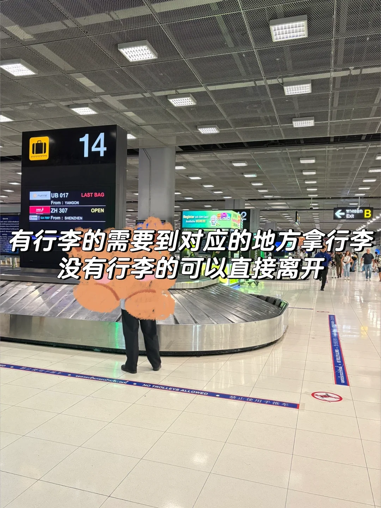

Al aterrizar en Suvarnabhumi por primera vez, la preocupación es no saber por dónde caminar. Esta guía divide todo el recorrido de llegadas internacionales en una foto por paso, para que solo tengas que seguirla: útil para un viajero mayor que vuela solo o para la familia que espera fuera.

## La ruta en una línea

**Bajar del avión → pasarela o autobús → seguir los carteles de “Arrivals” → inmigración → recogida de equipaje → Exit → zona pública**

> La señalización de Suvarnabhumi es excelente, y **los carteles principales incluyen chino además de tailandés e inglés**, así que no deberías perderte por el camino.

## Paso a paso

### 1. Sigue a la multitud al bajar del avión

Normalmente sales por una pasarela, y solo hay una ruta: sigue a los demás.

### 2. Sigue caminando y atento a la pantalla de vuelos

Un poco más adelante hay una pantalla que muestra tu vuelo.

Muestra **tu número de vuelo, la ciudad de la que vienes y tu cinta de equipaje** (el número 14 en la foto de abajo). Anota tu número.

### 3. Busca el cartel negro de “Arrivals”

Al salir de la pasarela llegas a los carteles. Busca el **panel negro que dice “Arrivals” (旅客到达)** —suele estar en la parte superior del panel— y ponte en marcha en esa dirección (unos 190 metros).

Por el camino pasas escaleras mecánicas y cintas transportadoras; solo sigue “Arrivals”.

### 4. Envía la tarjeta de llegada TDAC antes de inmigración

Tailandia usa ahora la **tarjeta de llegada digital, TDAC (Thailand Digital Arrival Card)**, que debe completarse en línea **antes de llegar a inmigración**, en [tdac.immigration.go.th](https://tdac.immigration.go.th).

Hay un gran panel informativo en el pasillo. Si el viajero no lee inglés, un familiar más joven puede rellenarla en el teléfono con antelación y guardar una captura del código QR.

### 5. Gira a la izquierda en el cruce hacia aduanas

Este gran cartel marca el cruce: “Arrivals” a la izquierda, y vuelos de conexión y el mostrador de tránsitos a la derecha. Los pasajeros que se dirigen a la ciudad **giran a la izquierda aquí** y pasan a la zona de aduanas.

### 6. Inmigración: toma el carril de pasaportes extranjeros

En la zona de aduanas, únete a la cola de **Foreign Passport**. **No se permite hacer fotos dentro**: guarda el teléfono.

Ten esto preparado:

- **Tu billete de vuelta** (o un itinerario de salida)
- **La reserva del hotel**
- **Efectivo:** la inmigración tailandesa puede comprobar fondos: unos 10.000 baht por persona, 20.000 baht por familia

Si tus papeles están en orden, normalmente no te preguntan nada más. Si no entiendes el inglés, muestra al agente la traducción del teléfono.

### 7. Recoge tu equipaje

Pasada la aduana está la sala de recogida de equipaje. Mira los carteles y encuentra el número de tu cinta.

Si facturaste una maleta, espera en la cinta con tu número; **si no llevas equipaje facturado, sigue recto hacia la salida**.

### 8. Encuentra la letra de tu salida y pasa a la zona pública

Las salidas están identificadas con letras (A, B, C, etc.) y cualquiera de ellas lleva a la misma pasarela pública.

Fuera está la zona pública, donde el pilar o el cartel del techo te indica **en qué número de puerta estás** (la puerta 5 abajo). Es el lugar más fácil para encontrarte con familiares o amigos, o para seguir directamente a un taxi o al Airport Rail Link.

## Si vas a recoger a alguien

- Pide al viajero que llega que **anote el número de cinta y la letra de salida**: con esos dos datos puedes localizarlo.
- El nivel de llegadas de Suvarnabhumi tiene varias secciones de salida, así que **acordar “la puerta 5” es mejor que acordar “la salida”**.
- Desde el aterrizaje hasta salir a la zona pública suelen pasar **45–75 minutos**, incluidos inmigración y equipaje. Deja un poco de margen cuando salgas a recoger a alguien.
