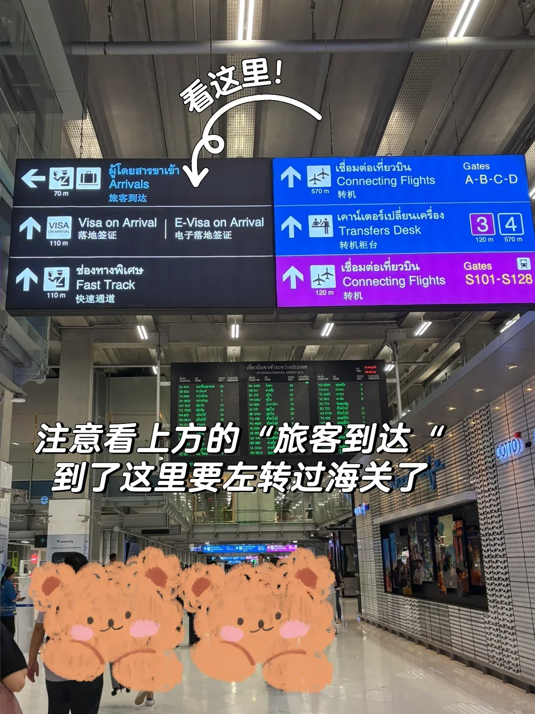

Mendarat di Suvarnabhumi untuk pertama kalinya, kekhawatirannya adalah tidak tahu harus berjalan ke arah mana. Panduan ini memecah seluruh rute kedatangan internasional menjadi satu gambar per langkah, sehingga Anda cukup mengikutinya — berguna bagi pelancong lanjut usia yang terbang sendirian, atau bagi keluarga yang menunggu di luar.

## Rute dalam satu baris

**Turun dari pesawat → garbarata atau bus → ikuti papan “Arrivals” → imigrasi → pengambilan bagasi → Exit → area publik**

> Papan petunjuk Suvarnabhumi sangat baik, dan **papan utamanya memuat bahasa Tionghoa serta Thailand dan Inggris**, jadi Anda seharusnya tidak tersesat di jalan.

## Langkah demi langkah

### 1. Ikuti kerumunan turun dari pesawat

Anda biasanya keluar melalui garbarata, dan hanya ada satu rute — ikuti saja orang lain.

### 2. Terus berjalan dan perhatikan layar penerbangan

Sedikit lebih jauh ada layar yang menampilkan penerbangan Anda.

Layar itu menunjukkan **nomor penerbangan Anda, kota asal, dan carousel bagasi Anda** (nomor 14 pada foto di bawah). Catat nomor Anda.

### 3. Cari papan “Arrivals” hitam

Setelah keluar dari garbarata Anda mencapai papan-papan. Cari **panel hitam bertuliskan “Arrivals” (旅客到达)** — biasanya berada di bagian atas papan — dan berangkatlah ke arah itu (sekitar 190 meter).

Anda melewati eskalator dan travelator di jalan; terus ikuti “Arrivals”.

### 4. Kirim kartu kedatangan TDAC sebelum imigrasi

Thailand kini menggunakan **kartu kedatangan digital, TDAC (Thailand Digital Arrival Card)**, yang harus diisi secara online **sebelum Anda mencapai imigrasi**, di [tdac.immigration.go.th](https://tdac.immigration.go.th).

Ada papan pemberitahuan besar di jalur pejalan kaki. Jika pelancong tidak membaca bahasa Inggris, kerabat yang lebih muda dapat mengisinya di ponsel terlebih dahulu dan menyimpan tangkapan layar kode QR.

### 5. Belok kiri di persimpangan menuju bea cukai

Papan besar ini menandai persimpangan: “Arrivals” ke kiri, dan Connecting Flights serta Transfers Desk ke kanan. Penumpang yang menuju kota **belok kiri di sini** dan masuk ke area bea cukai.

### 6. Imigrasi: ambil jalur paspor asing

Di area bea cukai, bergabunglah dengan antrean **Paspor Asing**. **Fotografi tidak diizinkan di dalam** — simpan ponsel Anda.

Siapkan ini:

- **Tiket pulang Anda** (atau itinerary lanjutan)
- **Pemesanan hotel Anda**
- **Uang tunai:** imigrasi Thailand dapat memeriksa dana secara acak — sekitar 10.000 baht per orang, 20.000 baht per keluarga

Jika dokumen Anda tertib, biasanya Anda tidak ditanya lebih banyak. Jika Anda tidak mengikuti bahasa Inggrisnya, tunjukkan terjemahan di ponsel Anda kepada petugas.

### 7. Ambil bagasi Anda

Setelah bea cukai adalah aula pengambilan bagasi. Lihatlah ke atas pada papan dan temukan nomor carousel Anda.

Jika Anda mencatatkan bagasi, tunggu di carousel dengan nomor Anda; **jika Anda tidak memiliki bagasi tercatat, berjalan lurus menuju pintu keluar**.

### 8. Temukan huruf Exit Anda dan masuk ke area publik

Pintu keluar diberi huruf (A, B, C, dan seterusnya) dan salah satunya mengarah ke jalur pejalan kaki publik yang sama.

Di luar adalah area publik, tempat pilar atau papan di atas kepala memberi tahu **di nomor gerbang mana Anda berada** (gerbang 5 di bawah). Ini tempat termudah untuk bertemu keluarga atau teman — atau untuk langsung melanjutkan ke taksi atau Airport Rail Link.

## Jika Anda menjemput seseorang

- Minta pelancong yang datang untuk **mencatat nomor carousel dan huruf Exit mereka** — dengan dua detail itu Anda dapat menemukan mereka.
- Lantai kedatangan Suvarnabhumi memiliki beberapa bagian pintu keluar, jadi **menyepakati “gerbang 5” lebih baik daripada menyepakati “pintu keluar”**.
- Dari mendarat hingga masuk ke area publik biasanya memakan waktu **45–75 menit**, termasuk imigrasi dan bagasi. Sisakan sedikit kelonggaran saat Anda berangkat menjemput seseorang.
